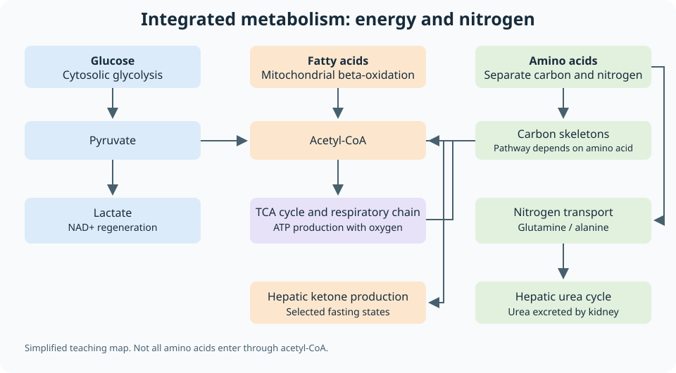

# Carbohydrate, lipid and amino acid metabolism — concept guide

**Advance preparation, candidate only.** Yeh guide Batch 01 ke pehle teen question banks ke liye hai. Audit mein Bank 01 aur 02 ke confirmed overlapping draft objectives replace kiye gaye hain. Original count aur question numbers preserve kiye gaye hain.

## 1. Carbohydrate metabolism

Hamari body glucose ko immediate energy source ke taur par use kar sakti hai. Glycolysis cytoplasm mein glucose ko do pyruvate molecules mein convert karti hai. Ek glucose se net do ATP aur do NADH bante hain. Jab mitochondria available nahi hote, jaise mature RBC mein, pyruvate ko lactate mein convert karke NAD+ regenerate hota hai. Isse glycolysis continue kar sakti hai. Oxygen present hone par many cells pyruvate ko acetyl-CoA mein convert karke mitochondrial TCA cycle aur respiratory chain ke through further ATP production kar sakte hain.

Glycolysis ka committed regulatory step phosphofructokinase-1 catalyze karta hai. Hexokinase ya liver glucokinase glucose ko glucose-6-phosphate mein convert karta hai. Pyruvate kinase last ATP-generating reaction mein involved hai. Pyruvate dehydrogenase glycolysis aur TCA cycle ko link karta hai aur thiamine-derived TPP iska important cofactor hai. Gluconeogenesis pyruvate kinase step ko pyruvate carboxylase aur PEP carboxykinase ke through bypass kar sakti hai.

Jab meal ke baad insulin badhta hai, toh liver aur muscle glucose store karne ke liye glycogen bana sakte hain. Glycogen mein alpha-1,4 linkages aur alpha-1,6 branch points hote hain. Fasting mein glucagon hepatic glycogen breakdown support karta hai. Glycogen phosphorylase glucose-1-phosphate release karta hai. Liver glucose-6-phosphatase use karke free glucose circulation mein release kar sakta hai. Skeletal muscle mein yeh final enzyme absent hota hai, isliye muscle glycogen mostly local energy ke liye use hota hai.

Gluconeogenesis lactate, glycerol aur selected amino acids se glucose banane mein help karti hai. Cori cycle mein muscle ya RBC se lactate liver tak ja sakta hai aur glucose mein convert ho sakta hai. Pentose phosphate pathway NADPH aur ribose-5-phosphate provide karti hai. NADPH RBC mein reduced glutathione maintain karne mein help karta hai. G6PD deficiency mein oxidative stress se hemolysis ka risk badh sakta hai.

Intestinal SGLT1 sodium ke saath glucose aur galactose absorb karta hai. Lactase lactose digest karta hai. Lactase deficiency mein undigested lactose osmotic diarrhea aur fermentation-related symptoms de sakta hai. Classic galactosemia GALT deficiency se associated hai aur hereditary fructose intolerance aldolase B deficiency se. Suspected inherited metabolic disease mein timely clinician-directed evaluation important hai.

### Glycogen ke branch points aur Cori cycle ki energy

Jab glycogen phosphorylase glucose units release karta hai, toh woh branch point ke paas ruk jata hai. Ab debranching enzyme ki transferase activity kuch glucose units ko doosri chain par shift karti hai. Phir isi enzyme ki alpha-1,6-glucosidase activity bacha hua branch bond todti hai aur free glucose release karti hai. Isliye phosphorylase aur debranching enzyme ka role alag hai. [Glycogen breakdown ka source](https://www.ncbi.nlm.nih.gov/books/NBK549820/).

Cori cycle mein peripheral tissue ko ek glucose se do ATP milte hain, lekin liver ko do lactate se glucose wapas banane ke liye chhe ATP equivalents kharch karne padte hain. Is simple complete cycle ka net body cost chaar ATP equivalents hota hai. Iska matlab hai ki liver energy kharch karke muscle aur RBC jaise tissues ko glucose supply support karta hai. [Cori cycle pathway](https://pubchem.ncbi.nlm.nih.gov/pathway/WikiPathways%3AWP1946).

[Carbohydrate practice](../MCQs/01-Carbohydrate-Metabolism-20-MCQs.md)

## 2. Lipid metabolism

Dietary long-chain triglycerides digestion ke baad enterocytes mein reassemble hokar chylomicrons banate hain, jo lymphatic route se circulation tak jaate hain. Bile salts emulsification aur micelle formation mein help karte hain aur pancreatic lipase triglycerides hydrolyze karta hai. Liver VLDL ke through endogenous triglycerides transport karta hai. Lipoprotein lipase circulating triglycerides se fatty acids release karne mein help karta hai. HDL reverse cholesterol transport mein participate karta hai.

Fasting mein adipose lipolysis se fatty acids aur glycerol release hote hain. Fatty acids blood mein albumin ke saath transport ho sakte hain aur glycerol gluconeogenesis mein contribute kar sakta hai. Long-chain fatty acyl groups mitochondrial matrix tak carnitine shuttle ke through pahunchte hain. CPT1 ko malonyl-CoA inhibit kar sakta hai, jisse fed state mein simultaneous fatty acid synthesis aur oxidation coordinate hote hain. Beta-oxidation repeatedly acetyl-CoA units release karti hai. Palmitoyl-CoA ke 16 carbons se seven cycles aur eight acetyl-CoA molecules bante hain. Odd-chain oxidation ke end mein propionyl-CoA mil sakta hai jo succinyl-CoA mein convert ho sakta hai.

Fasting ya marked insulin deficiency mein hepatic acetyl-CoA se ketone bodies ban sakti hain. Acetoacetate aur beta-hydroxybutyrate energy substrates hain, jabki acetone volatile compound hai. Liver mein SCOT activity absent hone ki wajah se liver synthesized ketone bodies ko efficiently oxidize nahi karta. Fatty acid oxidation defects mein fasting hypoglycemia ke saath low ketones ka pattern mil sakta hai. DKA mein acid-base disturbance aur dehydration ka urgent evaluation chahiye.

Fatty acid synthesis mein malonyl-CoA repeated two-carbon donor hai. Cholesterol synthesis mein HMG-CoA reductase regulated enzyme hai aur statins is enzyme ko inhibit karte hain. Linoleic acid diet se milna zaroori hai kyunki humans required double bond introduce nahi kar sakte.

### Fat transport aur digestion mein MTP aur colipase

Intestine aur liver ko apoB-containing lipoproteins banane ke liye microsomal triglyceride transfer protein, yani MTP, ki madad chahiye. Yeh protein growing lipoprotein ko lipids load karne mein help karta hai. Abetalipoproteinemia mein inherited MTTP defect ki wajah se chylomicrons aur VLDL ki assembly impair ho sakti hai. Isse fat malabsorption aur bahut low apoB-containing lipoproteins mil sakte hain. Yeh inherited condition specialist assessment demand karti hai. [GeneReviews](https://www.ncbi.nlm.nih.gov/books/NBK532447/).

Colipase ek pancreatic cofactor hai jo pancreatic lipase ko fat droplet aur paani ke interface par bind karne mein help karta hai. Bile salts ki presence mein yeh binding important hai kyunki lipase ko triglyceride ke ester bonds todne ke liye fat surface tak pahunchna padta hai. Colipase aur circulating lipoprotein lipase ka apoC-II cofactor alag roles rakhte hain. [NCBI colipase reference](https://www.ncbi.nlm.nih.gov/mesh/68003089).

[Lipid practice](../MCQs/02-Lipid-Metabolism-20-MCQs.md)

## 3. Protein and amino acid metabolism

Proteins digestion ke baad amino acids aur small peptides absorb ho sakte hain. Stomach mein pepsin acidic environment mein digestion start karta hai. Duodenum mein enteropeptidase trypsinogen activate karta hai, aur trypsin other pancreatic zymogens activate kar sakta hai. Nutritionally essential amino acids body adequate amount mein synthesize nahi kar sakti, isliye diet se milte hain.

Transamination mein amino group ek amino acid se keto acid tak transfer hota hai. Aminotransferases usually vitamin B6-derived pyridoxal phosphate use karte hain. Glutamate amino groups collect kar sakta hai aur glutamate dehydrogenase oxidative deamination ke through ammonia release kar sakta hai. Glutamine peripheral nitrogen transport mein help karti hai. Alanine cycle mein muscle nitrogen aur carbon skeleton liver tak carry kar sakta hai.

Ammonia toxic ho sakti hai, especially nervous system ke liye. Liver urea cycle ke through nitrogen ko urea mein convert karta hai. Mitochondrial CPS1 ammonia aur bicarbonate se carbamoyl phosphate banata hai, aur N-acetylglutamate iska essential activator hai. Aspartate urea ka second nitrogen provide karta hai. Arginase arginine ko hydrolyze karke urea aur ornithine form karta hai. Ornithine transcarbamylase defect mein hyperammonemia aur elevated orotic acid mil sakte hain. A symptomatic newborn mein suspected hyperammonemia emergency evaluation demand karti hai.

Leucine aur lysine exclusively ketogenic amino acids hain. Phenylketonuria mein phenylalanine-to-tyrosine conversion impaired ho sakti hai. MSUD branched-chain amino acid degradation defect se associated hai aur alkaptonuria mein homogentisic acid accumulate hota hai. Severe catabolic illness mein nitrogen loss intake se exceed ho sakta hai, jise negative nitrogen balance kehte hain.

[Protein and amino acid practice](../MCQs/03-Protein-and-Amino-Acid-Metabolism-20-MCQs.md)

## Clinical and exam references

- [Glycolysis](https://www.ncbi.nlm.nih.gov/books/NBK482303/)
- [Glycogenolysis](https://www.ncbi.nlm.nih.gov/sites/books/NBK549820/)
- [Physiology of metabolism](https://ncbi.nlm.nih.gov/books/NBK546690/)
- [How cells obtain energy from food](https://www.ncbi.nlm.nih.gov/sites/books/NBK26882/)
- [Protein catabolism](https://www.ncbi.nlm.nih.gov/sites/books/NBK556047/)
- [Urea cycle](https://www.ncbi.nlm.nih.gov/sites/books/NBK513323/)

Source search extracts reviewed. This guide is an original summary, not a reproduction of the source. Full item-specific verification for all 60 associated questions, independent clinical review, verified teaching and MCQ-practice video mapping remain pending.
