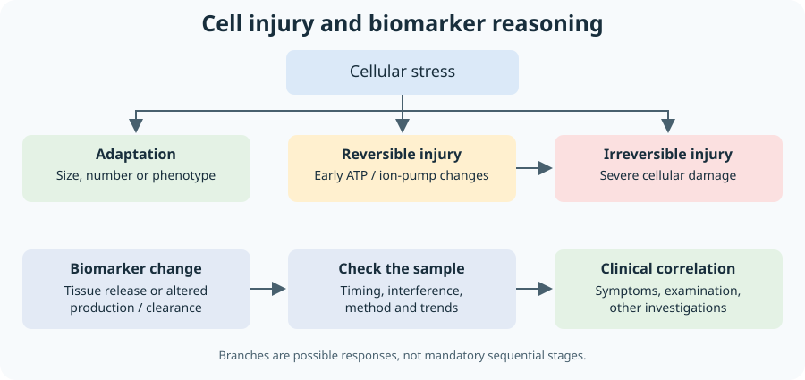

# Enzymes, biomarkers and cellular injury — concept guide

**Candidate only.** Yeh Batch 01 ke last two banks ka concept support hai. Existing questions aur keys unchanged hain.

## Enzymes and regulation

Enzymes biological catalysts hain jo reaction ki activation energy kam karte hain. Yeh equilibrium position ko change nahi karte. Apoenzyme protein component hai aur required cofactor ke saath active holoenzyme form ho sakta hai. Coenzymes organic cofactors hain aur many vitamins se derive ho sakte hain. Zymogen inactive precursor hai, jaise pepsinogen, jo appropriate activation ke baad active enzyme banta hai.

Simple Michaelis-Menten kinetics mein substrate concentration badhne par reaction rate increase hoti hai aur eventually Vmax ke near pahunchti hai. Km woh substrate concentration hai jahan rate Vmax ka half hota hai. Km ko har mechanism mein direct binding affinity ke barabar nahi samajhna chahiye. Competitive inhibition mein apparent Km increase hota hai aur Vmax unchanged reh sakta hai. Ideal pure noncompetitive inhibition mein Vmax decrease hota hai aur Km unchanged rehta hai. Mixed inhibition mein dono parameters change ho sakte hain. Temperature aur pH enzyme activity influence karte hain, aur excessive heat irreversible denaturation cause kar sakti hai. Enzyme activity unit defined assay conditions mein substrate conversion rate ko represent karta hai.

Isoenzymes same broad reaction catalyze karne wale distinct molecular forms hain. Tissue distribution aur laboratory method clinical interpretation affect karte hain. Troponin enzyme nahi hai, yeh cardiac structural regulatory protein hai. Elevated cardiac troponin myocardial injury support karta hai. Acute myocardial infarction ke liye acute troponin change ke saath myocardial ischemia evidence chahiye. Early normal value alone acute coronary syndrome rule out nahi karti. Serial validated pathway aur clinical assessment follow karna chahiye.

Pancreatitis mein lipase commonly useful enzyme marker hai, lekin isolated rise diagnosis establish nahi karti. ALT aur AST hepatocellular injury assess karne mein useful hain. ALP aur GGT ka pattern cholestatic process suggest kar sakta hai. ALP bone se bhi aa sakta hai, aur GGT context source interpretation help kar sakta hai. Albumin aur coagulation tests synthetic function ke indirect clues hain, lekin nonhepatic influences bhi hoti hain. CK skeletal muscle injury mein rise kar sakta hai. Hemolyzed specimen LDH aur other analytes falsely increase kar sakta hai, isliye laboratory se sample suitability verify karni chahiye.

[Enzymes and biomarkers MCQs](../MCQs/04-Enzymes-and-Biomarkers-20-MCQs.md)

## Cellular adaptation and injury

Jab cell ko stress milta hai, toh viable cell adapt karne ki koshish karta hai. Hypertrophy mein cell size badhta hai, hyperplasia mein cell number badhta hai aur atrophy mein cell size aur functional mass kam ho sakta hai. Metaplasia mein ek mature cell phenotype doosre adaptive phenotype se replace ho sakta hai. Dysplasia disordered maturation aur atypia ko describe karti hai aur necessarily invasive cancer nahi hoti. Invasion establish karne ke liye appropriate pathological evidence chahiye.

Hypoxia ka matlab oxygen availability ya use inadequate hona ho sakta hai. Ischemia blood supply reduction hai, jo oxygen ke saath nutrients aur waste removal bhi compromise kar sakti hai. ATP fall hone par ion pumps fail ho sakte hain aur sodium-water cell mein enter karke hydropic swelling cause kar sakte hain. Early injury reversible ho sakti hai. Severe mitochondrial dysfunction, calcium overload, reactive oxygen species aur membrane damage irreversible injury mein contribute karte hain. Reperfusion necessary blood supply restore karti hai, lekin selected circumstances mein oxidative aur inflammatory injury bhi contribute kar sakti hai.

Necrosis mein membrane integrity lose ho sakti hai aur intracellular contents inflammatory response trigger kar sakte hain. Coagulative necrosis ischemic solid organ infarcts mein typical hai, lekin brain infarction commonly liquefactive necrosis develop karta hai. Caseous necrosis tuberculosis jaise granulomatous conditions se associated ho sakti hai. Pancreatic fat necrosis mein fatty acids calcium ke saath chalky deposits bana sakte hain. Apoptosis regulated cell death hai jisme cell shrinkage aur apoptotic bodies form ho sakte hain. Intrinsic pathway mein mitochondrial cytochrome c release apoptosome aur caspase activation promote kar sakta hai.

Dystrophic calcification damaged tissue mein normal serum calcium ke bawajood ho sakti hai. Metastatic calcification systemic calcium-phosphate imbalance ke context mein otherwise viable tissue mein deposit ho sakti hai. Nurse laboratory calcium ko clinical setting aur tissue findings ke saath interpret karti hai.

[Cellular injury and adaptation MCQs](../MCQs/05-Cellular-Injury-and-Adaptation-20-MCQs.md)

## Sources and limits

- [Enzyme kinetics and inhibition](https://www.ncbi.nlm.nih.gov/sites/books/NBK92001/)
- [Cardiac biomarkers](https://www.ncbi.nlm.nih.gov/sites/books/NBK545216/)
- [Laboratory test interpretation](https://www.ncbi.nlm.nih.gov/books/NBK570615/)
- [Histology, cell death](https://www.ncbi.nlm.nih.gov/sites/books/NBK526045/)
- [Histology, cell](https://www.ncbi.nlm.nih.gov/sites/books/NBK554382/)
- [Liver and gallbladder laboratory tests](https://www.merckmanuals.com/professional/hepatic-and-biliary-disorders/testing-for-hepatic-and-biliary-disorders/laboratory-tests-of-the-liver-and-gallbladder)

Source extracts and available direct background reviewed. Full independent clinical and source-per-item review, video evidence and rendering checks remain pending. Prior bronchial metaplasia overlap with Oncology PR30 requires coordination before integration.
