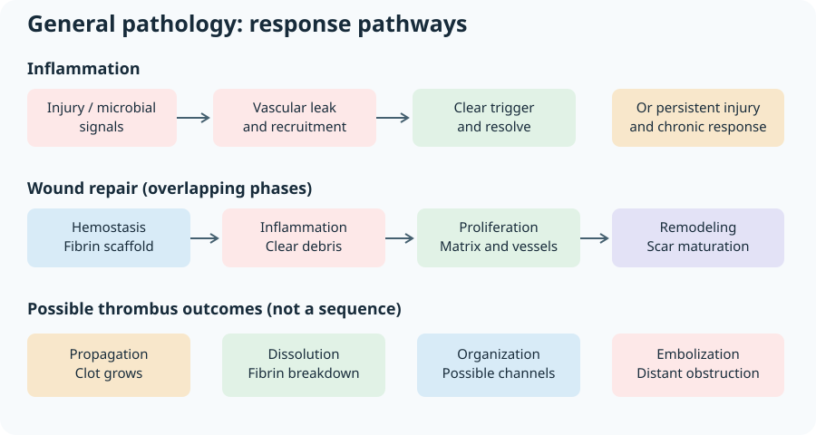

# General pathology — inflammation, repair and vascular injury

**Candidate concept guide.** Yeh advance practice material hai. Isko studied ya independently audited nahi maana gaya hai.

## Inflammation

Jab tissue ko injury hoti hai ya microbes enter karte hain, toh resident immune cells chemical signals release karte hain. Histamine vessel wall ki permeability badha sakta hai. Protein-rich fluid tissue mein aata hai, jise exudate kehte hain. Agar fluid mainly hydrostatic pressure ya low oncotic pressure ki wajah se leak ho raha hai aur vascular barrier relatively intact hai, toh transudate mein protein comparatively kam hota hai. Clinical fluid classification ke liye specific laboratory criteria bhi apply hote hain.

Leukocyte recruitment ko ek sequence mein samjho. Selectins cell ko endothelium ke saath temporarily tether aur roll karne dete hain. Activated integrins firm adhesion establish karte hain. Cell vessel wall cross karta hai aur chemotactic signals ko follow karta hai. Neutrophil bacteria ko engulf kar sakta hai, aur opsonins jaise C3b recognition ko easy banate hain. Oxidative burst intracellular killing mein help karta hai. NADPH oxidase defect mein selected microbes ke against defense weak ho sakti hai.

Bradykinin pain receptors ko stimulate kar sakta hai aur PGE2 fever mein hypothalamic set point raise karta hai. IL-6 liver mein CRP jaise acute-phase proteins ki synthesis stimulate karta hai. CRP infection-specific test nahi hai. Sterile trauma mein bhi rise ho sakta hai. Nurse ko temperature, pain, vital signs, perfusion aur clinical condition ko saath assess karna chahiye. Rapid deterioration ko inflammatory marker report ka wait kiye bina escalate karna zaroori hai.

Chronic inflammation mein macrophages aur lymphocytes ke saath ongoing tissue damage aur fibrosis mil sakte hain. Persistent foreign body ke around giant cells form ho sakte hain. Granuloma ko granulation tissue se confuse mat karo. Granuloma macrophage-rich organized immune response hai, jabki granulation tissue repair ke fibroblasts aur new capillaries se banta hai.

[Inflammation MCQs](../MCQs/06-Inflammation-20-MCQs.md)

## Tissue healing and repair

Wound healing ke chaar overlapping phases hote hain. Hemostasis mein platelet aur fibrin clot bleeding limit karte hain aur provisional scaffold banate hain. Inflammation mein damaged tissue aur microbes ko remove karne ki process start hoti hai. Proliferation mein fibroblasts provisional matrix banate hain, VEGF new vessels grow karne mein help karta hai aur keratinocytes epithelial cover restore karte hain. Myofibroblasts defect ko contract kar sakte hain. Remodeling mein collagen turnover, cross-links aur alignment scar strength improve karte hain. Excess capillaries regress ho sakte hain. Surface heal hone ka matlab yeh nahi ki deep tissue fully strong ho gaya hai.

Early repair matrix mein type III collagen, fibronectin aur glycosaminoglycans mil sakte hain. Remodeling mein type I collagen comparatively dominant ho jata hai. Vitamin C collagen hydroxylation mein help karta hai aur copper-dependent lysyl oxidase cross-link formation mein contribute karta hai. TGF-beta fibroblast aur matrix deposition signals mein important hai. Excessive activity fibrosis contribute kar sakti hai. Matrix metalloproteinases repair matrix ko remodel karte hain, lekin imbalance chronic wound ko stall kar sakta hai.

Primary intention mein edges close hote hain. Secondary intention mein open defect ko tissue fill aur contraction se cover hona padta hai. Delayed primary closure mein wound ko initially open manage karke later close kiya jata hai. Yeh decision surgical team patient aur contamination ki condition ke according leti hai. Keloid original wound ke boundaries ke bahar extend kar sakta hai, hypertrophic scar aam taur par boundaries ke andar hota hai. Burn contracture motion limit kar sakti hai.

Nurse wound appearance, drainage, pain, surrounding skin, perfusion aur nutrition assess karti hai. New separation, rapid bleeding, systemic deterioration ya suspected infection ko timely escalate karna chahiye. Wound management patient-specific orders aur local protocol ke mutabik hota hai.

[Tissue repair MCQs](../MCQs/07-Tissue-Healing-and-Repair-20-MCQs.md)

## Thrombosis and embolism

Thrombus living circulation mein blood components ka pathological clot hota hai. Endothelial damage, abnormal flow aur hypercoagulability risk factors hain. Plaque rupture mein thrombogenic material expose hota hai. Arterial thrombi often platelet-rich hote hain, venous thrombi mein fibrin aur trapped RBC relatively prominent ho sakte hain. Lines of Zahn antemortem thrombus ko support karne wali laminations hain, lekin final histological distinction multiple findings se hoti hai.

Clot grow kar sakta hai, dissolve ho sakta hai, embolize kar sakta hai ya organization ke through fibrous tissue mein convert ho sakta hai. Recanalization mein organized clot ke andar channels develop ho sakte hain. Plasmin fibrin degrade karta hai. D-dimer cross-linked fibrin breakdown ka marker hai, lekin elevated D-dimer akela VTE diagnose nahi karta.

Embolus circulation ke saath move karta hai aur distant vessel block kar sakta hai. Venous clot commonly lung tak jata hai. Left heart ka thrombus systemic circulation tak pahunch sakta hai. Right-to-left shunt ke through venous material systemic side mein aaye toh paradoxical embolism ho sakta hai. Septic embolus infection seed kar sakta hai aur cholesterol emboli small arteries block kar sakte hain. Fat embolism mein mechanical obstruction ke saath inflammatory injury bhi ho sakti hai.

Infarction ischemic tissue death hai. Solid terminal-supply organs mein pale infarcts ho sakte hain. Venous obstruction ya dual supply ke context mein hemorrhagic infarction ho sakta hai. Sudden dyspnea, chest pain, neurological deficit ya acute limb ischemia urgent assessment aur escalation demand karte hain. Nurse diagnosis ya anticoagulation independently assume nahi karti.

[Thrombosis MCQs](../MCQs/08-Thrombosis-and-Embolism-20-MCQs.md)

## Sources and limits

- [Acute inflammation](https://www.ncbi.nlm.nih.gov/books/NBK556083/)
- [Chronic inflammation](https://www.ncbi.nlm.nih.gov/books/NBK493173/)
- [Wound healing](https://www.ncbi.nlm.nih.gov/books/NBK535406/)
- [Thrombosis](https://www.ncbi.nlm.nih.gov/books/NBK538430/)
- [Virchow triad](https://www.ncbi.nlm.nih.gov/books/NBK539697/)
- [Paradoxical embolism](https://www.ncbi.nlm.nih.gov/books/NBK470196/)
- [Inflammation and repair MCQ practice, Dr. Shweta Rana Khokhar](https://www.youtube.com/watch?v=nm6tuSl3iKI) and [Hemodynamic disorders MCQ practice, same channel](https://www.youtube.com/watch?v=jkPrZFkYwrw). Indexed topic-level leads only, exact item mapping and playback pending.

Independent clinical review and comprehensive source mapping remain pending.
