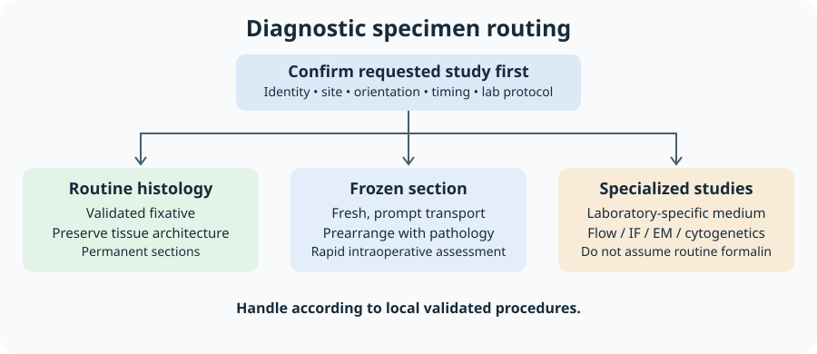

# General pathology — neoplasia and diagnostic specimens

**Candidate concept guide.** Yeh guide exam practice ke liye hai. Independent clinical review aur full source verification abhi pending hai.

## Neoplasia

Neoplasia mein abnormal cell population apne growth controls se escape kar sakti hai. Benign tumor bhi pressure effect de sakta hai, jabki malignant tumor nearby structures invade aur distant sites par spread kar sakta hai. Tumor ka naam uski lineage aur differentiation se related hota hai. Adenocarcinoma glandular epithelial differentiation dikhata hai. Osteosarcoma ki khas finding malignant cells se directly osteoid production hai. Squamous differentiation mein keratin pearls mil sakte hain. Melanoma melanocytic lineage ka tumor hai.

Microscope mein tumor ka appearance normal tissue se kitna milta hai, yeh differentiation batati hai. Grade cellular abnormality aur tumor-specific features describe karta hai. Stage anatomical extent batati hai. TNM mein T primary tumor, N regional nodes aur M distant spread describe karte hain. Grade aur stage ko same nahi samajhna chahiye. High grade automatically stage IV nahi hota. Lymphovascular invasion spread risk ka clue ho sakti hai, lekin distant metastasis ka direct proof nahi hoti.

Tumor ke around reactive fibrous stroma ko desmoplasia kehte hain. Tumor heterogeneity ka matlab hai ki alag regions mein cellular features alag ho sakte hain. Limited biopsy kuch aggressive areas miss kar sakti hai. Isliye specimen adequacy aur clinical correlation important hain. Ki-67 proliferation-associated antigen hai aur labeling index studied tumor population mein proliferative fraction estimate karta hai. Iska interpretation tumor-specific criteria se hota hai. Immunohistochemistry mein antibodies tissue antigens identify karti hain. Marker panel lineage aur treatment planning support kar sakta hai. Estrogen receptor positivity selected breast cancers mein endocrine treatment ki possible suitability inform karti hai, lekin complete treatment plan clinical team decide karti hai.

Cancer-related genes growth signaling, growth suppression aur DNA repair affect kar sakte hain. RB pathway cell-cycle progression restrain karta hai. High-risk HPV E6 p53 degradation promote kar sakta hai. E-cadherin loss epithelial cohesion reduce kar sakta hai. Yeh molecular mechanisms isolated diagnosis nahi hain. Clinical nurse pathology report ko correct patient aur procedure se match karke treating team tak accurately communicate karti hai. Tumor marker alone cancer prove nahi karta aur positive margin distant metastasis establish nahi karti.

[Neoplasia MCQs](../MCQs/09-Neoplasia-20-MCQs.md)

## Diagnostic specimens

Pathology sample handling diagnosis ki quality directly affect kar sakti hai. Jab routine permanent histology planned ho, toh validated fixative tissue morphology preserve karta hai. Common routine fixative 10% neutral buffered formalin hai. Har test ke liye formalin appropriate nahi hota. Fresh tissue, viable cells, immunofluorescence, electron microscopy aur cytogenetic studies mein laboratory-specific instructions chahiye. Frozen section intraoperative rapid examination ke liye hota hai aur fresh specimen promptly pathologist tak pahunchana hota hai. Renal biopsy jaise limited specimens ke multiple tests pehle coordinate karna zaroori hai.

Surgical orientation sutures aur actual anatomical site ko preserve karna chahiye. Pathology team tissue marking ink se assessed cut surfaces identify kar sakti hai. Fixation timing biomarker assessment ko affect kar sakti hai. Breast receptor tests ke liye removal aur fixation times local protocol ke mutabik document kiye jaate hain. Mineralized bone tissue ko controlled decalcification chahiye ho sakti hai, lekin test selection important hai kyunki processing selected antigens aur molecular targets affect kar sakti hai.

Fine needle aspiration cells aur clusters obtain karti hai. Core biopsy architecture preserve karne mein useful ho sakti hai. Dono techniques sampling error se completely free nahi hain. Inadequate sample ka matlab definite negative report nahi hota. Agar result limited hai, toh treating team ko communicate karke further sampling ki need assess ki jati hai.

Nurse specimen label, request, source, orientation, relevant timing aur transport instructions verify karti hai. Incorrect timing ko accurately document karna chahiye, intended timing ko actual timing ki jagah nahi likhna chahiye. Formalin leak mein chemical safety protocol follow kiya jata hai. Irreplaceable specimen identity discrepancy ko guesswork se resolve nahi karna chahiye. Laboratory aur responsible clinical team ki documented procedure follow karni chahiye.

[Diagnostic specimen MCQs](../MCQs/10-Diagnostic-Specimens-20-MCQs.md)

## Sources and limits

- [NCI cancer biology](https://www.cancer.gov/about-cancer/understanding/what-is-cancer)
- [NCI tumor grade](https://www.cancer.gov/about-cancer/diagnosis-staging/diagnosis/tumor-grade)
- [NCI breast biomarkers](https://www.cancer.gov/types/breast/diagnosis/breast-cancer-biomarker-tests)
- [UC Davis surgical pathology specimen collection](https://health.ucdavis.edu/pathology/services/clinical/anatomic_pathology/surgical_pathology/clinical_services/specimen_collection.html)
- [RCPA fixation](https://www.rcpa.edu.au/Manuals/Macroscopic-Cut-Up-Manual/General-Information/Fixation)
- [WHO phlebotomy](https://www.ncbi.nlm.nih.gov/books/NBK138665/)
- [Neoplasia MCQs, Dr. Shweta Rana Khokhar](https://www.youtube.com/watch?v=fgmLncABMaY) and [Specimen collection MCQs, Medical Knowledge Online](https://www.youtube.com/watch?v=utfUGjshIaE) — indexed topic-level leads, exact item mapping and playback not verified.

Clinical references are starting points for detailed independent item review. Local validated specimen protocols take precedence. No verified historical question or complete chapter claim.
