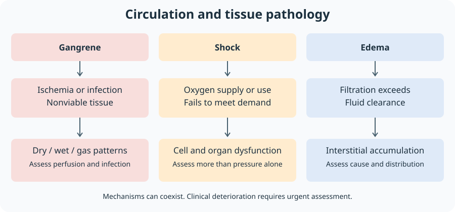

# Gangrene, shock and edema — general pathology mechanisms

**Candidate guide, not a bedside treatment protocol.** Yeh three topics circulation aur tissue injury ko connect karte hain.

## Gangrene

Gangrene grossly recognizable tissue necrosis ko describe karti hai. Dry gangrene often arterial ischemia ke baad slowly develop hoti hai, tissue dehydrated aur black ho sakta hai. Wet gangrene mein dead tissue infection aur decomposition ke saath moist aur swollen ho sakta hai. Dry lesion bhi secondary infection develop kar sakta hai. Gas gangrene rapidly progressive deep infection hai, commonly clostridial myonecrosis ke context mein. Crush injury devitalized low-oxygen tissue create kar sakti hai. C. perfringens alpha toxin phospholipase activity ke through cell membrane damage contribute kar sakta hai. Severe infection mein systemic toxicity aur hemolysis possible hain. Gas ya crepitus absence early infection rule out nahi karti.

Nurse tissue color, sensation, perfusion, pain progression, systemic observations aur wound changes document karti hai. Neuropathy mein severe injury ke bawajood pain low ho sakta hai. Calcified vessels ankle-brachial pressure index ko falsely high bana sakte hain. Dry ischemic tissue ki debridement aur revascularization decision specialist team leti hai. Suspected necrotizing infection mein urgent surgical and antimicrobial assessment chahiye, cultures ka wait karke source control delay nahi karna chahiye.

[Gangrene MCQs](../MCQs/11-Gangrene-and-Tissue-Viability-20-MCQs.md)

## Shock

Shock life-threatening circulatory failure hai jisme oxygen delivery aur utilization tissue requirements meet nahi kar paate. Oxygen delivery cardiac output aur arterial oxygen content ka product hai. Cardiac output L/min aur oxygen content mL/dL mein ho toh conversion factor 10 use karte hain. Saturation alone oxygen content nahi batati, kyunki hemoglobin concentration bhi important hai. Tissues moderate delivery fall ko increased extraction se compensate kar sakte hain, lekin reserve limited hoti hai.

Hypovolemic shock mein circulating volume inadequate hai, cardiogenic shock mein pump function compromised hai, obstructive shock mein mechanical blood flow limitation hai aur distributive shock mein vascular tone aur flow distribution disturbed ho sakte hain. Mixed mechanisms possible hain. Endothelial leak effective circulating volume reduce kar sakti hai. Microcirculation globally acceptable pressure ke bawajood heterogeneous ho sakti hai. Lactate production oxygen supply-demand imbalance, adrenergic stimulation aur clearance changes se influence hoti hai. Hepatic dysfunction lactate clearance reduce kar sakti hai.

Prolonged injury renal tubular dysfunction, hypoxic hepatocellular injury aur distant inflammatory organ injury contribute kar sakti hai. Blood pressure restoration alone cellular recovery prove nahi karti. Nurse clinical trends, mental state, urine output, peripheral perfusion aur ordered tests ko integrate karke deterioration urgently escalate karti hai. Specific resuscitation protocol cause aur patient condition ke according clinician-directed hota hai.

[Shock pathology MCQs](../MCQs/12-Shock-Cellular-and-Circulatory-Pathology-20-MCQs.md)

## Edema

Edema interstitial fluid accumulation hai. Classical Starling model mein capillary hydrostatic pressure, interstitial pressure, oncotic gradients, filtration coefficient aur protein reflection coefficient fluid exchange explain karte hain. Revised model endothelial glycocalyx aur subglycocalyx environment ko emphasize karta hai. Many systemic tissues mein steady-state filtered fluid primarily lymphatic drainage se circulation mein return hota hai, universal sustained venous-end reabsorption assume nahi karna chahiye.

Lymphatic obstruction se proteins aur fluid retain ho sakte hain. Chronic lymphedema mein fibrosis aur adipose remodeling firmness increase kar sakti hain. Pitting mobile fluid displacement ka sign hai, but absence of pitting all edema exclude nahi karti. Myxedema mein dermal glycosaminoglycan accumulation contributes. Precapillary vasodilation selected medications ke context mein local capillary pressure badha sakti hai. Venous obstruction localized drainage territory affect kar sakti hai. Anasarca extensive generalized swelling describe karta hai, specific disease nahi.

Ascites ke paired sample albumin values se SAAG calculate karte hain: serum albumin minus ascitic albumin. High gradient portal hypertensive physiology suggest karta hai, etiology alone prove nahi karta. Brain edema mein cytotoxic pattern intracellular swelling aur vasogenic pattern extracellular barrier leakage se related hai. Mechanisms coexist kar sakte hain. Nurse edema distribution, perfusion, skin integrity, respiratory symptoms aur serial clinical findings assess karti hai. Severe respiratory or neurological deterioration urgent escalation demand karti hai.

[Edema MCQs](../MCQs/13-Edema-and-Microvascular-Fluid-Exchange-20-MCQs.md)

## Evidence

- [Gangrene](https://www.ncbi.nlm.nih.gov/sites/books/NBK560552/)
- [IDSA skin and soft tissue infections](https://www.idsociety.org/practice-guideline/skin-and-soft-tissue-infections/)
- [Shock](https://www.ncbi.nlm.nih.gov/sites/books/NBK531492/)
- [Capillary fluid exchange](https://www.ncbi.nlm.nih.gov/books/NBK53447/)
- [Revised Starling principle](https://pmc.ncbi.nlm.nih.gov/articles/PMC1665155/)

Independent review and exact practice-video mapping remain pending. The referenced shock overview is used for broad mechanisms, not adopted as a treatment protocol.
