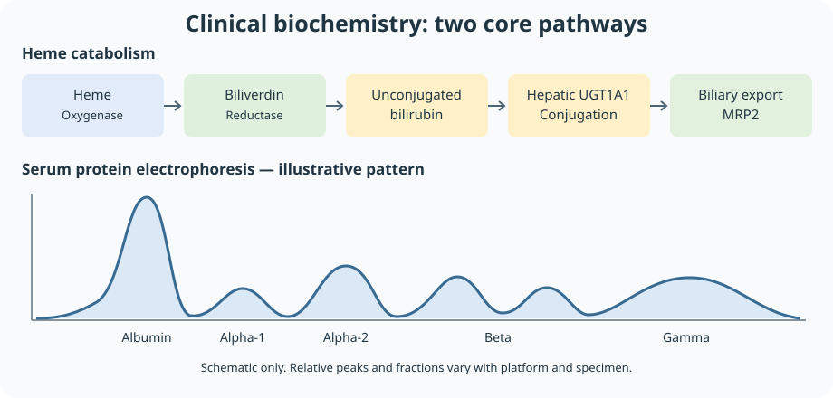

# Heme catabolism, bilirubin and plasma proteins — clinical biochemistry

**Candidate guide.** Yeh topic laboratory findings ko mechanism se connect karta hai. Clinical diagnosis aur treatment specialist assessment par depend karte hain.

## Heme catabolism

Old RBCs aur other heme proteins ke turnover se heme release hota hai. Heme oxygenase ring open karke biliverdin, iron aur carbon monoxide generate karta hai. Biliverdin reductase biliverdin ko bilirubin mein convert karta hai. Unconjugated bilirubin poorly water-soluble hota hai aur circulation mein mainly albumin ke saath noncovalently bind hota hai. Hepatocytes uptake ke baad UGT1A1 aur UDP-glucuronic acid use karke bilirubin glucuronides banate hain. Canalicular MRP2 in conjugates ko bile mein export karne mein important hai. Intestinal bacteria bilirubin derivatives ko urobilinogen mein convert kar sakte hain. Fecal stercobilin-related pigments stool ka brown color contribute karte hain.

Gilbert syndrome reduced conjugation capacity se associated hai, jabki Crigler-Najjar type I severe UGT1A1 deficiency se. Dubin-Johnson syndrome canalicular export defect aur dark liver pigmentation se associated hai. Rotor syndrome conjugated bilirubin transport disturbance ka distinct inherited example hai. Pattern alone diagnosis confirm nahi karta.

Traditional diazo assays direct-reacting fraction aur total bilirubin estimate karte hain. Indirect concentration commonly total minus direct calculate hoti hai. Direct fraction chemically pure conjugated bilirubin ke equivalent har method mein nahi hoti. Delta bilirubin albumin-bound conjugated pigment hai jo albumin turnover ke saath slowly clear ho sakta hai. Strong light exposure bilirubin sample degrade kar sakti hai. Nurse sample collection timing, light protection aur laboratory handling instructions follow karti hai. Unexpected analytical inconsistency ko laboratory se clarify karna chahiye. Unbound unconjugated bilirubin vulnerable brain tissue mein toxicity contribute kar sakta hai, especially neonates mein. Neonatal jaundice ki clinical assessment aur treatment age-specific guidelines ke according urgent care team karti hai.

[Heme catabolism MCQs](../MCQs/14-Heme-Catabolism-and-Bilirubin-Biochemistry-20-MCQs.md)

## Plasma proteins and serum electrophoresis

Albumin major circulating protein hai aur transport aur oncotic pressure contribute karta hai. Globulins diverse protein groups hain. Total protein se albumin subtract karke calculated globulin milta hai. A/G ratio albumin divided by globulin hai. Biuret total protein assay alkaline conditions mein peptide bonds aur copper complex formation par based hai. Normal total protein individual fractions normal hone ki guarantee nahi deta.

Conventional alkaline serum protein electrophoresis mein proteins mobility ke according separate hote hain. Albumin generally farthest anodal major fraction hai, followed by alpha-1, alpha-2, beta aur gamma regions. Serum generally preferred hota hai kyunki plasma fibrinogen additional interfering band bana sakta hai. Alpha-1 antitrypsin alpha-1 fraction ka important component hai, transferrin beta-1 region mein contribute karta hai, aur alpha-2 macroglobulin large size ki wajah se nephrotic protein loss mein relatively retained reh sakta hai. Acute inflammation selected alpha fractions increase kar sakti hai aur albumin decrease ho sakta hai.

Narrow discrete peak monoclonal protein ka clue ho sakti hai, jabki broad gamma elevation multiple immune clones ki activity suggest kar sakti hai. Immunofixation heavy-chain aur light-chain type characterize karne mein help karti hai. Normal routine SPEP all monoclonal disorders exclude nahi karti, aur clinically indicated serum free light chain testing useful ho sakti hai. Beta-gamma bridging chronic liver disease mein mil sakti hai but diagnostic proof nahi. Serial values method-dependent ho sakti hain, especially overlapping bands mein. Nurse result ko clinical context mein communicate karti hai aur patient ko isolated lab pattern se cancer diagnosis nahi batati.

[Plasma protein and electrophoresis MCQs](../MCQs/15-Plasma-Proteins-and-Serum-Protein-Electrophoresis-20-MCQs.md)

## Evidence

- [Merck liver and gallbladder laboratory tests](https://www.merckmanuals.com/professional/hepatic-and-biliary-disorders/testing-for-hepatic-and-biliary-disorders/laboratory-tests-of-the-liver-and-gallbladder)
- [Hyperbilirubinemia](https://www.ncbi.nlm.nih.gov/books/NBK544252/)
- [Bilirubinuria](https://www.ncbi.nlm.nih.gov/books/NBK557439/)
- [Labcorp serum protein electrophoresis](https://www.labcorp.com/tests/001487/protein-electrophoresis-serum)
- [University of Florida protein electrophoresis](https://pathlabs.ufl.edu/tests/test-directory-p/protein-electrophoresis/)
- [University of Utah clinical laboratory medicine](https://webpath.med.utah.edu/EXAM/LabMedCurric/LabMed02_10.html)

Full independent clinical review, video question mapping and historical exam verification remain pending.
