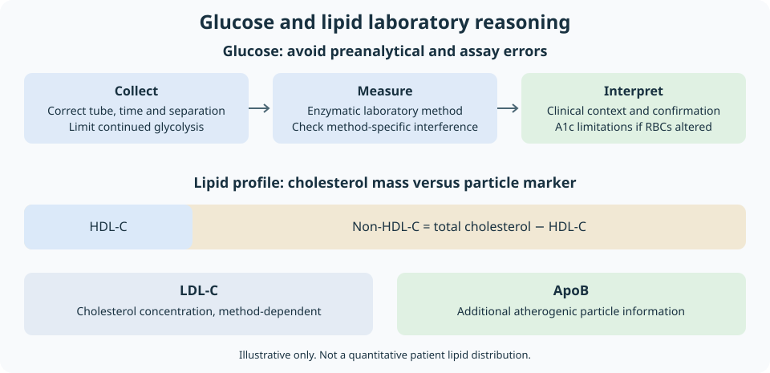

# Glucose diagnosis and lipid profile — clinical biochemistry

**Candidate guide for Banks 16–17.** Yeh exam-oriented concept support hai, clinical prescription ya independently certified material nahi.

## 1. Glucose tests ko samjho

Blood glucose collection ke waqt sample mein present cells glucose consume karna continue kar sakte hain. Agar plasma promptly separate nahi hua, toh glucose falsely low aa sakta hai. Sodium fluoride enolase inhibit karta hai, lekin early glycolysis immediately completely stop nahi hoti. Validated acidified citrate collection ya laboratory-directed prompt separation glucose loss reduce kar sakti hai. Sample additive, collection time aur transport instructions laboratory protocol se confirm karo.

Glucose oxidase reaction glucose ko oxidize karke hydrogen peroxide produce karti hai. Peroxidase-based color reaction signal provide kar sakti hai. Hexokinase method mein glucose glucose-6-phosphate banta hai aur coupled reaction NADPH generate karti hai. Optical measurement near 340 nm concentration estimate kar sakti hai. Meter result aur accredited laboratory result interchangeably assume mat karo. Hematocrit, peripheral perfusion, sample type, drugs aur device-specific interference difference create kar sakte hain. Patient symptomatic ho toh urgent protocol follow karte hue clinically discordant result verify karo.

ADA 2026 ke nonpregnant adult diagnostic criteria mein standardized HbA1c 6.5% ya above, fasting venous plasma glucose 126 mg/dL ya above, standardized 75-g oral glucose tolerance test ke two-hour plasma glucose 200 mg/dL ya above, ya classic hyperglycemia symptoms/crisis ke saath random plasma glucose 200 mg/dL ya above include hote hain. Unequivocal hyperglycemia absent ho toh confirmatory testing chahiye. These diagnostic criteria already covered in Endocrine banks hain. Pregnancy ke criteria different ho sakte hain. OGTT mein correct load, pretest preparation aur actual collection timing important hain. Vomiting ya incomplete load ko accurately report karo.

HbA1c erythrocyte hemoglobin glycation ka integrated marker hai. RBC survival change, severe iron deficiency, hemoglobin variants ya transfusion glycemia aur HbA1c ka relationship disturb kar sakte hain. HbA absent hone par standard HbA1c biologically unsuitable ho sakti hai. Fructosamine aur glycated albumin shorter-term protein glycation markers hain, lekin protein losses aur turnover inko affect kar sakte hain. IFCC mmol/mol aur NGSP percentage validated scales hain, identical numbers nahi.

Nitroprusside urine ketone assay mainly acetoacetate detect karti hai, beta-hydroxybutyrate nahi. Recovery ke dauran acetoacetate fraction increase ho sakti hai even while blood beta-hydroxybutyrate decreases. Isliye urine ketone trend ko alone DKA resolution ka measure mat banao. Historical copper reduction test nonglucose reducing substances bhi detect kar sakta hai, whereas glucose oxidase strip comparatively specific hai.

[Glucose diagnostic MCQs](../MCQs/16-Glucose-Diagnostic-Biochemistry-20-MCQs.md)

## 2. Lipid profile aur cholesterol derivatives

Routine profile total cholesterol, triglycerides aur HDL-C measure kar sakti hai, LDL-C method ke according estimate ya directly measure ho sakta hai. Non-HDL-C = total cholesterol minus HDL-C. Yeh atherogenic particle cholesterol content ka useful estimate hai. Historical Friedewald equation mg/dL mein LDL-C = TC minus HDL-C minus TG/5 hai. Yeh formula very high triglycerides mein unreliable hai. 2026 ACC/AHA guideline extracts newer Martin/Hopkins ya Sampson/NIH estimates prefer karte hain. Lab ka validated method aur applicable units follow karo. Fasting repeat selected situations mein requested ho sakta hai.

LDL-C cholesterol mass batata hai, particle number exactly nahi. ApoB-containing atherogenic particles mein generally ek apoB molecule hota hai. Same LDL-C ke saath different apoB concentrations possible hain. ApoB-100 LDL receptor recognition mein involved hai. ApoE remnant uptake mein help karta hai, apoC-II lipoprotein lipase activate karta hai. HDL-associated LCAT free cholesterol esterify karti hai aur SR-BI selective cholesterol ester uptake facilitate karta hai. Lipoprotein(a) LDL-like particle hai jisme apo(a) attached hota hai. Apo(a) isoform size variable hone ki wajah se mg/dL aur nmol/L fixed conversion appropriate nahi.

Cholesterol steroid hormones, bile acids aur vitamin D pathway ke precursors provide karta hai. Hepatic classic bile acid synthesis CYP7A1 se initiate hoti hai. Cholic acid aur chenodeoxycholic acid primary bile acids hain. Glycine ya taurine conjugation detergent properties support karti hai. Intestinal recycling enterohepatic circulation ke through hoti hai aur ileal disease/resection bile acid loss increase kar sakti hai. Mitochondrial CYP11A1 cholesterol ko pregnenolone mein convert karta hai, jo steroid hormone synthesis ka common precursor hai. Skin 7-dehydrocholesterol UVB exposure ke response mein previtamin D3 form karta hai. Atherosclerosis mein modified LDL macrophage uptake foam cell formation contribute karti hai. Plaque disease complex hai, isolated cholesterol value full cardiovascular risk establish nahi karti.

[Lipid profile MCQs](../MCQs/17-Lipid-Profile-and-Cholesterol-Derivatives-20-MCQs.md)

## References and limits

- [ADA 2026 diagnosis](https://doi.org/10.2337/dc26-S002)
- [AACC/ADA laboratory recommendations](https://doi.org/10.1093/clinchem/hvad080)
- [NGSP A1c interference](https://ngsp.org/factors.asp)
- [Endotext lipoprotein biochemistry](https://www.ncbi.nlm.nih.gov/sites/books/NBK305896/)
- [2026 ACC/AHA dyslipidemia](https://doi.org/10.1016/j.jacc.2025.11.016)
- [CYP7A1 and bile acid synthesis](https://pmc.ncbi.nlm.nih.gov/articles/PMC8291349/)

Direct AACC laboratory guideline, NGSP and Endotext text retrieved. Current ADA and ACC/AHA recommendations available as indexed extracts; full direct pages blocked. Specific item citations and independent review remain mandatory. No historical attribution or verified exact video mapping.
