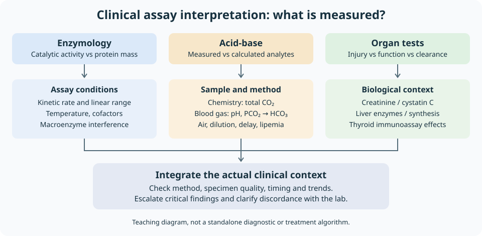

# Clinical enzymology, acid-base chemistry and organ-function tests

**Candidate guide for Banks 18–20.** Is material ka goal laboratory reasoning hai. Emergency treatment ya patient-specific diagnosis ke liye clinical team aur local validated protocol follow karo.

## 1. Clinical enzymology

Enzyme activity catalytic reaction rate hai, enzyme protein mass nahi. Activity assay ka temperature, pH, substrate, reagents aur measurement interval result influence karte hain. Kinetic assay repeated optical readings se reaction-rate slope estimate karti hai. Extremely high enzyme activity substrate rapidly exhaust kar sakti hai aur result underestimated ho sakta hai. Laboratory validated dilution aur repeat testing use kar sakti hai. Coupled AST assay mein AST-generated oxaloacetate malate dehydrogenase ke through malate mein convert hota hai. NADH consume hota hai, isliye absorbance decline near 340 nm activity ka signal ho sakta hai.

Macroenzymes ordinary enzyme se larger complexes hote hain. Macroamylase immunoglobulin association ke through renal clearance reduce kar sakta hai. PEG precipitation selected macrocomplexes ke screening mein useful hai, lekin normal proteins bhi precipitate ho sakte hain. Reference limits assay-specific hoti hain. Amylase-creatinine clearance ratio possible supportive clue hai, final diagnosis nahi. Amylase pancreatic aur salivary sources se aa sakti hai. Lipase renal dysfunction aur other nonpancreatic illnesses mein bhi rise ho sakti hai. Serum enzyme magnitude clinical severity ka exact substitute nahi hota.

ALP zinc-dependent enzyme hai aur magnesium activity support karta hai. EDTA contamination enzyme activity falsely low bana sakti hai. Growing children mein bone ALP physiological rise show kar sakti hai, so age-specific reference intervals chahiye. Persistently low age-adjusted ALP with compatible findings hypophosphatasia evaluation warrant kar sakta hai. LDH H aur M subunits ke tetramers se five classical forms banata hai. Cytosolic CK dimeric forms MM, MB aur BB show karta hai. CK-MB mass aur activity units interchangeable nahi.

Butyrylcholinesterase circulating liver-produced esterase hai, succinylcholine aur mivacurium metabolism mein important hai. Reduced activity ya inherited variant prolonged blockade contribute kar sakta hai. Dibucaine number percentage enzyme inhibition estimate karta hai, total activity measure nahi. Clinical team anesthetic history, quantitative activity, inhibitor phenotype aur appropriate genetic testing integrate karti hai.

[Clinical enzymology MCQs](../MCQs/18-Clinical-Enzymology-and-Analytical-Interpretation-20-MCQs.md)

## 2. Acid-base diagnostic chemistry

pH hydrogen ion activity ka negative logarithmic measure hai. Approximate 0.3 unit fall hydrogen ion concentration ko about double represent karta hai. Henderson-Hasselbalch teaching equation pH = 6.1 + log10[HCO3/(0.03 × PCO2)] hai when PCO2 mmHg mein aur bicarbonate mmol/L mein hai. pH 7.4 ke near bicarbonate-to-dissolved-CO2 ratio approximately 20:1 hota hai. Chemistry panel total CO2 includes bicarbonate plus dissolved gas contribution, whereas blood gas analyzer often measured pH aur PCO2 se bicarbonate calculate karta hai. Standard bicarbonate aur base excess metabolic component interpret karne ke complementary tools hain.

Sample handling result change kar sakti hai. Prolonged air exposure CO2 loss aur pH rise contribute kar sakti hai. Excess liquid heparin sample dilute kar sakta hai. Delayed processing mein blood cells glucose consume aur lactate produce kar sakte hain. Extreme leukocytosis effect enhance kar sakti hai. Severe lipemia selected photometric total CO2 assays interfere karke spurious low result produce kar sakti hai. Discordant chemistry and gas values laboratory se verify karo aur genuine urgent disease ko ignore mat karo.

Metabolic alkalosis mein urine chloride context useful ho sakta hai. Low urine chloride chloride depletion support kar sakta hai, but active diuretic urinary chloride temporarily raise kar sakta hai. Distal beta-intercalated cell ka pendrin chloride-bicarbonate exchanger hai. Chloride delivery low hone par bicarbonate secretion reduce ho sakti hai. Renal acid excretion ammonium aur titratable acid pathways se hoti hai. Net acid excretion = urinary ammonium + titratable acid − urinary bicarbonate over the same period. Urine osmolal gap ammonium ka rough indirect estimate de sakta hai under specific assumptions, but mannitol aur other unmeasured osmoles inference distort karte hain. Direct urinary ammonium measurement selected cases mein useful hai. Hemoglobin aur phosphate additional buffers hain.

[Acid-base diagnostic MCQs](../MCQs/19-Acid-Base-Diagnostic-Biochemistry-20-MCQs.md)

## 3. Organ-function tests

Creatinine-based eGFR ek estimate hai, directly measured filtration nahi. Jaffe alkaline picrate assay other chromogens se interfere ho sakti hai. Enzymatic methods bhi fully interference-free nahi. Standardized IDMS-traceable creatinine calibration validated equation comparison support karti hai. Trimethoprim tubular creatinine secretion reduce karke serum creatinine rise contribute kar sakta hai without equivalent GFR fall, but true AKI and hyperkalemia must still be considered. Cystatin C alternate filtration marker hai but glucocorticoids aur thyroid status jaise non-GFR factors affect kar sakte hain. More accurate measurement required ho toh specialist team exogenous marker clearance consider kar sakti hai. BUN urea ka nitrogen mass express karta hai, total urea mass nahi. Generation liver function and protein substrate se influenced hai.

Liver tests ko injury, excretion aur synthetic function mein separate socho. ALT/AST injury markers hain. ALP and selected additional markers hepatobiliary origin clarify kar sakte hain. Albumin aur PT/INR synthesis ke indirect clues hain, nonhepatic influences bhi important hain. Suspected DILI mein R = (ALT/ULN)/(ALP/ULN) pattern classify karta hai. R 5 ya above hepatocellular, R 2 ya below cholestatic aur between mixed pattern support karta hai, cause confirm nahi. Falling aminotransferases with worsening INR or encephalopathy urgent concern hai. Albumin relatively slow turnover ke kaaran early acute dysfunction mein normal reh sakti hai. Factor V vitamin K-dependent group mein nahi hai. Ammonia result alone hepatic encephalopathy grade establish nahi karta.

Thyroid laboratory interpretation mein clinical context aur assay consistency important hai. Macro-TSH immunoreactive complex result elevate kar sakta hai. Heterophile antibodies sandwich immunoassay mein false signals produce kar sakti hain. Unexpected free T4 results selected specialized methods like equilibrium dialysis/ultrafiltration se evaluate ho sakte hain. Acute illness peripheral thyroid hormone metabolism affect kar sakti hai, isolated low T3 automatically primary hypothyroidism nahi. Levothyroxine dose ke relative actual sample timing document karo. Anti-thyroglobulin antibodies serial thyroglobulin assays interfere kar sakti hain, clinical and imaging context needed hai.

[Organ-function MCQs](../MCQs/20-Organ-Function-Test-Interpretation-20-MCQs.md)

## References and limits

- [Clinical enzymology ALP review](https://doi.org/10.21037/jlpm-23-63)
- [Kinetic enzyme assay progress curve](https://pmc.ncbi.nlm.nih.gov/articles/PMC9092719/)
- [Macroenzyme screening](https://pubmed.ncbi.nlm.nih.gov/36627975/)
- [BChE deficiency](https://www.ncbi.nlm.nih.gov/books/NBK541032/)
- [Blood gas preanalytical review](https://pmc.ncbi.nlm.nih.gov/articles/PMC3900096/)
- [Metabolic alkalosis core curriculum](https://pmc.ncbi.nlm.nih.gov/articles/PMC10947768/)
- [Urine chemistries](https://pmc.ncbi.nlm.nih.gov/articles/PMC6390907/)
- [KDIGO CKD executive summary](https://doi.org/10.1016/j.kint.2023.10.016)
- [Merck liver laboratory tests](https://www.merckmanuals.com/professional/hepatic-and-biliary-disorders/testing-for-hepatic-and-biliary-disorders/laboratory-tests-of-the-liver-and-gallbladder)
- [AASLD DILI guidance](https://doi.org/10.1002/hep.32689)
- [ETA 2026 thyroid assay interference](https://pmc.ncbi.nlm.nih.gov/articles/PMC13482799/)
- [ATA thyroglobulin assay review](https://www.thyroid.org/professionals/laboratory-services-library/thyroglobulin-tg-assays/)

Direct Merck background reviewed and remaining sources indexed. Complete direct clinical citation-per-item verification, independent review, question-level video practice and historical evidence remain pending.
