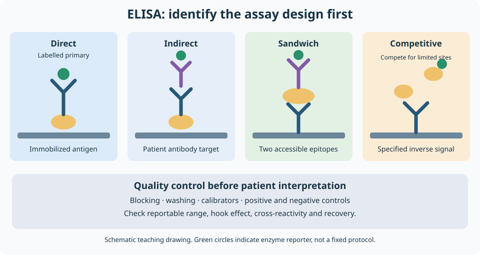

# Immunoglobulins and diagnostic immunochemistry

**Candidate concept guide for Bank 21.** Yeh laboratory-focused study material hai. Clinical disease diagnosis ke liye validated test-specific algorithm follow karna chahiye.

## 1. Immunoglobulin structure and function

Antibody usually do heavy aur do light polypeptide chains se bana hota hai. Disulfide bonds chains ko stabilize karte hain. Variable regions antigen recognition mein important hain. Fab arms antigen binding perform karti hain aur Fc region effector functions aur receptor interactions mein participate karta hai. IgG major serum antibody class hai. IgM secreted form mein commonly pentameric hota hai aur early humoral response mein important hai. IgA mucosal defense mein important hai, IgE immediate allergy-related mechanisms mein participate karta hai, aur IgD mature naive B-cell surface par IgM ke saath mil sakta hai.

In objectives ke existing original questions ko repeat nahi kiya gaya. Practice ke liye [Microbiology Immunoglobulins Q1–12 and Q27](../../Infection-Control-and-Microbiology/MCQs/22-Immunoglobulins-Complement-and-Hypersensitivity-40-MCQs.md), [Microbiology immunity Q27–36](../../Infection-Control-and-Microbiology/MCQs/21-Innate-and-Adaptive-Immunity-40-MCQs.md) aur [A&P immune physiology Q6–14](../../Anatomy-and-Physiology/MCQs/09-Lymphatic-System-and-Immune-Physiology-20-MCQs.md) already available hain. Yeh links coverage allocation hain, duplicate question count nahi.

## 2. ELISA ka basic principle

Enzyme-linked immunosorbent assay mein antigen-antibody interaction ko measurable enzyme-associated signal mein convert kiya jata hai. Format ke according sample antigen ya specific antibody detect ho sakti hai.

- Direct antigen-detection format mein enzyme-labelled primary antibody immobilized antigen recognize karti hai.
- Indirect antibody-detection format mein coated antigen patient antibody bind karta hai. Labelled anti-human immunoglobulin bound patient antibody detect kar sakti hai.
- Sandwich format mein capture antibody antigen hold karti hai aur detection antibody independently accessible epitope recognize karti hai.
- Competitive format mein sample analyte aur labelled or immobilized reagent limited sites ke liye compete kar sakte hain. Bound labelled antigen measure karne wale design mein increasing sample analyte signal reduce kar sakta hai. Signal direction always stated assay design ke according interpret karo.

Blocking unoccupied surfaces par nonspecific binding reduce karti hai. Washing unbound reagents remove karti hai. HRP/TMB example mein enzyme reaction optical signal generate karti hai. Incubation, wash, substrate and stop timing validated protocol ke according consistent hone chahiye. Antibody cross-reactivity structurally similar epitopes ki wajah se occur kar sakti hai.

## 3. Quality control aur interpretation

Positive control expected signal confirm karne mein help karta hai. Negative control unwanted background detect karne mein useful hai. Acceptance criteria fail ho toh affected patient results release karne se pehle laboratory corrective procedure follow karo. Analytical blank baseline signal estimate kar sakta hai. Duplicate well discrepancy pipetting, washing ya other variability suggest kar sakti hai.

Quantitative ELISA mein known calibrator concentrations se response curve establish hoti hai. Unknown sample signal validated range mein interpret karo. Above-range sample ke liye lab validated dilution protocol use kar sakti hai. One part specimen plus four parts diluent ka factor five hai. Agar measured diluted value 18 ng/mL hai aur recovery acceptable hai, original estimate 90 ng/mL hai.

Very high antigen concentration selected one-step sandwich methods mein high-dose hook effect cause kar sakti hai. Separate capture and detector saturation productive sandwich formation reduce kar sakti hai. Unexpectedly low result ko clinical context aur validated dilution study se investigate karo. Spike recovery experiment mein known analyte increment add karke observed increment compare karte hain. 24 ng/mL observed divided by 40 ng/mL added times 100 equals 60% recovery. Acceptance criterion specific assay validation se decide hoti hai.

Equivocal zone aur cutoff kit-specific hain. Antigen or antibody test ka positive result alone har infection ki current activity ya diagnosis establish nahi karta. HIV testing ke liye obsolete universal Western blot confirmation statements use nahi karne chahiye. Nationally applicable current test algorithm follow karna zaroori hai.

[Bank 21 practice](../MCQs/21-ELISA-and-Diagnostic-Immunochemistry-20-MCQs.md)

## References and limits

- [ELISA principles and QC](https://www.ncbi.nlm.nih.gov/books/NBK555922/)
- [Immunoassay interference review](https://doi.org/10.1515/cclm-2021-1288)
- [Analytical cross-reactivity](https://pubmed.ncbi.nlm.nih.gov/28847718/)
- [Spike and recovery](https://www.thermofisher.com/us/en/home/life-science/protein-biology/protein-biology-learning-center/protein-biology-resource-library/pierce-protein-methods/overview-elisa/spike-recovery-linearity-assessment.html)

Direct NCBI and spike-recovery texts retrieved. The general ELISA article contains outdated HIV confirmation advice that is not adopted. Other references indexed. Independent clinical and complete semantic review remain pending. [IFAS question-solving video](https://www.youtube.com/watch?v=Zq7BdLHtTsQ) is an indexed topic-level lead, not a verified exact-item mapping.
