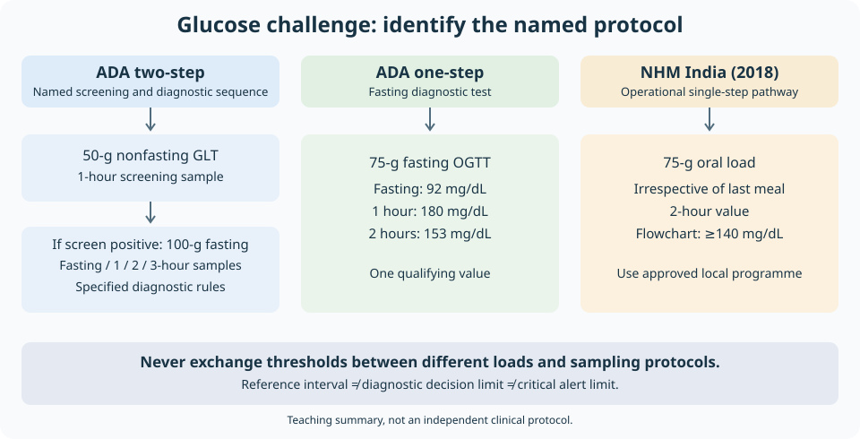

# Selected biochemical investigations and reference values

**Candidate concept guide for Bank 22.** Yeh guide remaining named INC objectives cover karta hai. Pregnancy-related diagnostic methods ko local clinical programme ke according apply karo. Historical tests modern routine clinical care ka replacement nahi hain.

## 1. Glucose tolerance test variants

Glucose challenge test mein specified glucose load dene ke baad plasma glucose response timed samples se assess hota hai. Ordinary nonpregnant 75-g OGTT aur gestational diabetes protocols different diagnostic cutoffs use karte hain. Ek protocol ka dose ya threshold doosre par apply mat karo.

ADA 2026 one-step pregnancy strategy mein 24–28 weeks par fasting 75-g OGTT ke fasting, one-hour aur two-hour samples assess hote hain. Named thresholds respectively 92, 180 aur 153 mg/dL hain. Ek qualifying value sufficient hai. ADA two-step strategy mein initial nonfasting 50-g GLT/GCT ka one-hour screening result local selected threshold, commonly 130, 135 or 140 mg/dL, se compare hota hai. Screen positive ho toh fasting 100-g three-hour diagnostic OGTT follow hota hai. Carpenter-Coustan thresholds 95, 180, 155 aur 140 mg/dL hain, at least two qualifying values required in the stated ADA approach.

India ke NHM Technical and Operational Guidelines (2018, still listed in the maternal health guidelines index during this retrieval) single-step 75-g oral load irrespective of last meal aur two-hour value use karte hain. Flowchart threshold 140 mg/dL or above hai. Yeh ADA fasting 75-g one-step strategy ke equivalent nahi hai. The NHM document's introductory prose has an inconsistent greater-than sign, so the explicit operational flowchart and the local approved programme must guide interpretation. Pregnancy GDM testing and management ki detailed clinical ownership OBG/Endocrine team ke paas rehti hai.

INC syllabus mini GTT aur extended GTT terms list karta hai, lekin dose, duration ya diagnostic cutoffs define nahi karta. Mini-GTT term ko automatically one universal protocol mat samjho. Actual requisition, named protocol, glucose dose, fasting state, route, collection timings and interpretation criteria verify karo. Extended glucose curves historical teaching mein multiple delayed samples include kar sakti hain. Suspected postprandial hypoglycemia ke liye routine extended OGTT appropriate diagnostic test nahi hai. Endocrine Society guidance symptom-correlated reliable plasma glucose and selected supervised mixed-meal assessment discuss karti hai. Historical description ko contemporary clinical recommendation mat banao.

IVGTT intestinal absorption aur nutrient-triggered incretin effect bypass karta hai. Specialist research mein early timed insulin measurements first-phase secretion characterize kar sakte hain. IVGTT routine glucose diagnostic thresholds ka substitute nahi hai.

Existing [glucose diagnostic biochemistry bank](../MCQs/16-Glucose-Diagnostic-Biochemistry-20-MCQs.md) ordinary OGTT preparation, processing and HbA1c assay limitations already covers. [Endocrine topic bank](../../Endocrine-System/MCQs/Endocrine-Topic-Wise.md), [Endocrine full mock](../../Endocrine-System/Mock-Tests/Endocrine-System-Mock-01-120.md), and [OBG endocrine adaptations](../../Obstetric-and-Midwifery-Nursing/MCQs/03E-Maternal-Endocrine-Adaptations-19-MCQs.md) contain related existing objectives. New questions focus on distinct named protocol interpretation.

## 2. Aldolase and prostatic markers

Aldolase fructose-1,6-bisphosphate ko glyceraldehyde-3-phosphate aur dihydroxyacetone phosphate mein split karta hai. Serum aldolase selected muscle disease evaluation mein supportive marker ho sakta hai. CK generally more useful muscle enzyme hai, lekin selected inflammatory myopathy cases mein CK normal aur aldolase elevated ho sakta hai. Neither marker alone exact diagnosis establish karta hai. Progressive muscular dystrophy mein tissue mass decline ke saath serum enzyme release decrease ho sakta hai despite functional worsening. Age and method-specific reference limits verify karo.

PSA kallikrein-family serine protease hai. Normal aur malignant prostate cells PSA produce kar sakte hain. BPH, inflammation, recent procedures and selected drugs result influence karte hain. Finasteride and dutasteride PSA lower kar sakte hain. Drug history and serial trends clinician ko communicate karo. PSA can support selected assessment and treatment monitoring, but one value does not establish cancer. Routine population screening is not universally recommended.

Prostatic acid phosphatase (PAP) acid phosphatase family ka prostate-associated enzyme hai. Historical prostate cancer screening/staging marker ke roop mein padha jata hai. Modern practice mein PSA much more commonly used hai, while PAP has limited selected applications. PAP and PSA are distinct analytes. Neither is a standalone malignancy diagnosis.

## 3. Reference values and clinical decision limits

Reference interval selected reference population ka observed distribution describe karti hai. Central 95% interval by construction about 5% reference individuals outside leave kar sakti hai. Diagnostic threshold clinical evidence par based decision limit hai, aur critical alert threshold urgent communication ka separate criterion hai. In terms ko interchangeable mat samjho.

Illustrative adult serum/plasma values from the cited MedlinePlus comprehensive metabolic panel example, not universal patient-specific ranges:

| Parameter | Example value |
|---|---|
| Albumin | 3.4–5.4 g/dL |
| Total protein | 6.0–8.3 g/dL |
| Creatinine | 0.6–1.3 mg/dL |
| BUN | 6–20 mg/dL |
| Total bilirubin | 0.1–1.2 mg/dL |
| ALT | 4–36 U/L |
| AST | 8–33 U/L |
| ALP | 20–130 U/L |
| Chemistry total CO2 | 23–29 mEq/L |
| Glucose | 70–100 mg/dL |

These examples depend on specimen, assay and reference population. Individual laboratory intervals govern clinical reporting. Thyroid tests also require laboratory-specific TSH and free T4 intervals, including age and pregnancy adjustments when applicable. Arterial blood gas teaching ranges often use pH 7.35–7.45, PaCO2 35–45 mmHg and bicarbonate 22–26 mmol/L, but clinical context and local laboratory intervals remain essential. Chemistry total CO2 and calculated blood-gas bicarbonate are related but distinct quantities.

Units carefully compare karo. Albumin 3.8 g/dL equals 38 g/L. Enzyme U/L measures activity under defined conditions, not mass concentration. An identical ALT number can have different flags at laboratories with different validated limits. Result alone patient disease presence ya absence prove nahi karta.

[Bank 22 practice](../MCQs/22-Selected-Biochemical-Investigations-20-MCQs.md)

## Sources and limits

- [ADA Standards 2026 diagnosis](https://diabetesjournals.org/care/article/49/Supplement_1/S27/163926/2-Diagnosis-and-Classification-of-Diabetes)
- [NHM Technical and Operational Guidelines for GDM](https://nhm.gov.in/New_Updates_2018/NHM_Components/RMNCH_MH_Guidelines/Gestational-Diabetes-Mellitus.pdf)
- [IVGTT research review](https://drc.bmj.com/content/12/4/e004256)
- [Endocrine Society adult hypoglycemic disorders](https://academic.oup.com/jcem/article/94/3/709/2596247)
- [Mayo aldolase](https://www.mayocliniclabs.com/test-catalog/overview/606872)
- [NCI PSA](https://www.cancer.gov/types/prostate/psa-fact-sheet)
- [Mayo prostatic acid phosphatase](https://www.mayocliniclabs.com/test-catalog/Overview/8019)
- [PSA and PAP biochemical characteristics](https://pubmed.ncbi.nlm.nih.gov/1715106/)
- [MedlinePlus metabolic panel](https://www.medlineplus.gov/ency/article/003468.htm)
- [Reference interval principles](https://pmc.ncbi.nlm.nih.gov/articles/PMC2556592/)
- [How to understand lab results](https://medlineplus.gov/lab-tests/how-to-understand-your-lab-results/)

NHM PDF text, Mayo and NCI and MedlinePlus direct pages retrieved. NHM and INC screenshots failed. ADA 2026 and additional review sources retrieved as indexed extracts, not full item-specific certification. Mini-GTT historical nomenclature and full systemic pathology allocation remain open. No exact video or historical question provenance is certified.
