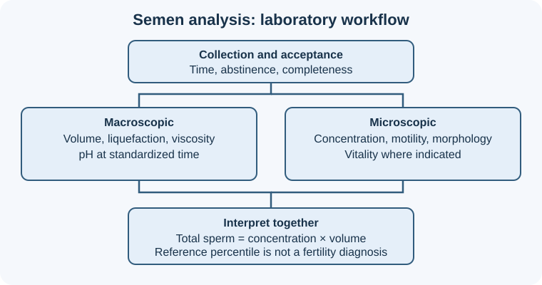

# Semen analysis and diagnostic andrology

**Study-ready candidate, not previously studied or independently certified.** Yeh guide aapko semen laboratory report samajhne mein help karegi. Infertility diagnosis aur treatment specialist clinical assessment ke through decide hota hai.

[Practice 20 MCQs](../MCQs/23-Semen-Analysis-and-Diagnostic-Andrology-20-MCQs.md) · [Batch checkpoint](../MCQs/Biochemistry-and-Pathology-Batch-Checkpoint.md)

## Sample quality sabse pehle

Dekho, semen analysis mein sperm cells aur unko carry karne wala seminal fluid dono examine hote hain. Agar collection incomplete ho, sample late aaye ya temperature suitable na ho, toh report actual biological condition ko accurately represent nahi kar paati. WHO 2021 standard collection ke liye 2–7 days abstinence interval use karta hai. Laboratory ke approved container, privacy, collection method aur transport instructions pehle explain karo. Agar first fraction miss ho jaaye, toh patient ko blame karne ke bajay incomplete collection document karo, kyunki first fraction sperm-rich ho sakta hai. Collection time, abstinence duration aur sample loss record karna repeat tests compare karne mein help karta hai.

## Macroscopic examination

Fresh semen initially gel-like ho sakta hai. Jab seminal proteins break down hote hain toh fluid liquefy hota hai. Liquefaction aur viscosity same cheez nahi hain. Liquefaction gel-to-fluid change hai aur viscosity fluid ke flow resistance ko batati hai. Standardized timing par pH bhi measure kiya jaata hai, kyunki carbon dioxide loss se value change ho sakti hai. Laboratory weight-based volume estimate mein empty container ka weight subtract karti hai. Agar density 1 g/mL assume ki gayi hai aur net weight 2.6 g hai, toh volume approximately 2.6 mL hai.

## Microscopic examination aur calculations

Sperm concentration ek milliliter mein sperm ki sankhya batati hai. Total sperm number poore ejaculate ka count hai. Agar concentration 25 million/mL aur volume 2.4 mL hai, toh total count 60 million hai. Motility mein progressive sperm aage move karte hain, nonprogressive sperm movement dikhate hain par meaningful advancement nahi karte, aur immotile sperm movement nahi dikhate. Total motility progressive plus nonprogressive percentage hoti hai. Total motile sperm count ke liye total number ko total motility fraction se multiply karte hain. Progressive motile count ke liye sirf progressive fraction use hoti hai.

Morphology sperm ke head, midpiece aur tail ki shape ko standardized criteria se assess karti hai. Vitality se pata chalta hai ki sperm alive hai ya nahi. Immotile sperm hamesha dead nahi hota. Eosin-based vitality testing damaged cell membrane mein dye entry ke principle par kaam karti hai. Low motility mein additional vitality assessment useful ho sakta hai. Extended testing mein round cells ka peroxidase-positive granulocyte component check kiya ja sakta hai. Agglutination sperm-to-sperm attachment hai, jabki nonspecific aggregation sperm aur debris ki attachment ho sakti hai.

## Result samajhna aur nurse ki role

WHO 2021 reference values fertile reference population ke lower percentiles par based hain. Inko absolute fertility cutoffs nahi samajhna chahiye. Ek low parameter se permanent infertility establish nahi hoti. Collection quality, method, medical history aur clinical assessment ko saath mein consider karte hain. Agar report mein no sperm seen ho, toh laboratory validated low-count procedure follow kar sakti hai. Nurse confidentiality protect karti hai, instructions clarify karti hai aur appropriate follow-up arrange karne mein team ko support karti hai.

## Practice and references

- [Q1–6 collection and macroscopic assessment](../MCQs/23-Semen-Analysis-and-Diagnostic-Andrology-20-MCQs.md#part-1)
- [Q7–15 counting, motility, vitality and morphology](../MCQs/23-Semen-Analysis-and-Diagnostic-Andrology-20-MCQs.md#part-2)
- [Q16–20 low counts, agglutination, pH and reporting](../MCQs/23-Semen-Analysis-and-Diagnostic-Andrology-20-MCQs.md#part-4)
- [WHO laboratory manual sixth edition, 2021](https://www.who.int/publications/i/item/9789240030787/)
- [ARCS diagnostic andrology guidance, 2024](https://www.rbmojournal.com/article/S1472-6483%2824%2900562-5/fulltext)
- [MedlinePlus semen analysis](https://medlineplus.gov/lab-tests/semen-analysis/)

Teaching video lead: [Semen Analysis | Human Semen Examination](https://www.youtube.com/watch?v=74QEXSnMbsM), indexed title and description mention morphology and motility. Channel, playback and exact coverage not independently authenticated. Dedicated MCQ video mapping remains pending for all 20 items. No historical appearance claimed.
