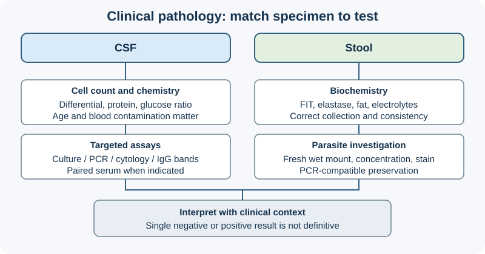

# Clinical pathology: CSF and stool analysis

**Study-ready candidate.** Is guide mein hum laboratory results ka meaning samjhenge. Patient ki diagnosis ya treatment ek isolated lab value se decide nahi karte.

[CSF practice bank](../MCQs/24-Cerebrospinal-Fluid-Laboratory-Analysis-20-MCQs.md) · [Stool practice bank](../MCQs/25-Stool-Clinical-Pathology-and-Biochemical-Tests-20-MCQs.md)

## CSF mein laboratory kya dekhti hai?

Cerebrospinal fluid (CSF) brain aur spinal cord ke around protective fluid hai. Normal CSF usually clear hota hai aur blood ke compared protein aur cell count kaafi kam hota hai. Jab inflammation, bleeding ya barrier dysfunction hoti hai toh cells, proteins aur chemical components change ho sakte hain. Lumbar puncture sirf trained clinician appropriate safety assessment ke baad karta hai. Nurse sample identification, collection timing aur test-specific transport coordinate karti hai. Suspected bacterial meningitis ek emergency hai, isliye sample testing ke chakkar mein urgent treatment delay nahi karna chahiye.

Opening pressure collection ke beginning mein relaxed lateral decubitus position mein measure ki jaati hai. Position aur straining reading affect kar sakti hain. Millimeter se centimeter H2O convert karne ke liye ten se divide karo. Adult aur neonatal reference intervals same nahi hote. Example ke liye AAFP review adult CSF WBC ka usual reference <5 cells/microliter aur neonatal <20 batata hai, lekin age, laboratory method aur clinical context ke according interpretation chahiye. Normal ya mildly abnormal results infection ko completely exclude nahi karte.

### Chemistry, cells aur paired blood

CSF glucose blood glucose se related hota hai. Agar CSF 42 mg/dL aur relevant serum glucose 120 mg/dL hai, toh ratio 42/120 = 0.35 hai. Ratio aur absolute values ko sampling timing ke saath dekhna chahiye. Bacterial meningitis mein glucose ratio kam, protein high aur neutrophils predominant ho sakte hain. Viral infection mein glucose usually preserved aur lymphocytes predominant ho sakte hain, par overlap aur early exceptions possible hain. Cell count ko differential percentage ke saath use kar sakte hain. Example mein 240 cells/microliter ka 75% neutrophil fraction 180 neutrophils/microliter deta hai.

Traumatic collection mein peripheral blood ke cells CSF mein aa sakte hain. Predicted contamination estimate ke liye CSF RBC count ko blood WBC/RBC ratio se multiply kar sakte hain, par correction imperfect hai. Is formula se meningitis rule out nahi hoti. Bloody sample ka yellow supernatant xanthochromia ho sakta hai. Light-sensitive bilirubin measurement ke liye lab handling instructions follow karo. First aur last tube ke RBC count mein decrease hemorrhage ko reliably exclude nahi karta.

### Specialized tests

Paired CSF aur serum oligoclonal band analysis se local IgG synthesis ko shared systemic antibody pattern se distinguish karne mein help milti hai. CSF-specific bands multiple sclerosis assessment support kar sakte hain, par other inflammatory conditions mein bhi aa sakte hain. Guillain-Barré syndrome mein high CSF protein aur normal ya relatively low cell count ka pattern albuminocytologic dissociation kehlata hai. Early illness mein protein normal ho sakta hai. Cytology malignant cells detect karne mein useful hai, lekin single negative sample ki sensitivity limited hoti hai. Multiplex PCR predefined targets detect karta hai aur negative result har infection exclude nahi karta.

## Stool examination ko test ke purpose ke hisaab se samjho

Stool sample se bleeding, malabsorption aur parasites jaise alag questions investigate hote hain. Har assay ke liye required sample container aur preservation instructions alag ho sakti hain. Patient ko kit instructions explain karo aur ordered test ke hisaab se collection coordinate karo.

### Occult blood

Occult blood ka matlab hidden blood hai jo naked eye se dikhna zaroori nahi. Traditional guaiac method heme-related oxidation reaction par based hai. Dietary heme false-positive signal contribute kar sakta hai aur high-dose vitamin C oxidation inhibit kar sakta hai. FIT antibodies human globin detect karti hain. Upper GI transit mein globin degrade ho sakta hai, isliye FIT suspected upper GI bleeding ko reliably exclude nahi karta. Positive screening result source, tumor stage ya cancer diagnosis establish nahi karta. Abnormal screening stool test ke baad appropriate colonoscopy follow-up treating team arrange karti hai.

### Malabsorption aur stool chemistry

Pancreatic elastase stool mein relatively stable hota hai aur exocrine pancreatic function ka marker hai. AGA 2023 ke according semisolid ya solid stool use karo. Watery stool dilution ki wajah se falsely low concentration de sakta hai. Values below 100 micrograms/g good evidence of exocrine insufficiency de sakti hain aur 100–200 indeterminate hain. Clinical context zaroori hai. Fecal elastase test prescribed pancreatic enzyme replacement ke dauran kiya ja sakta hai. Therapy apne aap stop nahi karni chahiye.

Timed fecal fat collection mein dietary instructions aur complete collection important hain. Agar 72 hours mein 36 g fat recover hua, toh daily average 12 g/24 hours hai. Missed stool measured loss underestimate kar sakta hai. Stool reducing sugars aur pH historical adjunctive tests hain aur children mein disaccharidase deficiency ke reliable screening substitutes nahi hain. Estimated stool osmotic gap ka formula 290 − 2(Na + K) hai. Sodium 40 aur potassium 30 mmol/L ho toh gap 150 mOsm/kg hai. Large gap unmeasured osmotic solutes support karta hai, lekin exact cause identify nahi karta.

### Parasite laboratory examination

Fresh diarrheal stool mein motile trophozoites observe karne ke liye prompt examination important hai. CDC DPDx ke according liquid stool passage ke 30 minutes ke andar examine karna useful hai. Delay unavoidable ho toh test-compatible preservation use ki jaati hai. Concentration methods sparse parasites ko fecal debris se enrich karti hain. Permanent trichrome stain protozoal morphology ka archived record provide kar sakti hai. Microscopy-compatible preservative PCR-compatible automatically nahi hota, isliye molecular lab se confirm karo.

## References and evidence

- [AAFP CSF analysis](https://www.aafp.org/afp/2021/0401/p422)
- [Mayo paired CSF/serum oligoclonal bands](https://www.mayocliniclabs.com/test-catalog/Overview/8017)
- [MedlinePlus occult blood test](https://medlineplus.gov/lab-tests/fecal-occult-blood-test-fobt/)
- [AGA exocrine pancreatic insufficiency guidance](https://gastro.org/clinical-guidance/epidemiology-evaluation-management-exocrine-pancreatic-insufficiency/)
- [Mayo quantitative fecal fat](https://www.mayocliniclabs.com/test-catalog/overview/607701)
- [Pediatric reducing sugars/pH limitations](https://pubmed.ncbi.nlm.nih.gov/32445391/)
- [CDC stool specimen processing](https://www.cdc.gov/dpdx/diagnosticprocedures/stool/specimenproc.html)
- [RCPA fecal osmolar gap](https://www.rcpa.edu.au/Manuals/RCPA-Manual/Pathology-Tests/F/Faecal-osmolar-gap)

CSF teaching video lead: [CSF chemical, cytological and culture analysis](https://www.youtube.com/watch?v=E5ZktZYLyoI), indexed title/description. Channel and playback not verified. Stool teaching video and dedicated MCQ videos for both banks remain pending. No exact video item or historical exam claim.
