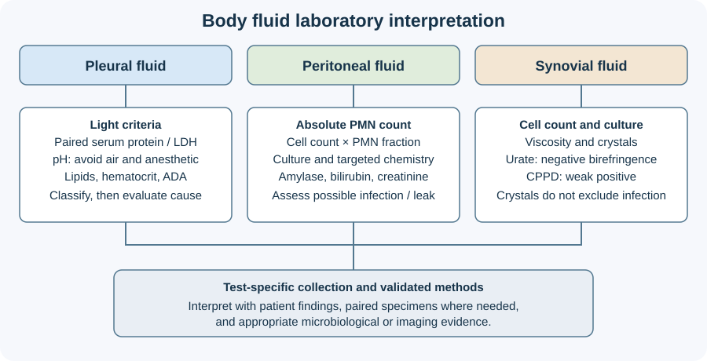

# Serous and synovial fluid laboratory analysis

**Study-ready candidate.** Is guide mein hum different body-cavity fluid samples ka biochemical aur microscopic meaning samjhenge. Ek laboratory result ko clinical context se alag karke diagnosis nahi banana chahiye.

[Serous fluid MCQs](../MCQs/26-Serous-Cavity-Fluid-Laboratory-Interpretation-20-MCQs.md) · [Synovial fluid MCQs](../MCQs/27-Synovial-Fluid-Analytical-Pathology-20-MCQs.md)

## Pleural fluid: transudate aur exudate

Pleural space mein fluid increase hone ke alag mechanisms hote hain. Hydrostatic ya oncotic pressure disturbance transudative effusion produce kar sakti hai. Local inflammation, infection ya malignancy mein permeability change hokar exudative effusion develop ho sakti hai. Light criteria pleural fluid aur serum protein/LDH ki comparison se fluid classify karti hain. Koi bhi ek criterion positive ho toh exudative classification support hoti hai. Criteria hain: fluid-to-serum protein ratio greater than 0.5, fluid-to-serum LDH ratio greater than 0.6, ya fluid LDH serum upper reference limit ke two-thirds se greater. Clinical cause sirf classification se confirm nahi hota. Diuretic-treated heart failure mein concentrated fluid pseudoexudate pattern de sakta hai.

Pleural pH measurement mein air bubble se carbon dioxide escape ho sakti hai aur pH falsely high aa sakta hai. Local anesthetic contamination pH falsely low kar sakti hai. Nonpurulent sample ko validated blood gas method se promptly analyze karte hain. Suspected pleural infection mein correctly measured pH 7.2 ya below complicated infection ka high-risk signal hai. Treating team drainage feasibility aur clinical context urgently assess karti hai. Frank pus mein routine pH testing ki zaroorat nahi hoti.

Cloudy fluid mein suspended cells ya lipid particles ho sakte hain. Centrifugation ke baad supernatant clear hona cellular debris contribution support karta hai. Milky fluid mein triglycerides, cholesterol aur chylomicron testing cause differentiate karne mein help karti hain. Long-standing cholesterol-rich fluid with cholesterol crystals aur absent chylomicrons pseudochylothorax support kar sakta hai. Bloody fluid ka hematocrit paired peripheral blood hematocrit se compare karte hain. Ratio 0.5 se above appropriate context mein hemothorax support karta hai. ADA activity tuberculous pleuritis ke assessment mein useful ho sakti hai, par independently definitive nahi hai.

## Peritoneal fluid: cells, chemistry aur culture

Ascitic fluid ka total leukocyte count aur differential absolute PMN count calculate karne mein help karte hain. Agar 600 leukocytes/mm3 mein 55% PMN hain, toh count 330/mm3 hai. Cirrhotic ascites mein PMN 250/mm3 ya above spontaneous bacterial peritonitis (SBP) ke assessment mein important hai. Negative culture raised PMN ke significance ko cancel nahi karti. Suspected infection mein ordered culture aliquots ko appropriate blood culture bottles mein bedside inoculation laboratory protocol ke according recovery improve kar sakta hai. Clinical team ko prompt results communicate karo.

Low glucose, elevated LDH aur polymicrobial culture secondary peritonitis ka concern raise kar sakte hain. Pancreatic duct leakage mein ascitic amylase markedly elevated ho sakti hai. Fluid creatinine paired serum se substantially high ho toh urinary leakage consider hota hai. Biliary surgery ke context mein disproportionate fluid bilirubin bile leakage ka clue de sakta hai. In results ka clinical aur imaging confirmation important hai. Classical Light criteria ko pericardial fluid par directly apply nahi karna chahiye, kyunki normal pericardial composition different hoti hai.

## Synovial fluid: viscosity, cells aur crystals

Normal joint fluid ki lubrication aur viscosity mein hyaluronan important hai. Inflammation mein hyaluronan degradation aur dilution se viscosity kam ho sakti hai. Historical mucin-clot reaction qualitative observation hai, modern infection workup ka replacement nahi. Viscous sample validated laboratory method mein controlled pretreatment maang sakta hai. Cell count sample clot ho jaaye toh trapped cells ki wajah se count unreliable ho sakta hai. Different tests ke containers alag ho sakte hain, isliye performing laboratory ki requirements follow karo.

Native joint fluid mein leukocyte count 50,000/microliter se above septic arthritis suggest kar sakta hai, lekin independently diagnosis establish nahi karta. Lower count infection exclude nahi karta, especially immunosuppression mein. Clinical suspicion aur microbiological identification important hain. Limited sample mein SANJO bacterial identification ko highest analytical priority deti hai. Negative Gram stain ya culture ke bawajood clinically suspicious case mein appropriate further testing zaroori ho sakti hai.

Compensated polarized microscopy mein monosodium urate crystals usually needle-shaped aur strongly negatively birefringent hote hain. Red compensator ke slow axis ke parallel yellow aur perpendicular blue ho sakte hain. Calcium pyrophosphate dihydrate crystals often rhomboid-shaped aur weakly positively birefringent hote hain. Sparse CPP crystals miss ho sakte hain. Basic calcium phosphate particles routine polarized microscopy mein reliably visible nahi hote. Crystals milne se bacterial infection automatically exclude nahi hota. Laboratory report ko patient assessment ke saath interpret karo.

## References and scope

- [Indian Chest Society/NCCP pleural effusion guideline](https://pmc.ncbi.nlm.nih.gov/articles/PMC11093145/)
- [BTS pleural disease guideline, 2023](https://thorax.bmj.com/content/78/Suppl_3/s1)
- [AAFP pleural effusion review](https://www.aafp.org/afp/2023/1100/pleural-effusion)
- [Laboratory recommendations for serous fluids](https://pmc.ncbi.nlm.nih.gov/articles/PMC6904973/)
- [Peritoneal fluid laboratory analysis](https://pubmed.ncbi.nlm.nih.gov/38538073/)
- [AASLD ascites guidance](https://aasldpubs.onlinelibrary.wiley.com/doi/full/10.1002/hep.31884)
- [ESC pericarditis guideline, 2025](https://doi.org/10.1093/eurheartj/ehaf192)
- [SANJO guideline, 2023](https://jbji.copernicus.org/articles/8/29/2023/index.html)
- [Synovial-fluid laboratory recommendations](https://pmc.ncbi.nlm.nih.gov/articles/PMC7394252/)
- [RCPA synovial fluid examination](https://www.rcpa.edu.au/Manuals/RCPA-Manual/Pathology-Tests/S/Synovial-fluid-examination)
- [Compensated polarized crystal microscopy](https://doi.org/10.1093/jalm/jfad011)

Teaching and dedicated MCQ video verification pending. These notes emphasize analytical pathology rather than duplicating system-specific treatment questions. Independent clinical and comprehensive semantic review remain pending.
