# Cardiovascular System — Master Study Guide (NORCET 12 / PGIMER / HP Staff Nurse)
[Chapter](../README.md) | [Existing anatomy MCQs](../MCQs/Day-04-Heart-Anatomy-Pericardium-Cardiac-Muscle.md) | [Valve MCQs](../MCQs/Day-04-Chambers-Valves.md) | [Previous Year Questions](../Previous-Year-Questions/README.md) | [Revision](../Revision/Day-04-Chambers-Valves-Quick-Revision.md) | [References](../References.md)

**26 November 2026 — Illustrated, English + Hindi-English detailed study-ready extension; not a record of completed learning or attempted questions.** Existing 128 questions unchanged. Roman Hinglish explanations; English original practice. Adult clinical values unless specified. Treatment is exam education, not independent bedside prescribing; follow institutional orders and emergency protocols.


> **How to study this chapter / Padhne ka tareeka:** English definitions aur medical terms pehle samjho; uske baad easy Hindi-English explanation padho. Har diagram mein arrows aur labels follow karo. Red and blue circulation diagrams oxygen-rich/oxygen-poor blood show karte hain; other color coding section-specific hai. Then read exam traps and solve hidden-answer English MCQs. Long theory retained; diagrams are schematic and not diagnostic images.

## 🎨 Colour-coded Exam Priority & Quick Navigation

🔴 **VERY HIGH — Pehle padho:** ECG and arrhythmias; ACS/MI; heart failure; cardiac output and hemodynamics; shock/CPR; cardiac drugs.

🟠 **HIGH — Next:** Heart anatomy, coronary circulation, valves and heart sounds; hypertension; investigations; PCI/CABG; tamponade; congenital defects; DVT/PAD.

🟡 **IMPORTANT — Skip mat karna:** Fetal circulation, rehabilitation, cardiomyopathy subtypes, less common inflammatory and vascular diseases.

> **PYQ evidence:** Ye study-priority labels hain, official weightage nahi. 'Repeated NORCET PYQ' sirf multiple traceable original papers verify hone par label karna; memory-based PYQs aur original practice MCQs ko alag rakho.

### 🫀 Blood flow — visual recap

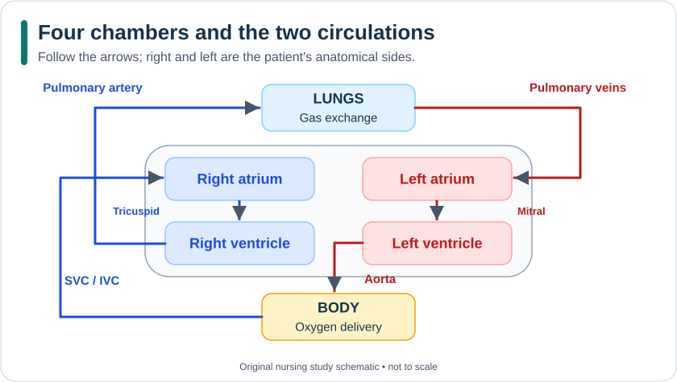

- 🔵 **Deoxygenated:** Body → SVC/IVC → RA → Tricuspid → RV → Pulmonary valve → Pulmonary artery → Lungs
- 🔴 **Oxygenated:** Lungs → Pulmonary veins → LA → Mitral → LV → Aortic valve → Aorta → Body
- 🧠 **Exam trap:** Artery means away from heart, not always oxygenated.

### 📚 Study pattern

- **Definition:** English medical terminology.
- **Concept:** Easy Hindi-English, with *why* and *how*.
- **Clinical:** Symptoms → mechanism → investigations → nursing priorities.
- **Visual:** Labelled diagram, flowchart, comparison table.
- **Practice:** Exam trap, original MCQ, separately sourced PYQ.

---

## Contents
- [Foundation and circulation](#foundation-and-circulation)
- [Coronary circulation and physiology](#coronary-circulation-and-physiology)
- [Assessment and investigations](#assessment-and-investigations)
- [ECG and dysrhythmias](#ecg-and-dysrhythmias)
- [Ischemic heart disease and ACS](#ischemic-heart-disease-and-acs)
- [Heart failure and cardiomyopathy](#heart-failure-and-cardiomyopathy)
- [Hypertension and vascular disorders](#hypertension-and-vascular-disorders)
- [Valve and inflammatory diseases](#valve-and-inflammatory-diseases)
- [Congenital and pediatric cardiovascular disease](#congenital-and-pediatric-cardiovascular-disease)
- [Shock resuscitation and critical care](#shock-resuscitation-and-critical-care)
- [Cardiac pharmacology and nursing procedures](#cardiac-pharmacology-and-nursing-procedures)
- [Revision and exam evidence](#revision-and-exam-evidence)
- [Original practice bank](#original-practice-bank)

## Foundation and circulation

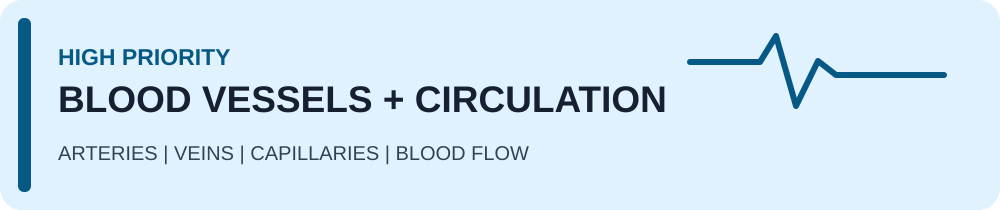

> **🟠 HIGH | Foundation and circulation**
> - 🎯 **Most important:** Blood flow sequence, vessels, valves, circulation exceptions
> - 🧠 **Exam trap:** Pulmonary artery carries deoxygenated blood; artery = away from heart
> - 📝 **PYQ status:** Exam-oriented emphasis; repeated NORCET/PGIMER/HPRCA PYQ frequency is **not verified** for this section.


**Visual 1 — Heart circulation:** Blue = oxygen-poor blood; red = oxygen-rich blood. Start at body, then RA → RV → lungs → LA → LV → body. Artery/vein ka naam direction se decide hota hai, oxygen content se nahi.

**English definition:** The cardiovascular system consists of the heart and blood vessels that circulate blood to deliver oxygen and nutrients and remove metabolic waste.

**Simple Hindi-English:** Heart ek pump hai; vessels delivery aur return ka network hain. Har cell ko oxygen aur nutrients pahunchte hain, waste remove hota hai. **Exam focus: Very High.**
**Very High:** anatomy, valve sounds and blood flow. Existing detailed nonduplicate foundation: [heart anatomy, layers, pericardium, cardiac muscle, embryology](Day-04-Heart-Anatomy-Pericardium-Cardiac-Muscle.md); [chambers, valves, septa, great vessels and auscultation](Day-04-Chambers-Valves.md). In dono ko isi master chapter ka Part 1 samjho; existing explanations aur diagrams wahan preserved hain.

- Heart ko do pumps samjho jo series mein kaam karte hain.
- Right pump oxygen-poor blood lungs bhejta hai; left pump oxygen-rich blood body ko.
- Artery heart se door, vein heart ki taraf; oxygen content definition nahi.
- Pulmonary artery aur veins classic exceptions to oxygen-content shortcut.
- Systemic aur pulmonary circuits ka flow long-term equal hota hai; imbalance congestion produce karta hai.

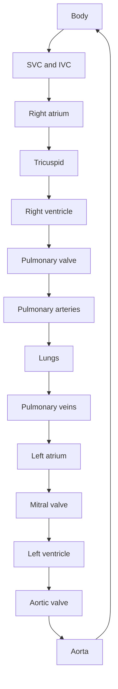

- Arteries: thick elastic/muscular media pressure handle karti hai.
- Arterioles resistance regulate karte hain; capillaries thin endothelial exchange surface; veins low-pressure capacitance reservoir, valves especially limbs mein backflow rokne mein help.
- Skeletal muscle pump aur breathing venous return support karte hain.
- Tunica intima endothelial lining, media smooth muscle, adventitia external support.
- Elastic arteries pulse dampen karte; muscular arteries distribution.
- Continuous capillaries muscle, fenestrated kidney/endocrine, sinusoidal liver/bone marrow.
- Hydrostatic pressure fluid outward push karta; plasma oncotic pressure outward filtration oppose karta.
- Lymphatic system excess interstitial fluid/protein return karta.
- Edema venous congestion, low albumin, permeability ya lymph obstruction se ho sakta.
- Clinical example: HF mein venous hydrostatic pressure badhkar edema; nephrotic syndrome mein albumin loss; unilateral lymph obstruction mein localized edema.

### Blood vessels, microcirculation and venous return — detailed concept

> **🟠 HIGH · 🎯 EXAM FOCUS** — Artery vs vein vs capillary; arterioles control resistance.
> **🧠 EXAM TRAP** — Pulmonary artery carries deoxygenated blood.
> **🩺 MCQ PRACTICE TARGET** — Compare vessel wall thickness, valves, pressure.
> **📌 PYQ EVIDENCE** — Specific repeated-question count not verified; this is a study-priority label, not a past-paper claim.


- Imagine ek city ka water supply: main pipe aorta, distribution pipes arteries, narrow adjustable taps arterioles, house ke paas exchange capillaries, aur return pipes veins.
- Arterioles ka radius thoda kam ho to resistance bahut badh sakti hai (ideal laminar tube mein R proportional 1/r⁴); actual vessels elastic hain, but concept useful.
- Vasodilation local blood supply badhati; exercise muscle metabolic products aur nitric oxide arterioles dilate karte hain.
- Sympathetic alpha-1 vasoconstriction skin/splanchnic blood flow redirect kar sakti hai.
- Veins mein large proportion blood stored hota hai; standing par gravity pooling, valves aur calf contraction return improve karte hain.
- Immobility → stasis → VTE risk.
- Capillary exchange mein hydrostatic pressure aur protein-related oncotic gradients important hain; classical exam arterial-end filtration/venous-end reabsorption model simplified hai, modern understanding mein most filtered fluid lymphatics return karte hain.
- Endothelial glycocalyx barrier bhi important.
- Nurse edema ko sirf fluid overload mat samjho: unilateral hot swelling DVT/infection, bilateral pitting edema HF/venous disease, nonpitting chronic lymphedema possibilities.
- Weight gain with edema, JVP, lung sounds and I/O combine karna clinical reasoning hai.
### Systemic, pulmonary and portal circuits

> **🟠 HIGH · 🎯 EXAM FOCUS** — Systemic vs pulmonary vs portal blood pathways.
> **🧠 EXAM TRAP** — Pulmonary veins carry oxygenated blood.
> **🩺 MCQ PRACTICE TARGET** — Trace each circulation from start to finish.
> **📌 PYQ EVIDENCE** — Specific repeated-question count not verified; this is a study-priority label, not a past-paper claim.


- Pulmonary circuit low pressure and resistance; systemic higher resistance.
- Portal circulation mein GI organs se blood portal vein through liver sinusoids, then hepatic veins → IVC.
- Renal artery blood kidneys ko, renal vein IVC ko.
- Arteries carry blood away from heart regardless oxygenation, veins towards.
- Pulmonary veins aur umbilical vein oxygenated exceptions.
- Blood pressure falls across resistance arterioles, velocity lowest at capillary bed because collective cross-sectional area highest.
- Exercise mein muscle flow rises while resting demand of other organs differs.
- 

## Coronary circulation and physiology

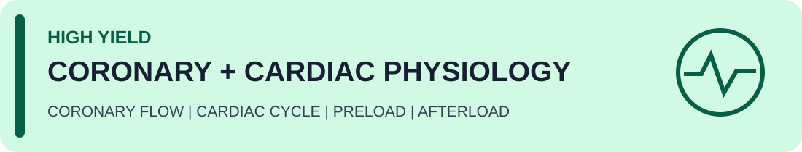

> **🔴 VERY HIGH | Coronary circulation and physiology**
> - 🎯 **Most important:** Coronary arteries, cardiac cycle, CO = HR × SV, preload/afterload
> - 🧠 **Exam trap:** Left coronary perfusion is predominantly during diastole
> - 📝 **PYQ status:** Exam-oriented emphasis; repeated NORCET/PGIMER/HPRCA PYQ frequency is **not verified** for this section.


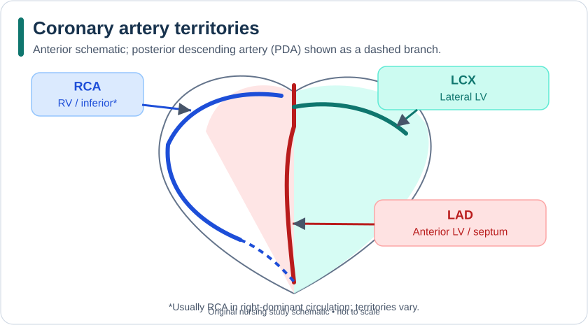

**Visual 2 — Coronary arteries:** LAD supplies anterior LV/anterior septum, LCX lateral LV, RCA commonly inferior wall and RV. Dominance is defined by PDA origin; anatomical variation possible.

**English definition:** Coronary circulation supplies the myocardium, while cardiac physiology explains how electrical activation, pressure, and contraction generate blood flow.

**Hindi-English explanation:** Heart body ko blood bhejta hai, lekin apne muscle ko bhi oxygen chahiye. Coronary arteries ye kaam karti hain. Heart ki pumping pressure aur valve movement par depend karti hai. **Very High.**
**Very High:** LAD, RCA, LCX; cardiac cycle, CO, EF, preload/afterload.
- Left main coronary artery usually LAD aur circumflex mein divide.
- LAD anterior LV, apex aur anterior two-thirds septum ko supply karti hai.
- LCX lateral LV; RCA commonly RV, inferior LV aur nodal branches; dominance PDA origin se define hoti hai, most commonly RCA.
- Variations common.
- Coronary sinus RA mein venous blood return karta.
- LV coronary flow mainly diastole mein: systole mein contracting muscle intramyocardial vessels compress karta.
- Tachycardia supply time ghata aur oxygen demand badha sakti hai.
- Coronary perfusion aortic diastolic pressure aur ventricular filling pressure gradient se related hai.

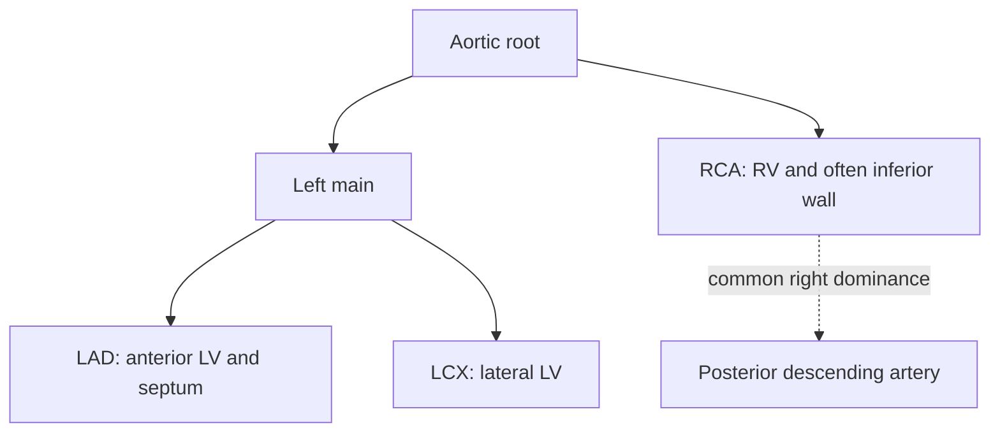

- Cardiac cycle ek heartbeat ke electrical aur mechanical events ka sequence hai.
- 75/min par total approximately 0.8 sec; textbook atrial systole 0.1 sec, ventricular systole 0.3 sec, remaining joint relaxation 0.4 sec (rate dependent).
- Atrial contraction ventricular filling finish karti; ventricle pressure badhne par AV valves close (S1), all valves closed isovolumetric contraction.
- Ventricular pressure arterial se greater hote hi semilunar valves open, ejection.
- Pressure girte hi semilunar close (S2), isovolumetric relaxation.
- Ventricular pressure atrial se lower hone par AV open, rapid filling then slower diastasis.
- S3 early rapid filling; children/young adults mein physiological, older symptomatic adult mein volume overload/HF clue.
- S4 stiff ventricle mein atrial contraction se, AF mein absent because organized atrial contraction nahi.
- Mechanical events electrical events ko follow karte hain.

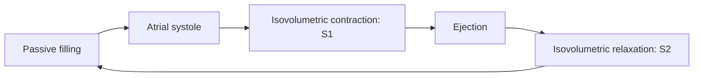

| Parameter | Formula and meaning |
|---|---|
| SV | EDV − ESV; one beat ka output |
| CO | HR × SV; usual resting adult approx 4–8 L/min |
| EF | SV/EDV × 100; normal LV about 50–70%, lab/sex dependent |
| Cardiac index | CO/body surface area; approx 2.5–4 L/min/m² |
| Pulse pressure | SBP − DBP |
| MAP | (SBP + 2 DBP)/3, approximate at normal rates |
| SVR | systemic vascular resistance; afterload ka contributor |

Example: EDV 120 mL, ESV 50 mL → SV 70 mL. HR 72 → 5040 mL/min = 5.04 L/min. EF 70/120 = 58.3%. BP 120/80 → pulse pressure 40; MAP ≈93 mmHg. CO aur EF same nahi: preserved EF ke bawajood small ventricle se low SV possible.

- Preload = end-diastolic myocardial stretch, filling/venous return se related.
- Frank-Starling: physiological range mein more filling → more contraction force.
- Failing heart mein extra filling excessive congestion de sakti hai.
- Afterload = ejection ke against load; systemic hypertension LV afterload increase.
- Contractility = intrinsic force independent of loading conditions; sympathetic beta-1 increases, ischemia decreases.
- HR high hone par initially CO increase but excessive HR filling reduce karta.
- Positive chronotropy HR up, inotropy force up, dromotropy conduction up, lusitropy relaxation enhance.
- Vagus HR/AV conduction slow; sympathetic opposite.
- Baroreceptors carotid sinus/aortic arch BP stretch sense; low BP → reduced firing → sympathetic increase; kidneys renin release → angiotensin II vasoconstriction and aldosterone sodium retention.
- ADH water retention, ANP/BNP natriuresis signal.
- Long term excessive RAAS activation HF remodeling worse kar sakti.

### Cardiac cycle deep dive — pressure-volume relationship and Wiggers diagram

> **🔴 VERY HIGH · 🎯 EXAM FOCUS** — Systole/diastole, valve opening, S1/S2, preload and afterload.
> **🧠 EXAM TRAP** — S1 = AV valves close; S2 = semilunar valves close.
> **🩺 MCQ PRACTICE TARGET** — Link ECG, pressure and valve events.
> **📌 PYQ EVIDENCE** — Specific repeated-question count not verified; this is a study-priority label, not a past-paper claim.


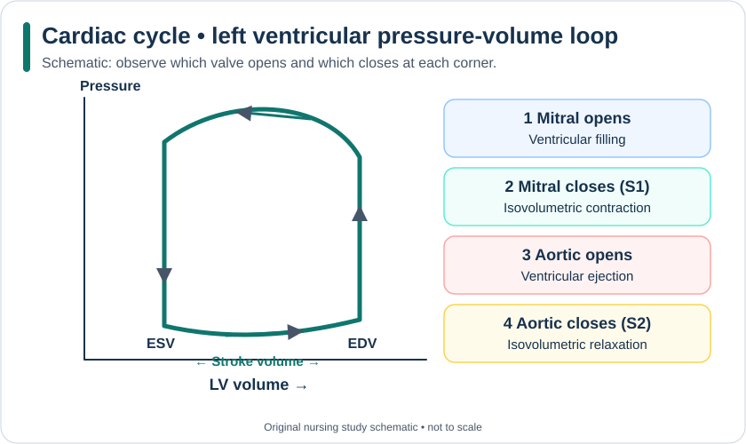

**Visual 3 — Pressure-volume loop:** Filling increases volume, isovolumetric contraction increases pressure, ejection decreases volume, and relaxation decreases pressure. Loop width = stroke volume. This is a PV loop, not a complete Wiggers tracing.
- Think pump ek room hai jisme inlet/outlet doors pressure difference se khulte hain.
- Passive filling mein AV valves open, semilunar closed.
- Atrial kick last filling contribution hai, roughly 10–30% variable; stiff ventricle depends more on it.
- AF mein kick lose hone se HFpEF patient suddenly dyspneic ho sakta.
- At EDV, mitral closes when LV exceeds LA pressure.
- Both doors closed, pressure rises but volume same.
- Aortic opens once LV exceeds aortic pressure.
- Ejection rapidly then slowly as pressure falls.
- ESV remaining volume.
- Aortic closes when pressure gradient reverses, notch arterial trace par.
- All valves closed again while pressure falls.
- Mitral opens once LV below LA.
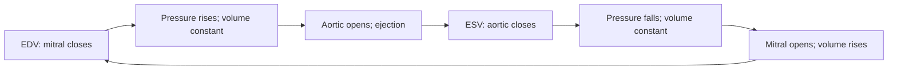
- PV loop mein x volume and y pressure: width SV, enclosed area stroke work.
- Increased preload usually loop right/wider; increased afterload initially ESV higher, SV lower; increased contractility ESV lower, SV higher.
- Aortic stenosis increases LV pressure load, while MR loses true isovolumetric phases because blood leaks.
- Normal example LV approximately 120/5–12 mmHg, RV 25/2–8, PA 25/10, aorta ~120/80; ranges vary.
- Why RV thinner? Same flow but low-resistance pulmonary circuit.
- Normal BP alone doesn't assure adequate CO if SVR high.
### Oxygen delivery, exercise and autonomic control

> **🟠 HIGH · 🎯 EXAM FOCUS** — CO = HR × SV; tissue oxygen delivery and autonomic response.
> **🧠 EXAM TRAP** — Normal SpO₂ alone does not prove adequate tissue perfusion.
> **🩺 MCQ PRACTICE TARGET** — Practice CO calculations.
> **📌 PYQ EVIDENCE** — Specific repeated-question count not verified; this is a study-priority label, not a past-paper claim.


- Oxygen delivery depends CO and arterial oxygen content, not SpO2 alone.
- Anemia patient 99% saturation but low Hb may still deliver less oxygen.
- Fick principle CO = oxygen consumption / arteriovenous oxygen content difference; if VO2 250 mL/min and difference 50 mL/L, CO 5 L/min.
- Exercise HR and SV rise; trained resting bradycardia may coexist with larger SV.
- Fever/tachycardia raises demand; beta blockers can blunt HR response.
- Rate-pressure product HR × SBP rough myocardial workload indicator.
- 
- Baroreflex short-term, renal RAAS long-term; carotid sinus senses pressure (IX nerve) and aortic arch (X); carotid bodies primarily blood chemistry.
- Angiotensin II also stimulates thirst, ADH and aldosterone.
- Aldosterone distal nephron sodium retention and K excretion; ACE inhibition reduces angiotensin II and raises bradykinin (cough).
- BNP released with ventricular stretch, promotes natriuresis and counter-regulation.
- These links explain why HF meds influence BP, fluid and electrolytes.
**Exam traps:** CO vs cardiac index; ejection fraction vs stroke volume; preload vs afterload; arteries vs oxygenation; carotid sinus vs carotid body. Source: [Cardiac cycle](https://openstax.org/books/anatomy-and-physiology-2e/pages/19-3-cardiac-cycle), [physiology](https://openstax.org/books/anatomy-and-physiology-2e/pages/19-4-cardiac-physiology).

## Assessment and investigations

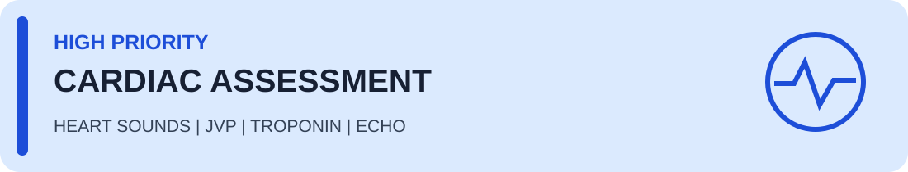

> **🟠 HIGH | Assessment and investigations**
> - 🎯 **Most important:** Heart sounds, pulse/BP, troponin, echo, ECG, catheterization
> - 🧠 **Exam trap:** Troponin is myocardial injury marker; interpret with clinical context
> - 📝 **PYQ status:** Exam-oriented emphasis; repeated NORCET/PGIMER/HPRCA PYQ frequency is **not verified** for this section.


**English definition:** Cardiovascular assessment evaluates perfusion, rhythm, congestion, structural function and symptoms through history, examination and targeted testing.

**Hindi-English:** Sirf BP dekhkar patient stable assume mat karo. Pulse, mental status, urine, breathing, JVP aur ECG bhi evaluate karo. **Very High.**
**Very High:** chest pain, pulses, JVP, ECG, troponin, echo, cath and nursing priorities.
- History: onset/provocation/quality/radiation/severity/time; dyspnea on exertion, orthopnea, PND (sleep se breathlessness), syncope, palpitations, weight gain, edema, claudication.
- Diabetes/older adults/women may have nonclassic ischemic symptoms; no chest pain does not exclude ACS.
- Assess ABC, mental status, skin warmth, peripheral pulses, refill, respiratory effort, oxygen saturation, BP both arms if dissection suspected, apical pulse/rhythm.
- JVP assess at 30–45 degrees, right internal jugular waveform; >3–4 cm above sternal angle often elevated.
- JVP RA pressure estimate, carotid pulsation palpable and single upstroke; JVP nonpalpable and position-dependent.
- Avoid simultaneous carotid palpation.

- BP: correct cuff size, rest 5 minutes, arm heart level, feet flat, no talking, repeat.
- Too small cuff falsely high; arm below heart falsely high.
- Orthostatic hypotension commonly drop ≥20 systolic or ≥10 diastolic within 3 min standing, with symptoms/fall risk.
- Record baseline position and reassess.
- Pulse deficit = simultaneous apical minus radial rates (e.g.
- AF).
- Edema grade local convention; daily weight more useful trend for fluid balance.
- Abnormal findings: cold extremities poor perfusion, cyanosis oxygenation issue, clubbing chronic hypoxemia or other disease, elevated JVP systemic congestion.

Investigations:
- 12-lead ECG electrical activity; serial ECG if symptoms continue. Troponin myocardial injury marker, rise/fall and ischemic evidence needed for MI; renal failure, myocarditis, sepsis can also elevate. CK-MB older marker not preferred when high-sensitivity troponin available. BNP/NT-proBNP cardiac wall stress supports HF but not standalone.
- Echo structural/functional: EF, wall motion, valve lesion, effusion; TEE close view left atrium/valves, sedation/fasting per protocol, gag reflex recovery before oral intake.
- Chest X-ray congestion, cardiomegaly, effusion; normal X-ray not exclusion. Stress testing stable selected patients, not active ACS/unstable arrhythmia. Holter ambulatory recording for intermittent symptoms. Lipids, HbA1c, renal/electrolytes, CBC, coagulation as indicated.
- Angiography contrast maps coronary lumen; PCI opens stenosis. Pre: consent verification, allergies/previous contrast reaction, kidney function, baseline pulses, medications, fasting per protocol. Post: bleeding/hematoma, distal pulse, color, temperature, sensation, BP, HR, access-specific restrictions. Radial band/bedrest per local orders. Femoral bleed may be hidden (back/flank pain, falling BP, tachycardia). Escalate immediately. No universal fixed bedrest duration.
- Hemodynamic monitoring: CVP approx 2–6 mmHg, PAOP approx 6–12 mmHg as textbook reference; influenced by ventilation and position. Level/zero transducer at phlebostatic axis (4th ICS mid-axillary approximate). Arterial line for continuous BP and sampling, never routine medication injection. Check waveform, distal perfusion, infection, secure lines. Low transducer false high. Lactate and urine output (often target ≥0.5 mL/kg/h) help evaluate perfusion.

### Bedside examination — systematic nursing workflow

> **🟠 HIGH · 🎯 EXAM FOCUS** — Chest pain, pulse, BP, capillary refill, heart sounds.
> **🧠 EXAM TRAP** — Assess unstable patient before routine history.
> **🩺 MCQ PRACTICE TARGET** — Choose first nursing assessment.
> **📌 PYQ EVIDENCE** — Specific repeated-question count not verified; this is a study-priority label, not a past-paper claim.


- First patient looks sick? If severe breathlessness, shock, altered consciousness or ongoing chest pain, emergency assessment before long history.
- Stable patient history includes medication adherence, anticoagulant bleeding, smoking, family premature CAD, congenital surgery, baseline functional capacity.
- NYHA classes: I no symptom limitation with ordinary activity; II slight limitation; III marked limitation; IV symptoms at rest.
- Document symptoms and activity not just label.
- Inspection: chest scars, respiratory effort, cyanosis, edema, visible pulsations.
- Palpation: PMI position, duration and displacement; sustained heave pressure overload clue; thrill palpable turbulent flow.
- Auscultate systematic valve sites in quiet room: diaphragm for higher-pitched S1/S2 and regurgitation, bell lightly at apex for low-frequency MS/S3/S4.
- Left lateral decubitus brings apex closer; sitting forward at end expiration can accentuate AR.
- Inspiration usually increases right-sided murmurs (Carvallo sign TR).
- Physiologic S2 splitting widens inspiration.
- Fixed split ASD; paradoxical split may be delayed A2 (LBBB/severe AS).
- Murmur intensity grade 1–6 does not equal severity; low-flow severe stenosis can be quiet.
- Never diagnose by sound alone.
### JVP waveform and peripheral examination

> **🟠 HIGH · 🎯 EXAM FOCUS** — JVP elevation, edema and peripheral pulses.
> **🧠 EXAM TRAP** — JVP reflects right atrial pressure, not left ventricular EF directly.
> **🩺 MCQ PRACTICE TARGET** — Differentiate right-sided congestion.
> **📌 PYQ EVIDENCE** — Specific repeated-question count not verified; this is a study-priority label, not a past-paper claim.


- a wave atrial contraction, c tricuspid bulging/early systole, v venous filling against closed tricuspid; x descent atrial relaxation, y descent ventricular filling.
- AF absent organized a wave; AV dissociation intermittent cannon a waves; TR prominent systolic v wave; tamponade often preserved x and blunted y.
- These are classic patterns, not mandatory.
- Hepatojugular reflux sustained JVP rise with abdominal pressure suggests elevated filling pressures.
- Check radial, brachial, femoral, popliteal, dorsalis pedis, posterior tibial pulses as appropriate; compare sides, grade local standard.
- Pulse character: bounding AR, slow-rising severe AS, alternating strong/weak pulsus alternans LV dysfunction.
- Pulsus paradoxus >10 mmHg inspiratory systolic drop also severe asthma possible.
### Tests: what question does each answer?

> **🟠 HIGH · 🎯 EXAM FOCUS** — ECG, troponin, echo, BNP and angiography indications.
> **🧠 EXAM TRAP** — Troponin elevation has non-MI causes.
> **🩺 MCQ PRACTICE TARGET** — Select appropriate investigation.
> **📌 PYQ EVIDENCE** — Specific repeated-question count not verified; this is a study-priority label, not a past-paper claim.


| Test | Clinical question | Nurse preparation / follow-up |
|---|---|---|
| ECG | electrical rhythm and ischemia clues | clean/dry skin, correct lead placement, compare prior |
| Echo/TTE | structure, motion, EF, pressure estimates | explain painless ultrasound, positioning |
| TEE | detailed valves, atrial thrombus, aorta | check swallowing/esophageal history, fasting and sedation policy, post procedure airway/swallow |
| Stress ECG/echo | inducible ischemia in selected stable patient | baseline ECG, contraindication screen, meds per order, stop for concerning symptoms |
| CT coronary angiography | noninvasive coronary anatomy | contrast and renal assessment, HR control if ordered |
| Cardiac MRI | tissue characterization/scar/myocarditis | implant/MRI safety, contrast policy |
| Coronary angiography | lumen anatomy and possible intervention | consent, bleeding/renal checks, neurovascular baseline |
| Blood culture | organism in suspected endocarditis | aseptic sampling before antibiotics when feasible |
| BNP/NT-proBNP | filling pressure/wall stress clue | interpret age, renal function, obesity and clinical context |
Serial values matter: acute rise/fall troponin is injury, clinical ischemia needed for MI diagnosis. High-sensitivity assays use lab-specific thresholds and timing. No fixed universal normal troponin number. 
### Nursing case: post-catheterization

> **🟠 HIGH · 🎯 EXAM FOCUS** — Femoral puncture site, distal pulses, bleeding and hematoma.
> **🧠 EXAM TRAP** — Back pain with hypotension may signal retroperitoneal bleeding.
> **🩺 MCQ PRACTICE TARGET** — Identify urgent post-catheterization complication.
> **📌 PYQ EVIDENCE** — Specific repeated-question count not verified; this is a study-priority label, not a past-paper claim.


- A stable patient becomes restless, HR rises, BP falls, puncture dressing looks dry.
- Don't assume anxiety.
- ABC, call team, repeat BP/pulse, inspect access and back/flank symptoms, maintain ordered positioning, check Hb and perfusion per team.
- Femoral retroperitoneal bleeding can be invisible.
- Contrast-associated AKI risk higher with renal impairment; fluid plans individualized (HF risk).
- Access limb pain/coolness/absent pulse urgent.
- Radial access generally lower bleeding risk but radial occlusion/hematoma possible.
- [Assessment source](https://openstax.org/books/clinical-nursing-skills/pages/24-3-nursing-assessment).

## ECG and dysrhythmias

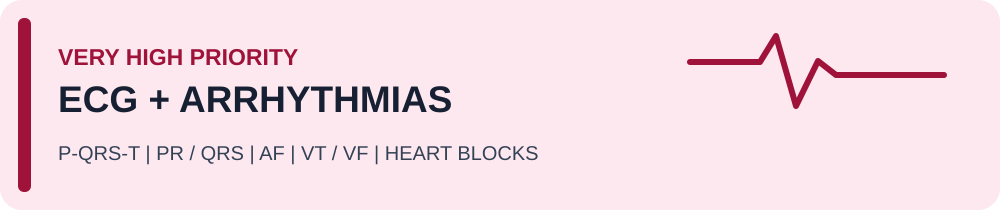

> **🔴 VERY HIGH — MUST REVISE | ECG and dysrhythmias**
> - 🎯 **Most important:** P-QRS-T, PR/QRS intervals, rhythm identification, AF, VT/VF, heart blocks
> - 🧠 **Exam trap:** VF/pulseless VT are shockable; asystole/PEA are not
> - 📝 **PYQ status:** Exam-oriented emphasis; repeated NORCET/PGIMER/HPRCA PYQ frequency is **not verified** for this section.


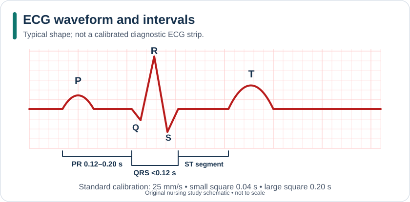

**Visual 4 — Normal ECG:** P = atrial depolarization; QRS = ventricular depolarization; T = ventricular repolarization. PR interval includes P; ST segment starts after QRS. ECG is electrical activity, not proof of pulse.

**English definition:** An electrocardiogram records electrical potential changes generated by the heart; a dysrhythmia is an abnormality of impulse formation or conduction.

**Hindi-English:** ECG electrical signal dikhata hai, directly pumping force nahi. Isliye abnormal tracing par patient aur pulse bhi check karo. **Very High.**
**Very High, case and image based.** SA node intrinsic normal sinus 60–100/min, AV junction escape 40–60, ventricular escape 20–40 approx. SA initiates; AV delay allows filling; His/bundle branches/Purkinje distribute fast coordinated ventricular activation. Pacemaker phase 4 spontaneous depolarization; calcium-mediated upstroke in nodal cells. Working myocyte fast sodium upstroke, calcium plateau, potassium repolarization. Long refractory period prevents tetany.

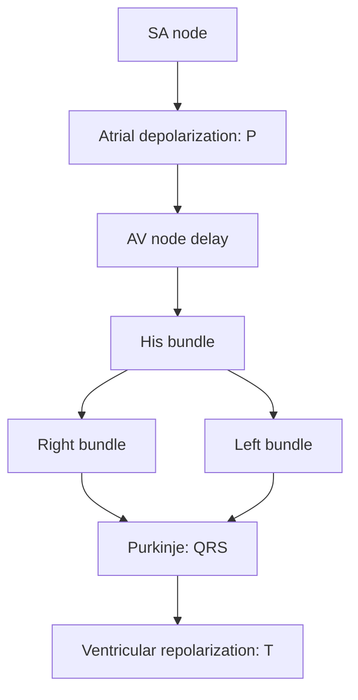

```text
                       R
                       /\
 baseline ___/P\______/  \__S______/T\____
             |<--PR-->|           ST/T
               QRS: Q to S (schematic, not to scale)
```
- At 25 mm/s, small square 0.04 s, large 0.20 s; amplitude standard 10 mm/mV.
- P atrial depolarization, PR 0.12–0.20 s, QRS normally <0.12 s, T ventricular repolarization.
- Atrial repolarization hidden in QRS.
- QT rate-dependent (use QTc; marked prolongation around >500 ms concerning).
- ST normally near baseline.
- Regular rate 300/large squares, 1500/small squares; irregular count QRS in 6 sec ×10.
- 10 electrodes produce 12 leads.
- Limb leads I II III aVR aVL aVF, chest V1 fourth ICS right sternum; V2 fourth left; V4 fifth left MCL; V3 halfway V2/V4; V5 anterior axillary and V6 midaxillary level with V4.
- Inferior II III aVF; septal V1 V2; anterior V3 V4; lateral I aVL V5 V6; posterior V7–V9, right V4R if indicated.
- Always check patient before treating monitor artifact.

| Rhythm | Clue | Nursing/clinical priority |
|---|---|---|
| Sinus brady/tachy | P before each QRS, rate abnormal | Treat cause; symptomatic brady protocol, unstable tachy evaluate |
| AF | Irregularly irregular, no distinct P | Stability, rate/rhythm strategy, stroke-risk anticoagulation assessment |
| Flutter | Sawtooth waves, variable conduction | Stability and embolic risk |
| SVT | Often regular narrow rapid rhythm | Stable: vagal/adenosine if appropriate; unstable synchronized cardioversion |
| PVC | Premature wide QRS | Symptoms, electrolytes, ischemia; isolated not always emergency |
| VT | Wide rapid complexes | Pulse and stability determine shock approach |
| VF | Chaotic, no organized QRS, no pulse | CPR and defibrillation |
| Asystole | No meaningful electrical activity | Confirm leads/rhythm, CPR and epinephrine |
| PEA | Organized tracing but no pulse | CPR, epinephrine, reversible causes |
| First-degree AV block | PR >0.20 s, no dropped beat | Observe cause/symptoms |
| Mobitz I | Progressive PR, then dropped QRS | Monitor and assess |
| Mobitz II | Fixed conducted PR, unexpected dropped QRS | High risk progression, urgent evaluation/pacing readiness |
| Third-degree | Atrial and ventricular dissociation | Urgent assessment, pacing often required |

- Torsades polymorphic VT with prolonged QT, correct electrolytes, magnesium per protocol, shock if sustained unstable/pulseless.
- Hyperkalemia peaked T, later widened QRS; hypokalemia flattened T/U waves; ECG alone cannot exclude electrolyte disorder.
- ECG exam trick: electrical rhythm ≠ mechanical pulse.
- Stable vs unstable signs include hypotension, acute altered mentation, shock, ischemic pain, acute HF caused by rhythm.

### ECG interpretation method — read every strip in same order

> **🔴 VERY HIGH · 🎯 EXAM FOCUS** — Rate, rhythm, P waves, PR, QRS and ST-T changes.
> **🧠 EXAM TRAP** — Irregularly irregular rhythm suggests AF; confirm on tracing.
> **🩺 MCQ PRACTICE TARGET** — Calculate rate from ECG squares.
> **📌 PYQ EVIDENCE** — Specific repeated-question count not verified; this is a study-priority label, not a past-paper claim.


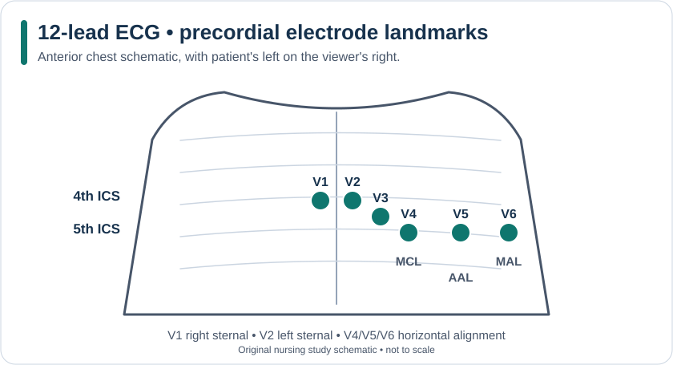

**Visual 5 — Chest leads:** V1 and V2 at fourth intercostal space, V4 at fifth left midclavicular, V3 between V2 and V4, V5/V6 level with V4. Diagram is anterior/oblique simplified; use anatomical landmarks at bedside.
1. Verify patient, lead, calibration and artifact. 2. Rate: regular use 300 method, irregular count 6 seconds. 3. Regularity: compare R-R and P-P. 4. P wave: present, same shape, before each QRS? 5. PR interval consistent? 6. QRS width and morphology. 7. ST/T and QTc; compare clinical symptoms. Normal sinus rhythm requires sinus P morphology, 1:1 relation and consistent PR. A narrow QRS suggests supraventricular origin or conduction through normal pathways; wide QRS may be VT, aberrancy or pacing. Assume uncertain wide tachycardia is VT until expert evaluation. 
Example: 20 small squares between R peaks → 1500/20=75/min. On 6-second strip 9 complexes → 90/min average. PR 6 small squares =0.24 s. QRS 4 squares =0.16 s. These are different measurements: don't confuse PR segment with PR interval.
### Action potential, arrhythmia mechanisms

> **🟠 HIGH · 🎯 EXAM FOCUS** — Pacemaker automaticity, conduction and re-entry.
> **🧠 EXAM TRAP** — AV nodal vs ventricular conduction differ.
> **🩺 MCQ PRACTICE TARGET** — Relate conduction to ECG intervals.
> **📌 PYQ EVIDENCE** — Specific repeated-question count not verified; this is a study-priority label, not a past-paper claim.


- Working myocyte phase 0 fast Na influx; phase 1 early repolarization; phase 2 calcium influx balanced K outward (plateau, contraction); phase 3 K outward repolarization; phase 4 resting potential.
- SA/AV nodal phase 4 spontaneous funny current and calcium contribution, phase 0 calcium dependent, phase 3 K repolarization.
- Automaticity abnormal impulse initiation; reentry circuit can perpetuate SVT/VT; triggered activity afterdepolarizations can occur in long QT or digoxin toxicity.
- Electrolytes/ischemia/drugs can cause arrhythmias.
```text
Sinus:    p-QRS-t    p-QRS-t    p-QRS-t
AF:       ~QRS~~ QRS~~~~~QRS~QRS     (irregular)
Flutter:  /\/\/\/\QRS/\/\/\/\QRS  (sawtooth schematic)
Mobitz I: p--QRS p---QRS p----QRS p [drop]
Mobitz II:p--QRS p--QRS p [drop] p--QRS
Complete: p    p    p    p    p    (atrial)
             QRS       QRS       (independent ventricle)
```
Schematic only, not diagnostic tracings. For actual illustrated strips use [OpenStax dysrhythmia](https://openstax.org/books/medical-surgical-nursing/pages/12-2-dysrhythmia).
### Supraventricular and ventricular rhythms — nurse priorities

> **🔴 VERY HIGH · 🎯 EXAM FOCUS** — AF, SVT, VT, VF, AV block and instability.
> **🧠 EXAM TRAP** — Pulseless VT/VF shockable; PEA/asystole not.
> **🩺 MCQ PRACTICE TARGET** — Identify rhythm and immediate action.
> **📌 PYQ EVIDENCE** — Specific repeated-question count not verified; this is a study-priority label, not a past-paper claim.


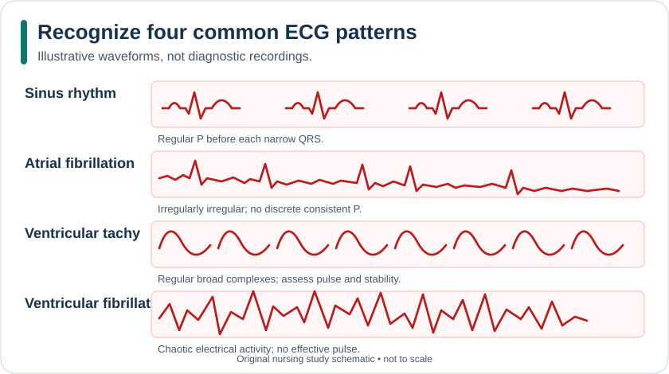

**Visual 6 — Rhythm recognition:** Compare organized P waves, R-R regularity, QRS width and pulse. These strips are schematic; clinical ECG interpretation also uses calibration, actual leads and patient assessment.
- PAC early abnormal P usually narrow QRS; premature beat may feel skipped.
- PVC early wide complex without preceding normal P, often compensatory pause; bigeminy every other beat, couplet two in sequence.
- Multifocal PVC differing morphologies.
- Frequent symptoms/ischemia/electrolyte imbalance need assessment; not every PVC needs antiarrhythmic.
- AF rate may be slow/normal/rapid; embolic risk based on clinical score and bleeding assessment, not symptoms alone.
- Planned cardioversion of AF of prolonged/unknown duration requires thrombus-risk strategy (anticoagulation or imaging per guideline); unstable patients emergency cardioversion not delayed solely for this.
- Flutter atrial circuit often around 250–350/min; 2:1 conduction ventricular ~150, can mimic sinus tachy.
- SVT may start/stop abruptly, palpitations and dizziness; stable selected narrow regular cases vagal maneuver/adenosine protocol.
- Adenosine transient AV block and flushing/chest discomfort; not an AF conversion drug.
- VT monomorphic regular wide; sustained generally ≥30 sec or requiring termination earlier for instability.
- VF disorganized no effective contraction.
- Torsades twists around baseline, often QT prolongation from drugs/low K/Mg.
- Polymorphic sustained unstable rhythm requires unsynchronized shock.
- Asystole check electrodes and another lead without delaying CPR.
- PEA includes normal-looking electrical activity but no pulse; treat cause not tracing alone.
Bundle branch block: QRS ≥0.12 s, RBBB typical terminal R in V1 and broad S in I/V6; LBBB broad/notched lateral R and deep S V1, complicates ischemia interpretation. New LBBB alone not automatically STEMI; clinical and ECG criteria needed. WPW preexcitation short PR, delta wave, wide QRS; irregular preexcited AF avoid AV nodal blockers and obtain urgent expert treatment. 
**High yield case:** HR 170 regular narrow, BP 72/40, confused: stability first, synchronized cardioversion under protocol. HR 170 due to hemorrhage sinus tachy: treat hemorrhage, don't shock compensatory rhythm. Distinguish rhythm causing instability from physiological response.

## Ischemic heart disease and ACS

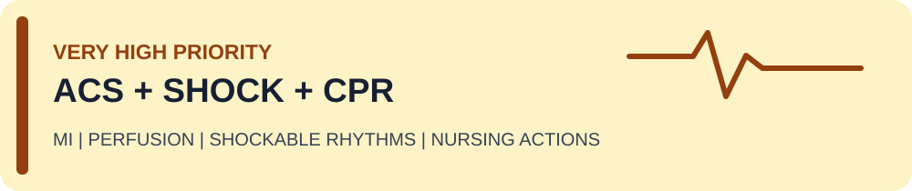

> **🔴 VERY HIGH — MUST REVISE | Ischemic heart disease and ACS**
> - 🎯 **Most important:** Stable angina vs ACS, STEMI/NSTEMI, ECG changes, troponin, urgent nursing priorities
> - 🧠 **Exam trap:** Normal initial troponin does not exclude early MI
> - 📝 **PYQ status:** Exam-oriented emphasis; repeated NORCET/PGIMER/HPRCA PYQ frequency is **not verified** for this section.


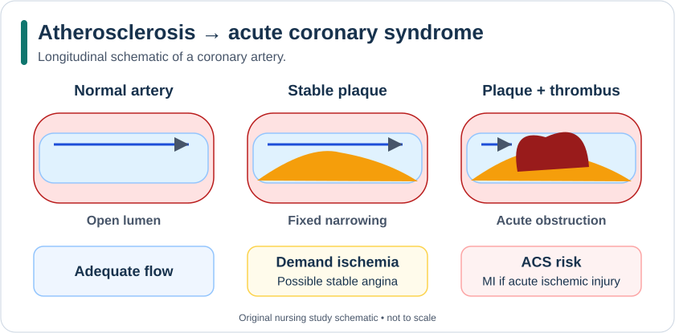

**Visual 7 — CAD vs ACS:** Stable plaque can narrow lumen; plaque disruption and thrombus can acutely reduce coronary flow. Stable angina ≠ MI; infarction requires acute myocardial injury with ischemia.

**English definition:** Myocardial ischemia occurs when oxygen supply is inadequate for demand; myocardial infarction involves acute myocardial injury due to ischemia.

**Hindi-English:** Jab coronary artery se oxygen kam milti hai, chest pain ho sakta hai. Agar ischemia myocardial cells ko injure kare, MI ho sakta hai. **Very High.**
**Very High:** risk factors, types of angina, MI ECG, biomarkers, drugs and complications.
- Atherosclerosis: endothelial dysfunction → lipid entry/inflammation → plaque → narrowing or rupture/thrombosis.
- Fixed stenosis causes demand ischemia (stable angina); acute plaque event may cause ACS.
- Modifiable risks tobacco, HTN, diabetes, dyslipidemia, sedentary lifestyle; age/family history nonmodifiable.
- Stable angina predictable on exertion, relieved rest/nitro; unstable new/worsening/rest pain without acute infarction biomarkers; vasospastic often rest/transient ST elevation.
- NSTEMI acute ischemic injury without persistent ST elevation; STEMI acute occlusion pattern requiring urgent reperfusion.
- ECG and serial hs-troponin plus symptoms together; early troponin may be negative.
- Do not wait for troponin to activate clear STEMI pathway.

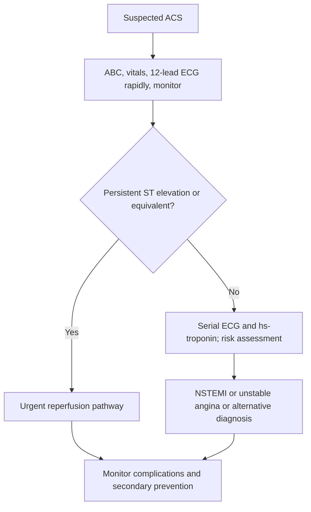

- First nursing steps: urgent emergency escalation, rest, monitoring, IV access per protocol, ECG ideally within 10 minutes of first medical contact, prescribed chewable aspirin if no contraindication, oxygen if hypoxemic (not routine at normal saturation), nitrate only after BP/contraindications including recent PDE5 inhibitor and suspected RV infarction evaluated; analgesia individualized.
- MONA is old memory aid, not mandatory order.
- STEMI primary PCI preferred when timely; fibrinolysis selected eligible STEMI if timely PCI unavailable, not NSTEMI, screen bleeding/dissection contraindications.
- Typical guideline target first medical contact-to-device ≤90 min PCI-capable and ≤120 min transfer setting; local system protocols.
- Dual antiplatelet therapy, anticoagulation, high-intensity statin and other drugs as indicated; bleeding monitoring.
- CABG bypasses stenotic arteries using grafts (internal mammary, radial, saphenous vein).
- Complications early arrhythmia, HF, shock; mechanical papillary muscle rupture (acute MR), VSD, free-wall rupture/tamponade; later ventricular aneurysm, thrombus, post-MI pericarditis.
- New murmur with shock after MI emergency.
- RV infarct hypotension + JVP high + clear lungs, avoid blindly reducing preload.
- Post MI rehab gradual activity, smoking cessation, medication adherence, warning signs, psychological support.
- Source [2025 ACS guidance](https://professional.heart.org/en/science-news/2025-guideline-for-the-management-of-patients-with-acute-coronary-syndromes).

### ACS from cell injury to clinical finding

> **🔴 VERY HIGH · 🎯 EXAM FOCUS** — Plaque rupture, ischemia, troponin and ECG changes.
> **🧠 EXAM TRAP** — Early negative troponin does not rule out ACS.
> **🩺 MCQ PRACTICE TARGET** — Distinguish STEMI/NSTEMI/unstable angina.
> **📌 PYQ EVIDENCE** — Specific repeated-question count not verified; this is a study-priority label, not a past-paper claim.


- When coronary oxygen delivery falls, aerobic ATP generation decreases, anaerobic metabolism and acidosis occur, relaxation impaired early then contraction.
- Persistent severe ischemia causes irreversible injury.
- Subendocardium particularly vulnerable; ECG changes can evolve from hyperacute T, ST elevation/depression, T inversion, pathological Q depending territory/time/reperfusion.
- Not every infarct has Q waves, not every ST elevation infarct (pericarditis, early repolarization etc.).
- Troponin identifies myocardial injury not exact artery.
- Type 1 MI plaque disruption with thrombosis; type 2 MI ischemic oxygen supply-demand mismatch without acute atherothrombosis (e.g.
- severe anemia/tachyarrhythmia); treatment depends mechanism.
### Chest pain differentiation

> **🟠 HIGH · 🎯 EXAM FOCUS** — Angina, MI, pericarditis, dissection and PE red flags.
> **🧠 EXAM TRAP** — Tearing pain with pulse deficit raises dissection concern.
> **🩺 MCQ PRACTICE TARGET** — Choose urgent differential diagnosis.
> **📌 PYQ EVIDENCE** — Specific repeated-question count not verified; this is a study-priority label, not a past-paper claim.


| Condition | Typical feature (not exclusion rule) |
|---|---|
| Stable angina | predictable effort-related pressure, relief with rest |
| ACS | new/prolonged/rest or worsening pressure, sweating, nausea, breathlessness |
| Pericarditis | sharp, positional/pleuritic |
| Aortic dissection | abrupt severe chest/back pain, pulse asymmetry possible |
| PE | pleuritic pain, dyspnea, tachycardia, VTE risk |
| Reflux/musculoskeletal | burning or reproducible pain, but coexistence possible |
Do not use pain relief after nitro to prove coronary origin. Record onset and baseline pain, reassess after prescribed therapy. Acute ischemia patient may be anxious, nauseated, pale, sweaty; older diabetic may present fatigue or breathlessness only.
### Reperfusion and aftercare

> **🟠 HIGH · 🎯 EXAM FOCUS** — PCI, reperfusion timing, antiplatelets and monitoring.
> **🧠 EXAM TRAP** — Treatment choice depends on STEMI pathway and contraindications.
> **🩺 MCQ PRACTICE TARGET** — Post-PCI nursing priorities.
> **📌 PYQ EVIDENCE** — Specific repeated-question count not verified; this is a study-priority label, not a past-paper claim.


- PCI radial/femoral access, wire/balloon and usually stent.
- Drug-eluting stent reduces restenosis; DAPT prevents stent thrombosis.
- Post PCI abrupt chest pain/ECG changes urgent possible thrombosis.
- 2025 guideline favors radial access when feasible and bleeding risk-based DAPT; default ACS DAPT ~12 months in those not high bleeding risk, individualized.
- Fibrinolysis dissolves fibrin clot but intracranial hemorrhage risk; screen history including prior intracranial bleeding, recent relevant stroke, active bleeding, suspected dissection.
- Transfer to PCI center after lysis; persistent ischemia/failed reperfusion requires rescue PCI.
- CABG graft selection and postoperative ventilation, drains, rhythm and perfusion surveillance.
### MI complications by mechanism

> **🔴 VERY HIGH · 🎯 EXAM FOCUS** — Arrhythmia, HF, shock and mechanical complications.
> **🧠 EXAM TRAP** — New murmur after MI can indicate mechanical complication.
> **🩺 MCQ PRACTICE TARGET** — Recognize deterioration early.
> **📌 PYQ EVIDENCE** — Specific repeated-question count not verified; this is a study-priority label, not a past-paper claim.


- Early electrical instability VT/VF, brady/AV block (inferior MI may affect AV nodal supply).
- Pump dysfunction LV HF, RV infarct, shock.
- Mechanical rupture tends to occur in first several days: acute MR from papillary muscle, VSD with harsh new murmur and shock, free-wall rupture with tamponade/PEA.
- Later remodeling can yield aneurysm, chronic HF, mural thrombus and embolism.
- Post-MI pericardial inflammation may be early or immune-mediated later.
- A new murmur or sudden deterioration after MI is emergency, not routine recovery.
### Nursing process for ACS

> **🔴 VERY HIGH · 🎯 EXAM FOCUS** — Rapid assessment, ECG, IV access, monitoring and reassessment.
> **🧠 EXAM TRAP** — Oxygen is not routinely indicated in normoxic ACS.
> **🩺 MCQ PRACTICE TARGET** — Prioritize nursing interventions.
> **📌 PYQ EVIDENCE** — Specific repeated-question count not verified; this is a study-priority label, not a past-paper claim.


- Assessment: pain, perfusion, ECG, bleeding risk, allergies, history PDE5 use, ordered labs.
- Nursing problems: acute pain, decreased cardiac output, anxiety, risk bleeding.
- Goals: rapid recognition/reperfusion, stable perfusion, pain improvement without hypotension, no access bleeding.
- Interventions: monitor ECG/vitals and serial symptoms, prepare ordered drugs/procedures, document times, avoid exertion initially, support patient.
- Evaluation: mental status, urine output, skin perfusion, symptom/ECG trends.
- Education: warning signs, emergency response, DAPT adherence and smoking cessation, cardiac rehab; no independent stopping of stent therapy.
- [2025 ACS guideline](https://professional.heart.org/en/science-news/2025-guideline-for-the-management-of-patients-with-acute-coronary-syndromes).

## Heart failure and cardiomyopathy

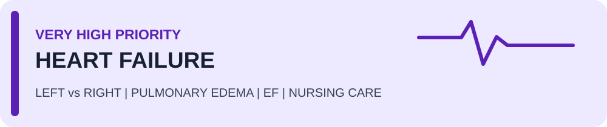

> **🔴 VERY HIGH | Heart failure and cardiomyopathy**
> - 🎯 **Most important:** Left vs right HF, pulmonary edema, EF, diuretics and nursing care
> - 🧠 **Exam trap:** Left-sided HF commonly causes pulmonary congestion
> - 📝 **PYQ status:** Exam-oriented emphasis; repeated NORCET/PGIMER/HPRCA PYQ frequency is **not verified** for this section.


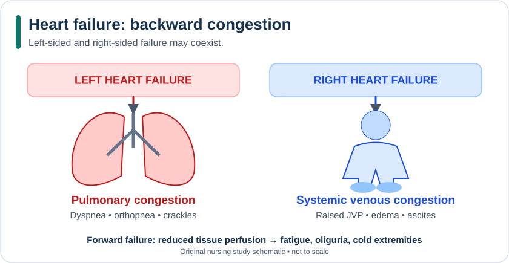

**Visual 8 — Left vs right HF:** Left-sided pressure backs up toward lungs; right-sided pressure backs up toward systemic veins. Either can coexist. Signs depend on congestion and perfusion.

**English definition:** Heart failure is a clinical syndrome caused by structural or functional cardiac abnormalities, with impaired output and/or elevated filling pressures.

**Hindi-English:** Weak ya stiff heart blood adequately pump ya fill nahi kar pata. Blood lungs ya systemic veins ki taraf back up kar sakta hai. **Very High.**
**Very High:** left/right HF, EF, pulmonary edema, drugs, daily weight.
- HF syndrome: heart unable to deliver adequate output or needs abnormally high filling pressures.
- Left HF backs up into lungs (dyspnea, crackles, orthopnea, PND); right HF systemic veins (JVP, hepatomegaly, dependent edema, ascites).
- Biventricular common.
- HFrEF EF ≤40%; HFmrEF 41–49%; HFpEF ≥50% with evidence of elevated filling pressures/structural abnormalities; HFimpEF previous ≤40 then >40.
- Preserved EF does not mean normal filling.
- Low output triggers sympathetic and RAAS response; sodium/fluid retention and remodeling eventually worsen failure.
- Acute pulmonary edema: severe breathlessness, hypoxemia, crackles, sometimes pink froth; upright if BP permits, rapid ABC/escalation, oxygen if low, ventilatory support and IV diuretic/vasodilator if appropriate under orders; assess shock before nitrates.
- Daily same-scale morning weight, strict I/O as ordered, edema and lung checks, renal function/electrolytes, activity pacing, individualized salt/fluid advice, early reporting of worsening symptoms.
- Common education threshold rapid weight gain 2–3 lb/day or 5 lb/week but personalized plan.

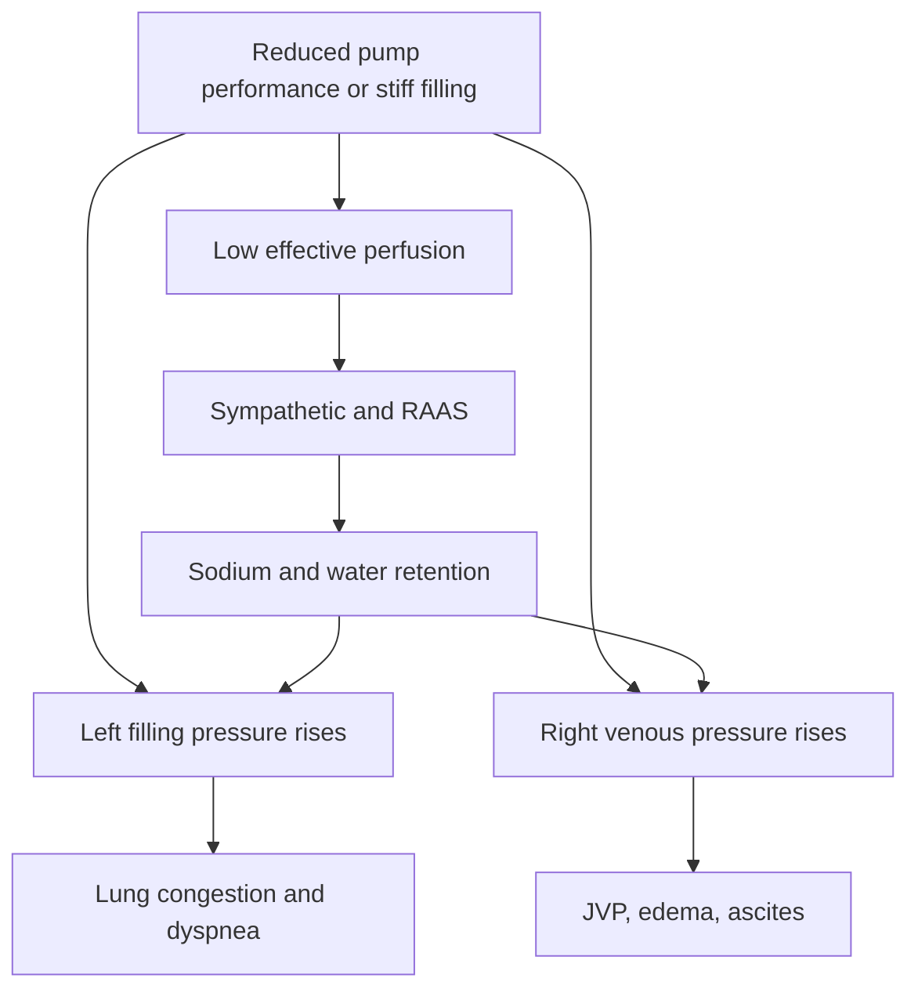

- Chronic HFrEF four foundational classes: ARNI (or ACEI/ARB), evidence-based beta blocker, MRA, SGLT2 inhibitor if eligible.
- Diuretics reduce congestion, not same disease-modifying role.
- Monitor BP, K, creatinine; ACEI-to-ARNI washout 36 h to reduce angioedema risk.
- Do not newly up-titrate beta blocker in shock/unstable decompensation without clinician plan.
- HFpEF treat congestion, BP, comorbidities; SGLT2 inhibitor often useful.
- Digoxin selected cases, narrow therapeutic window; renal function and K affect toxicity.
- Dilated cardiomyopathy enlarged weak ventricle → systolic failure; hypertrophic cardiomyopathy thick myocardium ± dynamic LV outflow obstruction, exertional syncope, family sudden death; dehydration may aggravate obstruction.
- Restrictive cardiomyopathy stiff ventricle (e.g.
- amyloid) impairs filling, EF may preserved.
- Takotsubo stress cardiomyopathy mimics ACS; urgent evaluation required.
- Myocarditis inflammation may produce HF or arrhythmias.
- Cor pulmonale RV changes due to pulmonary disease/PH, not primary left-heart failure.
- Pulmonary HTN echo suspicion, right heart cath definitive classification; treatment cause-specific, do not give PAH drugs indiscriminately.

### Heart failure deep nursing lesson: backward and forward failure

> **🔴 VERY HIGH · 🎯 EXAM FOCUS** — Left vs right failure, forward/backward effects, EF.
> **🧠 EXAM TRAP** — Orthopnea and crackles suggest pulmonary congestion.
> **🩺 MCQ PRACTICE TARGET** — Compare left/right manifestations.
> **📌 PYQ EVIDENCE** — Specific repeated-question count not verified; this is a study-priority label, not a past-paper claim.


- Imagine left pump ka outlet weak hai.
- Upstream pulmonary venous pressure rises, lung interstitium accumulates fluid, diffusion distance/work of breathing rise.
- Supine venous return redistributes fluid from legs, causing orthopnea; delayed nocturnal redistribution can cause PND.
- Right pump failing raises RA/systemic venous pressure, liver congestion and dependent edema.
- Forward failure means poor renal perfusion, fatigue, cold extremities, confusion and low urine.
- HF patient can have normal BP but reduced perfusion.
- 
| Clinical pattern | Typical mechanism | Nursing concern |
|---|---|---|
| Warm/wet | perfused, congested | decongestion and monitoring |
| Cold/wet | low perfusion and congestion | high-risk shock physiology, urgent escalation |
| Cold/dry | low perfusion, little congestion | assess true volume and pump function |
| Warm/dry | compensated | education and preventive care |
- HFrEF: impaired contractility and residual ESV; dilated chamber may compensate then worsen.
- HFpEF: stiff LV, impaired relaxation, small changes in volume cause large filling pressure increase.
- Both can develop pulmonary edema.
- ACC/AHA stages A risk, B pre-HF structural/biomarker abnormality without symptoms, C current/prior symptoms, D advanced refractory.
- NYHA functional limitation different from stages.
- 
### Acute decompensation and care plan

> **🔴 VERY HIGH · 🎯 EXAM FOCUS** — Pulmonary edema, oxygenation, diuresis and monitoring.
> **🧠 EXAM TRAP** — Assess respiratory distress and perfusion urgently.
> **🩺 MCQ PRACTICE TARGET** — Sequence bedside actions.
> **📌 PYQ EVIDENCE** — Specific repeated-question count not verified; this is a study-priority label, not a past-paper claim.


- Look for triggers: infection, ischemia, uncontrolled BP, AF, missed medication, excessive sodium/fluid, NSAIDs, kidney dysfunction.
- Rapid ABC, sitting upright if tolerated, continuous SpO2/ECG, notify emergency team, assess BP before vasodilators, IV loop diuretic prescribed for congestion.
- Noninvasive ventilation may help selected acute pulmonary edema but hypotension/airway limitations matter.
- Hypoxemia treat, not indiscriminate oxygen.
- Monitor diuretic response, intake/output, daily weight, orthostatic BP, creatinine/K/Mg.
- One kg short-term weight change roughly one liter water but trend not precise.
- Avoid forcing fluid restriction universally; individualized orders.
- Goals improved breathing, less congestion, adequate perfusion, safe electrolytes.
- Discharge teach teach-back: daily weight, symptoms, medication purpose, individualized action plan.
- Avoid NSAID self-use and potassium supplements without plan when on RAAS drugs/MRA.
### Cardiomyopathy comparison

> **🟠 HIGH · 🎯 EXAM FOCUS** — Dilated vs hypertrophic vs restrictive physiology.
> **🧠 EXAM TRAP** — HCM obstruction may worsen with reduced preload.
> **🩺 MCQ PRACTICE TARGET** — Match presentation to mechanism.
> **📌 PYQ EVIDENCE** — Specific repeated-question count not verified; this is a study-priority label, not a past-paper claim.


- Dilated: large weak ventricle, causes genetic/viral/alcohol/toxic/peripartum, risk HF and thrombus.
- Hypertrophic: sarcomeric genetic often, LV thickening and dynamic outflow obstruction; reduced preload/afterload or increased contractility can aggravate obstructive form.
- Murmur classically louder standing/Valsalva, softer squatting; sudden death risk assessment and family screening specialist.
- Restrictive: infiltrative/fibrotic stiff walls, biatrial enlargement/congestion despite relatively preserved EF.
- Arrhythmogenic cardiomyopathy may cause ventricular arrhythmia, family/genetic evaluation.
- Takotsubo transient stress-related wall-motion pattern resembling MI.
- No clinical presentation alone reliably distinguishes.
- [HF nursing source](https://openstax.org/books/medical-surgical-nursing/pages/12-3-heart-failure).

## Hypertension and vascular disorders

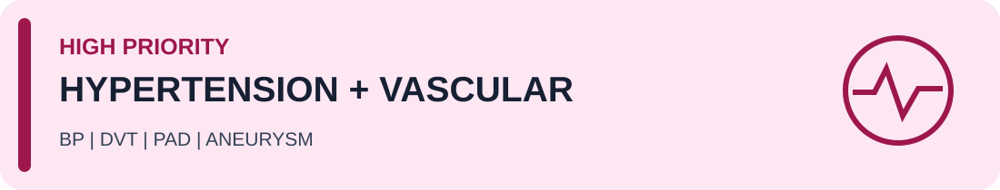

> **🟠 HIGH | Hypertension and vascular disorders**
> - 🎯 **Most important:** BP measurement, hypertensive emergency, DVT, PAD, aneurysm
> - 🧠 **Exam trap:** Hypertensive emergency means acute target-organ damage, not BP alone
> - 📝 **PYQ status:** Exam-oriented emphasis; repeated NORCET/PGIMER/HPRCA PYQ frequency is **not verified** for this section.


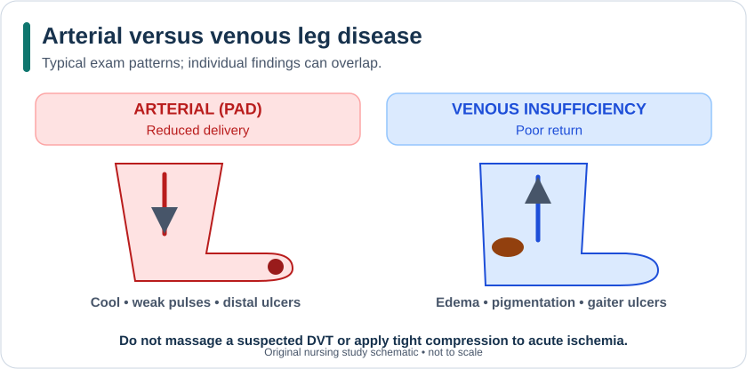

**Visual 13 — PAD vs venous disease:** Arterial disease = reduced delivery; venous disease = poor return. Check arterial supply before compression; sudden cold pulseless foot is an emergency.

**English definition:** Hypertension is persistently elevated arterial blood pressure; vascular disorders affect arterial delivery, venous return or vessel integrity.

**Hindi-English:** Long-term high pressure heart, brain, kidney aur blood vessels ko damage kar sakta hai. Arterial aur venous disease ke symptoms alag mechanism se aate hain. **High to Very High.**
**Very High:** correct BP, emergency vs asymptomatic, DVT/PAD, aneurysm.
- BP depends on CO × SVR approximately; primary hypertension multifactorial, secondary renal/endocrine/drug causes.
- 2025 US AHA adult categories normal <120 and <80; elevated 120–129 and <80; stage 1 130–139 or 80–89; stage 2 ≥140 or ≥90.
- Indian/other guideline diagnostic thresholds may differ (often office ≥140/90); exam answer named guideline follow karo.
- Confirm repeated/home readings unless emergency.
- Lifestyle DASH-style diet, sodium moderation, activity, weight, tobacco cessation, alcohol limitation.
- Common first line thiazide-type, ACEI/ARB, long acting dihydropyridine CCB depending on comorbidity.
- Severe BP without acute injury is not automatically IV emergency.
- Acute target organ injury (encephalopathy, ACS, dissection, pulmonary edema, AKI) = hypertensive emergency, monitored IV therapy and disease-specific BP reduction; avoid indiscriminate rapid normalization.
- Pregnancy protocols separate.
- PAD arterial supply low: walking pain relieved rest, cool pale foot, weak pulses, dependent rubor, distal ischemic ulcers.
- ABI ankle systolic/brachial systolic; ≤0.90 abnormal, >1.40 noncompressible may need toe index.
- Chronic treatment risk factor control, structured exercise, antiplatelet/statin as indicated.
- Acute limb ischemia 6 Ps pain, pallor, pulselessness, paresthesia, paralysis, poikilothermia: urgent vascular emergency.
- No tight compression or heating ischemic limb.
- Buerger disease tobacco-associated inflammatory thrombosis; complete tobacco cessation key.
- Raynaud episodic vasospasm with color changes, warmth and avoid triggers.
- Venous insufficiency: edema, brown pigmentation, medial gaiter ulcer, pulses often preserved, worse standing; elevation and compression only after arterial adequacy assessed.
- Varicose veins incompetent valves; walking/leg elevation appropriate.
- DVT Virchow triad stasis, endothelial injury, hypercoagulability.
- Unilateral swelling, warmth, pain; can be silent.
- No Homan sign reliance or massage.
- Assess clinical probability, D-dimer selected patients, ultrasound; anticoagulation per orders.
- PE sudden dyspnea/chest pain/tachycardia, severe hypotension emergency.
- Prevention mobilization and prescribed prophylaxis, bleeding checks.
- Avoid automatic prolonged bed rest after stable treated DVT.
- Aneurysm localized dilation; AAA often asymptomatic/pulsatile mass, rupture abdominal/back pain with shock.
- Do not repeatedly palpate suspected rupture.
- Dissection intimal tear creates false lumen; sudden severe chest/back pain, pulse difference, neuro signs; urgent imaging/team; type A ascending surgical emergency, type B management depends complications.
- Do not mistake for routine ACS and give lytic blindly.
- Peripheral aneurysm may embolize.

### Hypertension deep dive: causes, damage, nursing management

> **🟠 HIGH · 🎯 EXAM FOCUS** — Correct BP technique, chronic injury and emergency.
> **🧠 EXAM TRAP** — Hypertensive emergency requires acute organ damage.
> **🩺 MCQ PRACTICE TARGET** — Classify emergency vs severe asymptomatic BP.
> **📌 PYQ EVIDENCE** — Specific repeated-question count not verified; this is a study-priority label, not a past-paper claim.


- Primary HTN genetic/environmental with renal sodium handling, sympathetic and vascular regulation.
- Secondary clues early/abrupt onset, resistant BP, renal disease, sleep apnea, endocrine causes (primary aldosteronism, pheochromocytoma, thyroid), drugs (NSAIDs, steroids, stimulants).
- Long-term high pressure injures endothelium, promotes atherosclerosis, increases LV afterload leading hypertrophy/diastolic dysfunction, damages kidney glomeruli and retinal vessels, increases stroke risk.
- Most patients asymptomatic; headache alone unreliable.
- Measure accurate BP and home record; screen organ injury by symptoms, renal function, ECG and clinician tests.
- Orthostatic symptoms assess before fall.
- Emergency severe elevation + acute organ injury, not number alone; dissection has different urgent targets than stroke, avoid universal rapid lowering.
- 
### Vascular detailed differential and nursing

> **🟠 HIGH · 🎯 EXAM FOCUS** — PAD vs DVT vs acute limb ischemia.
> **🧠 EXAM TRAP** — Sudden cold pulseless limb is an emergency.
> **🩺 MCQ PRACTICE TARGET** — Distinguish arterial and venous findings.
> **📌 PYQ EVIDENCE** — Specific repeated-question count not verified; this is a study-priority label, not a past-paper claim.


Arterial ischemic ulcer distal toes/pressure points, punched-out, painful, cool foot and poor pulses. Venous ulcer medial ankle/gaiter, irregular shallow, edema and pigmentation; compression if adequate arterial flow confirmed. Neuropathic diabetic ulcer pressure plantar foot, diminished sensation; offloading and multidisciplinary care. 
- DVT proximal clot PE risk; anticoagulation prevents extension/embolization while natural fibrinolysis occurs.
- New unilateral swelling assess risk/symptoms; no forced Homan test.
- D-dimer useful rule-out in appropriately low-probability patients, not definitive positive diagnosis.
- Compression ultrasound assesses noncompressibility.
- Prevention after surgery: early mobilization, intermittent pneumatic compression and/or anticoagulant per risk; avoid placing device over suspected acute DVT without guidance.
- PE high-risk unstable patient urgent team; CT pulmonary angiography commonly diagnostic if stable, V/Q selected; oxygen/hemodynamic support, anticoagulation or reperfusion selected by severity.
- 
- Aortic aneurysm risk smoking, age, HTN, family; surveillance and repair depend size, growth, symptoms, location and patient risk.
- Post aortic repair monitor perfusion, renal output, bleeding, limb pulses and neuro deficits.
- Dissection true/false lumen may obstruct branches; sudden neurologic, renal or limb ischemia signs.
- Stanford A ascending involvement even with distal extension; B no ascending involvement.
- Acute uncomplicated B generally medical impulse control, complicated may require intervention.
- Lymphedema protein-rich fluid due lymphatic dysfunction after node surgery, malignancy, infection or primary disorder; chronic skin thickening, infection risk, skin care and specialist compression/exercise.
- Raynaud vasospasm can be primary or autoimmune secondary; warm protection, avoid tobacco, ulcers urgent.
- Buerger inflammatory thrombosing small/medium vessels associated tobacco; quitting essential.
- [PAD guideline](https://professional.heart.org/en/science-news/2024-guideline-for-the-management-of-lower-extremity-peripheral-artery-disease), [vascular nursing](https://openstax.org/books/medical-surgical-nursing/pages/12-6-vascular-disorders).

## Valve and inflammatory diseases

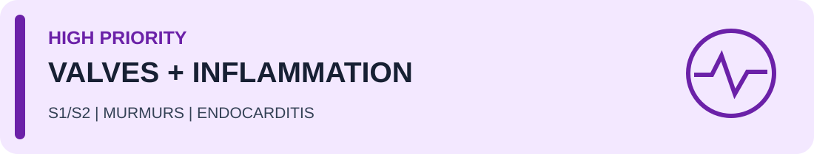

> **🟠 HIGH | Valve and inflammatory diseases**
> - 🎯 **Most important:** S1/S2, stenosis vs regurgitation, endocarditis, pericarditis, tamponade
> - 🧠 **Exam trap:** Tamponade impairs ventricular filling
> - 📝 **PYQ status:** Exam-oriented emphasis; repeated NORCET/PGIMER/HPRCA PYQ frequency is **not verified** for this section.


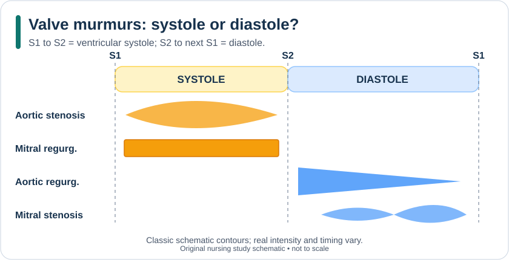

**Visual 9 — Murmur timing:** AS and MR generally systolic; MS and AR diastolic. Murmur location, radiation and character distinguish lesions. Timing is an exam clue, not a standalone diagnosis.

**English definition:** Valvular stenosis obstructs forward flow; regurgitation permits backward flow. Inflammatory conditions can affect the endocardium, myocardium or pericardium.

**Hindi-English:** Valve ek one-way door hai. Agar narrow ho to flow obstruct, agar leak ho to blood wapas aata hai. Heart ki different layers ki inflammation ke symptoms bhi different hote hain. **High to Very High.**
**High to Very High:** murmur timing, RF, endocarditis, pericarditis, tamponade.
Stenosis = narrow opening, pressure overload upstream; regurgitation = backward leak, volume overload. Mechanical valve typically long-term VKA; bioprosthetic strategy varies. Dental hygiene and follow-up essential; antibiotic prophylaxis limited to selected high-risk patients/procedures.
| Lesion | Classic murmur and clue |
|---|---|
| Aortic stenosis | Systolic ejection, right upper sternal, carotid radiation; exertional syncope, angina, dyspnea |
| Aortic regurgitation | Early diastolic decrescendo, left sternal; wide pulse pressure/bounding pulse |
| Mitral stenosis | Opening snap, low rumbling diastolic apex, rheumatic common; LA enlargement/AF |
| Mitral regurgitation | Holosystolic apex to axilla; pulmonary congestion |
| Tricuspid regurgitation | Holosystolic lower left sternum, increases inspiration |
| Mitral valve prolapse | Mid-systolic click ± late systolic murmur |

- Rheumatic fever immune response after group A streptococcal infection; revised Jones criteria risk-specific: major carditis, migratory arthritis, chorea, erythema marginatum, subcutaneous nodules; minor fever, arthralgia, inflammatory markers, prolonged PR (with exceptions).
- Evidence preceding GAS typically required; exceptions exist.
- Long-term secondary prophylaxis prevents recurrence; rheumatic heart disease often mitral.
- Infective endocarditis microbial valve/endocardial infection; fever, murmur, embolic signs; Janeway painless, Osler painful, splinter hemorrhage nonspecific.
- Blood cultures before antibiotics when feasible, echo, targeted prolonged antimicrobials, surgery selected.
- Myocarditis myocardial inflammation (infectious/immune/toxic) causes chest pain, arrhythmia, HF; avoid intense exercise until cleared.
- Pericarditis sharp positional pleuritic pain, rub, diffuse ST elevation/PR depression possible; therapy cause-specific NSAID/colchicine commonly.
- Effusion not synonymous tamponade: tamponade compresses filling → low CO, hypotension, raised JVP, muffled sounds (Beck triad may be incomplete), pulsus paradoxus >10 mmHg inspiratory systolic fall.
- Urgent echo/clinician drainage; do not delay resuscitation.
- Constrictive pericarditis chronic rigid pericardium limits filling, systemic congestion and Kussmaul sign possible.

### Valve disease in depth — why each symptom occurs

> **🟠 HIGH · 🎯 EXAM FOCUS** — Stenosis vs regurgitation, murmurs and hemodynamics.
> **🧠 EXAM TRAP** — Murmur timing matters more than loudness alone.
> **🩺 MCQ PRACTICE TARGET** — Match valve lesions to sounds.
> **📌 PYQ EVIDENCE** — Specific repeated-question count not verified; this is a study-priority label, not a past-paper claim.


**Mitral stenosis (High):** rheumatic commissural fusion narrows LA→LV opening. LA pressure rises → pulmonary congestion, LA dilation → AF and embolic risk. Tachycardia shortens diastole, worsens gradient. Echo valve area/gradient, pulmonary pressure. Symptom management rate control/diuresis as ordered, anticoagulation when indicated (rheumatic MS with AF usually VKA), balloon commissurotomy selected anatomy or surgery. 
**Mitral regurgitation:** LV ejects partly backward into LA during systole. Chronic volume overload dilates LA/LV; acute severe MR after rupture causes dramatic pulmonary edema without time to dilate. Echo mechanism primary leaflet vs secondary ventricular remodeling. Repair/replacement or transcatheter intervention selected. 
**Aortic stenosis:** fixed outlet obstruction raises LV systolic pressure, concentric hypertrophy, oxygen demand; exertion may cause angina/syncope/dyspnea. Calcific degenerative, bicuspid or rheumatic. Severe symptomatic AS needs specialist valve intervention (SAVR/TAVR selection). Avoid uncontrolled preload reduction and exertional symptoms ignored. 
**Aortic regurgitation:** diastolic leak aorta to LV; chronic LV dilation and increased total SV, low DBP; acute severe AR can cause shock without classic wide pulse pressure. Treat cause and specialist surgery based on severity/symptoms/LV. **Tricuspid stenosis/regurgitation:** systemic venous congestion, hepatomegaly/edema; TR often secondary RV/annular dilation. **Pulmonary stenosis/regurgitation:** congenital or repaired congenital, RV pressure/volume load. 
### Endocarditis, rheumatic fever, myocarditis and pericardial disease

> **🟠 HIGH · 🎯 EXAM FOCUS** — Endocarditis, pericarditis, myocarditis and tamponade.
> **🧠 EXAM TRAP** — Suspected tamponade with instability needs urgent escalation.
> **🩺 MCQ PRACTICE TARGET** — Recognize hallmark symptoms.
> **📌 PYQ EVIDENCE** — Specific repeated-question count not verified; this is a study-priority label, not a past-paper claim.


- Infective endocarditis vegetation platelet-fibrin-microbe mass on valve/device; destructive regurgitation, abscess/conduction block, emboli to brain/kidney/spleen or lung in right-sided disease.
- Staph aureus can be aggressive; streptococci and enterococci other examples.
- Prosthetic valve/device/IV drug use and prior endocarditis increase risk.
- Diagnostic criteria combine cultures, imaging and clinical signs, not a single murmur.
- Nurse culture aseptically, monitor temperature, new neuro deficit, renal output, HF, antibiotic levels/renal labs where indicated, IV site and long-course adherence.
- Surgery considered HF, uncontrolled infection, embolic risk.
- 
- Rheumatic fever is immune-mediated after GAS; not direct bacterial vegetation.
- Carditis can affect all layers; chronic scarring especially mitral.
- Jones criteria risk category matters; ASO/anti-DNase B evidence preceding GAS; ECG PR prolongation minor in appropriate setting.
- Treat GAS, inflammation, HF and long-term secondary prophylaxis per specialist.
- Sydenham chorea involuntary movements, school/safety support.
- 
- Myocarditis suspect after viral illness with chest pain, arrhythmia, new HF; troponin/echo/MRI selected, biopsy in specific severe presentations.
- Avoid strenuous exercise during recovery, monitor electrical and pump function.
- Pericarditis rub transient, effusion may coexist.
- Tamponade pressure-volume curve steep once pericardial reserve exhausted: small rapid hemopericardium dangerous, slow large effusion tolerated until threshold.
- Echo RA/RV collapse clues and clinical shock.
- Urgent drainage by trained team; positive pressure ventilation or excessive preload reduction may worsen unstable tamponade.
- Constrictive pericarditis chronic rigid shell, rapid early filling then abrupt stop, prominent y descent.
- Different from restrictive myocardial disease; echo/MRI/cath differentiation.
- 

## Congenital and pediatric cardiovascular disease


> **🟠 HIGH | Congenital and pediatric cardiovascular disease**
> - 🎯 **Most important:** ASD/VSD/PDA, TOF, cyanotic vs acyanotic, fetal shunts
> - 🧠 **Exam trap:** TOF is a cyanotic congenital heart defect
> - 📝 **PYQ status:** Exam-oriented emphasis; repeated NORCET/PGIMER/HPRCA PYQ frequency is **not verified** for this section.


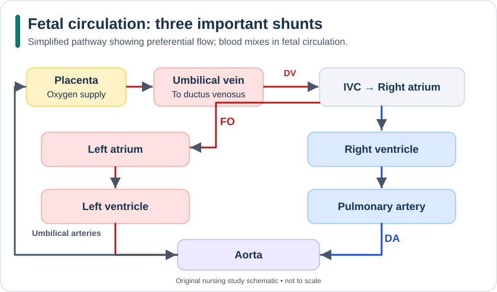

**Visual 10 — Three fetal shunts:** Ductus venosus bypasses much liver, foramen ovale connects RA→LA, ductus arteriosus connects PA→aorta. Oxygen-rich placental blood enters through umbilical vein; umbilical arteries return blood.

**English definition:** Congenital heart disease is a structural cardiovascular abnormality present at birth, which can alter blood flow or oxygenation.

**Hindi-English:** Birth se heart ya great vessels ki structure abnormal ho sakti hai. Kuch defects lungs mein extra blood bhejte hain, kuch oxygen-poor blood body mein bhejte hain. **High.**
**High:** shunts, TOF, PDA, coarctation, fetal circulation. Fetal placenta oxygenates blood. Umbilical vein carries oxygen-rich blood; ductus venosus bypasses much liver, foramen ovale RA→LA, ductus arteriosus pulmonary artery→aorta, two umbilical arteries back placenta. After birth lungs expand → PVR drops, LA pressure rises → functional FO closure; oxygen rise and prostaglandin fall promote ductal closure. Persistent fetal connection may be disease.

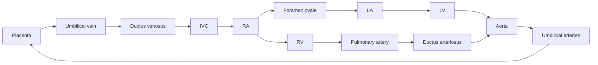

- ASD usually left-to-right, fixed split S2; VSD holosystolic lower sternal; PDA continuous machinery murmur, bounding pulses; large shunt → pulmonary overcirculation/HF, untreated pulmonary vascular disease can reverse shunt (Eisenmenger cyanosis).
- TOF four components VSD, pulmonary outflow obstruction, overriding aorta, RV hypertrophy.
- Cyanotic spell: knee-chest, calm child, urgent oxygen/clinical support and ordered therapy; squatting increases systemic resistance.
- TGA parallel circuits, survival depends mixing (ASD/VSD/PDA), urgent neonatal specialist/prostaglandin as appropriate.
- Coarctation arm pressure high, legs low/delayed femoral.
- Tricuspid atresia, truncus arteriosus, TAPVR and hypoplastic left heart are specialist-managed; understand mixing/duct-dependent perfusion.
- Infant HF feeding fatigue, sweating, tachypnea, poor growth; age-specific HR/BP and drug dosing.
- Kawasaki prolonged fever with mucocutaneous changes, coronary aneurysm risk, IVIG and aspirin under pediatric specialist; pediatric aspirin exceptional indication.
- Pregnancy: cardiac output increases, severe stenosis/PH high risk; peripartum cardiomyopathy can present late pregnancy/postpartum with new HF.
- Escalate dyspnea at rest/syncope.
- This is overview; neonatal and obstetric resuscitation have separate algorithms.

### Congenital shunts and pediatric nursing — physiology to symptoms

> **🟠 HIGH · 🎯 EXAM FOCUS** — ASD, VSD, PDA, TOF and cyanosis.
> **🧠 EXAM TRAP** — TOF hypercyanotic spell: knee-chest positioning can help.
> **🩺 MCQ PRACTICE TARGET** — Cyanotic vs acyanotic defects.
> **📌 PYQ EVIDENCE** — Specific repeated-question count not verified; this is a study-priority label, not a past-paper claim.


- Left-to-right shunt initially sends oxygenated systemic blood back to lungs; cyanosis typically absent early.
- Large VSD/PDA cause pulmonary overcirculation and infant HF once PVR falls after birth.
- Small VSD can be loud because high velocity, large equal-pressure defect may softer.
- ASD right volume load and fixed S2 split.
- PDA aortic pressure exceeds PA in systole and diastole → continuous murmur; preterm PDA management differs (ibuprofen/indomethacin or other strategies selected, not every PDA needs closure).
- Duct-dependent congenital lesions may need prostaglandin E1 to maintain patency; apnea monitoring critical.
- 
- TOF severity depends RV outflow obstruction.
- Crying/exertion lowers relative systemic resistance or worsens obstruction, increasing R→L shunt and cyanosis.
- Knee-chest increases systemic resistance; calm, urgent help, oxygen and prescribed measures.
- Squatting older child compensatory.
- TGA oxygenated pulmonary circuit and systemic circuit parallel; mixing lifesaving.
- TAPVR total pulmonary venous drainage to systemic side, mixing through ASD essential; obstruction emergency.
- Coarctation differential pulses and BP; newborn critical lesion may collapse when duct closes.
- 
- Nursing: feed small frequent energy-efficient feeds per team, rest pauses, monitor growth and urine, respiratory distress, baseline saturation individualized to lesion (not force normal adult saturation target in every cyanotic condition), infection prevention, parental education.
- Post congenital surgery monitor rhythm, perfusion, drains, residual shunts and low-output signs.
- Pediatric CPR age-specific; infants/children often respiratory origin, compression depth about one-third chest AP (infant ~4 cm, child ~5 cm); 30:2 one rescuer, 15:2 two trained rescuers prepubertal without advanced airway, separate neonatal protocol.
- 

## Shock resuscitation and critical care


> **🔴 VERY HIGH — MUST REVISE | Shock resuscitation and critical care**
> - 🎯 **Most important:** Shock types, perfusion, CPR, defibrillation, emergency priorities
> - 🧠 **Exam trap:** Pulseless VT/VF shockable; PEA/asystole require CPR and cause treatment
> - 📝 **PYQ status:** Exam-oriented emphasis; repeated NORCET/PGIMER/HPRCA PYQ frequency is **not verified** for this section.


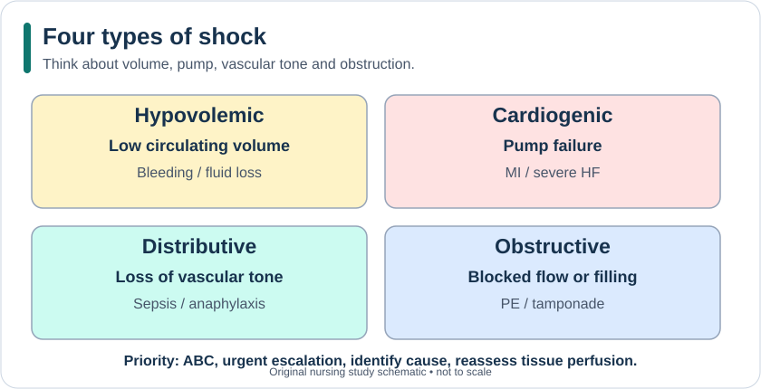

**Visual 11 — Four shock mechanisms:** Low volume, weak pump, excessive vasodilation or blocked flow. Same hypotension can have different causes; assess perfusion and treat cause.

**English definition:** Shock is life-threatening circulatory failure resulting in inadequate tissue oxygen delivery or utilization; cardiac arrest is loss of effective circulation.

**Hindi-English:** Low BP shock ka clue hai, definition nahi. Tissues ko oxygen nahi mil rahi ho to urgent action chahiye. Arrest mein effective pulse absent hota hai. **Very High.**
**Very High:** types, perfusion, BLS/ACLS, cardioversion vs defibrillation.
- Shock inadequate tissue oxygen delivery/utilization; early BP may preserved.
- Look altered mentation, poor urine, cool skin (warm possible distributive), lactate trend, tachycardia.
- Hypovolemic low circulating volume (bleeding/dehydration), cardiogenic pump failure, distributive low SVR (sepsis/anaphylaxis/neurogenic), obstructive impeded filling/outflow (tamponade, tension pneumothorax, massive PE).
- Cardiogenic often high filling pressure/congestion; do not reflex large fluids.
- Hypovolemia control bleeding and replace appropriately; sepsis antibiotics/source control and individualized fluids/vasopressors; anaphylaxis IM epinephrine per protocol; obstruction treat cause urgently.
- All require escalation, oxygenation, monitoring, IV access, perfusion reassessment; shock management not one drug for all.
- Cardiogenic shock urgent reperfusion if MI, inotrope/vasopressor and mechanical support selected.
- MAP often initial target 65 in septic shock individualized; urine output trends.

- Adult BLS: unresponsive, absent normal breathing (gasping abnormal), healthcare provider pulse check ≤10 sec; activate emergency response/AED, start compressions if no definite pulse.
- Rate 100–120/min, depth at least 5 cm avoiding >6 cm, full recoil, minimize pauses, 30:2 without advanced airway.
- With advanced airway continuous compressions and 1 breath/6 sec.
- Avoid excessive ventilation.
- AED prompt; rhythm/pulse checks approx every 2 min as indicated.
- Defibrillate VF/pVT; no shock asystole/PEA; epinephrine per ALS.
- Post ROSC monitor oxygenation, ventilation, BP, cause, temperature control in appropriate patients.
- 2025 AHA algorithms supersede old classroom sequences.

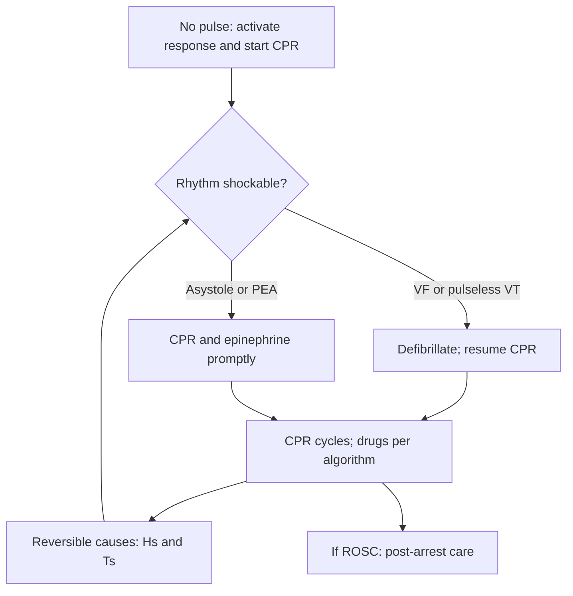

- AHA adult arrest epinephrine 1 mg IV/IO every 3–5 min; nonshockable as soon as feasible, shockable after initial defibrillation attempts per algorithm.
- Refractory VF/pVT amiodarone or lidocaine per protocol.
- Hs: hypovolemia, hypoxia, hydrogen ion/acidosis, hypo/hyperkalemia, hypothermia.
- Ts: tension pneumothorax, tamponade, toxins, pulmonary thrombosis, coronary thrombosis.
- Symptomatic bradycardia atropine 1 mg IV every 3–5 min max 3 mg under adult algorithm; if ineffective pacing/dopamine/epinephrine per protocol.
- High-grade block may need immediate pacing.
- Stable regular narrow tachy: vagal maneuvers/adenosine if appropriate; unstable with pulse synchronized cardioversion (sedate if feasible without delay).
- Polymorphic VT cannot reliably synchronize, unsynchronized high-energy shock if sustained unstable.
- Defibrillation energy device-specific; use manufacturer/AHA guidance.
- Source [AHA 2025 algorithms](https://cpr.heart.org/en/resuscitation-science/cpr-and-ecc-guidelines/algorithms/).

### Hemodynamics of shock — compare rather than memorize

> **🔴 VERY HIGH · 🎯 EXAM FOCUS** — Hypovolemic, cardiogenic, distributive, obstructive.
> **🧠 EXAM TRAP** — Hypotension can be late; assess perfusion.
> **🩺 MCQ PRACTICE TARGET** — Differentiate shock mechanisms.
> **📌 PYQ EVIDENCE** — Specific repeated-question count not verified; this is a study-priority label, not a past-paper claim.


| Type | CO tendency | SVR tendency | Filling pressure tendency |
|---|---|---|---|
| Hypovolemic | low | high compensatory | low |
| Cardiogenic LV | low | high compensatory | high left-sided |
| Distributive early sepsis | often high/variable | low | variable |
| Obstructive | low | high | depends obstruction, JVP often high |
These are typical patterns, not universal. Initial compensated shock tachycardia/vasoconstriction preserves BP; progressive shock anaerobic metabolism, lactate, organ dysfunction; refractory severe injury despite therapy. Lactate may also reflect nonhypoxic mechanisms. Urine output, mentation, capillary refill, peripheral temp and serial BP assess together. 
- Example cardiogenic vs hypovolemic: both hypotension/cold skin; crackles and raised filling pressures suggest cardiac congestion, dry patient with blood loss suggests low preload.
- Fluids can worsen pulmonary edema; use cause and response, not blindly volume.
- Obstructive tamponade/PE require definitive cause intervention.
- Neurogenic shock loss sympathetic tone can cause hypotension and relative bradycardia; spinal shock is neurological loss of reflexes, not identical.
- 
### Resuscitation workflow and post-arrest nursing

> **🔴 VERY HIGH · 🎯 EXAM FOCUS** — High-quality CPR, shockable rhythms and reversible causes.
> **🧠 EXAM TRAP** — Do not defibrillate asystole or PEA.
> **🩺 MCQ PRACTICE TARGET** — Identify immediate arrest algorithm.
> **📌 PYQ EVIDENCE** — Specific repeated-question count not verified; this is a study-priority label, not a past-paper claim.


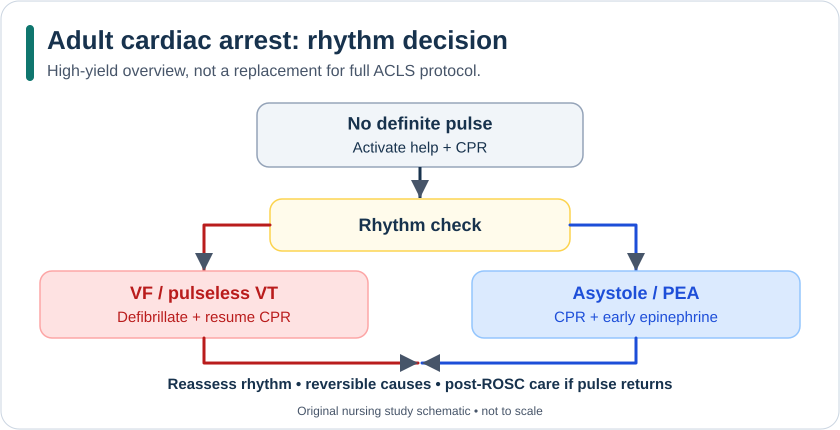

**Visual 12 — Adult arrest:** CPR immediately for pulseless patient; shock VF/pulseless VT, not PEA/asystole. Follow current AHA algorithm and trained team protocol.
- CPR compress lower half sternum, patient on firm surface when feasible, arms straight, switch compressor about every 2 min; avoid leaning.
- Defibrillation unsynchronized for VF/pVT; after shock immediately resume compressions, don't pause for pulse unless indicated.
- AED follow prompts; ensure no contact during analysis/shock.
- Team roles compressor, airway, monitor/defib, IV/drugs, recorder/leader.
- Record timing, rhythm, drugs, shocks, ROSC.
- Capnography helps confirm advanced airway and assess CPR; sudden sustained ETCO2 rise may suggest ROSC, not sole criterion to stop resuscitation.
- 
Synchronized cardioversion aligns shock with R to avoid vulnerable T; check synchronization markers, resync after shocks if needed. Unstable tachy with pulse selected; sedation if feasible. Transcutaneous pacing for selected unstable brady: electrical capture (spike then QRS) plus mechanical capture (pulse/BP), analgesia/sedation as tolerated. 
After ROSC stabilize airway/oxygenation/ventilation, avoid hypoxia/hyperoxia and hypotension, ECG and cause investigation, seizure/temperature monitoring, multidisciplinary ICU. Neurologic prognosis delayed and multimodal; no premature pessimistic conclusion. [AHA adult BLS](https://cpr.heart.org/en/resuscitation-science/cpr-and-ecc-guidelines/adult-basic-life-support), [ALS](https://cpr.heart.org/en/resuscitation-science/cpr-and-ecc-guidelines/adult-advanced-life-support/).

## Cardiac pharmacology and nursing procedures

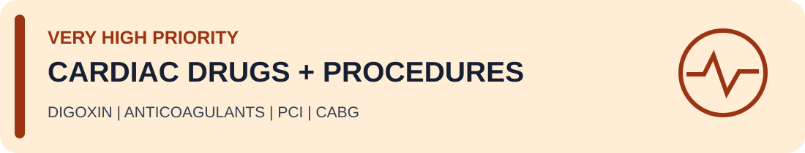

> **🔴 VERY HIGH | Cardiac pharmacology and nursing procedures**
> - 🎯 **Most important:** Digoxin, nitrates, beta blockers, anticoagulants, PCI/CABG nursing
> - 🧠 **Exam trap:** Medication contraindications and monitoring matter more than memorizing names
> - 📝 **PYQ status:** Exam-oriented emphasis; repeated NORCET/PGIMER/HPRCA PYQ frequency is **not verified** for this section.


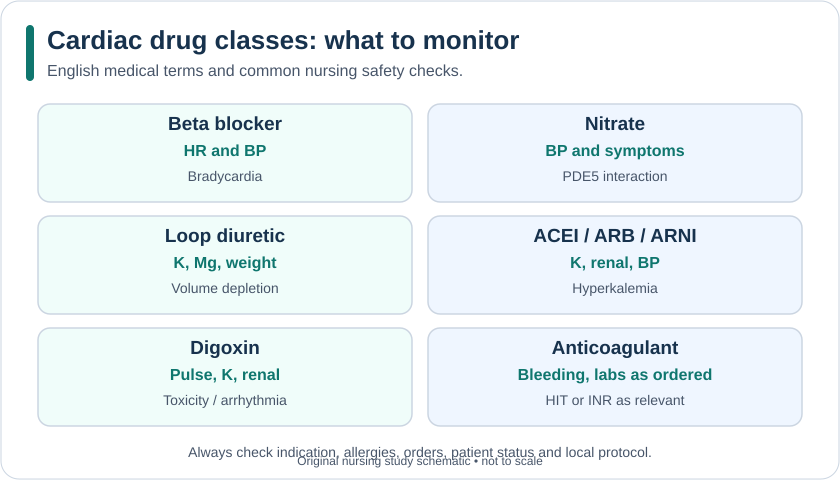

**Visual 14 — Cardiac drug safety:** Match the drug to its primary action and nursing monitoring. Antiplatelets, anticoagulants and fibrinolytics are not interchangeable.

**English definition:** Cardiovascular drugs and interventions modify heart rate, contractility, vascular resistance, fluid balance, clotting or coronary flow.

**Hindi-English:** Har drug ka action aur monitoring alag hai. Drug dene se pehle BP, pulse, relevant labs, contraindications aur order check karo. **Very High.**
**Very High:** adverse effects, contraindications, monitoring and patient safety.
| Drug/class | Action / nurse checks |
|---|---|
| Aspirin, P2Y12 inhibitors | Antiplatelet; ACS/PCI indication, bleeding, adherence; do not stop post-stent without specialist |
| UF heparin / LMWH | Anticoagulants; aPTT/anti-Xa UFH per protocol, platelets/HIT, bleeding, renal for LMWH; protamine reversal mainly UFH |
| Warfarin | Vitamin K antagonist; INR, interactions, consistent vitamin K intake; reversal vitamin K/PCC when indicated |
| DOACs | AF/VTE selected; renal, bleeding, adherence; not routine mechanical valves; reversal agent-specific |
| Nitrates | Venodilation, preload reduction; BP, headache, PDE5 interaction, RV infarct caution |
| Beta blockers | HR/contractility reduction; HR/BP, brady/block, bronchospasm caution; selected HFrEF benefit |
| ACEI/ARB/ARNI | RAAS modulation; K, renal, BP, angioedema; pregnancy contraindication; ACEI cough |
| Loop diuretics | Decongestion; daily weight, BP, K/Mg, renal, ototoxicity risk with high/rapid IV dose |
| Thiazide-type | BP; Na/K, gout/metabolic effects |
| MRA | K-sparing disease modification selected HF; hyperkalemia/renal |
| SGLT2 inhibitor | HF benefit selected; volume status, genital infection, ketoacidosis risk, sick-day guidance |
| Digoxin | Positive inotropy, AV slowing; apical pulse, renal/K, nausea/visual changes/arrhythmia, hold/escalate per orders; toxicity may require Fab |
| CCB | DHP vasodilation/edema; verapamil/diltiazem rate slowing, avoid selected HFrEF/block |
| Statin | LDL lowering; muscle symptoms, interactions |
| Amiodarone | Rhythm drug; QT, thyroid, liver, lung toxicity, interactions |
| Adenosine | Brief AV nodal block, selected regular SVT; monitor, rapid IV per protocol; avoid irregular wide rhythms |
| Atropine | Vagolytic symptomatic brady; may fail infranodal block |
| Norepinephrine / dobutamine | Pressor / inotrope; continuous monitoring, perfusion, extravasation and arrhythmia risks |
| Fibrinolytic | Clot breakdown selected STEMI; bleeding/ICH and contraindication checks, no NSTEMI routine |

- Pacemaker: electrical stimulus when intrinsic rhythm insufficient; temporary transcutaneous/transvenous or permanent.
- Spikes without P/QRS = failure capture; missing spike when expected = failure output; inappropriate timing may be sensing issue.
- Assess pulse/perfusion, check connections, escalate.
- Post implant wound, hematoma, infection, pneumothorax symptoms, device follow-up and arm instructions specific to team.
- ICD detects/treats dangerous ventricular arrhythmias; CRT synchronizes selected dyssynchronous HF.
- IABP inflates diastole to augment coronary perfusion, deflates before systole to reduce afterload; monitor limb circulation, timing, bleeding, positioning; severe AR/dissection contraindications.
- Impella/ECMO/LVAD selected advanced support; bleeding, thrombosis, infection, perfusion and device alarms trained-team management.
CABG/valve surgery post-op: monitor airway, hemodynamics, bleeding/chest drains, rhythm, urine, pain, wound, mobilization/respiratory exercises and education. Sudden low output with rising filling pressure or abrupt drain changes may indicate tamponade; escalate, do not blindly manipulate drain. Cardiac rehabilitation phased individualized supervised exercise and risk-factor education; discharge teach medication purpose, warning symptoms, follow-up, bleeding precautions, daily weight in HF.

### Pharmacology deeper: compare similar drugs and monitoring

> **🔴 VERY HIGH · 🎯 EXAM FOCUS** — Digoxin, diuretics, beta blockers, nitrates, anticoagulants.
> **🧠 EXAM TRAP** — Check pulse, BP, electrolytes, renal function as relevant.
> **🩺 MCQ PRACTICE TARGET** — Drug adverse effects and monitoring.
> **📌 PYQ EVIDENCE** — Specific repeated-question count not verified; this is a study-priority label, not a past-paper claim.


- Antiplatelets prevent platelet aggregation (arterial thrombosis), anticoagulants interfere coagulation factors (AF/VTE etc.), fibrinolytics break fibrin clot.
- Not interchangeable.
- Aspirin irreversibly inhibits platelet COX-1; clopidogrel P2Y12 blockade; ticagrelor dyspnea possible.
- UFH onset rapid IV, variable monitoring, protamine reversal; LMWH predictable but renal clearance and partial protamine reversal.
- HIT suspect platelet fall >50% around 5–10 days (earlier recent exposure), new thrombosis; stop all heparin and urgent specialist strategy, don't merely substitute LMWH.
- Warfarin delayed onset, INR usual 2–3 many indications but mechanical valve-specific; vitamin K consistent intake not total avoidance.
- DOAC missed dose may reduce protection rapidly; follow prescribed instructions.
- Nitrates reduce venous return and myocardial demand, headache/orthostatic hypotension; PDE5 interactions can cause severe hypotension.
- Beta1 blockade lowers HR, AV conduction and workload; abrupt withdrawal can worsen ischemia; assess bradycardia, block and hypotension.
- ACEI/ARB reduce RAAS, monitor creatinine/K, ACEI cough/angioedema; no ACEI+ARB routine combination.
- ARNI neprilysin inhibition plus ARB, 36 h washout from ACEI.
- Spironolactone hyperkalemia/gynecomastia.
- Furosemide blocks Na-K-2Cl in thick ascending loop → natriuresis, low K/Mg, dehydration; thiazide distal Na-Cl transporter, hyponatremia/hyperuricemia.
- Digoxin inhibits Na/K ATPase → increased intracellular Ca, vagal AV slowing; hypokalemia predisposes toxicity; check renal and interacting meds, pulse according prescription; classic yellow/blurred vision, GI upset and many arrhythmias.
- Digoxin Fab for severe poisoning selected.
- 
- Vaughan Williams antiarrhythmics I Na channel (e.g.
- lidocaine), II beta blockers, III K channel (amiodarone), IV non-DHP calcium channel (verapamil/diltiazem); adenosine and digoxin other mechanisms.
- Amiodarone multi-channel effects, monitor thyroid/liver/lung, QT and interactions.
- Adenosine short half-life, selected regular SVT.
- Atropine blocks muscarinic effects; high-degree infranodal block may not respond.
- Norepinephrine predominantly alpha pressor, dobutamine beta1 inotrope; both can provoke arrhythmia and need closely monitored IV.
- 
### Procedures, postoperative care and devices

> **🟠 HIGH · 🎯 EXAM FOCUS** — PCI/CABG, pacemaker, arterial line and complications.
> **🧠 EXAM TRAP** — Pressure transducer leveling changes displayed BP.
> **🩺 MCQ PRACTICE TARGET** — Postprocedure priority assessment.
> **📌 PYQ EVIDENCE** — Specific repeated-question count not verified; this is a study-priority label, not a past-paper claim.


- Pacemaker modes NBG first three letters chamber paced/sensed/response (e.g.
- VVI ventricular paced and sensed, inhibited response; DDD dual chamber tracking).
- Failure to capture spikes without depolarization, undersensing inappropriate spikes despite intrinsic beats, oversensing inappropriate inhibition.
- Patient first, pulse and perfusion, urgent escalation if unstable.
- ICD prevents sudden death via antitachycardia pacing/shock for selected arrhythmia; CRT improves synchrony in eligible HF.
- Postimplant infection/hematoma, pneumothorax, lead displacement concerns; avoid universal arm restriction duration, follow specific device team.
- IABP diastolic inflation increases aortic diastolic pressure/coronary perfusion, systolic deflation decreases afterload; check augmentation timing/waveform, distal pulses and access bleeding.
- Not routine for all MI shock; severe AR or dissection contraindication.
- ECMO/LVAD advanced team, monitor perfusion/bleeding/device; continuous-flow LVAD may have weak palpable pulse, use trained protocols not ordinary pulse assumptions.
- 
- CABG median sternotomy often, graft supply new route beyond stenosis.
- Post-op early ABC and hemodynamic monitoring, bleeding/drain output, temporary pacing wires, glucose, pain, pulmonary hygiene, neuro/renal checks.
- New AF common after surgery; hypotension/tachycardia and low urine could be bleeding/low CO/tamponade; escalating rather than assuming normal.
- Drain suddenly stops with worsening shock possible clot/tamponade.
- Mobilization and incision support per protocol; fever, wound drainage or unstable sternum notify.
- Valve replacement mechanical durable but anticoagulation burden, tissue less durable generally with individualized antithrombotic plan.
- TAVR transfemoral often; monitor access, conduction block, stroke signs.
- Cardiac rehab inpatient early mobilization, supervised outpatient exercise and long-term lifestyle maintenance.
- 
### Practical care-plan examples

> **🟠 HIGH · 🎯 EXAM FOCUS** — Assessment → nursing diagnosis → intervention → evaluation.
> **🧠 EXAM TRAP** — Interventions should match patient stability.
> **🩺 MCQ PRACTICE TARGET** — Apply care plan to clinical scenarios.
> **📌 PYQ EVIDENCE** — Specific repeated-question count not verified; this is a study-priority label, not a past-paper claim.


- Acute HF: impaired gas exchange related pulmonary congestion; outcome improved oxygenation/respiratory effort; position, monitor, prescribed decongestion, reassess.
- PAD: ineffective peripheral perfusion; compare neurovascular status, protect feet, urgent acute changes; outcome no tissue injury and improved functional walking if stable.
- Anticoagulated patient: bleeding risk; assess stool/urine/gums/bruises, fall safety, medication reconciliation and escalation for major bleeding.
- Post cath: neurovascular compromise risk; pulse/temp/cap refill/sensation and access monitoring; outcome stable site and distal perfusion.
- 
### Additional exam angles and research limits

> **🟠 HIGH · 🎯 EXAM FOCUS** — Clinical calculations, emergency traps and source checks.
> **🧠 EXAM TRAP** — Exam prediction is not verified PYQ frequency.
> **🩺 MCQ PRACTICE TARGET** — Revise incorrect practice answers.
> **📌 PYQ EVIDENCE** — Specific repeated-question count not verified; this is a study-priority label, not a past-paper claim.


- Highest study focus remains clinical priorities, ECG mechanisms and drug adverse effects because these allow both recall and case-based questions.
- HP 2020 transcription independently located [here](https://hpgeneralstudies.com/solved-paper-hp-staff-nurse-exam-2020-hpssc-hamirpur-part-1/).
- [HP archive 2020–22](https://ramanacademy.in/hp-staff-nurse-previous-year-question-papers/), [2026 archive](https://himexam.com/hp-staff-nurse-previous-question-papers-pdf-download/) are leads, not proof of exact exam frequency.
- [ACC guideline index](https://www.acc.org/Guidelines/) includes ACS, HF, congenital, PAD and PE.
- This expansion is study material, not claimed completed; original 168 practice items unchanged.
- Separate videos and rare congenital/specialist subtypes remain less deeply verified.

## Revision and exam evidence


> **🔴 VERY HIGH — FINAL REVISION | Revision and exam evidence**
> - 🎯 **Most important:** Emergency algorithms, ECG, drug adverse effects, mistakes and source-tagged PYQs
> - 🧠 **Exam trap:** Do not call an original practice MCQ a verified PYQ
> - 📝 **PYQ status:** Exam-oriented emphasis; repeated NORCET/PGIMER/HPRCA PYQ frequency is **not verified** for this section.

Priority estimates are qualitative, NOT official weightage or counted historical frequency. Very High: coronary supply, cardiac output, ECG/rhythms, ACS, HF, CPR/shock, drugs and cath care. High: hypertension, congenital, murmurs, endocarditis/RF, vascular disease, hemodynamics. Anatomy foundation already in earlier notes.
| Source (third-party unless stated) | Reported topic | Evidence |
|---|---|---|
| [HPSSC October 2020](https://ramanacademy.in/previous-papers/staff-nurse-hpssc-october-2020/) | Q14 LAD, Q16 tobacco/CAD, Q17 cath, Q20 CPR, Q25 MI complications, Q36 ST elevation, Q37 DVT | Online transcription, academy key not official; Q37 wording/Homan sign dated, do not rely on it clinically |
| [PGIMER 2020](https://nextnurse.in/pyq/pgimer-nursing-officer/pgimer-nursing-officer-pgimer-no-2020) | Post-cath pulse and digoxin toxicity | Search result reported, official paper/key not verified |
| [NORCET 2023 memory-based](https://testbook.com/question-answer/ecg-given-below-is-of--6298516cf77ee164918a8c21) | ECG identification | Recalled, not official |
| [AIIMS Raipur 2019 memory-based](https://testbook.com/question-answer/cardiac-output-is-increased-in-case-of--62c539c4c6e14093ce29e619) | CO regulation | Recalled, not official |
| [MPESB 2022 attributed](https://testbook.com/question-answer/what-is-the-major-goal-of-nursing-care-for-a-clien--677d2fa6264e0b0fee707bfa/amp) | HF/pulmonary edema goal | Third-party attribution |
| [SGPGI 2024 reported](https://www.scribd.com/document/1057778094/SGPGI-Nursing-Officer-Question-Paper-28-Feb-2024-Shift-1) | Digoxin hold, TOF | Third-party, not official |
| [HPRCA 2026 paper archive](https://himexam.com/hp-staff-nurse-previous-question-papers-pdf-download/) | Further paper search | Archive lead, not verified individual questions |
No copied paper stems here; open original source for reported wording. No new official question or key independently authenticated. No fabricated frequency or session numbers.

Medical sources: [OpenStax cardiac physiology](https://openstax.org/books/anatomy-and-physiology/pages/19-4-cardiac-physiology), [clinical nursing assessment](https://openstax.org/books/clinical-nursing-skills/pages/18-2-cardiovascular-system), [medical-surgical cardiovascular chapter](https://openstax.org/books/medical-surgical-nursing/pages/12-introduction), [ACC guidelines](https://www.acc.org/Guidelines/), [AHA BP 2025](https://professional.heart.org/en/science-news/2025-high-blood-pressure-guideline/top-things-to-know), [AHA ALS 2025](https://cpr.heart.org/en/resuscitation-science/cpr-and-ecc-guidelines/adult-advanced-life-support/). Clinical specifics depend on patient/protocol. Not every specialist condition individually guideline-verified.
Videos checked via titles/descriptions only: [NORCET complete CVS revision](https://www.youtube.com/watch?v=lMcuJHpC8-4), [ECG and electrolytes theory + MCQs](https://www.youtube.com/watch?v=pb-xAsSIr2s), [CVS question session NORCET/SGPGI](https://www.youtube.com/watch?v=6vzQkElR1S4). Existing anatomy videos in linked pages. Separate subtopic videos not all independently verified.

## Original practice bank


> **📝 PRACTICE — ALL LEVELS | Original practice bank**
> - 🎯 **Most important:** Solve without opening answers, then revise mistakes
> - 🧠 **Exam trap:** Original practice ≠ verified NORCET PYQ
> - 📝 **PYQ status:** Exam-oriented emphasis; repeated NORCET/PGIMER/HPRCA PYQ frequency is **not verified** for this section.

40 new English questions; unattempted, not previous paper reproductions. Existing 128 anatomy/valves questions remain in prior files. Select answer first, then expand explanation.

### Q1. A patient has a critical proximal LAD stenosis. Which myocardial region is particularly at risk?
**Difficulty:** Medium | **Exam focus:** NORCET / PGIMER / HP Staff Nurse style (original)

A. Inferior right ventricular wall only

B. Anterior left ventricle and anterior septum

C. Posterior left atrial wall only

D. Entire myocardium equally

<details><summary>Sahi answer aur explanation dekho</summary>

**Answer: B. Anterior left ventricle and anterior septum**

LAD anterior LV aur anterior septum ko supply karti hai. Inferior wall usually RCA/PDA, posterior atrium variable branches, aur har region equally affected nahi hota.

</details>

### Q2. During marked tachycardia, which change can directly reduce left ventricular coronary perfusion?
**Difficulty:** Difficult | **Exam focus:** NORCET / PGIMER / HP Staff Nurse style (original)

A. Longer diastole

B. Increased venous oxygen saturation

C. Shortened diastolic filling time

D. Closure of the vena cava

<details><summary>Sahi answer aur explanation dekho</summary>

**Answer: C. Shortened diastolic filling time**

LV coronary perfusion mainly diastole mein hoti hai. Short diastole supply time kam karti hai; longer diastole opposite effect, venous saturation indirect, vena cava closure normal mechanism nahi.

</details>

### Q3. An adult has a heart rate of 80/min and stroke volume of 65 mL. What is the cardiac output?
**Difficulty:** Medium | **Exam focus:** NORCET / PGIMER / HP Staff Nurse style (original)

A. 0.52 L/min

B. 8.0 L/min

C. 6.5 L/min

D. 5.2 L/min

<details><summary>Sahi answer aur explanation dekho</summary>

**Answer: D. 5.2 L/min**

80 × 65 = 5200 mL/min = 5.2 L/min. A decimal error hai, B aur C multiplication nahi dikhate.

</details>

### Q4. The end-diastolic volume is 150 mL and the end-systolic volume is 90 mL. What is the ejection fraction?
**Difficulty:** Difficult | **Exam focus:** NORCET / PGIMER / HP Staff Nurse style (original)

A. 40%

B. 60%

C. 90%

D. 150%

<details><summary>Sahi answer aur explanation dekho</summary>

**Answer: A. 40%**

SV = 150 − 90 = 60 mL; EF = 60/150 × 100 = 40%. 60 mL volume hai percent nahi; 90 ESV hai; 150 EDV hai.

</details>

### Q5. Which intervention most directly reduces left ventricular afterload in an appropriately selected hypertensive patient?
**Difficulty:** Medium | **Exam focus:** NORCET / PGIMER / HP Staff Nurse style (original)

A. Increasing systemic vascular resistance

B. Reducing systemic arterial resistance

C. Increasing venous return alone

D. Increasing blood viscosity

<details><summary>Sahi answer aur explanation dekho</summary>

**Answer: B. Reducing systemic arterial resistance**

Afterload LV ke saamne resistance hai. Arterial vasodilation isko kam karti hai; SVR aur viscosity badhna opposition badhata hai; venous return preload hai.

</details>

### Q6. A patient loses substantial blood volume. Which initial compensatory response is expected from arterial baroreceptors?
**Difficulty:** Difficult | **Exam focus:** NORCET / PGIMER / HP Staff Nurse style (original)

A. Increased baroreceptor firing and vagal activity

B. Reduced sympathetic activity

C. Reduced baroreceptor firing and increased sympathetic activity

D. Immediate suppression of renin

<details><summary>Sahi answer aur explanation dekho</summary>

**Answer: C. Reduced baroreceptor firing and increased sympathetic activity**

Pressure fall se carotid/aortic stretch aur firing kam; sympathetic HR/SVR badhata hai. Increased vagal, reduced sympathetic aur renin suppression opposite responses hain.

</details>

### Q7. At standard ECG paper speed, the R-R interval spans four large squares. What is the approximate regular ventricular rate?
**Difficulty:** Medium | **Exam focus:** NORCET / PGIMER / HP Staff Nurse style (original)

A. 60/min

B. 100/min

C. 120/min

D. 75/min

<details><summary>Sahi answer aur explanation dekho</summary>

**Answer: D. 75/min**

300/4 = 75/min at 25 mm/s. 60 five squares, 100 three, 120 2.5 squares ke liye hota.

</details>

### Q8. A PR interval measures 0.24 seconds with every P wave followed by a QRS complex. Which rhythm abnormality is present?
**Difficulty:** Medium | **Exam focus:** NORCET / PGIMER / HP Staff Nurse style (original)

A. First-degree AV block

B. Mobitz II block

C. Complete heart block

D. Ventricular fibrillation

<details><summary>Sahi answer aur explanation dekho</summary>

**Answer: A. First-degree AV block**

PR >0.20 s with 1:1 conduction first-degree hai. Mobitz II mein dropped QRS, complete block mein dissociation, VF mein organized P/QRS nahi.

</details>

### Q9. Telemetry shows progressive PR prolongation followed by a dropped QRS complex. Which block is most likely?
**Difficulty:** Difficult | **Exam focus:** NORCET / PGIMER / HP Staff Nurse style (original)

A. First-degree AV block

B. Mobitz I second-degree AV block

C. Mobitz II second-degree AV block

D. Complete heart block

<details><summary>Sahi answer aur explanation dekho</summary>

**Answer: B. Mobitz I second-degree AV block**

Wenckebach mein PR progressively lengthens aur beat drop. First degree mein drop nahi; Mobitz II conducted PR stable; complete block mein P aur QRS independent.

</details>

### Q10. A patient has an irregularly irregular ventricular rhythm without distinct P waves. Which complication requires risk assessment?
**Difficulty:** Difficult | **Exam focus:** NORCET / PGIMER / HP Staff Nurse style (original)

A. Aortic rupture

B. Pulmonary valve stenosis

C. Systemic embolic stroke

D. Tension pneumothorax

<details><summary>Sahi answer aur explanation dekho</summary>

**Answer: C. Systemic embolic stroke**

AF mein atrial stasis se embolic stroke risk. Other conditions is rhythm ke typical thromboembolic consequence nahi.

</details>

### Q11. Which ECG lead group primarily assesses the inferior myocardial territory?
**Difficulty:** Medium | **Exam focus:** NORCET / PGIMER / HP Staff Nurse style (original)

A. V1–V2

B. I and aVL only

C. V5–V6 only

D. II, III and aVF

<details><summary>Sahi answer aur explanation dekho</summary>

**Answer: D. II, III and aVF**

Inferior = II III aVF; V1–V2 septal, I/aVL high lateral, V5–V6 lateral.

</details>

### Q12. A patient with ischemic chest pain has a rising troponin above the diagnostic threshold but no persistent ST elevation. Which diagnosis is most consistent after other causes are excluded?
**Difficulty:** Difficult | **Exam focus:** NORCET / PGIMER / HP Staff Nurse style (original)

A. NSTEMI

B. Stable angina

C. Unstable angina without necrosis

D. Isolated sinus arrhythmia

<details><summary>Sahi answer aur explanation dekho</summary>

**Answer: A. NSTEMI**

Acute myocardial injury plus ischemia without persistent ST elevation NSTEMI hai. Stable/unstable angina mein infarction-level injury absent; sinus arrhythmia necrosis explain nahi karti.

</details>

### Q13. A patient with suspected ACS has an oxygen saturation of 98% on room air and no respiratory distress. What is the appropriate oxygen approach?
**Difficulty:** Medium | **Exam focus:** NORCET / PGIMER / HP Staff Nurse style (original)

A. Routine high-flow oxygen for every patient

B. Do not routinely administer supplemental oxygen solely for ACS

C. Delay ECG until oxygen is delivered

D. Provide oxygen only after discharge

<details><summary>Sahi answer aur explanation dekho</summary>

**Answer: B. Do not routinely administer supplemental oxygen solely for ACS**

Normoxemia mein routine oxygen benefit established nahi. High-flow automatic nahi; ECG delay unsafe; hypoxemia develop ho to oxygen timely use karna hai.

</details>

### Q14. A patient with inferior MI has hypotension, raised JVP and clear lung fields. Which additional infarct should be suspected?
**Difficulty:** Difficult | **Exam focus:** NORCET / PGIMER / HP Staff Nurse style (original)

A. Isolated left atrial infarction

B. Posterior cerebral infarction

C. Right ventricular infarction

D. Isolated papillary muscle hypertrophy

<details><summary>Sahi answer aur explanation dekho</summary>

**Answer: C. Right ventricular infarction**

RV failure se systemic venous pressure high, LV preload low, lungs relatively clear. Baaki options classic acute pattern explain nahi karte; right-sided ECG helpful.

</details>

### Q15. After femoral cardiac catheterization, the patient develops new back pain, tachycardia and hypotension without obvious external bleeding. Which complication is most concerning?
**Difficulty:** Medium | **Exam focus:** NORCET / PGIMER / HP Staff Nurse style (original)

A. Expected recovery discomfort

B. Stable superficial bruising only

C. Chronic venous insufficiency

D. Retroperitoneal hemorrhage

<details><summary>Sahi answer aur explanation dekho</summary>

**Answer: D. Retroperitoneal hemorrhage**

Hidden retroperitoneal bleed shock cause kar sakti hai. Expected pain/bruising hypotension explain nahi; venous insufficiency chronic condition.

</details>

### Q16. A patient with left-sided heart failure becomes breathless when lying flat and improves on sitting up. Which symptom is this?
**Difficulty:** Medium | **Exam focus:** NORCET / PGIMER / HP Staff Nurse style (original)

A. Orthopnea

B. Claudication

C. Syncope

D. Hemoptysis

<details><summary>Sahi answer aur explanation dekho</summary>

**Answer: A. Orthopnea**

Orthopnea supine dyspnea hai; claudication walking limb pain, syncope transient unconsciousness, hemoptysis blood cough.

</details>

### Q17. Which combination represents the four foundational medication classes for eligible patients with chronic HFrEF?
**Difficulty:** Difficult | **Exam focus:** NORCET / PGIMER / HP Staff Nurse style (original)

A. Nitrate, aspirin, digoxin, antibiotic

B. ARNI/ACE inhibitor/ARB, evidence-based beta blocker, MRA, SGLT2 inhibitor

C. Loop diuretic, calcium supplement, statin, thrombolytic

D. Atropine, adenosine, epinephrine, dopamine

<details><summary>Sahi answer aur explanation dekho</summary>

**Answer: B. ARNI/ACE inhibitor/ARB, evidence-based beta blocker, MRA, SGLT2 inhibitor**

B disease-modifying pillars hain. A/C drugs specific roles mein but complete pillars nahi; D emergency agents hain. Eligibility, BP, renal function aur potassium assess karo.

</details>

### Q18. A patient taking furosemide develops weakness and new ventricular ectopy. Which electrolyte disturbance should be investigated first?
**Difficulty:** Medium | **Exam focus:** NORCET / PGIMER / HP Staff Nurse style (original)

A. Hypercalcemia

B. Hypernatremia

C. Hypokalemia

D. Hypermagnesemia

<details><summary>Sahi answer aur explanation dekho</summary>

**Answer: C. Hypokalemia**

Loop diuretic urinary K loss kar sakta hai; low K arrhythmia risk. Other abnormalities possible context-dependent but classic expected K loss hai.

</details>

### Q19. A patient taking digoxin develops nausea, visual disturbance and new bradyarrhythmia after renal function deteriorates. Which action is most appropriate?
**Difficulty:** Difficult | **Exam focus:** NORCET / PGIMER / HP Staff Nurse style (original)

A. Give an additional dose

B. Ignore symptoms if blood pressure is normal

C. Encourage potassium restriction automatically

D. Hold the drug and urgently notify the treating team

<details><summary>Sahi answer aur explanation dekho</summary>

**Answer: D. Hold the drug and urgently notify the treating team**

Renal clearance decline se digoxin accumulation; symptoms toxicity suggest karte hain. Extra dose dangerous, normal BP exclude nahi, potassium therapy labs aur clinician plan par.

</details>

### Q20. Which finding distinguishes hypertensive emergency from severe asymptomatic hypertension?
**Difficulty:** Medium | **Exam focus:** NORCET / PGIMER / HP Staff Nurse style (original)

A. Acute target-organ injury

B. A single elevated reading alone

C. A family history of hypertension

D. Absence of all symptoms

<details><summary>Sahi answer aur explanation dekho</summary>

**Answer: A. Acute target-organ injury**

Emergency acute organ damage se defined hai, BP number alone se nahi. Family history risk hai; absence symptoms emergency establish nahi karta.

</details>

### Q21. A patient has fever, new regurgitant murmur and suspected infective endocarditis. If clinically stable, which investigation should precede antibiotics when feasible?
**Difficulty:** Difficult | **Exam focus:** NORCET / PGIMER / HP Staff Nurse style (original)

A. Routine exercise stress test

B. Multiple blood culture sets

C. Ankle-brachial index

D. Spirometry

<details><summary>Sahi answer aur explanation dekho</summary>

**Answer: B. Multiple blood culture sets**

Cultures pathogen identify karte hain. Stress test acute illness mein inappropriate; ABI peripheral arterial, spirometry respiratory. Unstable sepsis mein urgent antibiotics delay nahi.

</details>

### Q22. Which chest pain pattern is most characteristic of acute pericarditis?
**Difficulty:** Medium | **Exam focus:** NORCET / PGIMER / HP Staff Nurse style (original)

A. Pain only with walking, relieved by rest

B. Pain relieved by lying flat

C. Sharp pain worse supine and improved leaning forward

D. Painless unilateral leg swelling

<details><summary>Sahi answer aur explanation dekho</summary>

**Answer: C. Sharp pain worse supine and improved leaning forward**

Pericardial irritation positional/pleuritic pain deti hai. A stable angina pattern; B opposite; D DVT suggest kar sakta.

</details>

### Q23. An unstable patient has a rapid regular wide-complex rhythm with a palpable pulse and hypotension attributed to the rhythm. Which intervention is generally indicated?
**Difficulty:** Difficult | **Exam focus:** NORCET / PGIMER / HP Staff Nurse style (original)

A. Routine observation

B. Immediate unsynchronized shock for all such patients

C. Carotid massage as sole treatment

D. Synchronized cardioversion

<details><summary>Sahi answer aur explanation dekho</summary>

**Answer: D. Synchronized cardioversion**

Unstable monomorphic tachycardia with pulse synchronized shock; observation/massage delay. Unsynchronized shock VF/pulseless VT or polymorphic VT situations mein, not routinely here.

</details>

### Q24. Which pair of cardiac arrest rhythms is shockable?
**Difficulty:** Medium | **Exam focus:** NORCET / PGIMER / HP Staff Nurse style (original)

A. Ventricular fibrillation and pulseless ventricular tachycardia

B. Asystole and pulseless electrical activity

C. Sinus bradycardia and atrial flutter with pulse

D. First-degree AV block and sinus rhythm

<details><summary>Sahi answer aur explanation dekho</summary>

**Answer: A. Ventricular fibrillation and pulseless ventricular tachycardia**

VF/pVT defibrillation indications. Asystole/PEA nonshockable; rhythms with pulse need assessment, not arrest shocks.

</details>

### Q25. A cardiac arrest patient has organized electrical activity but no palpable central pulse. Which immediate approach is appropriate?
**Difficulty:** Difficult | **Exam focus:** NORCET / PGIMER / HP Staff Nurse style (original)

A. Synchronized cardioversion for every organized rhythm

B. CPR, epinephrine per protocol and reversible cause assessment

C. Observe until a pulse returns

D. Defibrillate repeatedly regardless of rhythm

<details><summary>Sahi answer aur explanation dekho</summary>

**Answer: B. CPR, epinephrine per protocol and reversible cause assessment**

PEA electrical activity without effective output. CPR/epinephrine/Hs Ts. Cardioversion/shock routine indicated nahi; observation dangerous.

</details>

### Q26. A patient with acute MI has cold clammy skin, oliguria, low blood pressure and pulmonary crackles. Which shock mechanism is most likely?
**Difficulty:** Medium | **Exam focus:** NORCET / PGIMER / HP Staff Nurse style (original)

A. Distributive vasodilation only

B. Isolated mild dehydration

C. Cardiac pump failure

D. Neurogenic loss of sympathetic tone

<details><summary>Sahi answer aur explanation dekho</summary>

**Answer: C. Cardiac pump failure**

MI + congestion + poor perfusion cardiogenic shock. Hypovolemia usually low filling pressure; distributive/neurogenic vasodilation primary mechanism.

</details>

### Q27. An adult has BP 84/48 mmHg. What is the approximate mean arterial pressure at a usual heart rate?
**Difficulty:** Difficult | **Exam focus:** NORCET / PGIMER / HP Staff Nurse style (original)

A. 84 mmHg

B. 66 mmHg

C. 48 mmHg

D. 60 mmHg

<details><summary>Sahi answer aur explanation dekho</summary>

**Answer: D. 60 mmHg**

MAP ≈ (84 + 2×48)/3 = 60. 84 SBP, 48 DBP, 66 simple mean.

</details>

### Q28. A patient with peripheral arterial disease reports reproducible calf pain while walking that subsides with rest. Which symptom is described?
**Difficulty:** Medium | **Exam focus:** NORCET / PGIMER / HP Staff Nurse style (original)

A. Intermittent claudication

B. Orthopnea

C. Paroxysmal nocturnal dyspnea

D. Dependent venous edema

<details><summary>Sahi answer aur explanation dekho</summary>

**Answer: A. Intermittent claudication**

Exercise demand supply se exceed karta hai. Orthopnea/PND HF symptoms; venous edema different mechanism.

</details>

### Q29. A patient suddenly develops a painful, pale, cold foot with absent distal pulses. What is the priority?
**Difficulty:** Difficult | **Exam focus:** NORCET / PGIMER / HP Staff Nurse style (original)

A. Apply tight compression immediately

B. Urgent vascular evaluation for acute limb ischemia

C. Massage the limb vigorously

D. Schedule routine follow-up next month

<details><summary>Sahi answer aur explanation dekho</summary>

**Answer: B. Urgent vascular evaluation for acute limb ischemia**

Acute arterial occlusion limb-threatening hai. Compression/massage ischemia worsen/delay kar sakte; routine review too late.

</details>

### Q30. Which assessment is most appropriate when a hospitalized patient develops new unilateral calf swelling and tenderness?
**Difficulty:** Medium | **Exam focus:** NORCET / PGIMER / HP Staff Nurse style (original)

A. Repeated forced dorsiflexion to elicit Homan sign

B. Vigorous massage to reduce swelling

C. Prompt DVT assessment with clinical probability and appropriate ultrasound

D. Assume bilateral heart failure

<details><summary>Sahi answer aur explanation dekho</summary>

**Answer: C. Prompt DVT assessment with clinical probability and appropriate ultrasound**

DVT evaluation clinical probability and ultrasound se; Homan sign unreliable; massage avoid; unilateral swelling ko HF assume mat karo.

</details>

### Q31. A child with tetralogy of Fallot becomes acutely cyanotic during crying. Which position can help while urgent treatment is arranged?
**Difficulty:** Difficult | **Exam focus:** NORCET / PGIMER / HP Staff Nurse style (original)

A. Flat with legs extended

B. Trendelenburg with head down

C. Prone with abdomen compressed

D. Knee-chest position

<details><summary>Sahi answer aur explanation dekho</summary>

**Answer: D. Knee-chest position**

Knee-chest SVR increase karke right-to-left shunt reduce kar sakta hai. Other positions intended physiological effect reliably nahi deti.

</details>

### Q32. Which finding is classically associated with coarctation of the aorta?
**Difficulty:** Medium | **Exam focus:** NORCET / PGIMER / HP Staff Nurse style (original)

A. Higher arm pressure than leg pressure with delayed femoral pulses

B. Higher leg pressure with bounding femoral pulses

C. Equal absent pulses in all limbs from birth

D. Isolated raised JVP without pulse differences

<details><summary>Sahi answer aur explanation dekho</summary>

**Answer: A. Higher arm pressure than leg pressure with delayed femoral pulses**

Narrowing usually distal to left subclavian, proximal pressure high and distal perfusion low. B reverse, C/D nonspecific.

</details>

### Q33. A patient on unfractionated heparin develops a greater than 50% fall in platelet count and a new thrombosis. What should be suspected?
**Difficulty:** Difficult | **Exam focus:** NORCET / PGIMER / HP Staff Nurse style (original)

A. Vitamin K deficiency alone

B. Heparin-induced thrombocytopenia

C. Expected therapeutic anticoagulation

D. Isolated iron deficiency

<details><summary>Sahi answer aur explanation dekho</summary>

**Answer: B. Heparin-induced thrombocytopenia**

HIT immune platelet activation, thrombosis despite thrombocytopenia. Other choices pattern explain nahi. Stop heparin and urgent specialist-directed nonheparin anticoagulant assessment.

</details>

### Q34. Which laboratory test is routinely used to monitor the anticoagulant effect of warfarin?
**Difficulty:** Medium | **Exam focus:** NORCET / PGIMER / HP Staff Nurse style (original)

A. Serum troponin

B. Serum creatinine alone

C. PT/INR

D. BNP

<details><summary>Sahi answer aur explanation dekho</summary>

**Answer: C. PT/INR**

Warfarin vitamin K-dependent factors affect karta; PT/INR monitoring. Troponin injury, creatinine renal, BNP wall stress marker.

</details>

### Q35. An arterial pressure transducer is placed substantially below the patient's phlebostatic axis. How will the displayed pressure be affected?
**Difficulty:** Difficult | **Exam focus:** NORCET / PGIMER / HP Staff Nurse style (original)

A. Falsely low

B. Unchanged regardless of position

C. Only the heart rate changes

D. Falsely high

<details><summary>Sahi answer aur explanation dekho</summary>

**Answer: D. Falsely high**

Hydrostatic pressure low transducer par reading high banata. Above axis low reading; heart rate directly affected nahi.

</details>

### Q36. Following pacemaker implantation, a patient has dizziness and monitor spikes without subsequent QRS complexes. Which malfunction is suggested?
**Difficulty:** Medium | **Exam focus:** NORCET / PGIMER / HP Staff Nurse style (original)

A. Failure to capture

B. Normal ventricular pacing

C. Failure to sense only

D. Expected battery charging

<details><summary>Sahi answer aur explanation dekho</summary>

**Answer: A. Failure to capture**

Spike ke baad depolarization absent = failure to capture. Normal capture QRS produce karta; sensing issue inappropriate timing/spikes; battery charging explanation nahi.

</details>

### Q37. A patient with sudden tearing chest pain radiating to the back has unequal arm pressures. Which diagnosis should be urgently considered before giving thrombolysis?
**Difficulty:** Difficult | **Exam focus:** NORCET / PGIMER / HP Staff Nurse style (original)

A. Stable angina

B. Acute aortic dissection

C. Chronic uncomplicated varicose veins

D. Isolated mitral stenosis

<details><summary>Sahi answer aur explanation dekho</summary>

**Answer: B. Acute aortic dissection**

Dissection classic abrupt pain and pulse/BP asymmetry; thrombolysis harmful ho sakti. Other options acute syndrome explain nahi.

</details>

### Q38. Which finding is a classic sign of severe aortic regurgitation?
**Difficulty:** Medium | **Exam focus:** NORCET / PGIMER / HP Staff Nurse style (original)

A. Narrow pulse pressure only

B. Fixed splitting of S2

C. Wide pulse pressure with bounding pulses

D. Absent arterial pulsation in all limbs

<details><summary>Sahi answer aur explanation dekho</summary>

**Answer: C. Wide pulse pressure with bounding pulses**

Diastolic runoff lowers DBP and large SV can raise SBP; wide PP. Narrow PP opposite; fixed split ASD clue; absent pulses not typical.

</details>

### Q39. A patient with a mechanical mitral valve asks whether a direct oral anticoagulant can routinely replace warfarin. Which response is appropriate?
**Difficulty:** Difficult | **Exam focus:** NORCET / PGIMER / HP Staff Nurse style (original)

A. All anticoagulants are interchangeable

B. Aspirin alone is always sufficient

C. Anticoagulation is unnecessary after healing

D. Mechanical valves generally require vitamin K antagonist therapy

<details><summary>Sahi answer aur explanation dekho</summary>

**Answer: D. Mechanical valves generally require vitamin K antagonist therapy**

Mechanical valve thrombosis risk ke liye VKA standard. DOAC interchangeable nahi; aspirin alone/no anticoagulation unsafe; INR target valve and risk specific.

</details>

### Q40. Which lifestyle intervention reduces cardiovascular risk and improves walking capacity in stable peripheral arterial disease?
**Difficulty:** Medium | **Exam focus:** NORCET / PGIMER / HP Staff Nurse style (original)

A. Structured exercise and smoking cessation

B. Prolonged bed rest indefinitely

C. Increasing tobacco use

D. Avoiding prescribed lipid-lowering therapy

<details><summary>Sahi answer aur explanation dekho</summary>

**Answer: A. Structured exercise and smoking cessation**

Exercise and cessation functional capacity/risk improve karte. Bed rest deconditioning, tobacco injury, prescribed statin avoid karna risk badhata.

</details>

[Chapter](../README.md) | [Existing anatomy](Day-04-Heart-Anatomy-Pericardium-Cardiac-Muscle.md) | [Existing valve concepts](Day-04-Chambers-Valves.md) | [Previous Year Questions](../Previous-Year-Questions/README.md) | [References](../References.md)
