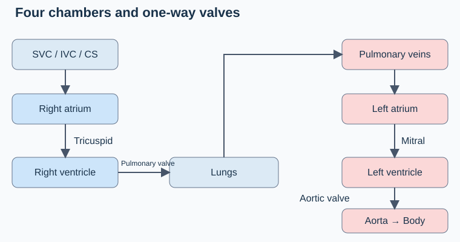

# Day 4 — Heart Chambers, Valves, Septum and Great Vessels

[Chapter](../README.md) | [Concepts](../Concepts/Day-04-Chambers-Valves.md) | [MCQs](../MCQs/Day-04-Chambers-Valves.md) | [Previous Year Questions](../Previous-Year-Questions/README.md) | [Revision](../Revision/Day-04-Chambers-Valves-Quick-Revision.md) | [References](../References.md)

**Status:** Theory covered in chat on 26 November 2026, including final gap audit. Practice Q1 offered, not attempted; Q2–Q50 and 30 mixed questions available for practice. Priorities study recommendations hain, official exam weightage nahi. NORCET 12 / HPRCA / PGIMER / ESIC / RRB.

## Contents
- [Four chambers](#four-chambers)
- [Septum and fetal openings](#septum-and-fetal-openings)
- [Four valves](#four-valves)
- [Chordae and papillary muscles](#chordae-and-papillary-muscles)
- [Valve mechanism and heart sounds](#valve-mechanism-and-heart-sounds)
- [Auscultation](#auscultation)
- [Clinical correlations](#clinical-correlations)
- [Great vessels](#great-vessels)
- [Videos and sources](#videos-and-sources)

## Four chambers

**Easy Hinglish — pehle concept samjho**

**Simple example:** Heart ko four-room house samjho. Upar ke do rooms (atria) blood receive karte hain, neeche ke do rooms (ventricles) blood pump karte hain. Right ventricle ko lungs tak pump karna hai; left ventricle ko poori body tak, isliye LV ki wall thicker hoti hai.

**Yaad rakho:** Right side → lungs, left side → body. Dono atria receiving chambers hain.

**Priority: Very High.** Heart ko ek four-room pumping house ki tarah imagine karo. Upar ke rooms blood receive karte hain aur neeche ke rooms blood ko aage pump karte hain. Atrium = Arrival of blood. Ventricle = blood ko aage pump karta hai.

| Chamber | Function | Blood type |
|---|---|---|
| Right atrium (RA) | Body aur myocardium se blood receive | Deoxygenated |
| Right ventricle (RV) | Lungs mein blood pump | Deoxygenated |
| Left atrium (LA) | Lungs se blood receive | Oxygenated |
| Left ventricle (LV) | Poori body mein blood pump | Oxygenated |

### Right atrium — Very High
SVC head, neck, upper limbs aur upper body se; IVC lower body se; coronary sinus heart muscle ka majority venous blood laata hai. Ye three main venous openings RA mein hain. RA → tricuspid valve → RV.
| Internal structure | Meaning |
|---|---|
| Sinus venarum | Smooth posterior part |
| Pectinate muscles | Comb-like muscular ridges, anterior wall and auricle |
| Crista terminalis | Smooth aur rough parts separate karne wali muscular ridge |
| Fossa ovalis | Fetal foramen ovale ka remnant on interatrial septum |
| Right auricle | Muscular pouch, capacity badhata hai |
| SA node | Natural pacemaker near SVC opening |
| AV node | Lower interatrial septal region near coronary sinus |

**Exam trap:** Coronary sinus opens into RA, not RV. Conduction details later.

#### Additional structures (Medium)
Eustachian valve IVC opening par variable flap hai. Fetal life mein IVC blood ko foramen ovale ki taraf direct karne mein help karta hai. Adult mein usually major function nahi. Thebesian valve coronary sinus opening par variable flap hai. Ye four main heart valves ki counting mein nahi aate.
Triangle of Koch right atrium mein anatomical region hai: tendon of Todaro, septal tricuspid annulus and coronary sinus ostium. AV node apex ke paas hai. [AATS anatomy](https://www.aats.org/tsra-primer-cardiac-anatomy).

### Right ventricle — Very High
RA → tricuspid → RV → pulmonary valve → pulmonary trunk → lungs. Trabeculae carneae inner ventricular wall ki irregular muscular ridges hain; dono ventricles mein present. Papillary muscles ventricular projections; RV generally three groups: anterior, posterior, septal (variation possible). Moderator band (septomarginal trabecula) septum se anterior papillary muscle/free wall region tak jaati hai aur right bundle branch fibers carry karti hai. Only RV. Conus arteriosus / infundibulum smooth upper outflow portion; funnel-shaped passage towards pulmonary valve.

### Left atrium — Very High
Normally four pulmonary veins: right superior, right inferior, left superior, left inferior. Anatomical variations possible; standard exam answer four. LA mostly smooth, pectinate muscles mainly left auricle. Esophagus behind LA. Blood mitral valve se LV mein jaata hai.
Left atrial appendage: AF mein effective atrial contraction kam → blood stasis → thrombus risk (particularly LAA) → embolic stroke risk. AF and anticoagulants later detail mein.

### Left ventricle — Very High
LA → mitral → LV → aortic valve → aorta → body. LV mein anterolateral aur posteromedial papillary muscles ke two main groups; chordae mitral leaflets ko anchor karti hain; trabeculae carneae present, moderator band absent, aortic vestibule smooth outflow region.
| Feature | RV | LV |
|---|---|---|
| Blood | Deoxygenated | Oxygenated |
| Inlet | Tricuspid | Mitral |
| Outlet | Pulmonary | Aortic |
| Papillary groups | Usually 3 | Usually 2 |
| Moderator band | Present | Absent |
| Circuit | Pulmonary | Systemic |
| Pressure | Lower | Higher |

## Septum and fetal openings

**Easy Hinglish — pehle concept samjho**

**Kya hai?** Septum heart ke right aur left parts ke beech partition hai. Jaise do rooms ke beech wall hoti hai, waise septum normally blood ko direct mix hone se rokta hai. Fetal life mein circulation alag hoti hai; foramen ovale ek normal fetal passage hai. Birth ke baad circulation badalti hai.

**Priority: High.** Septum = partition; jaise do rooms ke beech wall. Interatrial septum separates atria; interventricular separates ventricles; small AV septal region separates RA and LV. IV septum large muscular lower and small membranous upper part. ASD = abnormal atrial opening; VSD = abnormal ventricular opening; perimembranous common type. Typical uncomplicated ASD/VSD shunting initially left-to-right (depends on pressure/resistance). Detailed congenital disorders later.

Fetal lungs gas exchange nahi karte; oxygen placenta se milti hai. Foramen ovale RA → LA blood passage. Birth: first breath → lungs expand → pulmonary vascular resistance decreases → lung blood flow increases → LA pressure exceeds RA → flap closes functionally. Anatomical fusion later, not always complete. Fossa ovalis oval depression. PFO incomplete flap fusion, not exactly same as ASD. **Foramen = Opening; Fossa = Depression.**

## Four valves

**Easy Hinglish — pehle concept samjho**

**Analogy — one-way doors:** Valve ka kaam blood ko correct direction mein jaane dena aur reverse flow rokna hai. Pressure difference se valves open aur close hote hain. Tricuspid aur mitral atria aur ventricles ke beech; pulmonary aur aortic ventricles ke outlets par.

**Exam trick:** Right AV valve = tricuspid; left AV valve = mitral (bicuspid).

**Priority: Very High.** Valves heart ke one-way doors hain; non-return water valve ki tarah backflow prevent karte hain. AV valves atria and ventricles ke beech; semilunar ventricles and great arteries ke beech.

| Valve | Location | Cusps | Chordae |
|---|---|---|---|
| Tricuspid | RA → RV | 3 (anterior, posterior, septal) | Present |
| Pulmonary | RV → pulmonary trunk | 3 (anterior, right, left) | Absent |
| Mitral/bicuspid | LA → LV | 2 (anterior, posterior) | Present |
| Aortic | LV → aorta | 3 (right coronary, left coronary, non-coronary) | Absent |

**TPMA — Try Pulling My Aorta.** Normal total cusps = 11. Pulmonary and aortic valves lack chordae and papillary attachment. Aortic sinuses (sinuses of Valsalva) are behind cusps; right and left coronary arteries originate from respective aortic sinuses, normally none from non-coronary sinus. Detailed coronary circulation later.

### Annulus and commissures — High
Annulus fibrous support ring hai. Leaflets moving flaps, commissures adjacent leaflets ke meeting regions. Door ka frame annulus, moving part leaflet. Annular dilation se mitral leaflets ka coaptation (proper meeting) affect ho sakta hai, regurgitation possible. [Valve anatomy](https://teachmeanatomy.info/thorax/organs/heart/heart-valves/).

## Chordae and papillary muscles

**Easy Hinglish — pehle concept samjho**

Chordae tendineae ko strong strings samjho jo AV valve leaflets ko papillary muscles se connect karti hain. Ventricular contraction ke time papillary muscles chordae ko tension mein rakhte hain, taaki leaflets atria ki taraf prolapse na karein. Ye valve ko kheenchkar open nahi karte.

**Priority: Very High.** Chordae tendineae strong fibrous cords (heart strings) connect AV leaflets to papillary muscles. Papillary muscles ventricular myocardium ke muscular projections hain; systole mein contract karke chordae taut rakhte hain. AV leaflets atria mein ulte nahi mudte.

Parachute ki canopy ko leaflets aur strings ko chordae samjho. Strings canopy ko support karti hain. **Papillary muscles valves ko actively open ya close nahi karte.** Pressure differences valves ko open/close karte hain. Chordae aur papillary muscles prolapse prevent karte hain.
MI → papillary muscle rupture → loss of mitral support → systolic LV-to-LA leakage → acute MR → pulmonary edema/hypotension risk. Emergency clinical correlation only; disease management later.

## Valve mechanism and heart sounds

**Easy Hinglish — pehle concept samjho**

**Kaise hota hai?** Ventricles contract karte hain, pressure badhta hai aur AV valves close hote hain — S1 (lub). Ventricles relax karne lagte hain, semilunar valves close hote hain — S2 (dub).

**Exam clue:** S1 = mitral + tricuspid closure; S2 = aortic + pulmonary closure. Sound ko valve opening se confuse mat karna.

**Priority: Very High.** Systole = contraction; diastole = relaxation. Ventricular filling: atrial pressure > ventricular pressure, AV valves open, semilunar closed. Ejection: ventricular pressure > atrial pressure closes AV valves; ventricular pressure > corresponding arterial pressure opens semilunar valves. Pressure gradients drive passive opening/closure.

| Valve | Filling | Ejection |
|---|---|---|
| Mitral/tricuspid | Open | Closed |
| Aortic/pulmonary | Closed | Open |

**Dhyan de:** Isovolumetric contraction and relaxation mein all four valves closed. Whole systole/diastole mein same valve state nahi hoti. Detailed cardiac cycle later.
S1 LUB = mitral + tricuspid closure associated, start ventricular systole. S2 DUB = aortic + pulmonary closure associated, start ventricular diastole. Sounds associated with closure, not normal valve opening. HPSSC 2021 Q42 reported concept; full normal S2 includes both valves.

## Auscultation
**Priority: Very High.** Auscultation = stethoscope se sounds sunna. Actual valve location aur best listening area same nahi; sound tissues/blood flow se transmit hota hai.

| Area | Location |
|---|---|
| Aortic | Right 2nd ICS, sternal border |
| Pulmonic | Left 2nd ICS, sternal border |
| Erb's point | Left 3rd ICS, sternal border |
| Tricuspid | Left 4th–5th ICS, lower sternal border |
| Mitral | Left 5th ICS, midclavicular line |

APE To Man = Aortic, Pulmonic, Erb, Tricuspid, Mitral. Aortic right, others left. Erb's point separate valve nahi.
### Patient position and stethoscope — Very High
Left lateral decubitus position mitral stenosis low-pitched murmur and S3/S4 ke liye useful. Sitting leaning forward, after exhalation if tolerated, aortic regurgitation ke liye useful. Traditional bell lightly apply; low-pitched sounds. Diaphragm firmly apply; higher-pitched sounds, S1/S2 and AR. Bell = low frequency. Detailed cardiovascular assessment later.

## Clinical correlations
**Priority: Very High (introductory).** Stenosis = opening narrow, forward flow obstructed. Regurgitation/insufficiency/incompetence = incomplete closure, backward leakage. Prolapse = abnormal leaflet bulging (mitral systole LA ki taraf). Atresia = congenital absent/nonpatent opening. Bicuspid aortic valve = congenital two cusps instead of normal three.
| Disorder | Mechanism | Typical murmur timing |
|---|---|---|
| Mitral stenosis | LA → LV obstructed | Diastolic |
| Mitral regurgitation | LV → LA leakage | Systolic |
| Aortic stenosis | LV → aorta obstructed | Systolic |
| Aortic regurgitation | Aorta → LV leakage | Diastolic |

Detailed symptoms, rheumatic disease, diagnosis, treatment, nursing management later.

## Great vessels
**Priority: Very High.** SVC upper body → RA; IVC lower body → RA; coronary sinus myocardium → RA; pulmonary arteries RV → lungs; pulmonary veins lungs → LA; aorta LV → body.
Artery = away from heart; vein = towards heart; oxygen content definition nahi. Pulmonary artery deoxygenated, pulmonary veins oxygenated in normal postnatal circulation. Full pulmonary/systemic circulation next topic.

## Practice after theory

[50 topic-wise MCQs](../MCQs/Day-04-Chambers-Valves.md) · [30 mixed mock](../MCQs/Day-04-Cardio-Studied-Topics-Mixed-Mock-30.md) · [Previous Year Questions evidence](../Previous-Year-Questions/README.md#chambers-and-valves-evidence).

## Videos and sources
| Topic group | Teaching video | MCQ practice |
|---|---|---|
| Chambers, great vessels, valves, chordae | [Nursing Wallah — Heart A&P Lifeline](https://www.youtube.com/watch?v=JyiYX39mW2c) | [CVS question discussion Part 1](https://www.youtube.com/watch?v=y6YYRSndzRE) |
| Valve mechanism and support | [Heart working model](https://www.youtube.com/watch?v=s4KD2legpH8) | [Staff Nurse CVS 25 MCQs](https://www.youtube.com/watch?v=0FQ6kGFkvEA) |
| Septum, fetal openings, small internal structures, auscultation | Written references below; individual suitable videos not separately verified | Mixed video only relevant sections; individual coverage not confirmed |

Titles/descriptions verified, full videos not watched. Skip unstudied sections. [OpenStax heart anatomy](https://openstax.org/books/anatomy-and-physiology-2e/pages/19-1-heart-anatomy), [AATS anatomy](https://www.aats.org/tsra-primer-cardiac-anatomy), [TeachMeAnatomy valves](https://teachmeanatomy.info/thorax/organs/heart/heart-valves/), [Open RN assessment](https://www.ncbi.nlm.nih.gov/books/NBK596723/), [OpenStax nursing assessment](https://openstax.org/books/clinical-nursing-skills/pages/24-3-nursing-assessment). Diagrams new schematic reconstructions, exact chat image bytes not accessible.

[Chapter](../README.md) | [Concepts](../Concepts/Day-04-Chambers-Valves.md) | [MCQs](../MCQs/Day-04-Chambers-Valves.md) | [Previous Year Questions](../Previous-Year-Questions/README.md) | [Revision](../Revision/Day-04-Chambers-Valves-Quick-Revision.md) | [References](../References.md)
