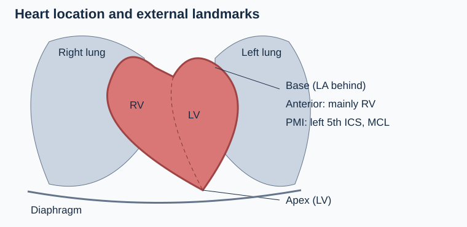
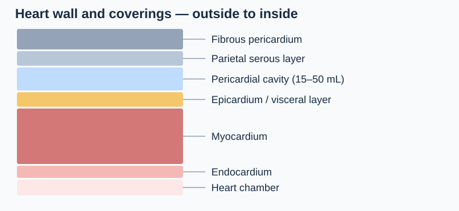
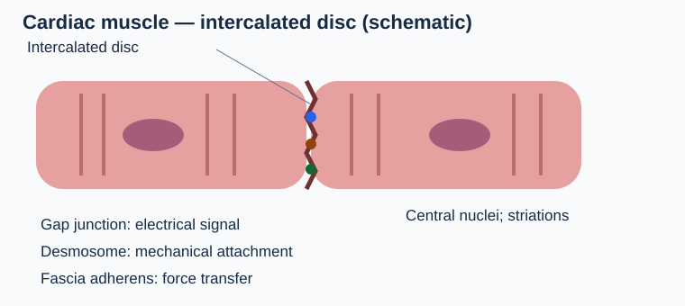

# Day 4 — Heart Anatomy, Pericardium and Cardiac Muscle

[Chapter](../README.md) | [Concepts](../Concepts/Day-04-Heart-Anatomy-Pericardium-Cardiac-Muscle.md) | [MCQs](../MCQs/Day-04-Heart-Anatomy-Pericardium-Cardiac-Muscle.md) | [Previous Year Questions](../Previous-Year-Questions/README.md) | [Revision](../Revision/Day-04-Heart-Anatomy-Quick-Revision.md) | [References](../References.md)

**Status:** Taught in chat on 26 November 2026; practice in progress. NORCET 12, HPRCA, PGIMER and all-India nursing exams. Yeh external heart anatomy aur cardiac muscle basics hain, poora CVS nahi.

## Contents
- [Location and external anatomy](#location-and-external-anatomy)
- [Pericardium and heart wall](#pericardium-and-heart-wall)
- [Cardiac muscle and skeleton](#cardiac-muscle-and-skeleton)
- [Clinical correlations](#clinical-correlations)
- [Videos](#videos)

## Location and external anatomy

Cardiovascular system body ka transportation system hai. Heart blood pump karta hai, blood vessels blood ko ek jagah se doosri jagah le jaati hain aur blood oxygen, nutrients, hormones aur waste products transport karta hai. Heart ko water pump ki tarah samjho, blood vessels ko pipes aur blood ko pipes mein flow hone wala liquid.

| Feature | Important fact |
|---|---|
| Location | Middle mediastinum, between lungs |
| Size | Approximately closed fist |
| Shape | Cone-shaped |
| Adult weight | Approximately 250–350 g; varies |
| Position | Roughly 2/3 left and 1/3 right of midline |
| Apex | Left ventricle |
| Base | Mainly left atrium |
| Normal adult apex beat | Left 5th intercostal space, midclavicular line |

Apex heart ka neeche wala pointed part, left side ki taraf hota hai. Base broad posterior part hai. Apex beat ko PMI (Point of Maximal Impulse) bhi kehte hain. Intercostal space = do ribs ke beech ki jagah; midclavicular line = collarbone ke middle se neeche aane wali imaginary line. **Memory trick:** Apex = Left + 5th ICS + MCL; Base = LA, Apex = LV.

### Surfaces and borders
| Surface | Mainly formed by |
|---|---|
| Anterior (sternocostal) | Right ventricle |
| Inferior (diaphragmatic) | Left ventricle, partly right ventricle |
| Posterior (base) | Left atrium |
| Right pulmonary surface | Right atrium |
| Left pulmonary surface | Left ventricle |

| Border | Mainly formed by |
|---|---|
| Right | Right atrium |
| Left | Left ventricle, small left auricle contribution |
| Inferior | Mainly right ventricle, small left ventricle contribution |
| Superior | Atria/auricles and roots of great vessels |

**Exam trap:** Anterior surface = RV, apex = LV, base = LA. Surface aur border same cheez nahi.

### External grooves (Sulci)
Sulcus ka matlab groove ya heart ki external surface par bani hui naali jaisi structure. In grooves mein coronary blood vessels travel karti hain.
- Coronary sulcus (AV groove): atria aur ventricles ko separate karta hai.
- Anterior interventricular sulcus: right aur left ventricles ke beech anteriorly.
- Posterior interventricular sulcus: right aur left ventricles ke beech posteriorly.
Memory trick: Inter = between, ventricular = ventricles, sulcus = groove.

### Anatomical relations
Anterior: sternum and costal cartilages. Posterior: esophagus and descending thoracic aorta. Inferior: diaphragm. Lateral: lungs and mediastinal pleura. Superior: great vessels. Esophagus left atrium ke peeche hota hai; isi relationship ka use transesophageal echocardiography (TEE) mein hota hai.

### Embryological development (High priority for HP Staff Nurse)
Heart embryo ki splanchnic (splanchnopleuric) mesoderm se develop hota hai. [NCBI embryology](https://www.ncbi.nlm.nih.gov/books/NBK537313/) · [HPSSC 2022 scanned Q43](https://www.snowstudy.in/wp-content/uploads/2022/09/Staff-Nurse-933-Post-Code-Question-Paper.pdf#page=10). [Additional 40 topic-wise MCQs and priorities](../Concepts/Extra-High-Yield-Concepts-and-MCQs.md).

### Position variations
Levocardia: apex left side. Dextrocardia: congenital right-directed apex. Situs inversus totalis: thoracic aur abdominal organs ki mirror-image arrangement. Har dextrocardia patient mein situs inversus necessary nahi hai.

## Pericardium and heart wall
Pericardium ek protective sac hai jo heart ko surround karta hai. Fibrous pericardium tough outer covering hai; heart ko protect karta hai, position maintain karta hai aur sudden excessive stretching prevent karta hai. Serous pericardium ki two layers: parietal aur visceral (epicardium).

| Layer | Location and function |
|---|---|
| Epicardium | Outermost heart wall; visceral serous pericardium; protection |
| Myocardium | Middle muscular layer; contraction and pumping |
| Endocardium | Innermost smooth lining; chambers and valves cover karta hai |

**Memory trick EME:** Epicardium external, Myocardium muscle/middle, Endocardium internal lining. Left ventricular myocardium sabse thick hai: poori body mein high pressure se blood pump karna hota hai. RV ko lungs tak blood bhejna hota hai. LV wall roughly three times RV wall ho sakti hai; measurement varies. More workload → more pressure → thicker muscle.

Pericardial cavity parietal aur visceral serous layers ke beech potential space hai. Normal serous fluid approximately **15–50 mL** (clinical reference). Jaise machine mein oil friction kam karta hai, waise hi pericardial fluid heart ki continuous movement mein friction kam karta hai.

### Attachments, nerves and blood supply
| Point | Fact |
|---|---|
| Inferior attachment | Central tendon of diaphragm |
| Anterior attachment | Sternum via sternopericardial ligaments |
| Superior attachment | Adventitia of great vessels |
| Fibrous and parietal sensory supply | Phrenic nerve C3–C5 |
| Visceral layer | Autonomic innervation |
| Fibrous/parietal arterial supply | Mainly pericardiacophrenic artery (internal thoracic branch), other small branches |
| Visceral blood supply | Coronary arteries |

Phrenic nerve aur pericardiacophrenic vessels lateral pericardium ke paas saath travel karte hain. Pericardial irritation shoulder region mein referred pain de sakti hai. **C3, C4, C5 keep the diaphragm alive.**

### Pericardial sinuses
Transverse sinus ascending aorta/pulmonary trunk ke posterior aur SVC ke anterior mein passage hai. Oblique sinus left atrium ke posterior mein blind-ending recess hai. Lower priority but anatomy MCQs mein useful.

## Cardiac muscle and skeleton

| Property | Cardiac muscle |
|---|---|
| Control | Involuntary |
| Appearance | Striated |
| Shape | Branched |
| Nucleus | Usually single, centrally located; sometimes two |
| Special structure | Intercalated discs |
| Contraction | Rhythmic |
| Tetanus | Normally not possible |

Skeletal muscle voluntary and striated; smooth muscle involuntary and non-striated. Cardiac muscle dono striated aur involuntary hai. Cardiomyocytes mein mitochondria bahut zyada hote hain kyunki heart continuously kaam karta hai.

Intercalated discs ek cardiac muscle cell ko doosre se connect karte hain. Gap junctions electrical impulses pass karte hain; desmosomes cells ko strongly connected rakhte hain; fascia adherens contraction ki force transfer karta hai. Jaise electrical wires ek doosre se connected hoti hain, waise hi gap junctions electrical signals transfer karte hain. Functional syncytium: multiple cells coordinated unit ki tarah kaam karti hain.

### Histology
Epicardium: mesothelium and connective tissue. Myocardium: cardiac muscle tissue. Endocardium: simple squamous endothelium with underlying connective tissue.

### Fibrous cardiac skeleton
Ye bones se bana skeleton nahi hai; dense connective tissue framework hai. Valve support, valve openings ko overstretching se bachana, muscle attachment aur atria-ventricles ke beech electrical insulation provide karta hai. Normally electrical impulse AV bundle (Bundle of His) ke through cross karta hai. Full conduction sequence next topic mein padhenge.

### Special properties
| Property | Easy meaning |
|---|---|
| Automaticity | Khud impulse generate karna, mainly specialized pacemaker cells |
| Rhythmicity | Regular rhythm mein impulse generate karna |
| Excitability | Stimulus ka response dena |
| Conductivity | Electrical impulse aage transmit karna |
| Contractility | Contract hokar force generate karna |

Cardiac muscle ka refractory period long hota hai. Is wajah se sustained tetanic contraction normally nahi hota. Agar heart continuously contracted rahega, toh relax nahi kar payega aur blood filling nahi hogi. Yahan tetanus ka matlab infection nahi, sustained muscular contraction hai.

## Clinical correlations
| Condition | Meaning |
|---|---|
| Pericarditis | Pericardium ki inflammation |
| Myocarditis | Heart muscle ki inflammation |
| Endocarditis | Inner lining ki inflammation, often involving valves |
| Pericardial effusion | Excessive pericardial fluid accumulation |
| Cardiac tamponade | Fluid pressure ki wajah se heart filling compromised |
| Myocardial infarction | Ischemia ki wajah se heart muscle injury/death |
| Hemopericardium | Pericardial cavity mein blood |
| Pneumopericardium | Pericardial cavity mein air |
| Pericardiocentesis | Needle/catheter se pericardial fluid remove karna |
| Pericardiectomy | Pericardium surgically remove karna |

Tamponade: Excessive pericardial fluid → heart compression → decreased ventricular filling → decreased cardiac output → hypotension/risk of shock. Rapid accumulation mein kam fluid bhi dangerous ho sakta hai. Effusion aur tamponade same nahi; tamponade emergency hai. Pericardiocentesis selected tamponade cases mein life-saving ho sakta hai. Full disease management later.

**Memory tricks:** Tamponade = pressure on heart. Myo = muscle, cardio = heart, itis = inflammation. Fibrous = firm covering; fluid = friction reduction.

## Topic-wise priorities

Very High: heart wall/pericardial fluid, intercalated discs and cardiac skeleton, cardiac muscle properties, clinical conditions. High: location/development, surfaces/borders/grooves, cardiac muscle/histology. Medium: attachments, nerves, supply. Low: pericardial sinuses. [Practice all nine groups](../Concepts/Extra-High-Yield-Concepts-and-MCQs.md).

## Videos
| Studied topic group | Teaching | Practice |
|---|---|---|
| Heart position, external anatomy, surfaces | [Bhushan Science Nursing — Heart structure Hindi](https://www.youtube.com/watch?v=fHfqO5U63M0); [Dr Asim — General Anatomy of Human Heart Hindi/Urdu](https://www.youtube.com/watch?v=0K4-6NkDR3w) | [Cardiovascular System questions Part 01](https://www.youtube.com/watch?v=y6YYRSndzRE) |
| Layers and pericardium | [Layers of Heart in Hindi](https://www.youtube.com/watch?v=Bd5Isncdj_0) | Same practice video, coverings section only |
| Cardiac muscle, skeleton, histology, nerves, sinuses, clinical variations | No separately verified video for each fine subtopic; use written notes | No separately verified video for each fine subtopic |

Video titles/descriptions checked, full transcripts/length not verified. Skip unstudied ECG and disorders in mixed video. Source-linked diagrams are original reconstructions, not exact chat image bytes.

## Quick recall
Apex LV; base LA; anterior RV; normal PMI left 5th ICS MCL; EME; cavity between serous layers; 15–50 mL; phrenic C3–5; gap junction electrical; desmosomes mechanical; long refractory period; tamponade pressure. 

[Chapter](../README.md) | [Concepts](../Concepts/Day-04-Heart-Anatomy-Pericardium-Cardiac-Muscle.md) | [MCQs](../MCQs/Day-04-Heart-Anatomy-Pericardium-Cardiac-Muscle.md) | [Previous Year Questions](../Previous-Year-Questions/README.md) | [Revision](../Revision/Day-04-Heart-Anatomy-Quick-Revision.md) | [References](../References.md)
