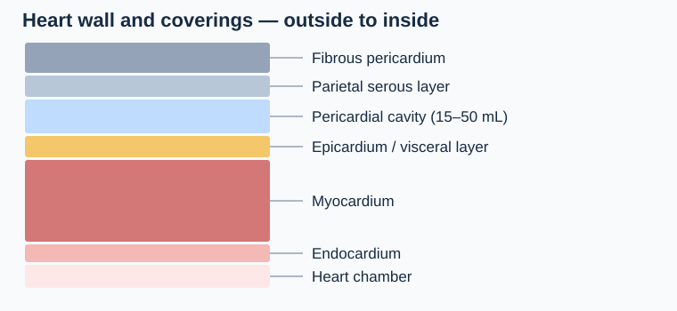

# Day 4 — Extra High-Yield Heart Anatomy Concepts and 40 Topic-wise MCQs

[Chapter](../README.md) | [Concepts](../Concepts/Day-04-Heart-Anatomy-Pericardium-Cardiac-Muscle.md) | [MCQs](../MCQs/Day-04-Heart-Anatomy-Pericardium-Cardiac-Muscle.md) | [Previous Year Questions](../Previous-Year-Questions/README.md) | [Revision](../Revision/Day-04-Heart-Anatomy-Quick-Revision.md) | [References](../References.md)

**Status:** 40 original English practice questions provided in chat, unattempted; not official Previous Year Questions. Priorities are study recommendations, not official exam weightage. Exact stems and options retained, including Q10/Q14 as explicitly marked optional terminology/application reinforcement. Earlier 8 questions stay in the [original bank](../MCQs/Day-04-Heart-Anatomy-Pericardium-Cardiac-Muscle.md).

## Missed high-yield concept: embryological development (High priority for HP Staff Nurse)

Heart embryo ki **splanchnic (splanchnopleuric) mesoderm** se develop hota hai. Lateral plate mesoderm ka visceral layer cardiac progenitors ka source hai. Surface ectoderm, neural ectoderm aur endoderm primary cardiac tissue source nahi hain. [NCBI embryology](https://www.ncbi.nlm.nih.gov/books/NBK537313/) · [HP scanned paper, Series A, Q43, printed page 10](https://www.snowstudy.in/wp-content/uploads/2022/09/Staff-Nurse-933-Post-Code-Question-Paper.pdf#page=10). Original paper answer medically reasoned C; official key not verified. Practice Q4 is newly worded, answer A.

## Topic priorities and practice

- Topic 1: Location, size, shape and development — **High** (4 questions)
- Topic 2: Surfaces, borders, grooves and anatomical relations — **High** (5 questions)
- Topic 3: Heart wall, pericardium and pericardial fluid — **Very High** (5 questions)
- Topic 4: Pericardial attachments, nerves and blood supply — **Medium** (5 questions)
- Topic 5: Pericardial sinuses — **Low** (2 questions)
- Topic 6: Cardiac muscle and histology — **High** (4 questions)
- Topic 7: Intercalated discs and fibrous cardiac skeleton — **Very High** (5 questions)
- Topic 8: Properties of cardiac muscle — **Very High** (5 questions)
- Topic 9: Clinical conditions and anatomical variations — **Very High** (5 questions)

## Topic 1 — Location, size, shape and development | High priority

### Q1. Approximately how much of the normal adult heart lies to the left of the midline?

- **A.** One-fourth
- **B.** One-third
- **C.** Two-thirds
- **D.** Three-fourths

**Difficulty:** Easy | **Exam focus:** NORCET / HPRCA / All-India Staff Nurse

✅ Answer aur detailed explanation dekho

**C. Two-thirds**

**Kyun sahi?** Heart midline ke dono taraf hai; roughly 2/3 left aur 1/3 right.

**Baaki options kyun nahi?** A too little; B roughly right-side proportion; D usual estimate se zyada.

**Exam trick:** Left 2/3, right 1/3.

### Q2. Which of the following best describes the approximate weight of a normal adult heart?

- **A.** 50–100 g
- **B.** 250–350 g
- **C.** 500–600 g
- **D.** 700–900 g

**Difficulty:** Easy | **Exam focus:** NORCET / HPRCA / All-India Staff Nurse

✅ Answer aur detailed explanation dekho

**B. 250–350 g**

**Kyun sahi?** Adult heart approximately 250–350 g; body size aur sex se vary karta hai.

**Baaki options kyun nahi?** A too low; C aur D typical normal adult estimate se kaafi high.

**Exam trick:** Weight approximate hai, fixed nahi.

### Q3. The size of a normal adult heart is approximately equal to which of the following?

- **A.** An open palm
- **B.** A kidney
- **C.** Two closed fists
- **D.** A closed fist

**Difficulty:** Easy | **Exam focus:** NORCET / HPRCA / All-India Staff Nurse

✅ Answer aur detailed explanation dekho

**D. A closed fist**

**Kyun sahi?** Heart roughly apni closed fist jitna hota hai.

**Baaki options kyun nahi?** A open palm flat hai; B kidney alag shape hai; C normal estimate se larger.

**Exam trick:** One closed fist.

### Q4. The primordial heart develops primarily from which embryonic tissue?

- **A.** Splanchnic mesoderm
- **B.** Surface ectoderm
- **C.** Neural ectoderm
- **D.** Endoderm

**Difficulty:** Medium | **Exam focus:** NORCET / HPRCA / All-India Staff Nurse

✅ Answer aur detailed explanation dekho

**A. Splanchnic mesoderm**

**Kyun sahi?** Cardiac progenitors splanchnic lateral plate mesoderm se aate hain. Ye HPSSC scanned paper Q43 ka concept hai.

**Baaki options kyun nahi?** B epidermis jaise tissues; C nervous system; D gut lining jaise tissues ka source hai, primary cardiac tissue nahi.

**Exam trick:** Heart = splanchnic mesoderm; scanned source ka original option C hai, is new MCQ ka A.

## Topic 2 — Surfaces, borders, grooves and anatomical relations | High priority

### Q5. Which chamber forms the major part of the sternocostal surface of the heart?

- **A.** Left atrium
- **B.** Left ventricle
- **C.** Right atrium
- **D.** Right ventricle

**Difficulty:** Medium | **Exam focus:** NORCET / HPRCA / All-India Staff Nurse

✅ Answer aur detailed explanation dekho

**D. Right ventricle**

**Kyun sahi?** Sternocostal matlab sternum ki taraf anterior surface, mainly RV.

**Baaki options kyun nahi?** A base; B apex aur left surface; C right border.

**Exam trick:** Anterior RV, apex LV.

### Q6. Which cardiac chamber predominantly forms the right border of the heart?

- **A.** Right atrium
- **B.** Right ventricle
- **C.** Left atrium
- **D.** Left ventricle

**Difficulty:** Easy | **Exam focus:** NORCET / HPRCA / All-India Staff Nurse

✅ Answer aur detailed explanation dekho

**A. Right atrium**

**Kyun sahi?** Right atrium right cardiac border ka main part hai.

**Baaki options kyun nahi?** B mainly anterior/inferior border; C posterior base; D left border.

**Exam trick:** Right border RA.

### Q7. The diaphragmatic surface of the heart is predominantly formed by which structures?

- **A.** Both atria
- **B.** Both ventricles, predominantly the left ventricle
- **C.** Right atrium and left atrium
- **D.** Left atrium and pulmonary trunk

**Difficulty:** Medium | **Exam focus:** NORCET / HPRCA / All-India Staff Nurse

✅ Answer aur detailed explanation dekho

**B. Both ventricles, predominantly the left ventricle**

**Kyun sahi?** Inferior surface diaphragm par rest karta hai; mainly LV aur partly RV.

**Baaki options kyun nahi?** A and C atria hi hain; D posterior atrium aur great vessel hai.

**Exam trick:** Diaphragmatic = inferior, LV dominant.

### Q8. Which external groove separates the atria from the ventricles?

- **A.** Interatrial sulcus
- **B.** Anterior interventricular sulcus
- **C.** Coronary sulcus
- **D.** Posterior interventricular sulcus

**Difficulty:** Medium | **Exam focus:** NORCET / HPRCA / All-India Staff Nurse

✅ Answer aur detailed explanation dekho

**C. Coronary sulcus**

**Kyun sahi?** Coronary sulcus ko AV groove bhi kehte hain.

**Baaki options kyun nahi?** A atria ke beech; B anterior ventricles ke beech; D posterior ventricles ke beech.

**Exam trick:** AV = atrium–ventricle.

### Q9. During transesophageal echocardiography, which cardiac chamber is anatomically closest to the esophagus?

- **A.** Right ventricle
- **B.** Right atrium
- **C.** Left ventricle
- **D.** Left atrium

**Difficulty:** Difficult | **Exam focus:** NORCET / HPRCA / All-India Staff Nurse

✅ Answer aur detailed explanation dekho

**D. Left atrium**

**Kyun sahi?** Esophagus LA ke posterior mein hai; TEE is relation ka use karta hai.

**Baaki options kyun nahi?** A anterior hai; B right border; C inferior/apical part, LA se less directly related.

**Exam trick:** TEE: esophagus behind LA.

## Topic 3 — Heart wall, pericardium and pericardial fluid | Very High priority

### Q10. Which layer of the heart is continuous with the visceral layer of the serous pericardium?

- **A.** Myocardium
- **B.** Epicardium
- **C.** Endocardium
- **D.** Fibrous pericardium

**Difficulty:** Easy | **Exam focus:** NORCET / HPRCA / All-India Staff Nurse

✅ Answer aur detailed explanation dekho

**B. Epicardium**

**Kyun sahi?** Epicardium hi visceral serous layer hai, heart ki outer surface par.

**Baaki options kyun nahi?** A muscle; C inner lining; D tough outer sac.

**Exam trick:** Visceral = epicardium.

### Q11. What is the approximate normal volume of fluid in the adult pericardial cavity?

- **A.** 1–5 mL
- **B.** 100–150 mL
- **C.** 15–50 mL
- **D.** 200–250 mL

**Difficulty:** Easy | **Exam focus:** NORCET / HPRCA / All-India Staff Nurse

✅ Answer aur detailed explanation dekho

**C. 15–50 mL**

**Kyun sahi?** Normal lubricating fluid roughly 15–50 mL; sources ke ranges vary kar sakte hain.

**Baaki options kyun nahi?** A typical range se low; B aur D usual normal volume se high.

**Exam trick:** 15–50 mL pericardial fluid.

### Q12. What is the primary physiological function of pericardial fluid?

- **A.** Reducing friction during cardiac movement
- **B.** Generating cardiac impulses
- **C.** Supplying oxygen to cardiac muscle
- **D.** Increasing ventricular contraction

**Difficulty:** Easy | **Exam focus:** NORCET / HPRCA / All-India Staff Nurse

✅ Answer aur detailed explanation dekho

**A. Reducing friction during cardiac movement**

**Kyun sahi?** Fluid machine oil ki tarah moving surfaces mein friction kam karta hai.

**Baaki options kyun nahi?** B pacemaker cells; C coronary blood supply; D muscle contractility.

**Exam trick:** Fluid = friction reduction.

### Q13. Which sequence correctly represents the layers of the heart wall from outside to inside?

- **A.** Endocardium → Epicardium → Myocardium
- **B.** Myocardium → Endocardium → Epicardium
- **C.** Epicardium → Endocardium → Myocardium
- **D.** Epicardium → Myocardium → Endocardium

**Difficulty:** Medium | **Exam focus:** NORCET / HPRCA / All-India Staff Nurse

✅ Answer aur detailed explanation dekho

**D. Epicardium → Myocardium → Endocardium**

**Kyun sahi?** Outside epicardium, middle myocardium, inside endocardium.

**Baaki options kyun nahi?** A starts inside; B starts muscle; C muscle ko innermost rakhta hai.

**Exam trick:** EME = External, Muscle, Endo.

### Q14. A pathological process affects the serous membrane directly attached to the external surface of the heart. Which structure is involved?

- **A.** Visceral serous pericardium
- **B.** Parietal serous pericardium
- **C.** Endocardium
- **D.** Fibrous pericardium

**Difficulty:** Medium | **Exam focus:** NORCET / HPRCA / All-India Staff Nurse

✅ Answer aur detailed explanation dekho

**A. Visceral serous pericardium**

**Kyun sahi?** Visceral serous pericardium directly heart surface par hai, epicardium bhi kehte hain.

**Baaki options kyun nahi?** B fibrous sac ki internal surface line karta hai; C chamber lining; D outer tough covering.

**Exam trick:** Q10 ki terminology ka clinical recall; optional reinforcement.

## Topic 4 — Pericardial attachments, nerves and blood supply | Medium priority

### Q15. The fibrous pericardium is attached inferiorly to which structure?

- **A.** Xiphoid process
- **B.** Central tendon of the diaphragm
- **C.** Esophagus
- **D.** Thoracic vertebrae

**Difficulty:** Medium | **Exam focus:** NORCET / HPRCA / All-India Staff Nurse

✅ Answer aur detailed explanation dekho

**B. Central tendon of the diaphragm**

**Kyun sahi?** Inferior fibrous sac central tendon se fused hota hai.

**Baaki options kyun nahi?** A anterior sternum relation; C posterior relation; D posterior bony structure, normal inferior attachment nahi.

**Exam trick:** Diaphragm central tendon.

### Q16. Which nerve carries somatic sensory impulses from the parietal pericardium?

- **A.** Vagus nerve
- **B.** Hypoglossal nerve
- **C.** Phrenic nerve
- **D.** Accessory nerve

**Difficulty:** Medium | **Exam focus:** NORCET / HPRCA / All-India Staff Nurse

✅ Answer aur detailed explanation dekho

**C. Phrenic nerve**

**Kyun sahi?** Phrenic nerve fibrous aur parietal layers ka somatic sensory supply hai.

**Baaki options kyun nahi?** A autonomic role; B tongue movement; D SCM/trapezius motor.

**Exam trick:** Phrenic C3–C5.

### Q17. A patient with pericardial inflammation experiences referred shoulder pain. Which spinal nerve roots explain this finding?

- **A.** C3–C5
- **B.** C6–C8
- **C.** T6–T8
- **D.** L1–L3

**Difficulty:** Difficult | **Exam focus:** NORCET / HPRCA / All-India Staff Nurse

✅ Answer aur detailed explanation dekho

**A. C3–C5**

**Kyun sahi?** Phrenic afferents C3–C5 spinal segments mein enter karte hain; shoulder region mein referred pain feel ho sakta hai.

**Baaki options kyun nahi?** B lower cervical; C thoracic; D lumbar roots, characteristic phrenic origin nahi.

**Exam trick:** C3, C4, C5 keep diaphragm alive.

### Q18. Which artery is a major source of blood supply to the fibrous and parietal pericardium?

- **A.** Pulmonary artery
- **B.** Radial artery
- **C.** Brachial artery
- **D.** Pericardiacophrenic artery

**Difficulty:** Medium | **Exam focus:** NORCET / HPRCA / All-India Staff Nurse

✅ Answer aur detailed explanation dekho

**D. Pericardiacophrenic artery**

**Kyun sahi?** Pericardiacophrenic artery phrenic nerve ke saath travel karke pericardium supply karti hai.

**Baaki options kyun nahi?** A lungs; B forearm/hand; C upper limb artery.

**Exam trick:** Pericardium → pericardiacophrenic.

### Q19. The pericardiacophrenic artery usually arises from which artery?

- **A.** Axillary artery
- **B.** Internal thoracic artery
- **C.** Common carotid artery
- **D.** Coronary artery

**Difficulty:** Difficult | **Exam focus:** NORCET / HPRCA / All-India Staff Nurse

✅ Answer aur detailed explanation dekho

**B. Internal thoracic artery**

**Kyun sahi?** Internal thoracic artery ki branch hai.

**Baaki options kyun nahi?** A axilla/upper limb; C head and neck; D myocardium/visceral pericardium supply.

**Exam trick:** Internal thoracic → pericardiacophrenic.

## Topic 5 — Pericardial sinuses | Low priority

### Q20. The transverse pericardial sinus lies posterior to which structures?

- **A.** Superior and inferior vena cava
- **B.** Right and left pulmonary veins
- **C.** Ascending aorta and pulmonary trunk
- **D.** Esophagus and thoracic aorta

**Difficulty:** Difficult | **Exam focus:** NORCET / HPRCA / All-India Staff Nurse

✅ Answer aur detailed explanation dekho

**C. Ascending aorta and pulmonary trunk**

**Kyun sahi?** Transverse sinus arterial outflow vessels ke peeche aur SVC ke aage hai.

**Baaki options kyun nahi?** A sinus SVC ke anterior hai; B pulmonary veins oblique sinus se related; D posterior mediastinal structures.

**Exam trick:** Transverse = behind arterial outflow.

### Q21. The oblique pericardial sinus is located primarily behind which chamber?

- **A.** Left atrium
- **B.** Right atrium
- **C.** Right ventricle
- **D.** Left ventricle

**Difficulty:** Medium | **Exam focus:** NORCET / HPRCA / All-India Staff Nurse

✅ Answer aur detailed explanation dekho

**A. Left atrium**

**Kyun sahi?** Oblique sinus LA ke posterior blind-ending recess hai.

**Baaki options kyun nahi?** B right border; C anterior; D mainly inferior/apex, sinus ki primary relation nahi.

**Exam trick:** Oblique behind LA.

## Topic 6 — Cardiac muscle and histology | High priority

### Q22. Which combination of characteristics correctly describes cardiac muscle?

- **A.** Voluntary and non-striated
- **B.** Voluntary and striated
- **C.** Involuntary and non-striated
- **D.** Involuntary and striated

**Difficulty:** Easy | **Exam focus:** NORCET / HPRCA / All-India Staff Nurse

✅ Answer aur detailed explanation dekho

**D. Involuntary and striated**

**Kyun sahi?** Cardiac muscle striated hoti hai par conscious control mein nahi.

**Baaki options kyun nahi?** A typical muscle class nahi; B skeletal; C smooth muscle.

**Exam trick:** Cardiac = involuntary + striated.

### Q23. A microscopic examination of normal cardiac muscle reveals which cellular characteristic?

- **A.** Multiple peripheral nuclei in long unbranched fibers
- **B.** Branched cells with predominantly central nuclei
- **C.** Spindle-shaped cells without striations
- **D.** Cells without nuclei or mitochondria

**Difficulty:** Medium | **Exam focus:** NORCET / HPRCA / All-India Staff Nurse

✅ Answer aur detailed explanation dekho

**B. Branched cells with predominantly central nuclei**

**Kyun sahi?** Cardiomyocytes branched, striated aur usually central nucleus wale hain.

**Baaki options kyun nahi?** A skeletal; C smooth; D mature RBC-like features, cardiac cells nahi.

**Exam trick:** Branched + central nucleus.

### Q24. The abundance of mitochondria in cardiomyocytes primarily supports which function?

- **A.** Storage of genetic material
- **B.** Production of digestive enzymes
- **C.** Continuous energy production for contraction
- **D.** Formation of pericardial fluid

**Difficulty:** Medium | **Exam focus:** NORCET / HPRCA / All-India Staff Nurse

✅ Answer aur detailed explanation dekho

**C. Continuous energy production for contraction**

**Kyun sahi?** Mitochondria ATP provide karte hain; heart constantly contract karta hai.

**Baaki options kyun nahi?** A nucleus primary genetic storage; B digestive secretory cells; D serous membrane fluid role.

**Exam trick:** Mitochondria = ATP for pumping.

### Q25. Which epithelial tissue lines the internal surface of the heart chambers?

- **A.** Simple squamous epithelium
- **B.** Stratified squamous epithelium
- **C.** Transitional epithelium
- **D.** Pseudostratified columnar epithelium

**Difficulty:** Medium | **Exam focus:** NORCET / HPRCA / All-India Staff Nurse

✅ Answer aur detailed explanation dekho

**A. Simple squamous epithelium**

**Kyun sahi?** Endocardial endothelium simple squamous epithelium hai; smooth blood-contact surface.

**Baaki options kyun nahi?** B skin/esophagus types; C urinary tract; D respiratory airway.

**Exam trick:** Endothelium = simple squamous.

## Topic 7 — Intercalated discs and fibrous cardiac skeleton | Very High priority

### Q26. Which component of an intercalated disc facilitates the movement of ions between adjacent cardiac muscle cells?

- **A.** Desmosomes
- **B.** Collagen fibers
- **C.** Fascia adherens
- **D.** Gap junctions

**Difficulty:** Medium | **Exam focus:** NORCET / HPRCA / All-India Staff Nurse

✅ Answer aur detailed explanation dekho

**D. Gap junctions**

**Kyun sahi?** Gap junction channels ions/electrical signal adjacent cell mein pass karte hain.

**Baaki options kyun nahi?** A mechanical adhesion; B connective tissue support; C actin anchoring.

**Exam trick:** Gap = electrical connection.

### Q27. Which structure primarily prevents adjacent cardiac muscle cells from separating during contraction?

- **A.** Gap junctions
- **B.** Desmosomes
- **C.** Nuclei
- **D.** Mitochondria

**Difficulty:** Medium | **Exam focus:** NORCET / HPRCA / All-India Staff Nurse

✅ Answer aur detailed explanation dekho

**B. Desmosomes**

**Kyun sahi?** Desmosomes strong mechanical attachment provide karte hain.

**Baaki options kyun nahi?** A ion transfer; C genetic control; D energy production.

**Exam trick:** Desmosome = cells hold together.

### Q28. Which component of the intercalated disc anchors actin filaments and helps transmit contractile force?

- **A.** Fascia adherens
- **B.** Gap junction
- **C.** Sarcoplasmic reticulum
- **D.** Nucleus

**Difficulty:** Difficult | **Exam focus:** NORCET / HPRCA / All-India Staff Nurse

✅ Answer aur detailed explanation dekho

**A. Fascia adherens**

**Kyun sahi?** Fascia adherens actin anchor karta hai aur force transfer karta hai.

**Baaki options kyun nahi?** B electrical coupling; C calcium storage; D genetic control.

**Exam trick:** Adherens = actin anchoring.

### Q29. Damage to electrical connections between adjacent cardiomyocytes would most directly interfere with which function?

- **A.** Formation of pericardial fluid
- **B.** Oxygen binding to hemoglobin
- **C.** Coordinated contraction as a functional syncytium
- **D.** Production of heart valves

**Difficulty:** Difficult | **Exam focus:** NORCET / HPRCA / All-India Staff Nurse

✅ Answer aur detailed explanation dekho

**C. Coordinated contraction as a functional syncytium**

**Kyun sahi?** Electrical coupling weak ho to coordinated cell activation/contraction affect hota hai.

**Baaki options kyun nahi?** A serous membrane; B RBC hemoglobin; D connective tissue/valve development.

**Exam trick:** Functional syncytium = coordinated unit.

### Q30. Which function of the fibrous cardiac skeleton helps maintain orderly electrical activation of the ventricles?

- **A.** Generation of spontaneous electrical impulses
- **B.** Direct transmission of impulses throughout all cardiac muscle
- **C.** Production of contractile proteins
- **D.** Electrical insulation between the atria and ventricles

**Difficulty:** Difficult | **Exam focus:** NORCET / HPRCA / All-India Staff Nurse

✅ Answer aur detailed explanation dekho

**D. Electrical insulation between the atria and ventricles**

**Kyun sahi?** Fibrous skeleton atria aur ventricles insulate karta hai, normal AV bundle route se impulse cross hota hai.

**Baaki options kyun nahi?** A pacemaker; B conduction cells/gap junctions; C cardiomyocytes.

**Exam trick:** Skeleton insulates, bundle conducts.

## Topic 8 — Properties of cardiac muscle | Very High priority

### Q31. The ability of specialized cardiac cells to initiate an electrical impulse without external stimulation is known as:

- **A.** Contractility
- **B.** Automaticity
- **C.** Conductivity
- **D.** Excitability

**Difficulty:** Easy | **Exam focus:** NORCET / HPRCA / All-India Staff Nurse

✅ Answer aur detailed explanation dekho

**B. Automaticity**

**Kyun sahi?** Specialized pacemaker cells spontaneously impulse generate karte hain.

**Baaki options kyun nahi?** A force; C impulse spread; D response to stimulus.

**Exam trick:** Auto = self.

### Q32. A cardiac cell responds to an adequate electrical stimulus by generating an action potential. Which property is demonstrated?

- **A.** Rhythmicity
- **B.** Contractility
- **C.** Automaticity
- **D.** Excitability

**Difficulty:** Medium | **Exam focus:** NORCET / HPRCA / All-India Staff Nurse

✅ Answer aur detailed explanation dekho

**D. Excitability**

**Kyun sahi?** Excitability stimulus ka electrical response hai.

**Baaki options kyun nahi?** A regularity; B force; C spontaneous generation without stimulus.

**Exam trick:** Excitable = responds.

### Q33. Which property allows an electrical impulse to spread from one region of the heart to another?

- **A.** Conductivity
- **B.** Contractility
- **C.** Elasticity
- **D.** Rhythmicity

**Difficulty:** Medium | **Exam focus:** NORCET / HPRCA / All-India Staff Nurse

✅ Answer aur detailed explanation dekho

**A. Conductivity**

**Kyun sahi?** Conductivity signal ko aage transmit karne ki ability hai.

**Baaki options kyun nahi?** B force; C stretch/recoil; D regular timing.

**Exam trick:** Conduct = transmit.

### Q34. Which property of cardiac muscle enables it to develop force and shorten?

- **A.** Automaticity
- **B.** Excitability
- **C.** Contractility
- **D.** Conductivity

**Difficulty:** Medium | **Exam focus:** NORCET / HPRCA / All-India Staff Nurse

✅ Answer aur detailed explanation dekho

**C. Contractility**

**Kyun sahi?** Contractility mechanical force aur shortening generate karna hai.

**Baaki options kyun nahi?** A self impulse; B response; D transmission.

**Exam trick:** Contract = force.

### Q35. Why is sustained tetanic contraction normally prevented in cardiac muscle?

- **A.** Absence of calcium ions
- **B.** Prolonged refractory period
- **C.** Absence of actin filaments
- **D.** Lack of electrical activity

**Difficulty:** Difficult | **Exam focus:** NORCET / HPRCA / All-India Staff Nurse

✅ Answer aur detailed explanation dekho

**B. Prolonged refractory period**

**Kyun sahi?** Long refractory period contraction ke dauran repeated stimulation limit karta hai, relaxation aur filling possible hoti hai.

**Baaki options kyun nahi?** A calcium necessary hai; C actin present; D electrical activity necessary.

**Exam trick:** Long refractory → no tetanus.

## Topic 9 — Clinical conditions and anatomical variations | Very High priority

### Q36. A patient has excess pericardial fluid, but ventricular filling and hemodynamic function remain unaffected. Which condition best describes this finding?

- **A.** Cardiac tamponade
- **B.** Myocarditis
- **C.** Myocardial infarction
- **D.** Pericardial effusion

**Difficulty:** Medium | **Exam focus:** NORCET / HPRCA / All-India Staff Nurse

✅ Answer aur detailed explanation dekho

**D. Pericardial effusion**

**Kyun sahi?** Excess fluid alone effusion hai; hemodynamic compromise nahi hai.

**Baaki options kyun nahi?** A filling impaired hoti hai; B muscle inflammation; C ischemic injury.

**Exam trick:** Effusion fluid; tamponade pressure.

### Q37. Following chest trauma, blood accumulates within the pericardial cavity. What is this condition called?

- **A.** Hemopericardium
- **B.** Hemothorax
- **C.** Hemoptysis
- **D.** Pneumopericardium

**Difficulty:** Medium | **Exam focus:** NORCET / HPRCA / All-India Staff Nurse

✅ Answer aur detailed explanation dekho

**A. Hemopericardium**

**Kyun sahi?** Hemo = blood, pericardium = sac around heart.

**Baaki options kyun nahi?** B blood in pleural cavity; C coughing blood; D air in pericardium.

**Exam trick:** Location aur material dono identify karo.

### Q38. Which procedure involves removing accumulated fluid from the pericardial cavity using a needle or catheter?

- **A.** Thoracentesis
- **B.** Paracentesis
- **C.** Pericardiocentesis
- **D.** Bronchoscopy

**Difficulty:** Medium | **Exam focus:** NORCET / HPRCA / All-India Staff Nurse

✅ Answer aur detailed explanation dekho

**C. Pericardiocentesis**

**Kyun sahi?** Pericardiocentesis pericardial fluid drain karta hai.

**Baaki options kyun nahi?** A pleural fluid; B commonly abdominal ascites drainage; D airway examination.

**Exam trick:** Centesis = puncture/drain; pericardio = heart sac.

### Q39. Which hemodynamic change is expected when elevated pericardial pressure significantly restricts ventricular filling?

- **A.** Increased cardiac output
- **B.** Decreased cardiac output
- **C.** Increased ventricular filling
- **D.** Increased stroke volume

**Difficulty:** Difficult | **Exam focus:** NORCET / HPRCA / All-India Staff Nurse

✅ Answer aur detailed explanation dekho

**B. Decreased cardiac output**

**Kyun sahi?** Filling kam → stroke volume kam → cardiac output kam, compensation fail ho to hypotension.

**Baaki options kyun nahi?** A opposite expected effect; C directly contradicts stem; D reduced filling se SV usually decreases.

**Exam trick:** Tamponade → filling ↓ → output ↓.

### Q40. Imaging reveals a congenital right-sided cardiac apex with normally positioned abdominal organs. Which finding is most appropriate?

- **A.** Levocardia
- **B.** Situs inversus totalis
- **C.** Pericardial effusion
- **D.** Dextrocardia

**Difficulty:** Medium | **Exam focus:** NORCET / HPRCA / All-India Staff Nurse

✅ Answer aur detailed explanation dekho

**D. Dextrocardia**

**Kyun sahi?** Congenital right-directed apex dextrocardia hai, normal abdominal arrangement ke saath bhi possible.

**Baaki options kyun nahi?** A left apex; B thoracic/abdominal mirror arrangement; C fluid accumulation.

**Exam trick:** Dextro = right; situs describes organs.

## Videos and references

- [Heart anatomy and layers teaching video — Nursing Wallah](https://www.youtube.com/watch?v=s4KD2legpH8) (description/timestamps checked; studied section only).
- [Original day concept and practice video links](../Concepts/Day-04-Heart-Anatomy-Pericardium-Cardiac-Muscle.md#videos). Full transcripts and individual fine-subtopic videos not independently verified.
- [OpenStax cardiac muscle](https://openstax.org/books/anatomy-and-physiology-2e/pages/19-2-cardiac-muscle-and-electrical-activity) · [NCBI heart and pericardial cavity](https://ncbi.nlm.nih.gov/sites/books/NBK482452/) · [All references](../References.md).

[Chapter](../README.md) | [Concepts](../Concepts/Day-04-Heart-Anatomy-Pericardium-Cardiac-Muscle.md) | [MCQs](../MCQs/Day-04-Heart-Anatomy-Pericardium-Cardiac-Muscle.md) | [Previous Year Questions](../Previous-Year-Questions/README.md) | [Revision](../Revision/Day-04-Heart-Anatomy-Quick-Revision.md) | [References](../References.md)

## Next practice

[50 chambers and valves questions](../MCQs/Day-04-Chambers-Valves.md) · [30 mixed Cardio mock](../MCQs/Day-04-Cardio-Studied-Topics-Mixed-Mock-30.md). Earlier 40 anatomy questions preserved; no reprinting.
