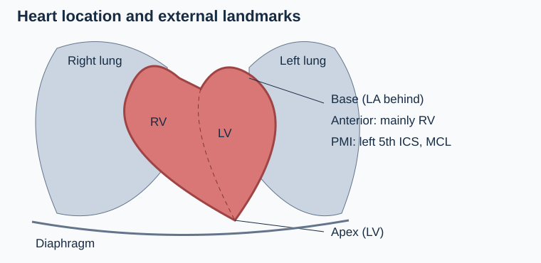

# ❤️ Cardiovascular System — NORCET & Staff Nurse

[Repository home](../../README.md) | [Concepts](Concepts/Day-04-Heart-Anatomy-Pericardium-Cardiac-Muscle.md) | [MCQs](MCQs/Day-04-Heart-Anatomy-Pericardium-Cardiac-Muscle.md) | [Previous Year Questions](Previous-Year-Questions/README.md) | [Revision](Revision/Day-04-Heart-Anatomy-Quick-Revision.md) | [References](References.md)

Heart aur blood circulation ka chapter. Day 4 mein external heart anatomy, pericardium aur cardiac muscle basics padhe hain. Chambers, valves, septum, great vessels aur auscultation basics bhi cover hue hain. Practice in progress hai.

| Studied topic group | Concepts | English MCQs | Previous Year Questions | Teaching video | Practice video | Revision |
|---|---|---|---|---|---|---|
| Day 4: location, surfaces, borders, grooves, relations, variants | [Read](Concepts/Day-04-Heart-Anatomy-Pericardium-Cardiac-Muscle.md#location-and-external-anatomy) | [8 questions](MCQs/Day-04-Heart-Anatomy-Pericardium-Cardiac-Muscle.md) | [Reported leads](Previous-Year-Questions/README.md) | [Heart anatomy Hindi](https://www.youtube.com/watch?v=fHfqO5U63M0) | [Mixed CVS practice](https://www.youtube.com/watch?v=y6YYRSndzRE) | [Revise](Revision/Day-04-Heart-Anatomy-Quick-Revision.md) |
| Day 4: pericardium, layers, fluid, nerves, attachments, sinuses | [Read](Concepts/Day-04-Heart-Anatomy-Pericardium-Cardiac-Muscle.md#pericardium-and-heart-wall) | [Same bank](MCQs/Day-04-Heart-Anatomy-Pericardium-Cardiac-Muscle.md) | [Evidence](Previous-Year-Questions/README.md) | [Heart layers Hindi](https://www.youtube.com/watch?v=Bd5Isncdj_0) | [Coverings section](https://www.youtube.com/watch?v=y6YYRSndzRE) | [Revise](Revision/Day-04-Heart-Anatomy-Quick-Revision.md) |
| Day 4: cardiac muscle, junctions, skeleton, histology and clinical basics | [Read](Concepts/Day-04-Heart-Anatomy-Pericardium-Cardiac-Muscle.md#cardiac-muscle-and-skeleton) | [Same bank](MCQs/Day-04-Heart-Anatomy-Pericardium-Cardiac-Muscle.md) | [Evidence](Previous-Year-Questions/README.md) | Not separately verified | Not separately verified | [Revise](Revision/Day-04-Heart-Anatomy-Quick-Revision.md) |

**Practice:** Q1–Q7 attempted in chat; Q8 pending. 40 additional topic-wise practice MCQs are now available (unattempted); 48 total across both banks. No personal scores published.

## Additional topic-wise practice — 40 MCQs

[Open 40 MCQs with hidden Hinglish answers and topic priorities](Concepts/Extra-High-Yield-Concepts-and-MCQs.md). Includes embryology, surfaces, coverings, nerves, sinuses, histology, junctions, muscle properties and clinical basics. 9 Easy, 22 Medium, 9 Difficult. Priorities are study guidance, not official weights.

## Topic 2 — Chambers and valves (Very High priority)

| Topic | Concepts | MCQs | Previous Year Questions | Teaching | Practice video | Revision |
|---|---|---|---|---|---|---|
| Chambers, septum, fetal openings | [Read](Concepts/Day-04-Chambers-Valves.md#four-chambers) | [Q1 pending](MCQs/Day-04-Chambers-Valves.md) | [HP 2026 Q38 reported](Previous-Year-Questions/README.md#chambers-and-valves-evidence) | [Heart A&P](https://www.youtube.com/watch?v=JyiYX39mW2c) | [CVS discussion](https://www.youtube.com/watch?v=y6YYRSndzRE) | [Revise](Revision/Day-04-Chambers-Valves-Quick-Revision.md) |
| Valves, chordae, papillary muscles, great vessels | [Read](Concepts/Day-04-Chambers-Valves.md#four-valves) | [Practice](MCQs/Day-04-Chambers-Valves.md) | [HP 2021 Q42 reported](Previous-Year-Questions/README.md#chambers-and-valves-evidence) | [Heart working model](https://www.youtube.com/watch?v=s4KD2legpH8) | [25 MCQs](https://www.youtube.com/watch?v=0FQ6kGFkvEA) | [Revise](Revision/Day-04-Chambers-Valves-Quick-Revision.md) |
| Auscultation, clinical basics and extra anatomy | [Read](Concepts/Day-04-Chambers-Valves.md#auscultation) | [Practice](MCQs/Day-04-Chambers-Valves.md) | [Evidence](Previous-Year-Questions/README.md#chambers-and-valves-evidence) | Not separately verified | Not separately verified | [Revise](Revision/Day-04-Chambers-Valves-Quick-Revision.md) |

Five reconstructed diagrams embedded; complete lesson includes final gap audit. 1 question offered, not attempted; 50 planned questions not yet delivered. Total existing CVS questions: 49 (48 anatomy + 1 chambers).

**Next study:** Chambers/valves practice, then pulmonary and systemic blood circulation. Coronary circulation, conduction, ECG, diseases and treatment not yet completed.

**Sources:** [Medical references](References.md). HPSSC 2022 Series A Q43 verified in third-party scanned paper; official key not verified. Other reported leads are separate. Videos checked by titles/descriptions, not full transcripts. Diagrams original reconstructed SVGs.

[Repository home](../../README.md) | [Concepts](Concepts/Day-04-Heart-Anatomy-Pericardium-Cardiac-Muscle.md) | [MCQs](MCQs/Day-04-Heart-Anatomy-Pericardium-Cardiac-Muscle.md) | [Previous Year Questions](Previous-Year-Questions/README.md) | [Revision](Revision/Day-04-Heart-Anatomy-Quick-Revision.md)
