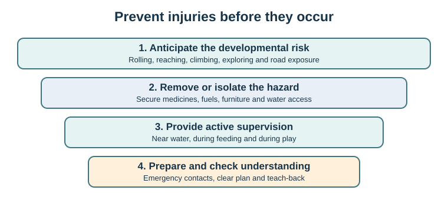
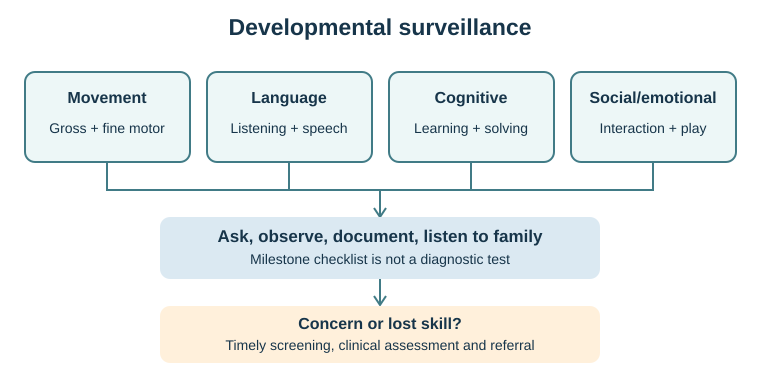
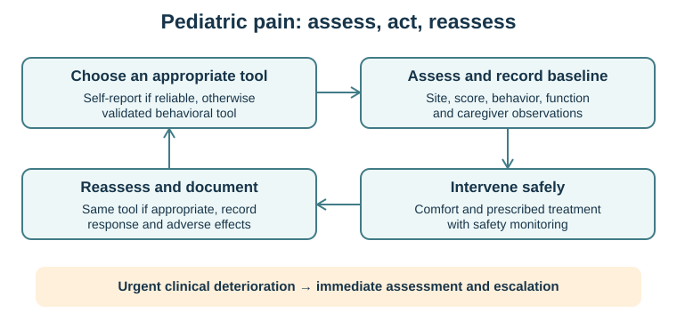

# Child Health Nursing — Batch 01: Healthy child and hospital care

> Original teaching candidate. Roman Hinglish revision notes for NORCET and Indian Staff Nurse examinations. Not a substitute for facility policy, individualized assessment or clinical supervision. Independent clinical and language review pending.

## 01A. Preventive pediatrics and injury prevention

Anticipatory guidance ka matlab hai bacche ki next developmental ability ko anticipate karke caregiver ko injury hone se pehle prepare karna. Jab baby roll karna seekhta hai, changing surface se girne ka risk badhta hai. Jab toddler climb karta hai, furniture, stairs aur windows ka risk badhta hai. Sirf bacche ko "careful raho" kehna enough nahi hota.

- **Safe sleep:** Healthy infant ko har sleep ke liye back (supine) position mein firm, flat, non-inclined sleep surface par rakho. Loose pillows, quilts, soft toys aur positioners sleep area mein nahi hone chahiye. Reflux alone routine prone sleeping ka indication nahi hai. Car seat travel restraint hai, routine sleep surface nahi. Agar infant travel device mein so jaye, practical aur safe hote hi suitable flat sleep surface par transfer karo.
- **Poisoning:** Medicines, household cleaners aur kerosene original labelled containers mein locked, child-inaccessible storage mein rakho. Fuel ko water ya soft-drink bottle mein store mat karo. Suspected ingestion mein symptoms aane ka wait mat karo. Urgent professional guidance lo, vomiting induce mat karo aur container identification team ko do.
- **Drowning:** Water ke paas close, continuous, attentive adult supervision chahiye. Buckets aur tubs use ke baad empty karo. Water access ko barriers se restrict karo. Float toys supervision ka replacement nahi hain.
- **Choking:** Developmentally suitable food texture aur shape use karo. Child ko upright aur supervised feed karo. Whole nuts, whole grapes aur hard round pieces young children ke airway ko obstruct kar sakte hain. Toys ke small detachable parts aur loose button batteries secure rakho. Suspected button battery ingestion urgent medical assessment maangta hai even if child initially asymptomatic ho.
- **Falls and burns:** Stair guards, secured furniture, window protection aur low safe play surfaces useful hain. Hot liquids, electrical cords aur cooking handles child reach se door rakho. Active supervision aur environmental control dono zaroori hain.
- **Road safety:** Child restraint ko size, manufacturer limits, vehicle compatibility aur applicable local rules ke hisaab se choose karo. Infant ko adult ki lap par hold karna effective crash restraint nahi hai. Helmet, crossing supervision aur age-appropriate road education reinforce karo.

Home visit mein nurse age-specific hazards identify kare, caregiver ke resources samjhe, realistic changes suggest kare aur teach-back se confirm kare. Injury ko automatically caregiver negligence assume nahi karna chahiye. Safeguarding concern ho toh institutional and applicable legal pathway follow karo.

[Practice: 20 injury prevention MCQs](../MCQs/01A-Preventive-Pediatrics-and-Injury-Prevention-20-MCQs.md)

## 01B. Developmental surveillance and milestones

Growth body size mein quantitative change hai. Development skills aur function mein progressive change hai. Gross motor mein large muscle movement, fine motor mein hand-finger coordination, language mein receptive aur expressive communication, cognitive mein learning/problem solving aur social-emotional mein interaction aur emotional regulation assess hota hai.

Surveillance har suitable health encounter par longitudinal observation hai. Standardized screening validated instrument se risk identify karti hai. Diagnostic assessment alag process hai. Caregiver concern ko seriously lo, even when a checklist appears reassuring. Milestone ages guides hain, exact deadlines ya diagnosis nahi. Skill loss/regression, concerning asymmetry or persistent concern warrants timely assessment and referral.

Selected CDC surveillance examples (most children by that age, not a stand-alone diagnostic rule):

| Age | Examples |
|---|---|
| 2 months | Looks at face, smiles when spoken to, holds head up on tummy |
| 6 months | Reaches for toy, laughs, rolls tummy to back |
| 9 months | Sits without support, transfers objects, responds to name |
| 12 months | Pulls up to stand, waves bye-bye, uses thumb and pointer finger to pick things up |
| 18 months | Walks without holding on, points to show something interesting, tries at least three words besides mama/dada |
| 2 years | Says at least two words together, runs, kicks ball |
| 3 years | Joins play, asks simple questions, copies circle when shown |
| 4 years | Pretend play, sentences of four or more words, catches large ball most of the time |
| 5 years | Takes turns in games, tells a story with at least two events, hops on one foot |

Preterm infant mein early developmental assessment ke liye corrected age consider karo according to local follow-up protocol. Example: 32 weeks gestation par birth hua aur chronological age 6 months hai. Approx 8 weeks early birth ko subtract karne par corrected age about 4 months hai. Exact dates use karo. Different developmental tools ke age rules check karo.

Nurse chronological and relevant corrected age, parent observations, skills across domains and any regression document kare. Hearing or vision concerns, inadequate opportunities and medical factors ko assess kare rather than a single label assign kare. Early intervention referral delay mat karo when indicated.

**Overlap protection:** Detailed child anthropometry and nutritional measurement questions are reserved in Nutrition and Dietetics draft PR35 (03C). Is batch mein unko repeat nahi kiya gaya. Growth chart interpretation remains a cross-reference topic pending coordination and verified integration.

[Practice: 20 developmental surveillance MCQs](../MCQs/01B-Developmental-Surveillance-and-Milestones-20-MCQs.md)

## 01C. Developmental theories and play

Erikson ke psychosocial stages exam mein age and nursing approach ke saath connect karo.

| Stage | Developmental challenge | Nursing support |
|---|---|---|
| Infancy | Trust vs mistrust | Consistent comfort, caregiver contact |
| Toddler | Autonomy vs shame and doubt | Safe choices and self-care attempts |
| Preschool | Initiative vs guilt | Explain simply, encourage imaginative play |
| School age | Industry vs inferiority | Tasks with achievable success, learning continuity |
| Adolescence | Identity vs role confusion | Privacy, participation and respectful discussion |

Piaget ke cognitive model mein sensorimotor stage (roughly birth to 2 years) action aur sensory exploration se learning hoti hai. Object permanence ka matlab object nazar se disappear ho kar bhi exist karta hai. Preoperational stage (roughly 2–7) symbolic play aur limited perspective-taking common hain. Concrete operational stage (roughly 7–11) logical reasoning concrete objects par stronger hoti hai. Formal operational thought adolescence mein abstract and hypothetical reasoning ko support kar sakta hai. Real children different pace par progress karte hain.

Play normal learning, coping aur emotional expression support karta hai. Solitary, parallel, associative aur cooperative play descriptive patterns hain, rigid age-based diagnoses nahi. Hospitalized toddler ke liye safe independent/parallel play options useful ho sakte hain. Preschool child doll par procedure enact karke fears express kar sakta hai. School-age child ko achievable games aur school activities maintain karne mein help karo. Adolescent ko preferences aur peer contact ke appropriate options do.

Therapeutic play child ko procedure understand karne, emotions express karne aur sense of control develop karne mein help karta hai. Yeh consent, pain assessment ya prescribed analgesia ka replacement nahi. Shared toys cleanable, developmentally safe aur isolation precautions ke compatible hone chahiye.

[Practice: 20 theories and play MCQs](../MCQs/01C-Developmental-Theories-and-Play-20-MCQs.md)

## 01D. Hospitalized child and family-centered care

Family-centered care mein respect, understandable information, appropriate participation aur collaboration important hain. Child aur caregiver dono ko care partnership mein involve karo according to child capacity, family preference and safety.

Admission ke time child ka usual sleep, feeding, comfort object, communication needs, medication and allergy history, developmental level aur family routines samjho. Hospitalization se anxiety, sleep disturbance, separation distress ya temporary behavioral regression ho sakta hai. Child ko shame ya punishment mat do. Predictable routine, familiar caregiver, appropriate play aur honest age-appropriate preparation coping mein help karte hain.

Toddler ko simple choices do jahan choice genuinely available hai. Preschool child ko concrete language mein procedure explain karo and avoid threatening expressions. School-age child ko steps aur purpose explain karo. Adolescent ko respectful privacy aur confidential conversation offer karo within safeguarding, consent and local legal limits. Legal consent requirements aur developmentally appropriate assent separate concepts hain. Emergency care ko inappropriate delay mat karo.

Triadic interview mein clinician, child aur caregiver teen participants hote hain. Child ki understandable responses directly invite karo aur caregiver se additional context lo. Language barrier mein appropriate qualified interpretation arrange karo. Discharge readiness mein caregiver ko warning signs, medication plan, follow-up and emergency contact information clear hona chahiye. Chronic illness wale child ke liye school action plan, activity guidance aur relevant contacts coordinate karna useful hai. Safeguarding, infection control aur confidentiality requirements preserve karo.

[Practice: 20 hospitalization MCQs](../MCQs/01D-Hospitalized-Child-and-Family-Centered-Care-20-MCQs.md)

## 01E. Pediatric pain assessment and reassessment

Pain subjective experience hai. Jab child reliable self-report de sakta hai, uski report important evidence hai. Sirf crying, tachycardia ya staff impression se pain intensity establish nahi hoti. Child quiet ho tab bhi pain possible hai. Tool choice age, understanding, communication ability and facility protocol ke hisaab se karo.

- FLACC: Face, Legs, Activity, Cry, Consolability. Har item 0–2 score, total 0–10. Useful behavioral approach when self-report is not reliable. Individual baseline aur clinical context consider karo.
- Revised FLACC: individualized behavioral descriptors caregivers ke input se helpful ho sakte hain for children with cognitive or communication impairment.
- Faces Pain Scale–Revised: child se apne pain level ko represent karne wala face choose karwao, happiness/sadness nahi. Validated scale instructions follow karo.
- Numerical rating scale: tab choose karo jab child numbers aur pain intensity ordering samajh sake. Sirf age dekh kar numeric understanding assume mat karo.
- Neonatal pain: suitable neonatal validated instrument and neonatal-unit protocol follow karo. Adult pain scale force mat karo.

Pain assessment mein location, severity, onset, aggravating factors, function, baseline behavior aur caregiver observation include karo. Rest aur care/movement ke during pain different ho sakta hai. Comfort positioning, age-appropriate distraction and caregiver support ko prescribed analgesia ke saath coordinate karo. Sedating medicines ke baad appropriate respiratory and sedation monitoring essential hai. Same appropriate tool se response reassess karo within intervention- and protocol-specific interval. Document score, intervention, time, adverse effects and next action. New severe pain or clinical deterioration urgent clinical evaluation maangta hai, sirf repeat score ka wait nahi.

[Practice: 20 pain MCQs](../MCQs/01E-Pediatric-Pain-Assessment-and-Reassessment-20-MCQs.md)

## Sources and scope

The five topics map to healthy child/development, preventive pediatrics, hospitalized child, and pediatric pain elements in INC B.Sc. Nursing curriculum. Full chapter coverage and full independent audit are not complete. See [candidate evidence and video gaps](Batch-01-Research-and-Video-Evidence.md) and [candidate inventory](../MCQs/Batch-01-Original-MCQ-Candidate-Inventory.md).
