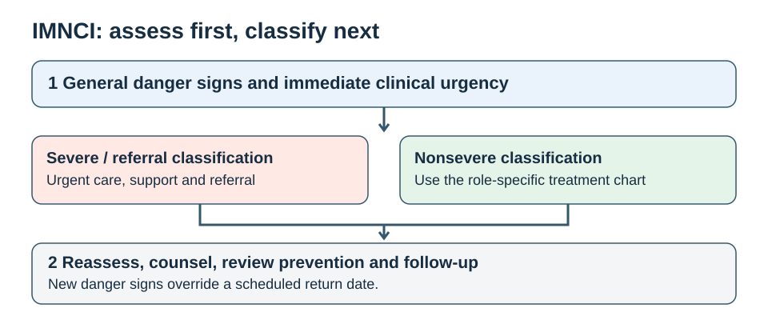

# IMNCI health-worker clinical decisions — Batch 02A

> Draft NORCET/Staff Nurse revision. Roman Hinglish. This lesson deliberately uses the **India NHM 2023 health-worker chart for children aged 2–59 months**. Medical-officer and generic WHO charts are not interchangeable; local approved updates and trained clinician judgement govern actual care.

## 1. Assessment comes before classification

IMNCI mein child ko sirf presenting symptom se label nahi karte. Sabse pehle general danger signs check karo: kya child drink/breastfeed kar sakta hai, kya har oral intake vomit karta hai, convulsion history hai, aur lethargy/unconsciousness present hai? Vomiting everything ka matlab ordinary occasional vomiting nahi hai. Child kuch bhi retain nahi kar pa raha, yeh important distinction hai. Convulsion abhi visible na ho tab bhi relevant history ignore nahi karni.

Danger sign present ho to urgently assess, classify and arrange indicated support/referral according to the health-worker pathway. Har associated symptom assess karo, but emergency care ko routine paperwork ke liye delay mat karo.

## 2. Cough and difficult breathing

Respiratory rate calm child mein full one minute count karo. Crying se rate temporarily high ho sakti hai. Chart cutoffs: 2–11 months at least 50/min; 12–59 months at least 40/min. Exact age important hai: 12 completed months means the latter category.

Health-worker chart mein lower chest indrawing, specified danger signs, stridor in a calm child or SpO2 below 90% can trigger the severe classification. Is chart ko medical-officer chart ke chest-indrawing pathway se confuse mat karo. Normal respiratory rate alone severe finding ko cancel nahi karti. Cough longer than 14 days merits further assessment according to the chart, even if the current classification is not pneumonia.

## 3. Diarrhea, supervised ORS and reassessment

Blood in stool is a separate referral concern even when dehydration signs absent hain. Dehydration class independently determine karo. If already classified as some dehydration and suitable for supervised Plan B, approximate initial ORS is 75 mL/kg over four hours. Example: 11 kg × 75 mL/kg = 825 mL. Continue suitable breastfeeding; vomiting once does not automatically mean Plan B has failed. Pause around ten minutes and resume slower small sips if child remains suitable for oral rehydration. Reassess after initial period and reclassify, rather than automatically repeating the same plan. Worsening danger signs require prompt review.

## 4. Fever, anemia and follow-up

Fever with stiff neck or another general danger sign requires urgent severe-febrile-disease action regardless of a positive malaria test. Malaria testing in specified endemic contexts follows chart and local public-health program. Persistent daily fever longer than seven days requires further assessment. Severe palmar pallor supports severe anemia referral classification; pallor is not a laboratory hemoglobin measurement.

If two nonurgent classifications have different follow-up dates, arrange the earlier review while keeping other follow-ups. New difficulty breathing, inability to drink or other danger signs mean immediate reassessment, not waiting for the planned appointment.

## 5. Prevention during illness visits

An acute illness visit also allows checking immunization status, vitamin A, iron–folic acid and indicated preventive services according to current eligibility. Assess caregiver-child interaction, play and communication practices. Counselling individualized honi chahiye, not merely handing over medicines. Do not duplicate sibling Nutrition anthropometry questions.

## Sources and practice

- [NHM IMNCI health-worker chart booklet, 2023](https://nhm.gov.in/images/pdf/programmes/child-health/guidelines/IMNCI-Module-2023-For-health-worker/IMNCI-Chart-booklet-Health-Worker-2023.pdf), role-specific pages on general danger signs, respiratory classification, diarrhea, fever, anemia, follow-up and preventive services.
- [Medical-officer chart, separate role](https://www.nhm.gov.in/images/pdf/programmes/child-health/guidelines/IMNCI-Module-2023-For-Medical-Officers/IMNCI-Chart-booklet-Medical-Officer-2023.pdf) — compare role before applying.
- [20 original MCQs](../MCQs/02A-IMNCI-Health-Worker-Classification-and-Follow-Up-20-MCQs.md).
- [Topic-level MCQ video lead](https://www.youtube.com/watch?v=CNmwF9sNhjg) — indexed title/description only; exact item, timestamps and playback pending. Separate teaching video verification pending.
