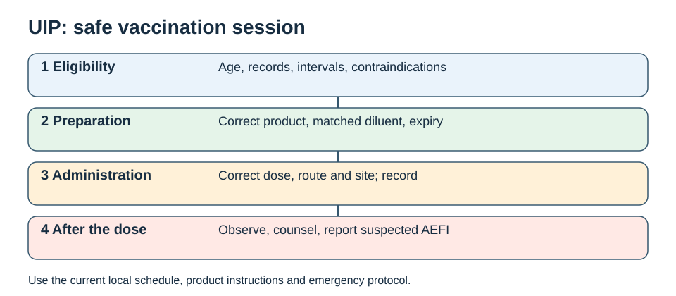

# Pediatric UIP vaccination and AEFI — Batch 02B

> Draft original Roman Hinglish notes. Use the cited Indian MoHFW health-worker immunization manual for these version-specific exam cases. Current program amendments, eligibility, product-specific instructions and facility orders supersede these revision notes for real care. The 2026 HPV campaign needs separate current-program review.

## 1. Understand the schedule rather than memorizing an old poster

UIP ka goal eligible children ko vaccine-preventable disease protection dena hai. Immunization record se age, previous valid doses, intervals aur contraindications verify karte hain. Catch-up mein generally valid earlier series ko restart nahi karte; missing doses appropriate intervals and eligibility ke according complete karte hain.

| Routine age in cited manual | Selected vaccine set |
|---|---|
| 6 weeks | bOPV-1, pentavalent-1, rotavirus-1, fIPV-1 and PCV-1 |
| 10 weeks | bOPV-2, pentavalent-2 and rotavirus-2 |
| 14 weeks | bOPV-3, pentavalent-3, rotavirus-3, fIPV-2 and PCV-2 |
| 9–11 months | MR-1, PCV booster, fIPV-3; JE-1 where indicated; first vitamin A dose |
| 16–23 months | DPT booster-1, bOPV booster, MR-2; JE-2 where indicated; review vitamin A separately |

Historical FIC indicator and expanded FIC-plus indicator same nahi hain. Cited manual defines the older indicator using BCG, three bOPV doses, three pentavalent doses and MR by the first birthday; FIC-plus includes additional vaccines as specified. Reporting metric ko full current protection ka guarantee mat samjho.

## 2. Route and site decisions

Fractional IPV is intradermal (0.1 mL), not oral polio vaccine. Cited manual specifies right upper arm for fIPV-1 and -2, left upper arm for fIPV-3. Pentavalent left anterolateral thigh and PCV right anterolateral thigh are program-specific site instructions. BCG intradermal dose varies by age; cited manual lists 0.1 mL after one month for eligible children before first birthday. JE route depends on the actual vaccine formulation (killed versus live attenuated). Never assume all formulations use the same route.

## 3. Safety before administration

Mild cold alone ordinarily does not mean all vaccines must be postponed. Assess illness severity and contraindications. Chemotherapy, immunosuppression and previous anaphylaxis need individualized review. Use only the correct matched diluent for the supplied lyophilized product. MR reconstituted at 09:00 under the manual's four-hour rule is not eligible at 13:15 even if it looks normal. Use the current cold-chain, expiry and session rules, not appearance alone.

Settle child and give oral vaccines before injections according to the cited session procedure, without dropper-mouth contact. Regurgitated rotavirus dose management in the cited Indian health-worker manual says repeat the dose; product instructions or other countries' guidance may differ. Follow the actual authorized local product and protocol rather than applying a generic rule.

## 4. AEFI is not automatically vaccine causation

After vaccination, the cited manual recommends 30-minute observation at the session site. Rapid generalized hives, swelling and wheeze suggest possible anaphylaxis; trained staff should activate emergency support, give protocol-indicated IM adrenaline promptly and arrange urgent transfer. Reporting an event is distinct from determining causality. For a serious suspected AEFI, stop use of the implicated vial and retain it properly under the investigation protocol. Preserve documentation and traceability.

## Sources and practice

- [MoHFW Routine Immunization Manual for Health Workers](https://www.mohfw.gov.in/sites/default/files/Routine%20Immunization%20Manual%20For%20Health%20Workers.pdf), schedule pp. 21–22 and subsequent session, contraindication, reconstitution and AEFI sections.
- [20 original MCQs](../MCQs/02B-Pediatric-UIP-Vaccination-and-AEFI-20-MCQs.md).
- [Sachin Nursing Classes: immunization schedule MCQ lead](https://www.youtube.com/watch?v=MhTNodEpPlc), indexed description, no exact question/timestamp/playback verification.
- [Bhushan Science Nursing: schedule teaching lead](https://www.youtube.com/watch?v=_L-eZZBHImw), indexed description, playback and content accuracy still to be reviewed.
