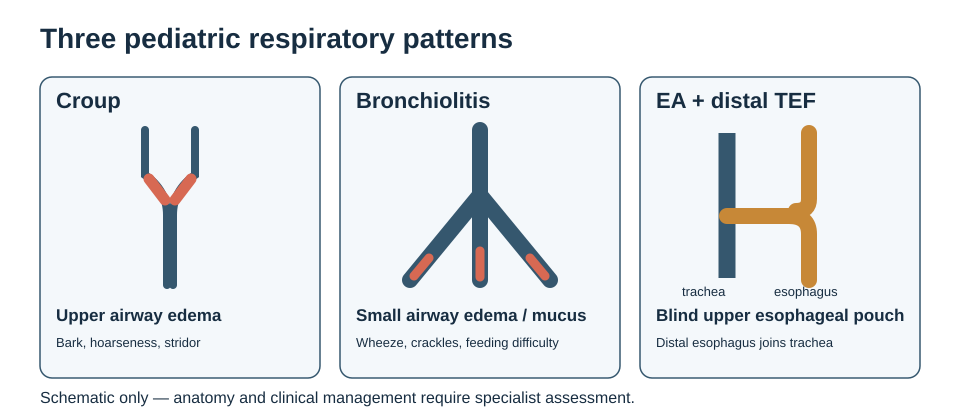

# Pediatric respiratory conditions — Batch 02C–E

> Original Roman Hinglish revision. Clinical pathways are linked to named pediatric guidelines, not universal thresholds or independent treatment orders. This draft requires independent review before integration.

## 02C. Acute viral croup (laryngotracheobronchitis)

Croup upper airway ki inflammatory swelling hai, especially subglottic region. Parainfluenza common cause hai, but other respiratory viruses possible hain. Barking cough, hoarseness aur inspiratory stridor typical features hain, often after coryza. Age commonly 6 months–6 years; very young infant, atypical history, toxic appearance or abrupt choking demands alternative-diagnosis assessment.

Stridor at rest, recession, air entry, alertness and fatigue assess karo. Loudness alone severity nahi batati. Faint stridor with drowsiness and poorer air entry ominous ho sakta hai; normal SpO2 bhi significant obstruction exclude nahi karti. Child ko calm rakho, position of comfort respect karo, avoid unnecessary examinations and tests in typical stable cases. Senior airway assistance early involve karo if severe.

Dexamethasone inflammation reduce karti hai; nebulized adrenaline severe symptoms mein transient edema reduction provide karti hai. Do not interpret rapid response as permanent cure. RCH pathway requires at least three hours observation after nebulized adrenaline before discharge consideration, and longer when access to urgent care is limited or risk persists. CPS uses a different observation window; follow the named/local guideline. RCH and CPS also differ in some mild-case steroid recommendations. Severe or recurrent symptoms require escalation, not steam or cough suppressants. Return urgently for rest stridor or increasing effort.

## 02D. Acute viral bronchiolitis

Bronchiolitis mein small bronchioles inflamed and mucus-filled hote hain, causing obstruction, wheeze, crackles and feeding difficulty. RSV classic common cause hai. Very young infants apnea without prominent wheeze ke saath present ho sakte hain. Prematurity and cardiopulmonary disease severe course ka risk increase karte hain.

Typical severity peaks around day 2–3 after increased work of breathing begins, but course varies; cough may persist after breathing improves. Typical management supportive: observe breathing, oxygenation, alertness and hydration. RCH usual pathway uses oxygen for persistent SpO2 below 90%, not brief isolated dips. Australasian PREDICT 2025 guideline mein otherwise healthy infant aged 6 weeks or more ke liye persistent SpO2 below 90% threshold hai. Age below 6 weeks ya infant under 12 months with underlying health condition mein persistent SpO2 below 92% threshold hai. Brief dips alone se oxygen start nahi karte; clinical condition aur trend bhi assess karo. Documented individualized cardiac target overrides a generic target. Low-flow first where appropriate; escalation depends on response and severity.

When oral feeds inadequate, suitable infant may need NG hydration; if enteral route unsafe, prescribed IV isotonic glucose-containing solution and monitoring may be needed. Avoid forced feeding during distress. Acute illness can increase ADH and hyponatremia risk; fluid rate individualized by team. Selective superficial nasal suction may help obstructing secretions affecting feeding. Routine deep suction, chest physiotherapy, beta agonists, corticosteroids, adrenaline and antibiotics are not routine for typical uncomplicated bronchiolitis. PREDICT 2025 selected severe ICU cases mein combined corticosteroid/nebulized adrenaline consider karne aur selected SARS-CoV-2 coinfection mein corticosteroid consider karne ki conditional guidance deti hai. Ye specialist exceptions hain, routine uncomplicated bronchiolitis treatment nahi.

Routine X-ray and viral identification usually do not change typical supportive care; use selectively if atypical course or infection-control needs. Discharge se pehle age/risk-appropriate oxygen stability observation, breathing, adequate intake, hydration aur follow-up access verify karo. New apnea emergency assessment maangti hai. Fatigue, poor intake ya markedly reduced wet nappies mein urgent assessment lo; dono symptoms ka wait mat karo.

## 02E. Esophageal atresia (EA) and tracheoesophageal fistula (TEF)

EA means food-pipe continuity is interrupted; TEF means abnormal communication between trachea and esophagus. Gross type C (EA with distal TEF) is most common. Fetal polyhydramnios is a possible nonspecific clue. After birth, excess frothy secretions, cough/choking/cyanosis during feeding and resistance to gentle tube passage suggest EA. Never force the tube. Imaging may show proximal coiling with bowel gas suggesting distal fistula; gasless abdomen suggests no functioning distal communication, not proof of every detail.

H-type TEF can have continuous esophagus, so normal gastric tube passage does not exclude this lesion. Persistent feeding-linked cough or recurrent aspiration infections merit specialist assessment.

Unrepaired suspected EA needs routine oral feeds withheld, prescribed nonoral hydration/nutrition, proximal secretion drainage and urgent neonatal surgical planning. Replogle double-lumen tube drains pooled saliva with prescribed low-pressure suction. Check system and infant if drainage stops; no blind advancement or arbitrary pressure changes. Head elevation may be ordered in monitored neonatal care; this is not home sleep advice. Distal TEF can conduct positive-pressure gas into the stomach; urgently coordinate airway/surgical care and never withhold lifesaving respiratory support solely because of the fistula.

Assess associated anomalies including VACTERL components: vertebral, anorectal, cardiac, TE, renal and limb abnormalities. Echo/renal evaluation according to specialist plan. Repair aims at fistula closure and esophageal continuity when possible; long-gap cases may need staged repair.

Postoperatively protect the fresh anastomosis and tracheal repair. Documented surgical tube/ETT position, suction depth and feeding orders follow karo. CAHS postoperative guidance mein suction catheter ETT tip se aage nahi le jaana hai. Transanastomotic tube dislodge ho toh feed roko, surgeon ko turant notify karo aur reinsert mat karo; surgeon feeding/tube plan decide karega. Feeding resumes only on the authorized plan. Progressive dysphagia may indicate stricture; new meal-related coughing or recurrent infections may indicate recurrent fistula, reflux, dysmotility or another aspiration-related cause. Follow-up matters.

## References and practice

- [RCH croup guideline](https://www.rch.org.au/clinicalguide/guideline_index/Croup_Laryngotracheobronchitis/); [CPS croup guidance](https://cps.ca/en/documents/position/acute-management-of-croup).
- [Australasian Bronchiolitis Guideline 2025](https://www.predict.org.au/bronchiolitis-guideline/); age/risk thresholds and conditional exceptions.
- [RCH bronchiolitis guideline](https://www.rch.org.au/clinicalguide/guideline_index/Bronchiolitis/); [NICE NG9](https://www.nice.org.uk/guidance/ng9/chapter/Recommendations), different risk/age thresholds; direct access limited in this review.
- [CAHS neonatal EA/TEF guideline](https://www.cahs.health.wa.gov.au/-/media/HSPs/CAHS/Documents/Health-Professionals/Neonatology-guidelines/Oesophageal-Atresia-Tracheoesophageal-Fistula.pdf); [MSD professional EA overview](https://www.msdmanuals.com/professional/pediatrics/congenital-gastrointestinal-anomalies/esophageal-atresia).
- [Croup 20 MCQs](../MCQs/02C-Acute-Viral-Croup-20-MCQs.md), [bronchiolitis 20 MCQs](../MCQs/02D-Acute-Viral-Bronchiolitis-20-MCQs.md), [EA/TEF 20 MCQs](../MCQs/02E-Esophageal-Atresia-and-TEF-20-MCQs.md).
- [Aarogyam Infinity MCQ series](https://www.youtube.com/watch?v=cuJ4sUMpKsU): indexed 14:09 chapter concerns bark/stridor; exact item/playback not verified. [Croup teaching + MCQ lead](https://www.youtube.com/watch?v=VzP7xXJ3z7s), indexed only. [Nursing Wallah by PW NORCET 10 respiratory MCQ series](https://www.youtube.com/watch?v=tVX4Q7LwYu4&t=5905s): indexed 01:38:25 bronchiolitis management chapter, topic-level MCQ lead only. [NextGen Nursing EA/TEF lecture](https://www.youtube.com/watch?v=MRkv2FXmKSQ), published 2026-07-27, indexed description includes anatomy, diagnosis, nursing and MCQs; lecture/mixed-content lead, not a dedicated item-specific MCQ match. Playback, clinical content and exact question mapping remain pending.
