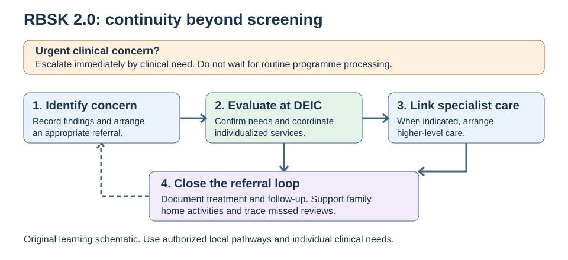

# RBSK 2.0: pediatric DEIC referral and continuity of care

> Roman Hinglish study notes for original NORCET-style practice. Named source: NHM RBSK 2.0 Operational Guidelines 2026. This is a candidate-only pediatric care topic, not a replacement for a local clinical referral protocol.

## Screening se care tak

RBSK mein screening se possible health concern identify hota hai. Screening result final diagnosis nahi hota. Agar stable child mein developmental concern milta hai, toh appropriate district early intervention service se assessment arrange karte hain. Agar acute serious clinical concern ho, toh immediate clinical escalation chahiye. Routine programme appointment ka wait mat karo.

DEIC ka full form District Early Intervention Centre hai. Yahan child ki needs ko different trained professionals milkar assess kar sakte hain. Example: motor delay wale child ko sirf diagnosis nahi, daily activities mein kya difficulty hai aur kis support se participation better hogi, yeh bhi samajhna important hai.

## Individual care ka practical meaning

Early stimulation mein caregiver ko aise activities sikhate hain jo child ki actual ability aur daily routine se match karti hain. Hearing concern mein audiology team indicated tests aur device needs assess karti hai. Device fitting ke baad communication support bhi zaroori ho sakta hai. Vision concern mein professional examination ke according correction aur referral arrange hota hai.

Motor limitation ke liye physiotherapy aur occupational therapy individual functional goals par work kar sakti hain. Communication disability mein AAC, yani augmentative and alternative communication, pictures ya other suitable methods ke through child ko apni needs express karne mein help kar sakta hai. Child ko sirf speech output ke basis par underestimate mat karo.

Chronic condition ya surgical repair mein ongoing treating-team instructions preserve karo. DEIC follow-up local rehabilitation aur higher-level services ke beech coordination support kar sakta hai. Guideline eligible beneficiaries ke liye free DEIC services envision karti hai. Local availability aur external treatment package eligibility actual programme team se confirm karo.

## Closed-loop referral

Referral document mein actual findings aur next facility ki relevant information record karo. Child ki required service local centre mein available nahi hai toh designated higher-level facility se link karo. Stable elective funded surgical pathway mein appropriate cost estimate aur applicable authorization arrange hoti hai. Emergency treatment ko paperwork ke liye delay nahi karna chahiye.

Sirf referral slip issue hone se treatment complete nahi hota. Family visit miss kare toh practical barrier identify karne mein help karo. Treatment summary aur follow-up instructions relevant authorized team tak pahunchni chahiye. Existing linked record update karo, unrelated duplicate record mat banao. Family ko understood, feasible next plan do.

## Exam distinctions

| Situation | Main learning point |
|---|---|
| Suspected developmental delay | Further evaluation and individualized intervention |
| Confirmed disability with daily-life difficulty | Appropriate functional or communication support |
| Service not available locally | Coordinated higher-level referral |
| Family misses referral visit | Trace barriers and document follow-up |
| Elective surgery completed | Rehabilitation and return-care linkage remain important |
| Urgent deterioration | Immediate clinical escalation, not routine programme processing |

## Evidence

- [Official NHM RBSK 2.0 guidelines, 2026](https://nhm.gov.in/images/pdf/programmes/RBSK/RBSK%202.0_Operational_Guidelines_2026_English.pdf), extracted printed pages 27–31 and 71 inspected. Page screenshots returned cache miss. Independent clinical/programme review and current local implementation checks pending.
- [NHM RBSK guidelines listing](https://nhm.gov.in/index4.php?lang=1&level=0&lid=775&linkid=535).
- [RBSK 2.0 teaching lead, 360 Degree Classes](https://www.youtube.com/watch?v=sOhLGY0_j2I) indexed description identifies 2026 updates. Not a verified dedicated MCQ video.
- [Doordarshan Uttar Pradesh RBSK quiz, 7 August 2019](https://www.youtube.com/watch?v=F9FJ4IIL1OY). Indexed quiz title only, predates 2026 revision. Do not use as proof of current-version question answers.
- [ASHA Samvad RBSK teaching programme, 7 May 2026](https://www.youtube.com/watch?v=sOFqYK2Id9w). Indexed description mentions referral and DEIC care, no verified playback or item mapping.
- [20 original candidate MCQs](../MCQs/03A-RBSK-2-DEIC-Referral-and-Continuity-20-MCQs.md).

General Community Health RBSK administration and Nutrition deficiency-screening content remain outside this allocation. Full semantic comparison and cross-chapter coordination remain mandatory before publication.
