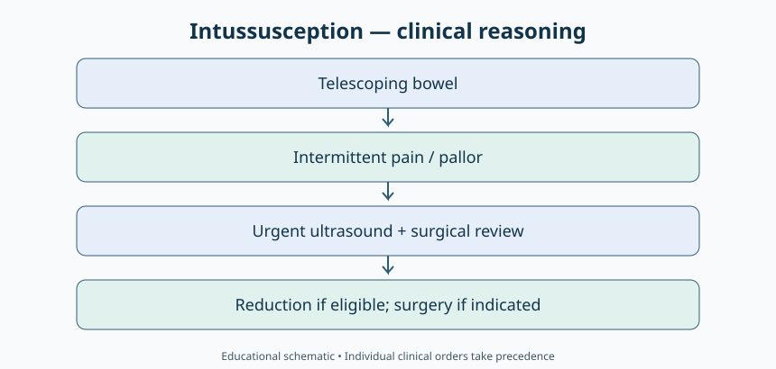

# Intussusception — nursing decisions

Draft learning guide — independent review pending.

## Concept and bedside reasoning (Roman Hinglish)

Intussusception mein proximal bowel distal segment mein telescope karta hai. Venous congestion se edema, ischemia aur obstruction progress kar sakte hain. Episodic pain, pallor, lethargy aur vomiting important clues hain; classic triad absent ho sakti hai. Bloody mucus late finding ho sakti hai, isliye uska wait nahi karna. Suspected case mein urgent pediatric surgical assessment, NPO, IV access aur fluid/analgesia per clinical order. Ultrasound preferred initial diagnostic test hai. Stable eligible child mein image-guided air/contrast reduction specialist team karti hai. Peritonitis, perforation ya shock mein nonoperative reduction inappropriate ho sakta hai. Failed reduction or pathological lead point mein surgery required ho sakti hai. Successful reduction ke baad recurrence education, observation aur discharge criteria local team ke according. Caregiver ko recurrent episodes par immediate return explain kare.

## Source and learning practice

[RCH clinical guideline, updated February 2026](https://www.rch.org.au/clinicalguide/guideline_index/intussusception/)

[Bank](../MCQs/03B-Pediatric-Intussusception-20-MCQs.md)

Video references in the bank are indexed topic leads, not independently playback-verified exact questions. Follow local pediatric protocols and specialist orders.
