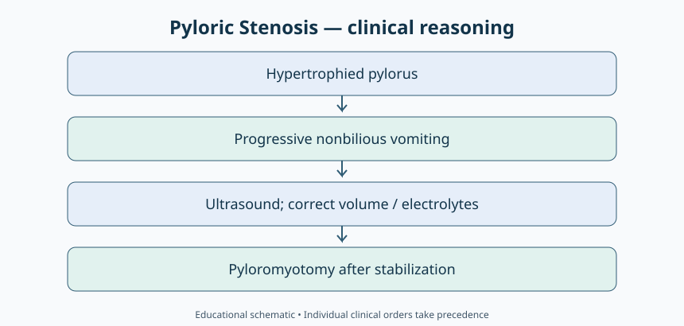

# Pyloric Stenosis — nursing decisions

Draft learning guide — independent review pending.

## Concept and bedside reasoning (Roman Hinglish)

Hypertrophied pyloric muscle gastric outlet narrow karta hai. Progressive nonbilious projectile vomiting, hunger after vomiting aur poor weight gain classical clues hain; early presentation mein signs subtle ho sakte hain. Bilious vomiting alternate obstruction ka red flag hai. Ultrasound preferred hai; equivocal early scan ko persistent suspicion mein repeat evaluation chahiye. Prolonged gastric acid loss hypochloremic metabolic alkalosis cause kar sakta hai, lekin early labs normal bhi ho sakte hain. IV fluids aur electrolyte correction prescribed monitoring ke saath; potassium only after adequate urine output and clinician order. Surgery se pehle alkalosis correct karna anesthesia-related apnea risk ke liye important hai. Pyloromyotomy muscle split karta hai, mucosa preserve hoti hai. Postoperative feeds surgeon's pathway ke according restart; persistent vomiting needs reassessment.

## Source and learning practice

[RCH clinical guideline](https://www.rch.org.au/clinicalguide/guideline_index/Pyloric_stenosis/); [CHOP](https://www.chop.edu/conditions-diseases/pyloric-stenosis)

[Bank](../MCQs/03C-Infantile-Hypertrophic-Pyloric-Stenosis-20-MCQs.md)

Video references in the bank are indexed topic leads, not independently playback-verified exact questions. Follow local pediatric protocols and specialist orders.
