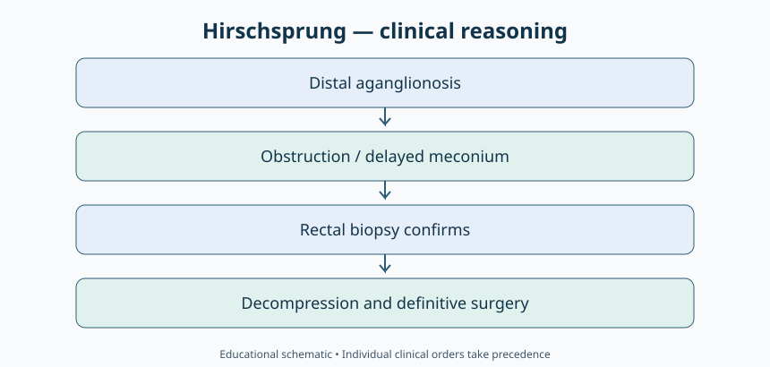

# Hirschsprung — nursing decisions

Draft learning guide — independent review pending.

## Concept and bedside reasoning (Roman Hinglish)

Hirschsprung disease mein distal bowel mein enteric ganglion cells absent hote hain. Affected segment relax nahi karta aur functional obstruction develop hota hai. Delayed meconium, distension, vomiting ya refractory constipation clues hain; alone diagnostic nahi. Contrast enema aur anorectal manometry supportive tests ho sakte hain, rectal biopsy definitive confirmation deta hai. Prescribed rectal irrigations trained team ke guidance mein decompression ke liye hain; generic home enema se interchange nahi karna. Pull-through surgery ganglionated bowel ko anus se connect karti hai; selected children may need staged diversion. Fever, distension, explosive diarrhea, lethargy or systemic illness Hirschsprung-associated enterocolitis suggest kar sakte hain even after surgery. Urgent hospital evaluation, resuscitation and specialist-directed antibiotics/decompression are required as indicated. Long-term stooling, continence and growth follow-up important hain.

## Source and learning practice

[NIDDK diagnosis](https://www.niddk.nih.gov/health-information/digestive-diseases/hirschsprung-disease/diagnosis); [RCH HAEC](https://www.rch.org.au/clinicalguide/guideline_index/Hirschsprung_associated_enterocolitis_HAEC/); [ERNICA guideline 2020](https://pmc.ncbi.nlm.nih.gov/articles/PMC7318734/)

[Bank](../MCQs/03D-Hirschsprung-Disease-20-MCQs.md)

Video references in the bank are indexed topic leads, not independently playback-verified exact questions. Follow local pediatric protocols and specialist orders.
