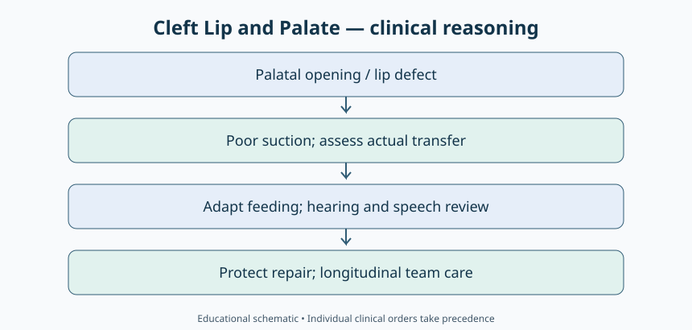

# Cleft lip and palate — nursing decisions

Draft learning guide — independent review pending.

## Concept and bedside reasoning (Roman Hinglish)

Isolated cleft lip aur cleft palate alag anatomy hain. Palate opening oral suction pressure ko impair karti hai. Actual milk transfer assess kare; isolated lip with effective transfer may breastfeed. Expressed breast milk aur assessed specialty feeder use ho sakta hai. Supported upright feeding, pacing aur burping breaks se efficiency support hoti hai. Nasal regurgitation alone aspiration prove nahi karti; persistent coughing, cyanosis or respiratory distress urgent assessment maangte hain. Palatal muscle dysfunction middle-ear effusion aur conductive hearing loss predispose karti hai, isliye passed newborn screen ke baad bhi audiology follow-up. Palatal repair speech pressure separation improve karta hai; structural velopharyngeal dysfunction aur learned compensatory articulation differentiate karna important hai. Postoperative device, diet aur protection surgeon-specific orders follow kare; heavy bleeding or respiratory distress emergency hai. Cleft team dental, orthodontic, speech, feeding and hearing care longitudinally coordinate karti hai.

## Sources

[ASHA](https://www.asha.org/practice-portal/clinical-topics/cleft-lip-and-palate/); [Children’s Minnesota infant feeding](https://www.childrensmn.org/educationmaterials/childrensmn/article/15304/cleft-palate-infant-feeding-/); [ACPA](https://acpacares.org/parameters-of-care/)

[Bank](../MCQs/03E-Cleft-Lip-and-Palate-20-MCQs.md)

Video reference is indexed topic-level only; exact-question playback verification pending.
