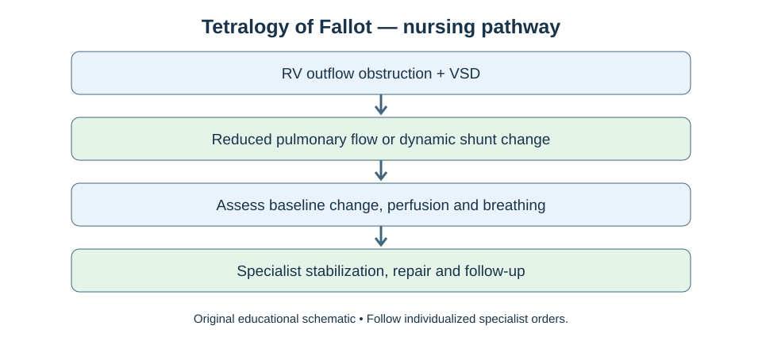

# Tetralogy of Fallot — pediatric nursing decisions

Draft companion guide. Independent clinical review pending.

## Concept aur nursing reasoning

TOF mein VSD, overriding aorta, RV outflow obstruction aur RV hypertrophy milte hain. Pulmonary outlet obstruction severe hone par blood lungs ki jagah VSD se systemic circulation mein shunt ho sakta hai. Mild obstruction mein cyanosis absent bhi ho sakti hai. Murmur pulmonary outflow se aata hai aur severe spell mein flow kam hone par softer ho sakta hai. Echo anatomy confirm karti hai. Acute baseline change, hyperpnea ya altered consciousness mein urgent help lo. Minimal handling aur caregiver comfort ke saath prescribed emergency pathway follow karo. Knee-chest positioning existing Cardiovascular bank mein covered hai. Specialist beta blocker dynamic obstruction aur phenylephrine systemic resistance address kar sakte hain. Drugs only monitored clinician-directed treatment hain. Selected duct-dependent newborns mein prostaglandin E1 temporary pulmonary blood flow support kar sakta hai. Definitive repair VSD close aur RV outflow obstruction relieve karti hai. After repair pulmonary valve function, RV size aur rhythm follow-up important hain.

## Sources

[MSD Professional](https://www.msdmanuals.com/professional/pediatrics/congenital-cardiovascular-anomalies/tetralogy-of-fallot) · [RCH cyanotic episodes](https://www.rch.org.au/clinicalguide/guideline_index/Cyanotic_Episodes_in_Congenital_Heart_Disease/) · [Mayo diagnosis and treatment](https://www.mayoclinic.org/diseases-conditions/tetralogy-of-fallot/diagnosis-treatment/drc-20353482)

[20 original candidate questions](../MCQs/04A-Tetralogy-of-Fallot-20-MCQs.md). Dedicated exact-item video verification remains pending. Use local protocols and specialist directions, not this guide as independent treatment orders.
