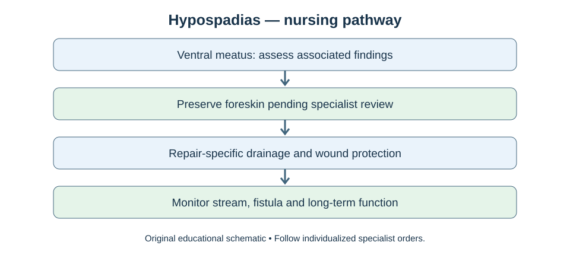

# Hypospadias — pediatric nursing decisions

Draft companion guide. Independent clinical review pending.

## Concept aur nursing reasoning

Hypospadias mein urethral meatus ventral surface par displaced hoti hai. Location ke saath chordee, glans aur urethral plate assess karna important hai. Bilaterally undescended testes ke saath early genetic/endocrine specialist workup required ho sakta hai. Foreskin reconstructive tissue ho sakti hai, isliye routine circumcision defer karo. EAU usual primary repair timing 6–18 months describe karta hai, not universal deadline. Repair-specific stent and dressing plan follow karo. Prescribed double diaper method stool aur urine separate karta hai. Dry outer diaper plus increasing bypass leakage and pain impaired drainage ka concern hai. Unapproved reinsertion or clamping avoid karo. Bladder spasms can occur, but ongoing drainage and comfort reassess karo. Late secondary urinary opening fistula suggest karta hai, progressive thin stream stenosis/stricture concern hai. Uroflow and pubertal follow-up individualized functional outcomes support karte hain. Prophylactic antibiotic benefit uncertain hai, actual medication plan clinician se clarify karo.

## Sources

[EAU](https://uroweb.org/guidelines/paediatric-urology/chapter/hypospadias) · [UCSF postoperative care](https://www.ucsfbenioffchildrens.org/education/post-operative-instructions-for-hypospadias-repair) · [Children's Health Queensland](https://www.childrens.health.qld.gov.au/health-a-to-z/hypospadias)

[20 original candidate questions](../MCQs/04B-Hypospadias-20-MCQs.md). Dedicated exact-item video verification remains pending. Use local protocols and specialist directions, not this guide as independent treatment orders.
