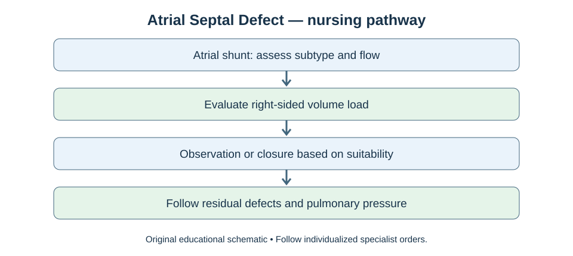

# Atrial Septal Defect — pediatric nursing decisions

Draft companion guide. Independent clinical review pending.

## Concept aur nursing reasoning

ASD mein atrial shunt right heart volume load increase kar sakta hai. Increased pulmonary ejection flow systolic murmur aur fixed S2 splitting produce kar sakta hai, but infants mein classic signs absent bhi ho sakte hain. Echo subtype, flow aur RV loading define karti hai. Primum defects AV valve region ke saath evaluate hote hain. Sinus venosus defect associated anomalous pulmonary venous drainage demand kar sakta hai. Tiny insignificant communication observation se managed ho sakti hai. Significant RV volume overload asymptomatic child mein bhi elective closure consideration ka reason hai. Suitable secundum anatomy mein device closure possible hai, other anatomy surgical evaluation require kar sakti hai. Severe pulmonary vascular disease mein operability verify kiye bina closure assume nahi karo. Endocarditis prophylaxis isolated unrepaired ASD mein routine nahi hai, early post-prosthetic repair and residual adjacent defect mein cardiology instructions clarify karo. Long-term follow-up shunt significance and symptoms ke hisaab se individualized hai.

## Sources

[MSD Professional pediatric ASD](https://www.msdmanuals.com/professional/pediatrics/congenital-cardiovascular-anomalies/atrial-septal-defect-asd) · [Indian congenital heart consensus 2019, indexed lead](https://pmc.ncbi.nlm.nih.gov/articles/PMC6796629/)

[20 original candidate questions](../MCQs/04C-Atrial-Septal-Defect-20-MCQs.md). Dedicated exact-item video verification remains pending. Use local protocols and specialist directions, not this guide as independent treatment orders.
