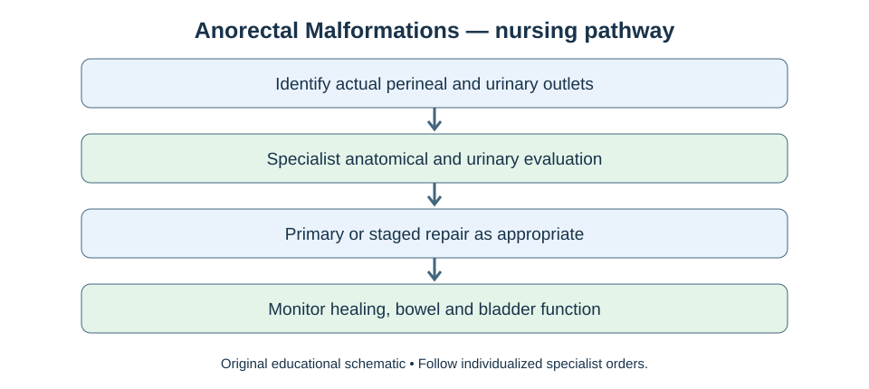

# Anorectal Malformations — pediatric nursing decisions

Draft companion guide. Independent clinical review pending.

## Concept aur nursing reasoning

Newborn mein normal anal opening absent ya abnormal location par ho sakti hai. Meconium kahan se aa raha hai aur urine mein meconium hai ya nahi, yeh carefully document karo. Cloacal anomaly mein single perineal opening aur urinary obstruction important concerns hain. Blind probing ya forceful rectal instrumentation mat karo. Surgical team anatomy, associated anomalies aur clinical stability assess karti hai. Kuch babies ko primary repair, aur kuch ko staged diversion aur reconstruction chahiye. Postoperative stool pattern, wound healing, urinary function aur prescribed dilatation plan monitor karo. Long-term bowel management individual anatomy aur continence potential par depend karta hai.

## Sources

https://link.springer.com/article/10.1007/s10151-015-1267-8

[20 original candidate questions](../MCQs/04D-Anorectal-Malformations-20-MCQs.md). Dedicated exact-item video verification remains pending. Use local protocols and specialist directions, not this guide as independent treatment orders.
