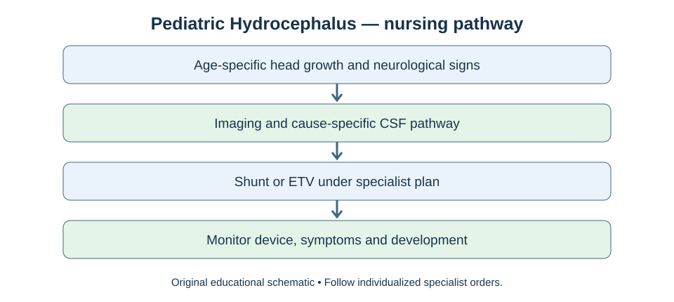

# Pediatric Hydrocephalus — pediatric nursing decisions

Draft companion guide. Independent clinical review pending.

## Concept aur nursing reasoning

Infants mein rapidly crossing head circumference percentiles, tense fontanelle aur sunsetting eyes concern raise karte hain. Older children mein headache, vomiting aur visual changes ho sakte hain. Imaging aur cause se CSF obstruction ya absorption problem samajhte hain. Specialist shunt ya endoscopic third ventriculostomy select karta hai. Shunt ke baad overdrainage, abdominal complications aur programmable valve precautions ko individual device instructions se assess karo. Positional headache, new neurological symptoms ya developmental change ko promptly report karo. Serial growth, neurodevelopment aur family education long-term nursing care ka part hain.

## Sources

https://www.fda.gov/medical-devices/cerebral-spinal-fluid-csf-shunt-systems

[20 original candidate questions](../MCQs/04E-Pediatric-Hydrocephalus-20-MCQs.md). Dedicated exact-item video verification remains pending. Use local protocols and specialist directions, not this guide as independent treatment orders.
