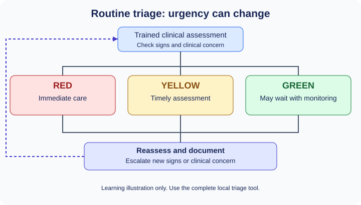

# Routine adult triage aur reassessment

**Draft, study-ready after review, not studied.** Ye guide WHO IITT ke facility-based age 12 aur usse zyada wale tool par based hai. Har hospital ka approved triage system alag ho sakta hai. Isliye actual practice mein apni training, clinical team aur local protocol follow karo.

[20 original MCQs](../MCQs/01-Routine-Adult-Triage-and-Reassessment-20-MCQs.md) · [Chapter](../README.md)

## Triage ka matlab kya hai?

Triage ko emergency department ka clinical priority check samjho. Jab kai patients aate hain, tab nurse pehle ye samajhti hai ki kis patient ko abhi treatment chahiye aur kaun safely thoda wait kar sakta hai. Ye decision arrival time, paisa ya bed number ke basis par nahi hota. Ye patient ki clinical condition ke basis par hota hai.

Maan lo ek patient ko ankle pain hai aur doosre ko bahut bleeding ho rahi hai. Bleeding wale patient ka blood volume kam ho sakta hai. Isse organs tak oxygen wala blood kam pahunch sakta hai. Nurse registration complete hone ka wait nahi karti. Woh urgent assessment aur care arrange karti hai.

## WHO IITT ke teen routine categories

| Category | Iska simple matlab |
|---|---|
| Red | Patient ko abhi clinical intervention chahiye. Nurse resuscitation team ya responsible clinician ko turant involve karti hai. |
| Yellow | Patient ko jaldi clinical assessment chahiye, lekin is assessment mein red criterion nahi mila. |
| Green | Patient ki immediate urgency kam hai. Woh facility ke protocol ke hisaab se wait kar sakta hai, lekin condition badle toh dobara assess hoti hai. |

WHO IITT adult tool mein stridor, active convulsions, heavy bleeding aur snakebite jaise kuch signs ya presentations red list mein hain. Ye complete list nahi hai. Open fracture, sudden testicular pain aur urine pass na kar pana yellow list mein ho sakte hain jab red signs absent hon. Red sign pehle check karna zaroori hai.

## Vital signs normal hone ka matlab hamesha safe nahi hota

Pulse, breathing rate, temperature aur oxygen saturation se body ki condition ke baare mein information milti hai. Lekin ek measurement se poori disease samajh nahi aati.

WHO IITT age 12 aur usse zyada wale tool mein pulse 130/min se upar ya 60/min se neeche aur breathing rate 30/min se upar ya 10/min se neeche high-risk screening flags hain. Pulse 150/min se upar ya 50/min se neeche specific red heart-rate criteria mein hain. Is difference ko yaad rakho. High-risk finding ka matlab nurse ko priority badhane ya immediate supervising clinician review ki zaroorat check karni hai. Clinical concern bhi action ki wajah ban sakta hai.

## Reassessment kyun zaroori hai?

Triage category us waqt ki condition batati hai. Maan lo kisi patient ko initial assessment ke baad green category mili, lekin wait karte hue usko faintness aur pallor develop hoti hai. Ab initial category par depend karna unsafe ho sakta hai. Nurse nayi findings assess karti hai, category ya review urgency badalti hai aur team ko update deti hai.

Nurse category, relevant findings aur reassessment ko local records mein document karti hai. Yellow aur green ke time goals facility ke protocol par depend karte hain. Red ko immediate attention chahiye. Kisi fixed waiting interval ko safe guarantee mat samjho.

## Triage aur diagnosis alag decisions hain

Red ka matlab zaroori nahi ki patient ICU mein admit hoga. Kuch patients emergency treatment se stabilize ho jaate hain. Admission, discharge aur referral ka decision detailed clinical assessment ke baad liya jaata hai. Triage clinical urgency batati hai, final diagnosis nahi.

Trained clinical staff ko standardized tool use karna chahiye. Security staff crowd management mein help kar sakte hain, lekin untrained personnel ko clinical category assign nahi karni chahiye.

## References aur practice

- [WHO IITT overview and original adult tool](https://www.who.int/tools/triage).
- [WHO adult IITT poster](https://cdn.who.int/media/docs/default-source/integrated-health-services-(ihs)/csy/iitt/iitt_adult.pdf?sfvrsn=b2a91431_1). Extracted criteria checked, PDF screenshot retrieval failed.
- [WHO IITT FAQ](https://cdn.who.int/media/docs/default-source/integrated-health-services-(ihs)/csy/iitt/iitt-faq.pdf?sfvrsn=cc11cf12_5). Extracted text checked, screenshot retrieval failed.
- Teaching video and dedicated MCQ video verification pending. The indexed quick-revision video at https://www.youtube.com/watch?v=9u34GUxB5cc is only a lead and has not been verified as question-solving coverage.
- [Solve topic-wise MCQs](../MCQs/01-Routine-Adult-Triage-and-Reassessment-20-MCQs.md). Historical exam appearances are not claimed.

Ye guide IITT ka full clinical algorithm nahi hai. Original tool aur local emergency policies ko clinical practice mein use karo.
