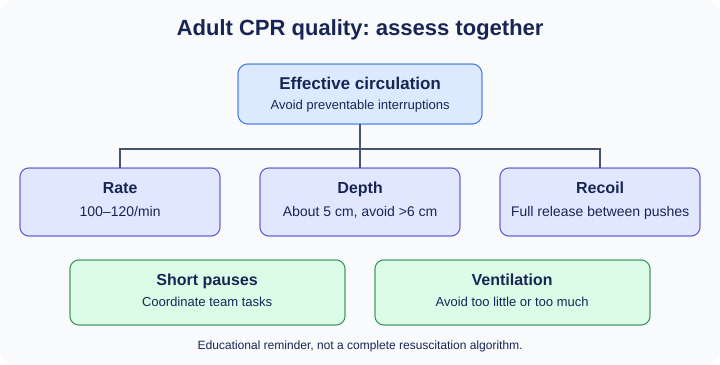

# Adult BLS aur CPR quality

**Draft candidate.** Ye adult BLS learning guide hai, actual resuscitation mein trained team aur current local emergency protocol follow karo.

[20 original MCQs](../MCQs/02-Adult-BLS-and-Resuscitation-Quality-20-MCQs.md) · [Chapter](../README.md)

## CPR se blood flow kaise milta hai?

Cardiac arrest mein heart effective pumping nahi kar paata. CPR mein chest ko press karne se blood ko aage move karne mein help milti hai. Jab chest poori tarah wapas aati hai, toh heart mein blood return hone mein madad milti hai. Nurse compression depth, rate, recoil aur interruptions ko monitor karti hai.

Adult CPR mein 100–120 compressions per minute ka target rakha jaata hai. Chest ko lagbhag 5 cm press karna chahiye aur 6 cm se zyada excessive depth avoid karni chahiye. Sirf rate correct hone se CPR effective prove nahi hoti. Depth aur full recoil bhi important hain.

## Chest compression fraction

Chest compression fraction ya CCF batata hai ki resuscitation ke total observation time ka kitna hissa patient ko actual compressions milne mein gaya. Formula hai actual compression time ÷ total time × 100. Maan lo total 300 seconds mein 210 seconds compressions di gayi. CCF 70% hoga.

AHA 2025 ke mutabik kam se kam 60% CCF rakhna reasonable ho sakta hai. Ye ek qualified recommendation hai, survival ki guarantee nahi. Necessary rhythm checks aur defibrillation ko hata kar 100% CCF achieve karne ki koshish nahi karni chahiye. Unnecessary interruption kam karna goal hai.

## Team coordination aur fatigue

Compressor thakne par depth gir sakti hai, chahe rate abhi bhi normal dikhe. Agar do ya usse zyada rescuers available hain, toh team lagbhag har do minute compressor change plan karti hai. Changeover ko short rakha jaata hai. Agar quality pehle deteriorate ho rahi hai, toh team jaldi correction karti hai.

Shock ke turant baad compressions resume karna reasonable hai. Scheduled rhythm assessment mein pulse check ko ten seconds se zyada nahi kheenchna chahiye. Agar definite pulse feel nahi hoti, toh compressions restart karte hain.

## Ventilation

Bag-mask ventilation mein airway open rehna aur mask ka seal hona important hai. Jab do trained rescuers available hote hain, toh ek mask ko dono haathon se seal aur airway position maintain kar sakta hai. Doosra bag squeeze karta hai. Adult arrest without advanced airway mein standard 30:2 sequence ke ventilation pause mein har breath lagbhag ek second mein itni deni hoti hai ki chest rise dikhe. Too much volume aur too many breaths se bachna hai.

Agar adult respiratory arrest mein clinician ko definite pulse milti hai, toh situation cardiac arrest se different hai. AHA adult rescue breathing mein har six seconds mein ek breath reasonable batata hai. Pulse aur breathing dobara assess karte hain.

## Safe location, equipment aur special circumstances

Agar patient jahan collapse hua hai wahin safe effective CPR possible hai, toh sirf room change karne ke liye compressions delay nahi karte. Firm support aur proper rescuer height se compression quality improve ho sakti hai. Obesity mein bhi standard adult targets use hote hain aur rescuer fatigue closely monitor hoti hai. Mechanical CPR routine replacement nahi hai.

AHA 2025 adult severe choking recommendation mein responsive adult ke liye five back blows ke baad five abdominal thrusts ke cycles hain jab abdominal thrusts feasible hon. Agar patient unresponsive ho jaaye, toh emergency response activate karke CPR start karte hain. Mouth mein object clearly visible ho toh appropriate removal karte hain. Blind finger sweep nahi karte. Pregnancy aur body-size limitations ke liye full guideline ka specific algorithm dekho.

## Evidence and video practice

- [AHA 2025 Adult BLS](https://cpr.heart.org/en/resuscitation-science/cpr-and-ecc-guidelines/adult-basic-life-support). Sections on compression quality, pauses, ventilation, choking and obesity. Official HTML opened.
- [The Nurse BLS and cardiac arrest MCQs](https://www.youtube.com/watch?v=ztNcRcHC05U). Indexed description indicates broad scenario-based question practice. Exact question, playback, channel and guideline-version check remains pending. This is not evidence of exam appearance.
- Teaching video verification pending. [Solve original practice](../MCQs/02-Adult-BLS-and-Resuscitation-Quality-20-MCQs.md).

Independent clinical review, comprehensive semantic screening and rendered UI validation remain pending.
