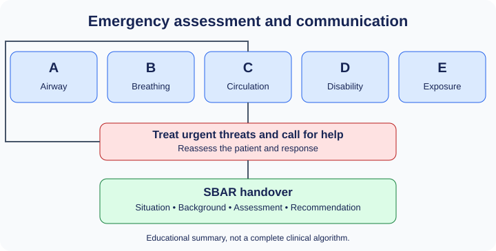

# ABCDE assessment aur structured handover

**Draft, unattempted.** Ye learning guide hai. Actual emergency mein trained team, approved scope aur local clinical protocol follow karo.

[20 MCQs](../MCQs/03-ABCDE-Assessment-and-Structured-Handover-20-MCQs.md) · [Chapter](../README.md)

## ABCDE ka purpose

Jab patient acutely unwell ho, nurse ek organized sequence se immediate life threats identify karti hai. A ka matlab Airway, B Breathing, C Circulation, D Disability aur E Exposure hai. Agar kisi step mein life-threatening problem milti hai toh assessment poora hone ka wait nahi karte. Team urgent treatment start karti hai, appropriate help bulati hai aur phir survey continue karti hai. Jab condition badalti hai, survey repeat hota hai.

## Airway aur breathing

Patient agar bol pa raha hai toh airway mein kuch airflow present hai. Lekin har do ya teen words ke baad saans leni pad rahi hai toh breathing distress ho sakti hai. Nurse respiratory rate, effort, chest movement aur saturation assess karti hai.

SpO2 oxygen saturation batata hai, carbon dioxide ka level nahi. Supplemental oxygen par SpO2 normal dikhne ke bawajood shallow breathing aur drowsiness serious ventilation problem indicate kar sakte hain. Isliye monitor ke number ko patient ke actual signs ke saath interpret karo.

## Circulation

Nurse pulse, BP, skin temperature, capillary refill aur overall perfusion dekhti hai. Blood loss ke early stage mein compensation ki wajah se BP normal reh sakta hai. Cold surroundings capillary refill prolong kar sakti hain, isliye ek finding se shock diagnose ya exclude mat karo. Ordered fluid challenge ke dauran nayi crackles aur dyspnea aaye toh turant reassess aur escalate karo.

## Disability aur exposure

Consciousness change mein pehle airway, breathing aur circulation check karo. Recent medicines, glucose aur neurological findings reversible cause identify karne mein help karte hain. Severe hypoperfusion mein finger-prick glucose unreliable ho sakta hai. Team reliable sample aur emergency treatment coordinate karti hai.

Exposure ka matlab required skin aur body examination hai. Privacy, dignity aur normal body temperature maintain karna bhi care ka part hai.

## Reassessment aur team communication

Serial measurements ek single number se zyada information de sakti hain. Treatment ka response check karo. Nayi deterioration par appropriate help immediately bulao. Team roles clear hon toh monitoring, access aur assessment parallel ho sakte hain.

## SBAR

- Situation: Patient kaun hai aur abhi urgent issue kya hai?
- Background: Relevant history, recent observations aur treatments kya hain?
- Assessment: Current severity, clinical trend aur intervention ka response kya hai?
- Recommendation: Agla action kya chahiye, kab chahiye aur delay ho toh kya plan hai?

Receiver se important information repeat karwana misunderstanding pakadne mein help karta hai. Transfer par pending tests ka owner, monitoring plan, treatment aur communication needs clear honi chahiye. Verbal handover ko accessible clinical documentation support karti hai.

## References

- [Resuscitation Council UK ABCDE approach](https://www.resus.org.uk/library/abcde-approach). Official HTML checked.
- [WHO Basic Emergency Care](https://www.who.int/publications/i/item/9789241513081). Course overview checked, slide download unavailable.
- [WHO SBAR job aid](https://cdn.who.int/media/docs/default-source/integrated-health-services-(ihs)/csy/bec-slides/bec/sbar.pdf?sfvrsn=a91f5c16_1). Extracted text checked, screenshot failed.
- [NICE QS174 structured handovers](https://www.nice.org.uk/guidance/qs174/chapter/Quality-statement-4-Structured-patient-handovers). Official HTML checked.
- Teaching and dedicated MCQ video verification pending. No historical exam appearances claimed.

Independent clinical and comprehensive semantic review pending.
