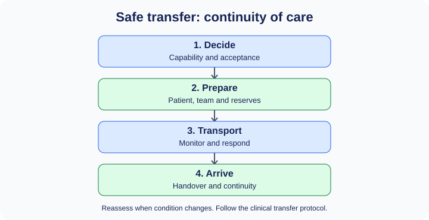

# Trauma transfer aur transport safety

**Draft candidate, study-ready after independent review.** Ye guide adult trauma aur critical patient transport par focus karti hai. Actual transfer mein trained team, current clinical orders, local protocol aur patient-specific needs follow karo.

[20 original MCQs](../MCQs/04-Trauma-Transfer-and-Transport-Safety-20-MCQs.md) · [Chapter](../README.md)

## Transfer ka decision

Patient ko doosri facility bhejne ka reason sirf bed ki availability nahi hota. Kabhi local hospital mein required surgery, specialist ya critical care support available nahi hota. Team treatment ki benefit aur journey ke risk ko compare karti hai. Receiving facility ki required capability aur acceptance confirm karo. Time-critical definitive treatment ko avoidable tests ke liye delay nahi karna chahiye.

## Departure se pehle patient aur team ki preparation

Transport mein staff aur equipment limited ho sakte hain. Isliye team patient ki airway, breathing, circulation, consciousness aur exposure assess karti hai. Jo necessary urgent interventions ambulance mein safely nahi ho sakti, unhe sending facility par clinically feasible hone par complete karo.

Suspected spinal injury mein indicated motion restriction use karo, lekin airway aur critical monitoring ka access maintain rakho. Bleeding control aur wound covering check karo. Required IV lines, drains aur tubes secure honi chahiye. Intubated patient mein tube position aur fixation verify karo. Portable ventilator par departure se pehle patient ka trial aur clinical response check karna useful hai.

Patient unstable ho raha ho toh scheduled departure ko blindly follow mat karo. Responsible team se urgent reassessment aur alternative risk-benefit plan discuss karo. Transfer ke dauran treatment manage karne ke liye suitably trained provider chahiye.

## Equipment, medication aur oxygen

Journey time ek estimate hota hai. Loading aur traffic delay se oxygen, infusion ya battery reserve khatam ho sakta hai. Nurse prescribed support ke hisaab se adequate supply aur reserve arrange karti hai. Concentration ya flow ko sirf supply bachane ke liye arbitrarily change nahi karti.

Patient aur stretcher dono ko safely secure karna hai. Emergency equipment staff ki reach mein ho aur braking ke waqt loose object ki tarah move na kare. Packaging patient ko warm rakhe, pressure injury minimize kare aur chest, airway aur IV sites jaise critical areas tak access de.

## Journey aur arrival

Transport mein appropriate monitoring continue hoti hai. Nayi respiratory distress, consciousness change ya circulatory deterioration par team immediately assessment aur indicated action karti hai. Receiving facility ko revised arrival time aur clinical changes communicate karo.

Arrival par equipment changeover coordinate karo taaki required support interrupt na ho. Structured clinical handover aur referral documents share karo. Patient ka transfer complete hone ke baad vehicle cleaning, supplies restocking aur dispatch communication next mission ki readiness ke liye important hai.

## References aur question practice

- [WHO Interfacility Acute Transfer Checklist](https://cdn.who.int/media/docs/default-source/integrated-health-services-%28ihs%29/csy/prehospital/interfacility-transfer-checklist.pdf). Extracted checklist sections checked. PDF screenshot could not be retrieved.
- [WHO Emergency Care Toolkit](https://www.who.int/teams/integrated-health-services/clinical-services-and-systems/emergency-and-critical-care/emergency-care-toolkit). Official page checked.
- [WHO Basic Emergency Care](https://www.who.int/publications/i/item/9789241513081). Course overview checked.
- [20 original topic MCQs](../MCQs/04-Trauma-Transfer-and-Transport-Safety-20-MCQs.md). Dedicated teaching and MCQ practice video verification pending.

This is not a complete trauma management curriculum. Independent clinical, semantic, source and rendered checks remain pending.
