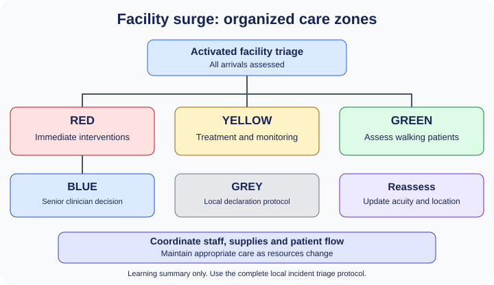

# Facility mass casualty management

**Draft, unattempted.** Ye guide WHO facility-based MC-IITT aur hospital incident management par based hai. Field triage ke systems aur local colour categories alag ho sakte hain. Actual incident mein approved local plan aur clinical command follow karo.

[20 original MCQs](../MCQs/05-Facility-Mass-Casualty-Management-20-MCQs.md) · [Chapter](../README.md)

## Mass casualty incident ka matlab kya hai?

Jab patients ki number aur severity facility ke usual staff, space aur supplies se zyada ho jaati hai, tab routine care ka process inadequate ho sakta hai. Is condition mein hospital mass casualty plan activate karta hai. Sirf patients ki count dekhkar decide nahi karte. Day shift aur night shift ki available capacity different ho sakti hai.

Routine triage mein individual patient ki urgency assess hoti hai. Activated surge response mein limited resources ka organized allocation bhi important hota hai. Aim ye hai ki available treatment se maximum possible clinical benefit mil sake. Incident se unrelated medical emergency bhi activated facility triage se assess hoti hai.

## WHO facility MC-IITT categories

| Zone | Simple explanation |
|---|---|
| Red | Life-threatening clinical signs wale patients ko urgent assessment aur resuscitation resources chahiye. |
| Yellow | Non-walking patients jinke assessment mein red signs ya high-risk vital signs nahi milte, unhe timely treatment aur monitoring chahiye. |
| Green | Walking patients initial sorting mein green area ja sakte hain. Wahan clinical reassessment ke baad category badal sakti hai. |
| Blue | Red category ke selected patients ko senior clinician current capacity, clinical needs aur treatment possibilities ke hisaab se blue designate kar sakta hai. Appropriate comfort care aur reassessment continue hoti hai. |
| Grey | Deceased patients ki category hai. Authorized clinician local declaration protocol follow karta hai. |

Blue ka matlab dead nahi hai. Resources available hone ya clinical condition badalne par team reassess karti hai. Palliative support mein symptoms, pain, comfort aur dignity ka dhyan rakha jaata hai. Is table ko complete clinical triage algorithm mat samjho.

## Zone organization aur patient flow

Entry par clinical sorting se patients ko appropriate care zone tak pahunchaya jaata hai. Red zone ko unnecessary waiting aur administrative crowding se protect karo. Yellow zone mein monitoring aur escalation ka access hona chahiye. Green zone mein bhi enough clinical staff aur assessment capacity chahiye. Patient ki condition badle toh appropriate higher-acuity care arrange karo.

Initial treatment ke baad BP improve hona definitive recovery ki guarantee nahi hai. Underlying injury ya illness abhi untreated ho sakti hai. Down-triage ka decision careful reassessment ke baad karo.

## Incident command aur preparedness

Incident plan mein activation authority, communication channels, clinical roles, resource roles aur zone locations pehle define hote hain. Volunteers ko competence aur authorization ke hisaab se organized staffing process mein assign karo. Prepared kits aur backup communication se treatment delay kam ho sakta hai.

Patient tracker mein patient ki current location aur status update hota hai. Unknown identity mein approved temporary unique identifier patient aur record ko link karta hai. Relatives ko appropriate information aur psychosocial support dene ke liye designated area useful hota hai. Periodic drills se plan ke gaps milte hain.

Incident de-escalate hone par ongoing patients ki care continue hoti hai. Command team coordination se resources restore aur routine services resume karti hai.

## Evidence aur practice

- [WHO facility MC-IITT guidance note](https://cdn.who.int/media/docs/default-source/integrated-health-services-(ihs)/csy/mcm-triage_guidance-note.pdf?sfvrsn=d20449f5_2). Extracted text checked, screenshot failed.
- [WHO Mass Casualty Management toolkit](https://www.who.int/teams/integrated-health-services/clinical-services-and-systems/emergency-and-critical-care/mass-casualty-management). Official HTML checked.
- [WHO preparedness and activation checklists](https://cdn.who.int/media/docs/default-source/integrated-health-services-(ihs)/csy/preparedness-and-activation-checklists.pdf?sfvrsn=fd7aa11d_1). Extracted text checked, screenshot failed.
- [WHO IITT overview](https://www.who.int/tools/triage). Official HTML checked.
- Teaching and specific MCQ practice video verification pending. Indian NDMA policy reconciliation pending. [Solve original MCQs](../MCQs/05-Facility-Mass-Casualty-Management-20-MCQs.md).

Independent clinical review, comprehensive semantic review and rendered validation pending. No historical exam appearance claimed.
