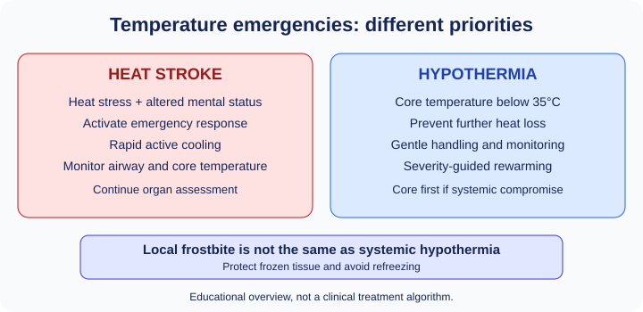

# Thermal emergencies — heat aur cold illness

**Draft candidate, unattempted.** Ye adult environmental emergency study guide hai. Actual care mein local protocol, trained team aur clinical orders follow karo.

[20 original MCQs](../MCQs/06-Thermal-Emergencies-20-MCQs.md) · [Chapter](../README.md)

## Body temperature kaise control hota hai?

Body metabolism se heat generate karti hai. Skin se heat surroundings mein transfer ho sakti hai. Sweating ke baad jab water evaporate hota hai toh heat loss hoti hai. Hot humid environment mein evaporation kam effective ho sakti hai. Exertion aur dehydration se body par heat load aur badh sakta hai.

## Heat illness

Heat exhaustion mein water aur salt loss ki wajah se weakness, sweating aur dizziness ho sakti hai. Alert patient jo safely swallow kar sakta hai usko exertion se hata kar cool place aur suitable oral fluids de sakte hain. Symptoms worsen hon ya consciousness change ho toh urgent escalation chahiye.

Heat stroke mein severe heat stress ke saath brain function affect hota hai. Patient confused, unconscious ya convulsing ho sakta hai. Exertional heat stroke mein sweating abhi bhi ho sakti hai. Dry skin ko diagnosis ke liye mandatory mat samjho.

Emergency transport activate karo aur safe active cooling ko delay mat karo. Trained team airway aur monitoring maintain karte hue cold-water immersion use kar sakti hai jab available aur feasible ho. Agar bath unavailable ho toh skin wet karke air movement aur available active cooling use karo. SCCM 2025 guideline ka target core temperature 39°C se neeche rapidly pahunchana hai. Clinical team core temperature monitor karke cooling adjust karti hai. Fever medicines heat stroke mein routine cooling ka substitute nahi hain.

Cooling rate nikalne ke liye temperature drop ko elapsed minutes se divide karte hain. Maan lo 40.6°C se 39.1°C tak 10 minute mein drop hua. Rate 0.15°C/min hai. Patient ka actual target aur response clinical team reassess karti hai.

Temperature normalize hone ke baad bhi heat-related kidney, liver aur muscle injury possible hai. Severe muscle pain aur cola-colored urine rhabdomyolysis ka clue ho sakta hai. Creatine kinase aur renal/electrolyte assessment treatment team ko injury samajhne mein help karte hain.

## Cold illness

Core body temperature 35°C se neeche ho toh hypothermia kehte hain. Mild cold mein shivering heat banane mein help karti hai. Worsening confusion aur shivering ka band hona reassuring sign nahi hai. Patient ko further cold se protect karo, wet clothes safely replace karo aur severity ke hisaab se urgent care aur warming arrange karo.

Severe hypothermia mein heart rhythm unstable ho sakti hai. Patient ko gently handle karo aur appropriate monitoring aur emergency response arrange karo. Warming devices mein insulation aur frequent skin checks zaroori hain, kyunki numb skin burns ko timely feel nahi kar sakti.

Frostbite local freezing injury hai. Moderate ya severe systemic hypothermia saath ho toh core rewarming priority hai. Frozen tissue rub nahi karte. Agar thaw ke baad refreezing avoid nahi ho sakti toh affected area protect karke safe evacuation arrange karte hain. Controlled rewarming aur specialist review clinical protocol se hota hai. Blood-filled blisters deep injury ka clue ho sakte hain.

Trench foot ya immersion foot freezing ke bina cold wet exposure se ho sakta hai. Drying, protection aur passive rewarming relevant hain. Isko frostbite ke rapid water rewarming protocol ke saath confuse nahi karna chahiye.

## Prevention

Hot work mein gradual acclimatization, rest, shade aur hydration plan useful hai. Cold exposure mein dry layers, wind protection aur wet clothing ka timely replacement further cooling kam karte hain.

## Source and video status

- [SCCM 2025 heat stroke guideline](https://sccm.org/clinical-resources/guidelines/guidelines/guideline-for-the-treatment-of-heat-stroke), active cooling, target, rate and medications.
- [CDC NIOSH heat-related illness](https://www.cdc.gov/niosh/heat-stress/about/illnesses.html), March 2026.
- [CDC Yellow Book heat and cold illness](https://www.cdc.gov/yellow-book/hcp/environmental-hazards-risks/heat-and-cold-illness-in-travelers.html), thermal injury and cold distinctions.
- [AHA/Red Cross 2024 first aid](https://cpr.heart.org/en/resuscitation-science/2024-first-aid-guidelines), hypothermia and frostbite safety.

First three direct HTML pages retrieved. AHA/Red Cross recommendations indexed. Dedicated teaching and MCQ videos pending. No actual historical appearance claimed. Independent clinical and comprehensive semantic review remain pending.
