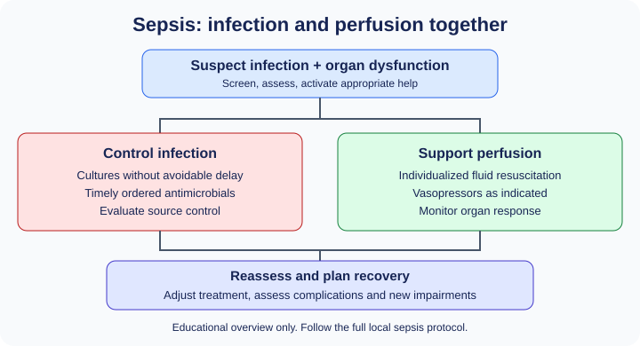

# Adult sepsis aur septic shock

**Draft candidate, unattempted.** Ye guide SSC 2026 adult recommendations par based hai. Actual orders, nursing scope aur approved emergency protocols follow karo.

[20 original MCQs](../MCQs/07-Adult-Sepsis-and-Septic-Shock-20-MCQs.md) · [Chapter](../README.md)

## Sepsis mein kya change hota hai?

Infection hone par immune system normally germs ke against response deta hai. Sepsis mein infection ke response ki dysregulation se body ke organs damage ho sakte hain. Blood vessels dilate ho sakti hain, fluid vessels se bahar leak ho sakta hai aur tissue perfusion disturb ho sakti hai. Septic shock sepsis ka severe subset hai jisme circulation aur metabolism ki problems aur significant hoti hain.

Nurse patient ki consciousness, respiratory rate, pulse, pressure, urine output aur clinical trend dekhti hai. NEWS2 ya doosra approved screening tool risk identify karne mein useful ho sakta hai. SSC 2026 hospital screening mein qSOFA alone ke bajay NEWS, NEWS2, MEWS ya SIRS jaise tools recommend karti hai. Screening diagnosis ka replacement nahi hai. Normal lactate se sepsis exclude nahi hoti.

## Antimicrobial timing aur source control

Blood culture se causative organism aur uski drug susceptibility ke baare mein information mil sakti hai. Ideally sample first antibiotic dose se pehle lete hain, lekin urgent treatment ko avoidably delay nahi karte.

SSC 2026 probable ya definite adult sepsis without shock, aur possible, probable ya definite septic shock mein immediate antimicrobial treatment, ideally recognition se one hour ke andar, recommend karti hai. Possible sepsis without shock mein rapid time-limited investigation hoti hai. Agar infection ka concern persist kare toh suspicion se three hours ke andar therapy di jaati hai. Patient worsen ho toh category aur urgency reassess hoti hai.

Source control ka matlab infection ka physical source address karna hai, jaise indicated collection drainage. Antibiotics source control ka automatic replacement nahi hain. Agar urgent source control required ho toh guideline ideally six hours ke andar early intervention conditionally suggest karti hai. Culture results aane par prescriber targeted therapy ya de-escalation evaluate karta hai.

## Perfusion aur fluids

Crystalloids first-line resuscitation fluid hain. SSC 2026 sepsis-induced hypoperfusion ya septic shock mein first three hours ke liye at least 30 mL/kg initial IV crystalloid conditionally suggest karti hai, individual clinical context ke saath. Isko blind fluid order mat samjho. Nurse response aur adverse signs closely monitor karti hai. BMI 30 se upar ho toh actual, adjusted ya ideal weight use karne ki guideline remark hai.

Balanced crystalloids generally preferred ho sakte hain, lekin sepsis ke saath traumatic brain injury mein 0.9% saline ki specific suggestion hai. Starches routine resuscitation ke liye recommended nahi hain.

Passive leg raise se temporary venous return badh sakta hai. Stroke volume response jaise dynamic measures team ko fluid responsiveness assess karne mein help karte hain. Lactate trend useful hai, lekin sirf lactate normal karne ke liye repeated fluids dena safe approach nahi hai. Capillary refill aur other perfusion findings ko overall context mein dekhte hain.

## Vasopressors aur monitoring

Vasopressor vessel tone support karte hain. Typical septic shock mein norepinephrine generally first-line hai. Severe unstable shock mein clinician selected cases mein fluid aur pressor simultaneously start kar sakta hai. Suitable monitored peripheral IV se authorized protocol ke under initial pressor dena central line ke wait se hone wala delay reduce kar sakta hai. Site, pump, infusion, BP aur extravasation monitoring important hai.

General initial MAP target 65 mm Hg hai. SSC 2026 age 65 ya usse zyada ke patients mein 60–65 mm Hg initial range conditionally suggest karti hai. Individual patient ka prescribed target aur perfusion response follow karo. Norepinephrine requirement escalate ho toh team vasopressin add karne ka decision evaluate kar sakti hai. Multiple pressors aur inconsistent cuff readings mein arterial monitoring useful ho sakti hai.

## Recovery

Acute resuscitation phase ke baad positive fluid balance ko evaluate karo. Active fluid removal ka decision current perfusion, cardiac aur respiratory status, weight aur edema par depend karta hai. Bicarbonate routine hypoperfusion-related lactate elevation ka hemodynamic treatment nahi hai. Specific severe acidemia aur acute kidney injury subgroup alag clinical consideration hai.

Sepsis survivor ko weakness, memory ya emotional problems ho sakti hain. Discharge par understandable education aur new impairments ke follow-up ka plan important hai.

## Evidence and practice

- [SSC 2026 adult guideline](https://sccm.org/clinical-resources/guidelines/guidelines/surviving-sepsis-campaign-international-guidelines-for-management-of-sepsis-and-septic-shock-2026), direct recommendations and remarks inspected for screening, timing, source control, fluids, vasopressors, monitoring, bicarbonate and recovery.
- [CDC clinical care for sepsis](https://www.cdc.gov/sepsis/hcp/clinical-care/), supporting lead.
- Dedicated teaching and MCQ-practice video verification pending. No historical appearance claimed. Independent clinical review, comprehensive semantic comparison and rendered checks pending.
