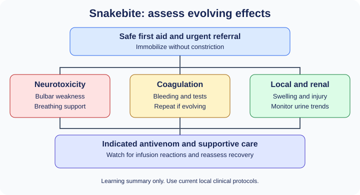

# Snakebite envenomation aur antivenom nursing

**Draft candidate, unattempted.** Ye India-context study material hai. Actual suspected snakebite ek emergency hai. Local clinical protocol, trained team aur current product instructions follow karo.

[20 original MCQs](../MCQs/08-Snakebite-Envenomation-and-Antivenom-Nursing-20-MCQs.md) · [Chapter](../README.md)

## Venom aur bite ka difference

Snakebite hone ka matlab har baar venom inject hona nahi hai. Lekin first look se dry bite aur evolving envenomation confidently distinguish nahi kar sakte. Isliye suspected bite ka prompt assessment, observation aur indicated treatment important hai. Krait jaise bites mein visible marks ya local swelling minimal ho sakti hai.

## First aid

Patient ko safe location par rakho aur unnecessary movement kam karo. Bitten limb ko nonconstricting splint se support karna useful hai. Ring, anklet ya tight items swelling se constrict kar sakte hain, isliye safely remove karo. Tight arterial tourniquet, incision, suction aur unproven traditional remedies avoid karo. Snake ko catch karne ki koshish mat karo. Patient ko assisted transport se capable health facility tak jaldi pahunchao.

## Envenomation ke clinical patterns

Neurotoxic venom nerves aur muscles ke communication ko disturb kar sakta hai. Ptosis, nasal speech, dysphagia aur progressive weakness important clues hain. Swallowing aur respiratory muscles weak ho jaayein toh airway protection aur ventilation compromised ho sakti hai. Antivenom dene ke baad bhi established paralysis immediately resolve hona guaranteed nahi hai, isliye indicated breathing support continue karte hain.

Kuch snake venoms clotting system ko disturb karke coagulation factors consume kar sakte hain. Gums se spontaneous bleeding, bruising aur other distant bleeding concerning signs hain. Acute kidney injury bhi ho sakti hai, isliye urine output, fluid balance aur renal laboratory trends observe karo.

Local swelling, blisters aur necrosis alag clinical effects ho sakte hain. Marked swelling compartment syndrome jaisi dikh sakti hai, lekin visible swelling alone fasciotomy ka indication nahi hai. Urgent surgical assessment, objective evaluation aur hemostatic correction important ho sakti hai.

## 20-minute whole blood clotting test

20WBCT ek bedside coagulation assessment hai. Indian protocol validated clean, dry glass container use karta hai. Sample ko prescribed time undisturbed rakha jaata hai. Liquid blood at 20 minutes positive result hai, jo clot formation failure suggest karta hai. Initial clotted result evolving venom-induced coagulopathy ko permanently exclude nahi karta. New bleeding ya inconsistent findings par clinical team repeat ya additional coagulation assessment arrange karti hai.

## Antivenom aur reactions

Antivenom specific venom effects neutralize karne ke liye use hota hai. Har suspected bite mein automatically antivenom dena appropriate nahi hai. Clinical team systemic envenomation, rapidly progressive local envenomation aur laboratory findings ke basis par indications assess karti hai.

Indian guideline mein child aur adult antivenom neutralizing dose ka principle injected venom quantity se related hai. Dilution volume aur monitoring child-specific hoti hai. Pregnancy alone indicated antivenom withhold karne ka reason nahi hai. Obstetric assessment coordinate karo.

Infusion ke dauran wheeze, generalized urticaria aur hypotension severe reaction ka signal ho sakte hain. Nurse infusion temporarily stop karke emergency help aur anaphylaxis protocol activate karti hai. Restart sirf clinical review aur authorized plan ke baad hota hai.

Delayed serum sickness-type symptoms, jaise fever, rash aur joint pain, days baad bhi ho sakte hain. Patient ko follow-up aur urgent warning signs ke baare mein understandable instructions do. New spontaneous bleeding aur marked urine reduction ko ignore nahi karna chahiye.

## Evidence and video status

- [WHO snakebite treatment and first aid](https://www.who.int/teams/control-of-neglected-tropical-diseases/snakebite-envenoming/treatment), direct HTML checked.
- [MoHFW/NHM Indian Standard Treatment Guidelines, August 2017](https://ncdc.mohfw.gov.in/uploads/pdf/Standard-Treatment-Guidelines-for-Management-of-Snake-Bite.pdf), currently listed NCDC resource, extracted first aid, syndrome, laboratory, antivenom, reaction and follow-up sections checked. PDF screenshot could not be retrieved. Do not treat this 2017 guideline as a 2026 revision.
- [NCDC PHC/CHC initial-management protocol](https://ncdc.mohfw.gov.in/uploads/pdf/PEP-Protocol.pdf), extracted text checked for coagulation interpretation. Screenshot retrieval failed.
- Dedicated teaching and MCQ practice video verification pending. No previous-year appearance claimed. Other animal bites, rabies post-exposure prophylaxis and further clinical toxicology remain separate curriculum tasks.

Independent clinical review, full cross-bank semantic review and rendered validation pending.
