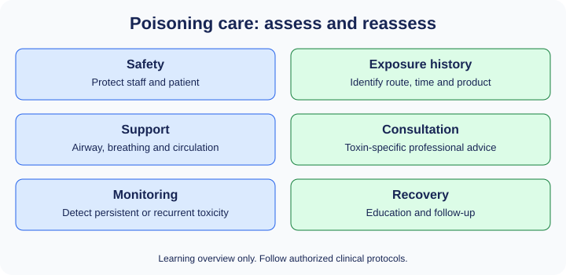

# Poisoning aur toxic exposure — emergency nursing

**Draft, unattempted.** Ye exam study material hai, self-treatment guide nahi. Actual poisoning mein trained clinical team aur poison specialist ki advice chahiye.

[20 original MCQs](../MCQs/09-Poisoning-and-Toxic-Exposure-20-MCQs.md) · [Chapter](../README.md)

## Exposure history aur initial safety

Poisoning mein pehle scene safety aur patient ki airway, breathing aur circulation assess karo. Product label, route, approximate exposure, time aur symptoms specialist ko risk samajhne mein help karte hain. Symptoms abhi absent hon toh bhi delayed toxicity possible hai. AIIMS National Poisons Information Centre India mein toxicology guidance deta hai. Severe symptoms mein emergency response delay nahi karte.

Contaminated clothing aur skin se secondary exposure ho sakta hai. Trained staff appropriate PPE aur substance-specific decontamination protocol use karte hain. Water-compatible eye irritant exposure mein immediate copious irrigation important hai. Persistent severe pain ya vision change urgent specialist assessment maangta hai.

## Carbon monoxide

CO hemoglobin ke saath bind karke oxygen delivery disturb kar sakta hai. Conventional pulse oximeter normal number dikha sakta hai, isliye suspected case mein blood CO-oximetry aur exposure history important hain. Source se removal aur oxygen treatment ke baad COHb level decrease ho sakta hai. Later sample ko initial peak exposure mat samjho. Recovery ke baad delayed neurological problems possible hain, isliye discharge education aur follow-up chahiye.

## Drug toxicity aur antidote monitoring

Opioid respiratory depression mein immediate airway aur breathing support important hai. Indicated naloxone authorized protocol ke hisaab se diya jaata hai. Opioid effect antagonist se lamba ho sakta hai, isliye initial improvement ke baad recurrent respiratory depression monitor karte hain. Mixed overdose aur benzodiazepine dependence mein routine flumazenil seizures ya arrhythmias ka risk badha sakta hai. Specialist assessment chahiye.

Cholinesterase-inhibiting exposure mein muscarinic effects, jaise excess secretions aur bradycardia, aur nicotinic muscle effects alag hain. Atropine muscarinic effects ko address karta hai, par neuromuscular paralysis directly reverse nahi karta. Selected organophosphate poisoning mein oxime use ka decision specialist karta hai. Persistent weakness mein ventilation assessment essential hai.

Specialist-directed therapy for serious beta-blocker toxicity can require glucose aur potassium monitoring. Digoxin-specific immune Fab indicated serious digoxin poisoning mein drug bind karta hai. ECG aur electrolyte monitoring continue hoti hai. Har toxin ka treatment alag ho sakta hai. Uncertain exposure mein arbitrary antidote dena appropriate nahi hai.

## Evidence

- [AIIMS National Poisons Information Centre](https://aiims.edu/index.php/en/npic_intro), direct HTML checked.
- [Poison Control first aid](https://www.poison.org/first-aid-for-poisonings), direct HTML checked.
- [CDC CO clinical guidance](https://www.cdc.gov/carbon-monoxide/hcp/clinical-guidance/index.html), direct HTML checked.
- [AHA 2025 special circumstances](https://cpr.heart.org/en/resuscitation-science/cpr-and-ecc-guidelines/adult-and-pediatric-special-circumstances-of-resuscitation), toxicology recommendations checked.
- [University of Utah Poison Control high-dose insulin monitoring](https://poisoncontrol.utah.edu/news/2021/07/high-dose-insulin-therapy), supporting indexed evidence.

Specific MCQ video verification and independent clinical and semantic review pending. No historical exam appearance claimed.
