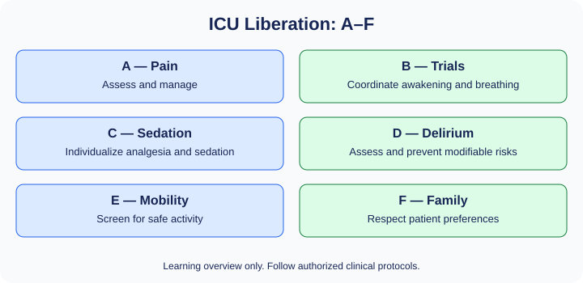

# ICU organization, monitoring aur liberation

**Draft, unattempted.** GPICS V3 UK critical-care service benchmark hai, Indian legal staffing standard nahi. Local approved policies follow karo.

[20 original MCQs](../MCQs/10-ICU-Organization-Monitoring-and-Liberation-20-MCQs.md) · [Chapter](../README.md)

## Staffed capacity aur team roles

ICU bed tab clinically useful hai jab trained staff, appropriate equipment aur required organ support available ho. Physical bed count alone safe capacity nahi batata. GPICS V3 mein duty ICU consultant aur nurse in charge safe bed utilization ka joint decision karte hain. Referral acceptance ya non-acceptance ka clinical decision aur ongoing plan document karna chahiye. Patient-specific escalation plan se next shift ko deterioration par appropriate action clear hota hai.

Nurse, doctor, pharmacist, physiotherapist aur other relevant disciplines shared clinical goals set karte hain. ICU discharge par patient ki functional needs aur rehabilitation plan receiving team tak communicate karte hain.

## ICU Liberation A–F

A mein pain assess, prevent aur manage hota hai. Patient self-report kar sakta hai toh uska report important hai. Nonverbal adult mein validated behavioral tool jaise CPOT ya BPS use ho sakta hai.

B mein awakening aur breathing trials coordinate hote hain. Trial eligibility aur stopping criteria follow karte hain. Respiratory distress ko ignore karke trial continue nahi karna chahiye.

C mein analgesia aur sedation choice patient ki needs ke hisaab se hoti hai. RASS jaise tool se prescribed sedation goal aur actual arousal compare kar sakte hain.

D mein delirium assess aur manage hota hai. Quiet patient bhi hypoactive delirium develop kar sakta hai. Deep unresponsiveness mein delirium screen valid nahi ho sakta. Hearing aids, glasses, orientation aur sleep support relevant nonpharmacological measures hain.

E mein safe early mobility aur exercise consider hoti hai. Clinical stability aur device safety check karte hain. F mein patient ki consent aur preference ke saath family participate kar sakti hai.

## Safety aur quality monitoring

Near miss report karne se system weakness actual harm se pehle identify ho sakti hai. Blame ke bajay contributing factors aur prevention barriers review karo. Device-associated infection surveillance ke liye consistent definitions aur exposure denominator chahiye. CDC NHSN CLABSI incidence density ka calculation eligible events divided by central-line days multiplied by 1000 hai. Example: 3 events and 750 line-days se rate 4 per 1000 line-days aata hai. Surveillance rate individual clinical diagnosis ka substitute nahi hai.

## Evidence

- [SCCM ICU Liberation](https://sccm.org/clinical-resources/iculiberation-home/abcdef-bundles), official HTML retrieved.
- [SCCM 2018 PADIS](https://sccm.org/clinical-resources/guidelines/guidelines/guidelines-for-the-prevention-and-management-of-pa) and [2025 focused update](https://sccm.org/clinical-resources/guidelines/guidelines/focused-update-padis-guideline), direct HTML checked.
- [GPICS V3](https://ics.ac.uk/static/86766fa2-a003-4b78-9c4e7b03e002d9bd/GPICS-V3-2026-03.pdf), UK standards text checked, PDF screenshot retrieval failed.
- [CDC NHSN January 2026 BSI module](https://www.cdc.gov/nhsn/pdfs/pscmanual/4psc_clabscurrent.pdf), Table 8 page 4-28, text and screenshot checked.

Specific teaching and MCQ video verification, independent clinical and comprehensive semantic review, and rendering checks pending.
