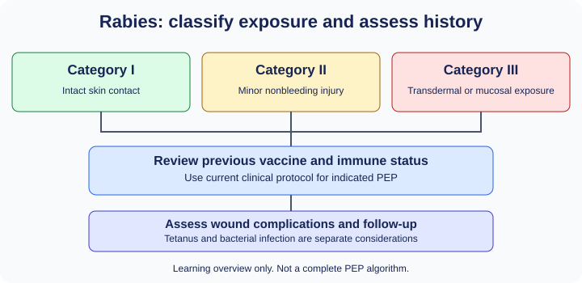

# Animal bites aur rabies post-exposure decisions

**Draft, unattempted.** Ye exam education hai. Actual animal bite ya suspected rabies exposure mein prompt medical assessment aur current local protocol chahiye. Indian NRCP 2019 ko explicitly historical guideline edition ke roop mein use kiya gaya hai, 2026 revision ke roop mein nahi.

[20 original MCQs](../MCQs/11-Animal-Bites-and-Rabies-PEP-20-MCQs.md) · [Chapter](../README.md)

## Exposure route aur skin barrier

Rabies virus infected animal ke saliva se broken skin ya mucous membrane tak pahunch sakta hai. Nurse contact ki details, wound site, skin integrity, animal species aur prior human vaccination history assess karti hai. Reliable intact-skin lick category I hai. Minor nonbleeding abrasion category II hai. Transdermal injury ya saliva ka mucosal contact category III hai. Category aur patient ki immune status ke hisaab se preventive treatment decide hoti hai.

## PEP planning

Wound washing aur urgent clinical assessment first aid ke important parts hain. Existing [IPC practice bank](../../Infection-Control-and-Microbiology/MCQs/17-Respiratory-Enteric-and-Vaccine-Preventable-Viruses-40-MCQs.md) mein immediate wound care question available hai. Yahan focus subsequent decisions par hai.

Indian 2019 protocol mein vaccine day 0 actual first vaccination date hai. Adult IM rabies vaccine ke liye deltoid preferred site hai. Gluteal site recommended nahi hai. Unavoidable route switch mein clinician valid prior doses review karke remaining schedule adapt kar sakta hai. Prior complete modern PEP ka reliable documentation re-exposure treatment ko change kar sakta hai. Uncertain history ya immune compromise mein special assessment chahiye.

RIG passive local protection deta hai jab indicated ho. Total authorized dose aur multiple wounds ka safe infiltration clinical team decide karti hai. Indian 2019 guideline first vaccine dose ke seven days baad routine RIG recommend nahi karti. Pregnancy indicated PEP withhold karne ka reason nahi hai.

Dog ya cat ki veterinary observation ko other mammals par automatically apply nahi karte. Endemic setting mein animal observation ka wait karke indicated medical evaluation aur PEP delay nahi karni chahiye.

## Bacterial wound complications

Rabies prevention aur bacterial infection prevention alag decisions hain. Cat puncture ya deep contaminated dog wound mein antibiotics ki prophylactic need ho sakti hai. Joint, tendon ya other deep structure injury specialist assessment maangti hai. Discharge develop ho toh clinician microbiological swab aur treatment review consider karta hai. Severe disproportionate pain serious complication ka warning sign ho sakta hai.

NICE NG184 UK guidance ka reference hai, Indian antibiotic prescribing rule nahi. Local antimicrobial resistance, allergies, wound findings, tetanus status aur clinician orders ko consider karna chahiye.

## Evidence status

- [Indian NRCP 2019 national guideline](https://ncdc.mohfw.gov.in/wp-content/uploads/2025/06/Rabies-Guidelines.pdf). Sections 2, 3, 4, 5, 6 and decision chart text inspected. Screenshot attempt failed (cache miss).
- [Current NRCP downloads](https://www.rabiesfreeindia.mohfw.gov.in/downloads), indexed official list includes 2019 edition. Later protocol changes need review before publication.
- [WHO rabies immunization](https://www.who.int/teams/control-of-neglected-tropical-diseases/rabies/vaccinations-and-immunization), direct HTML checked.
- [NICE NG184](https://www.nice.org.uk/guidance/NG184/chapter/recommendations), direct HTML checked.
- [ICMR 2025 antimicrobial guidance animal bites](https://amrtg.icmr.org.in/section-info/14/1), search result indexed but direct retrieval failed.
- [Adda247 Nursing rabies teaching short](https://www.youtube.com/watch?v=U83QqnRFuq8), indexed title and description only. Teaching lead, not dedicated MCQ evidence. No playback or exact item confirmed.
- All 20 dedicated question-practice video mappings pending. No historical appearances claimed.

Independent clinical, comprehensive semantic and rendered review pending.
