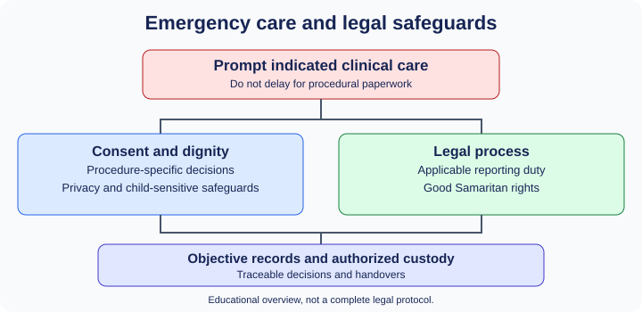

# Emergency medico-legal responsibilities — India

**Draft, unattempted.** Ye nursing exam education hai. Current institutional protocols, registered clinician ki authority aur applicable Indian law follow karo. MoHFW 2014 clinical guidance mein older IPC/CrPC references hain. Current statutory questions ke liye BNSS 2023 aur other applicable law ko separately verify karo.

[20 original MCQs](../MCQs/12-Emergency-Medico-Legal-Responsibilities-20-MCQs.md) · [Chapter](../README.md)

## Clinical care aur legal formalities

Medico-legal case (MLC) ka matlab aisi clinical situation hai jisme investigation ya legal documentation relevant ho sakti hai. Is label se patient ki emergency care ki priority kam nahi hoti. Parmanand Katara judgment ka central principle life preservation hai. Nurse urgent assessment, available lifesaving care aur appropriate referral team ke saath coordinate karti hai. Police reporting aur documentation clinical care ko unnecessarily delay nahi karte.

## Good Samaritan protection

Motor-vehicle accident victim ko voluntarily hospital laane wale Good Samaritan ke liye central 2020 rules specific protection dete hain. Rescuer se compulsory personal details, patient admission formalities ya treatment expense demand nahi karte. Voluntary identity disclose karke acknowledgement maangne par hospital prescribed acknowledgement provide karta hai. Rights charter public aur private hospital dono mein conspicuous location aur website par required languages mein accessible hona chahiye.

## Current statutory treatment duty

BNSS section 397 listed BNS aur POCSO offences ke victims ko immediate free first aid ya medical treatment provide karne aur police ko promptly inform karne ka hospital duty specify karta hai. Ye public/private dono hospitals par apply hota hai. Is specific provision ko har unrelated elective treatment par apply mat karo.

Statutory reporting aur consent alag concepts hain. Competent adult survivor evidence collection refuse kar sakta hai. Refusal ko accurately record karo aur consented clinical treatment continue karo. Police intimation ko forensic examination ki permission mat samjho. Non-emergency examination mein informed consent, privacy aur appropriate support ensure karte hain. Assault establish karne ke liye two-finger test valid nahi hai.

## Documentation aur evidence responsibility

Objective injury finding ko measured size, site aur appearance ke saath record karte hain. Reported history ko patient ke account ke roop mein attribute karte hain. Clinical staff unsupported legal conclusion nahi banata.

Authorized forensic examination aur collection ke baad designated custodian approved procedure se specimen packaging, identification, storage aur transfer coordinate karta hai. Har transfer ka traceable record maintain hota hai. Evidence access authorized roles tak limited hona chahiye. Any suspected discrepancy ko report karo aur original records preserve karo.

## Child-sensitive care

POCSO section 19 mein applicable offence ki information Special Juvenile Police Unit ya local police ko report karne ka provision hai. Internal hospital reporting alone statutory report ka replacement nahi hai. POCSO section 27 prior FIR ko medical examination ka prerequisite nahi banata. Girl child ki examination woman doctor se karane ka specified safeguard hai. Parent ya trusted person ki presence required hai, aur agar woh available nahi hain toh institution head nominated woman ka alternative provision hai. Consent, safety, reporting aur emergency care current applicable law aur policy ke according coordinate hoti hain.

## Evidence

- [Parmanand Katara v Union of India, 1989 judgment](https://indiankanoon.org/doc/498126/?type=print), direct judgment reproduction inspected.
- [MoRTH GSR 594(E), 29 September 2020](https://morth.gov.in/sites/default/files/notifications_document/GSR%20594%28E%29%2029th%20September%202020%20Good%20Samaritan_0.pdf), rules 168 and 169 text inspected, screenshot cache miss.
- [NCRB BNSS text](https://cytrain.ncrb.gov.in/staticpage/web_pages/ChaptersBNSS.html), section 397 direct HTML inspected.
- [MoHFW guidelines for medico-legal care of survivors of sexual violence](https://mohfw.gov.in/sites/default/files/9535223249_1.pdf), consent, privacy, injury documentation and custody text inspected, screenshot cache miss. Historical penal-section references not used for current statutory answers.
- [Official India Code POCSO Act](https://upload.indiacode.nic.in/showfile?actid=AC_CEN_13_14_00005_201232_1517807323686&filename=a2012-32.pdf&type=actfile), sections 19 and 27 text inspected, screenshot cache miss. [India Code model guidelines](https://www.indiacode.nic.in/bitstream/123456789/7746/1/pocso-modelguidelines.pdf) supporting indexed lead.
- Dedicated MCQ practice and teaching video verification pending. No historical exam claims.

Independent legal, clinical, comprehensive semantic and rendered review pending.
