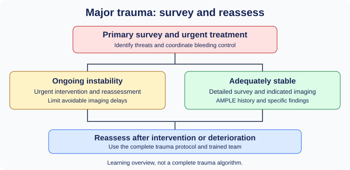

# Major trauma — primary aur secondary survey decisions

**Draft, unattempted.** Ye study guide UK NICE aur Australian state trauma references par based hai. Actual trauma care trained team, authorized clinical orders aur local protocol se hoti hai.

[20 original MCQs](../MCQs/13-Major-Trauma-Survey-Decisions-20-MCQs.md) · [Chapter](../README.md)

## Primary survey aur urgent haemorrhage control

Major trauma mein immediate threats identify aur manage karte hain. Catastrophic bleeding ko early control karna important hai. Standard ABCDE assessment aur ongoing reassessment ke baad further clinical examination hoti hai. Existing [ABCDE bank](../MCQs/03-ABCDE-Assessment-and-Structured-Handover-20-MCQs.md) basic sequence cover karta hai. Existing [trauma transfer bank](../MCQs/04-Trauma-Transfer-and-Transport-Safety-20-MCQs.md) transfer preparation cover karta hai. Is topic ka focus initial definitive clinical decisions aur specific secondary findings hain.

Major external limb bleeding direct pressure se control na ho toh trained team approved tourniquet escalation consider kar sakti hai. Suspected active internal bleeding mein definitive control ka plan early chahiye. Tranexamic acid ka timing injury se count hota hai. NICE NG39 three-hour window ke baad routine use recommend nahi karti unless hyperfibrinolysis ka evidence ho. Active bleeding ke saath VKA anticoagulation reversal ki specific need mein prescribed PCC plan relevant hai. Other anticoagulants ke liye separate specialist advice chahiye.

Initial empirical blood component strategy baad mein coagulation findings ke hisaab se adjust hoti hai. Major haemorrhage activation dynamic physiology aur resuscitation response par depend karti hai. Dominant traumatic brain injury mein cerebral perfusion preserve karne ke liye less restrictive volume strategy needed ho sakti hai.

## Imaging aur intervention

FAST selected areas mein free fluid identify karta hai, lekin negative result all abdominal ya retroperitoneal bleeding exclude nahi karta. Stable major trauma mein indicated CT ko FAST screening gate se unnecessarily delay nahi karte. Unstable nonresponding patient mein imaging sirf immediate intervention guide karne jitni necessary ho sakti hai. Active arterial pelvic bleeding mein specialist interventional radiology option consider hota hai when immediate surgery for other injuries is not needed.

## Secondary survey

Life-threatening problems address hone aur sufficient stability ke baad detailed examination aur AMPLE history hoti hai. L last meal ko refer karta hai. Nayi deterioration par immediate primary assessment dobara hoti hai.

Orbital pain, proptosis aur vision loss possible retrobulbar haemorrhage ke urgent clues hain. Neck injury mein hoarseness aur laryngeal crepitus par gentle assessment aur urgent airway review chahiye. Suspected unstable pelvis ko repeatedly spring nahi karte. In-situ binder ko routine inspection ke liye independently remove nahi karte. Agar posterior examination ke liye log-roll pelvic instability worsen kar sakta hai toh team safer examination plan banati hai.

Suspected basal skull fracture nasal tube placement ke route aur method ko affect kar sakta hai. Order clarify karo. Initial reassuring blood results ko clinical findings aur serial trends ke saath interpret karo.

## References

- [NICE NG39 major trauma PDF](https://www.nice.org.uk/guidance/ng39/resources/major-trauma-assessment-and-initial-management-pdf-1837400761285), sections 1.5.1–40 extracted text checked. Page 11 screenshot inspected. HTML recommendations direct request returned 403.
- [Victorian State Trauma System secondary survey](https://trauma.reach.vic.gov.au/specialist/early-trauma-care/secondary-survey/), official HTML inspected.
- [NSW Agency for Clinical Innovation adult secondary survey](https://aci.health.nsw.gov.au/ecat/adult/assessment/secondary-survey), official HTML inspected.
- [Victorian State Trauma System early management](https://trauma.reach.vic.gov.au/specialist/early-trauma-care/early-management/), official HTML inspected.
- Teaching and specific MCQ video verification pending. No historical exam appearance claimed.

Independent clinical, comprehensive semantic and rendered review pending.
