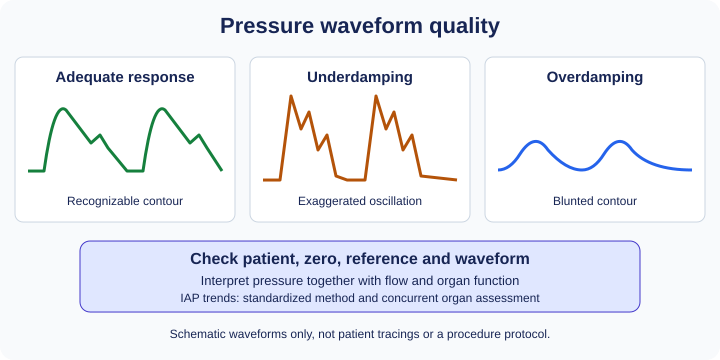

# Advanced ICU monitoring — pressure, flow aur organ perfusion

**Draft candidate, unattempted.** Ye trained nursing exam education hai. Actual invasive monitoring mein local approved protocol, device instructions aur authorized clinical team follow karo.

[20 original MCQs](../MCQs/14-Advanced-ICU-Monitoring-20-MCQs.md) · [Chapter](../README.md)

## Arterial pressure measurement ki quality

Arterial catheter continuous pressure measure karta hai. Reading correct hone ke liye transducer ka reference level aur zero verify karte hain. Zeroing atmospheric pressure ko reference banati hai. Position change par relevant anatomical reference level dobara check karo. Purani reading se compare karte waqt position aur measurement conditions document karna useful hai.

Underdamping mein pressure system zyada resonate kar sakta hai. Systolic artificially high aur diastolic low dikh sakti hai. Overdamping mein trace blunt hota hai, systolic underestimate ho sakti hai aur contour obscure ho sakta hai. Trained nurse approved dynamic response check se system quality assess kar sakti hai. Normally square-wave release ke baad brief oscillation aur prompt baseline return expected hai. Repeated ringing ya excessively slow response troubleshooting maangte hain. Patient unstable ho toh clinical help aur resuscitation delay nahi karte. Unexpected invasive values ko actual patient findings aur appropriate alternative measurement ke saath verify karo.

## Pressure, forward flow aur fluid response

MAP arterial pressure hai. Cardiac output per minute forward blood flow batata hai. Same MAP ke saath different flow possible hai kyunki vascular resistance aur cardiac performance differ karte hain. ESICM 2025 initial therapy ke nonresponders mein cardiac output aur/or stroke volume monitoring ka good-practice statement deta hai. Central venous oxygen saturation aur paired venous-to-arterial carbon dioxide partial-pressure difference serially evaluate ho sakte hain when access is available. In numbers ko single definitive perfusion endpoint nahi samjho.

Fluid responsiveness ke liye appropriate dynamic assessment helpful hai. Spontaneous respiratory efforts aur low tidal volume (below 8 mL/kg) ke saath PPV alone par rely karne ke against ESICM recommendation 21 hai. Sirf PPV measure karne ke liye independent ventilation changes nahi karte. Echo specialist ko shock phenotype assess karne mein help karti hai.

## Intra-abdominal pressure (IAP)

Elevated abdominal pressure kidney perfusion, ventilation aur circulation ko affect kar sakta hai. WSACS consensus mein adult intermittent bladder method maximum 25 mL sterile saline use karta hai. Supine position, end-expiration, relaxed abdominal wall aur midaxillary reference par standardized measurement hoti hai when clinically feasible. Actual catheter technique aur aseptic precautions trained protocol se follow karo. Results mmHg mein document karo. Coughing se pressure transiently increase ho sakta hai.

Repeated IAP 12 mmHg ya higher intra-abdominal hypertension ke definition mein aata hai. Grade I 12–15, grade II 16–20, grade III 21–25 aur grade IV above 25 mmHg hai. Sustained pressure above 20 mmHg plus new associated organ dysfunction abdominal compartment syndrome ka definition support karta hai aur urgent specialist assessment chahiye. Abdominal perfusion pressure = MAP minus IAP. Example 80 minus 15 gives 65 mmHg. Ye calculation automatic treatment target nahi hai.

## Evidence and limits

- [Saugel et al. arterial pressure measurement (2020)](https://link.springer.com/article/10.1186/s13054-020-02859-w), steps 4 and 5 direct HTML inspected.
- [ESICM 2025 full guideline](https://pure.eur.nl/ws/files/215348682/ESICM_guidelines_on_circulatory_shock_and_hemodynamic_monitoring_2025.pdf), recommendations 6–7, 21, 27 and echo guidance inspected. PDF screenshot cache miss. [Official society announcement](https://www.esicm.org/esicm-guideline-circulatory-shock-haemodynamic-monitoring/) directly retrieved.
- [WSACS consensus definitions table](https://www.wsacs.org/education/436/wsacs-consensus-guidelines-summary/), definitions 2 and 4–9 direct HTML inspected. Used for definitions only, not the older management recommendations on that summary. [2013 full consensus](https://pmc.ncbi.nlm.nih.gov/articles/PMC3680657/) indexed, direct retrieval blocked.
- Dedicated teaching and individual MCQ videos pending. Independent clinical and exhaustive semantic reviews pending. No historical exam appearance claimed.
