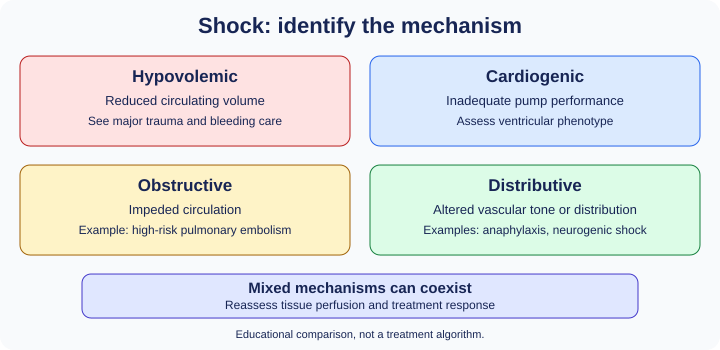

# Non-septic shock — mechanism aur nursing decisions

**Draft candidate, unattempted.** Ye study guide hai. Actual circulatory shock life-threatening emergency hai aur expert-directed clinical protocol chahiye.

[20 original MCQs](../MCQs/15-Non-Septic-Shock-Decisions-20-MCQs.md) · [Chapter](../README.md)

## Shock mechanisms

Shock mein effective tissue perfusion disturb hoti hai. Cardiogenic shock pump dysfunction se, obstructive shock circulation ki mechanical obstruction se, hypovolemic shock circulating volume loss se aur distributive shock abnormal vascular tone ya distribution se ho sakta hai. Mechanisms overlap bhi kar sakte hain.

[Major trauma survey bank](../MCQs/13-Major-Trauma-Survey-Decisions-20-MCQs.md) haemorrhage management decisions cover karta hai. [Adult sepsis bank](../MCQs/07-Adult-Sepsis-and-Septic-Shock-20-MCQs.md) septic shock cover karta hai. Is bank ka focus remaining non-septic mechanism-specific decisions hai.

## Cardiogenic shock

Pump output inadequate ho toh brain, kidney aur other organs ki perfusion compromise ho sakti hai. Pressure improve hone se full recovery guarantee nahi hoti. ACC 2025 guidance early shock team activation, serial reassessment aur suitable advanced heart-failure partner coordination emphasize karti hai. Left aur right ventricular phenotype support choice affect kar sakte hain. Temporary mechanical circulatory support mein access-related complications jaise limb ischemia ke signs immediately report karte hain. Device settings aur de-escalation specialist-led hoti hain.

## Obstructive shock due to pulmonary embolism

Acute high-risk PE right ventricular outflow par load badha sakti hai aur left heart filling reduce kar sakti hai. AHA/ACC 2026 clinical categories mein persistent hypotension ke saath cardiopulmonary failure category E hai. E1 subgroup mein urgent specialist advanced therapy assessment reasonable hai. Pulmonary embolism response team multidisciplinary coordination aur treatment timing support karti hai. Therapy selection bleeding risk aur local expertise par depend karti hai.

## Neurogenic shock aur acute spinal cord injury

Spinal injury ke baad autonomic disruption hypotension cause kar sakti hai. Saath mein occult bleeding ya other shock causes possible hain. Sirf neurological injury dekh kar bleeding exclude nahi karte.

2024 SCI hemodynamic guideline active MAP augmentation ke liye lower limit 75–80 mmHg aur upper limit 90–95 mmHg suggest karti hai. Suggested duration 3–7 days hai. Ye weak recommendations with very low certainty hain. Spontaneously higher MAP ko sirf augmentation upper limit ke basis par reduce karna required nahi. Clinical target responsible specialist decide karta hai.

## Anaphylactic shock

Allergic mediators vasodilation aur capillary leakage cause kar sakte hain. Adrenaline aur indicated IV crystalloid complementary circulatory support dete hain. Hypotensive patient ko suddenly stand ya walk nahi karwate. Position breathing aur circulation needs ke hisaab se choose hoti hai.

RCUK 2021 refractory anaphylaxis definition mein two appropriate IM adrenaline doses ke baad persistent respiratory ya cardiovascular compromise hai. Expert support promptly seek karte hain aur indicated resuscitation continue hoti hai. Specialist-directed IV infusion monitored setting mein use hoti hai. New tachyarrhythmia ya hypertension infusion safety review maangti hai. Tryptase supportive diagnostic test hai, urgent care ka prerequisite nahi.

RCUK 2021 high-risk observation framework mein more than two adrenaline doses required hon toh symptom resolution ke baad at least 12 hours observation recommended hai. Current local policy aur experienced clinician discharge decision guide karte hain. Biphasic recurrence possible hai, patient ko emergency action plan aur follow-up chahiye.

## Evidence and limits

- [ACC 2025 cardiogenic shock summary](https://www.acc.org/latest-in-cardiology/journal-scans/2025/03/17/18/39/accs-first-concise-clinical-guidance-focuses-on-evaluation-and-management-of-cardiogenic-shock), official HTML retrieved. [Full consensus](https://www.jacc.org/doi/full/10.1016/j.jacc.2025.02.018) indexed but direct retrieval 403, including access-related limb ischemia lead.
- [AHA/ACC 2026 acute PE top things to know](https://professional.heart.org/en/science-news/2026-guideline-for-the-evaluation-and-management-of-acute-pulmonary-embolism-in-adults/top-things-to-know), official HTML retrieved.
- [2024 SCI hemodynamic management guideline](https://journals.sagepub.com/doi/10.1177/21925682231202348), recommendations and evidence certainty checked.
- [RCUK 2021 anaphylaxis guideline](https://www.resus.org.uk/sites/default/files/2021-05/Emergency%20Treatment%20of%20Anaphylaxis%20May%202021_0.pdf), text and printed pages 36 and 43 visually checked. [RCUK 2025 special circumstances](https://www.resus.org.uk/professional-library/2025-resuscitation-guidelines/special-circumstances-guidelines) HTML confirms related emergency guidance.
- Dedicated teaching and MCQ videos pending. Independent clinical and comprehensive semantic review pending. No historical exam appearances claimed.
