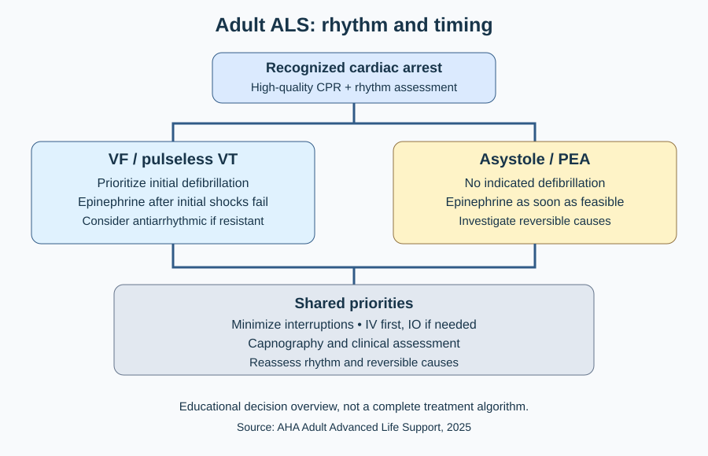

# Adult advanced cardiac life support — decision points

**Study status:** Candidate learning guide. Not a replacement for certified ALS training, institutional protocol or clinical supervision.

## Core concept

Cardiac arrest mein rhythm identify karna, uninterrupted high-quality CPR, appropriate defibrillation aur reversible causes ko address karna ek coordinated team process hai. Shockable rhythms (VF/pulseless VT) mein initial defibrillation attempts ko priority milti hai. Nonshockable rhythms (asystole/PEA) mein epinephrine as soon as feasible diya jata hai. Dono situations mein CPR essential hai.

## Energy and medicines

- Biphasic defibrillator mein manufacturer-recommended energy follow karo. Subsequent shock ke liye escalation device instructions ke according consider ki ja sakti hai.
- Persistent VF mein double sequential defibrillation aur vector change ki usefulness established nahi hai. Inhe routine universal rescue rule na samjho.
- IV access initial preference hai. IV access unsuccessful ya feasible na ho to IO access reasonable hai.
- Standard adult arrest epinephrine 1 mg every 3–5 minutes hai. Routine high-dose epinephrine recommended nahi hai.
- Defibrillation-resistant VF/pVT mein amiodarone ya lidocaine consider kiya ja sakta hai. Routine calcium, sodium bicarbonate aur magnesium unselected cardiac arrest mein recommended nahi hain. Specific indications alag hain.

## Monitoring and procedures

Capnography mein abrupt ETCO2 rise ROSC suggest kar sakta hai, lekin clinical confirmation chahiye. Nonintubated patient mein ETCO2 cutoff ko resuscitation terminate karne ke liye use nahi karna chahiye. POCUS only experienced operator ke saath consider karo jab CPR interrupt na ho. Head-up CPR outside clinical trials recommended nahi hai. Established cardiac arrest mein routine electrical pacing recommended nahi hai.

Advanced airway placement agar initial compressions interrupt karega to initial CPR aur defibrillation attempts ko pehle complete karo. Airway choice team skills aur context par depend karti hai.

## Tachyarrhythmia distinctions

Stable regular monomorphic wide-complex tachycardia mein adenosine diagnostic ya therapeutic purpose ke liye consider ho sakta hai. Irregular, polymorphic ya unstable wide-complex tachycardia mein adenosine nahi dena chahiye. Sustained polymorphic VT mein immediate unsynchronized shock recommended hai. Long-QT recurrent polymorphic VT (torsades) mein magnesium consider ho sakta hai. AHA 2025 ke according atrial fibrillation ki biphasic synchronized cardioversion ke liye at least 200 J reasonable initial energy hai (device and clinical context matter).

## Exam focus

Rhythm, pulse, stability aur timing ko alag-alag identify karo. Har shock ka type aur energy same nahi hota. Drug ka indication specific hai. CPR pause karne wali investigation se patient benefit kam ho sakta hai.

**Reference:** [AHA 2025 Adult Advanced Life Support](https://cpr.heart.org/en/resuscitation-science/cpr-and-ecc-guidelines/adult-advanced-life-support/). Dedicated question-specific video verification pending.