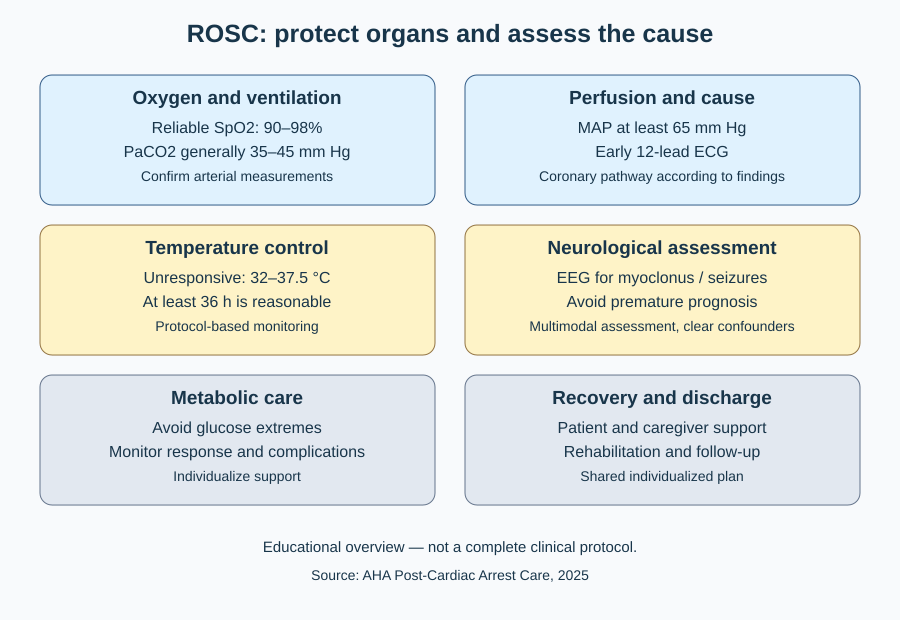

# Post-cardiac arrest care

**Study status:** Candidate learning guide. Apply clinical recommendations using local ICU protocol and multidisciplinary supervision.

## ROSC ke baad priorities

Pulse wapas aana recovery ka first step hai. Ischemia-reperfusion injury, myocardial dysfunction aur underlying arrest cause ko assess karna padta hai. Oxygenation, ventilation, perfusion aur neurological protection parallel priorities hain.

| Parameter | AHA 2025 exam reference |
|---|---|
| Oxygen before reliable measurement | FiO2 100% |
| Oxygen after reliable measurement | SpO2 90–98%, PaO2 60–105 mm Hg |
| Ventilation | PaCO2 generally 35–45 mm Hg in comatose adults |
| Blood pressure | MAP at least 65 mm Hg |
| Temperature if unable to follow verbal commands | Protocolized 32–37.5 °C, at least 36 hours reasonable |
| Glucose | Avoid values below 70 or above 180 mg/dL |

ETCO2 aur PaCO2 ka difference perfusion changes ke saath badal sakta hai. Arterial blood gas se arterial target verify karo. Temperature management ko initial arrest rhythm se restrict mat karo. Routine rapid cold IV fluid infusion for prehospital cooling recommended nahi hai.

## Coronary assessment

Early 12-lead ECG important hai. Persistent ST elevation aur suspected cardiac cause mein emergent coronary angiography indicated hai, even if patient comatose hai. ST elevation absent ho to shock, recurrent ventricular arrhythmias aur significant ongoing ischemia specialist ko urgent angiography consider karne ka reason de sakte hain. Stable comatose patient mein in features ke bina delayed/selective angiography strategy appropriate hai. Shock aur multivessel coronary disease mein initial culprit artery treatment ko routine immediate nonculprit intervention se distinguish karo.

## Neurological care

Myoclonus ko EEG se characterize karo. EEG correlate ke bina jerks ko solely suppress karne ka routine treatment recommended nahi hai. Routine seizure prophylaxis bhi recommended nahi hai. Detected seizures require appropriate clinical treatment. Early poor motor response, medication effects aur temperature confounding ko consider karo. Neurological prognosis ek single test par base nahi karna chahiye. Multimodal interpretation at least 72 hours after normothermia and sedative discontinuation reasonable hai. Family ko uncertainty clearly explain karo.

## Recovery

Medical stabilization ke baad physical, cognitive, neurological aur cardiopulmonary rehabilitation assessment important hai. Patient aur caregiver emotional distress ko screen karo. Individualized multidisciplinary discharge plan aur return-to-activity advice arrange karo.

**Reference:** [AHA 2025 Post-Cardiac Arrest Care](https://cpr.heart.org/en/resuscitation-science/cpr-and-ecc-guidelines/post-cardiac-arrest-care), sections 4–8, 10, 13–14 and 16. Dedicated question-specific video verification pending.