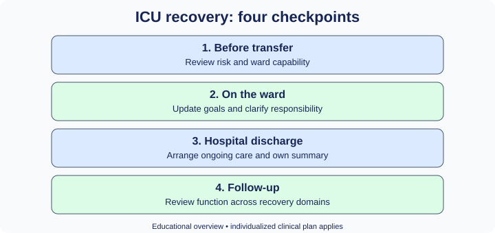

# ICU transitional care aur recovery

Draft educational material. [20 MCQs](../MCQs/18-ICU-Transitional-Care-and-Recovery-20-MCQs.md). Local protocol applies.

Critical illness ke baad physical weakness, memory aur concentration difficulty, anxiety aur intrusive memories persist ho sakte hain. PICS ek multidimensional recovery concept hai. Har patient mein same symptoms nahi hote. Functional assessment se actual daily activity aur participation samajh aati hai.

NICE CG50 daytime transfer prefer karta hai. Unavoidable 22:00–07:00 transfer ko adverse incident document karna specified UK benchmark hai. Sending aur receiving teams jointly check karti hain ki agreed plan ward mein deliver ho sake. Patient ko staffing, monitoring aur clinical responsibility ke change ke baare mein explain karo.

CG83 low-risk patient ka risk dobara check karta hai. At-risk patient mein comprehensive reassessment se physical, sensory, communication aur psychological goals update hote hain. Suitable patients ke liye supported self-directed rehabilitation manual at least six weeks consider hota hai. Discharge par own ICU summary aur ongoing rehabilitation arrangements important hain. Rehabilitation needs wale patients ka 2–3 months after critical care discharge functional reassessment recommended hai.

ICU-PAUSE diagnostic uncertainty ko explicit banata hai. Working diagnosis ki confidence, alternative causes, pending results, medication indications aur transfer-time examination communicate karte hain. Temporary ICU medicines ka prescriber review zaroori hai. Diagnostic outcomes ko track karo, sirf completed forms nahi.

References: [CG83](https://www.ncbi.nlm.nih.gov/books/NBK11657/) and [CG50](https://www.ncbi.nlm.nih.gov/books/NBK45950/) full recommendation summaries inspected; [AHRQ ICU transitions](https://www.ahrq.gov/diagnostic-safety/resources/issue-briefs/dxsafety-care-transitions3.html) inspected; [ICU-PAUSE](https://pubmed.ncbi.nlm.nih.gov/35924191/) indexed abstract; [AAST PICS consensus](https://pmc.ncbi.nlm.nih.gov/articles/PMC13691786/) indexed lead. Specific videos and independent review pending. No authenticated PYQ claim.
